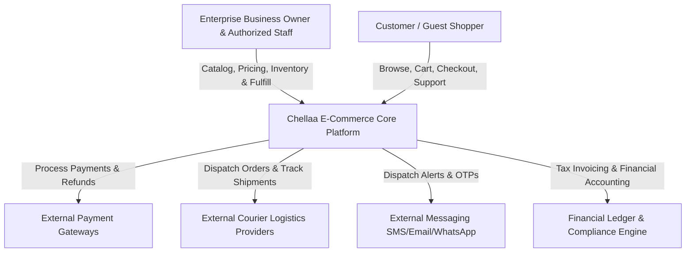
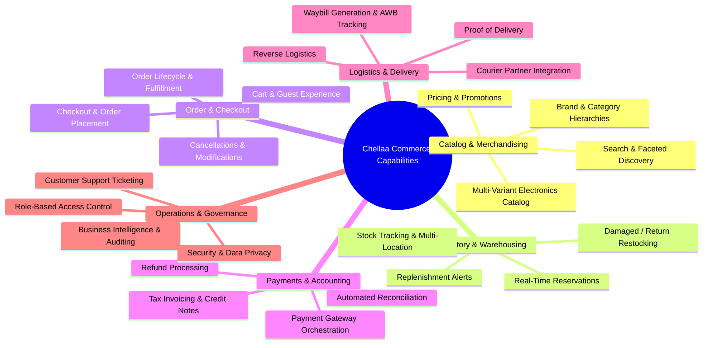

# Business Requirements Document (BRD)
## Document 00: Business Overview

| Document Attribute | Details |
| :--- | :--- |
| **Document ID** | BRD-DOC-00 |
| **Document Title** | Business Vision, Objectives, and Operating Model |
| **Project Name** | Chellaa E-Commerce Platform |
| **Target Architecture** | Backend-First Microservices Ecosystem (Phase 1: Requirements Baseline) |
| **Business Model** | Single-Retailer Direct-to-Consumer (D2C) & Business-to-Consumer (B2C) |
| **Version** | 1.0.0-DRAFT |
| **Lifecycle Status** | `PENDING_APPROVAL` |
| **Author** | Senior Business Analyst & E-Commerce Requirements Engineering Team |

---

## 1. Executive Summary & Business Vision

### 1.1 Business Vision Statement
The **Chellaa E-Commerce Platform** is envisioned as a modern, high-reliability, enterprise-grade digital retail platform owned and operated by a single retail enterprise. The business aims to transition from fragmented, manual, or brick-and-mortar retail operations into an automated, scalable, omnichannel-ready direct-to-consumer digital commerce engine.

The platform is designed to sell high-value consumer electronics, IT hardware, communication devices, computer peripherals, smart home appliances, and electrical accessories directly from the enterprise’s self-owned inventory to retail customers.

### 1.2 Core Business Problems Solved
1. **Inventory Inaccuracy & Overselling:** Legacy and manual retail systems suffer from inventory synchronization lag, leading to unfulfillable orders, customer frustration, stockouts, and financial write-offs. The platform establishes real-time inventory visibility, reservation mechanics, and automated threshold alerts.
2. **Operational Fulfillment Latency:** Orders currently experience fulfillment friction due to disjointed picking, packing, and courier handoffs. The platform automates the end-to-end order lifecycle from payment capture to courier dispatch.
3. **Fragmented Customer Experience:** Disconnected channels prevent customers from having transparent visibility into order states, live delivery tracking, seamless returns, and instant self-service inquiry resolution.
4. **Financial Reconciliation Friction:** Discrepancies between payment gateway settlements, merchant bank deposits, courier COD collections, customer refunds, and tax invoicing require hours of manual auditing. The platform introduces automated payment reconciliation and formal financial document generation.
5. **Lack of Granular Business Intelligence:** Business leadership lacks actionable visibility into product velocity, brand margin contribution, warehouse utilization, return reason patterns, and conversion drop-offs.

---

## 2. Business Objectives

The platform's primary business objectives are defined below. Each objective is assigned a stable identifier for requirements traceability.

| Objective ID | Objective Title | Business Objective Statement | Target Outcome / KPI Alignment | Status |
| :--- | :--- | :--- | :--- | :--- |
| **OBJ-001** | Direct Digital Sales Channel | Establish an owned, scalable direct-to-consumer online sales channel to capture market share in consumer electronics and home appliances. | Launch digital catalog with 100% self-managed pricing, promotions, and checkout capabilities. | `CONFIRMED` |
| **OBJ-002** | Catalog & Brand Governance | Enable centralized administrative management of comprehensive multi-variant product catalogs, brand identities, hierarchical categories, and technical specifications. | Support catalog expansion to 10,000+ SKUs with rich variant dimensions (color, storage, RAM, configuration). | `CONFIRMED` |
| **OBJ-003** | Real-Time Inventory Control | Maintain 99.9% inventory record accuracy across all enterprise storage locations and prevent overselling through strict reservation policies. | Zero overselling incidents under concurrent customer checkout traffic. | `CONFIRMED` |
| **OBJ-004** | Automated Order Processing | Streamline the order lifecycle from checkout to delivery with zero manual data re-entry between administrative, warehouse, and courier steps. | Reduce order-to-dispatch latency to under 4 business hours for in-stock items. | `CONFIRMED` |
| **OBJ-005** | Secure & Reconciled Payments | Provide reliable, frictionless payment options via external gateway integrations with automated settlement and refund reconciliation. | Maintain payment success rate >= 95% and automated reconciliation rate >= 99.5%. | `CONFIRMED` |
| **OBJ-006** | End-to-End Logistics Tracking | Integrate with verified third-party courier and logistics partners to provide automated waybill generation and real-time delivery milestone tracking. | Provide milestone tracking for 100% of dispatched orders. | `CONFIRMED` |
| **OBJ-007** | Customer Self-Service & Support | Empower customers with transparent order status, self-service cancellation, eligible return/replacement requests, and support ticket tracking. | Reduce customer support inquiries regarding "Where Is My Order" (WISMO) by 60%. | `CONFIRMED` |
| **OBJ-008** | Regulatory & Tax Compliance | Ensure full compliance with jurisdictional tax calculation, sequential invoice generation, credit note issuance, and customer data privacy obligations. | 100% audit-compliant tax invoices and verifiable transaction audit logs. | `CONFIRMED` |
| **OBJ-009** | Actionable Business Intelligence | Provide the business owner with real-time operational reporting on gross merchandise value (GMV), net margins, inventory velocity, and fulfillment efficiency. | Daily automated reconciliation, sales velocity reports, and stock replenishment alerts. | `CONFIRMED` |
| **OBJ-010** | High Operational Availability | Ensure enterprise-grade system resilience, failure isolation, and zero lost business transactions during peak promotional traffic. | 99.9% application uptime and zero silent transaction loss during third-party outages. | `PROPOSED` |

---

## 3. Business Model & Boundaries

### 3.1 Single-Retailer Commercial Model
The platform operates exclusively as a **single-retailer direct sales model**.
* **Product & Inventory Ownership:** All products listed on the platform are owned, inventoried, priced, and sold by the single enterprise owner.
* **Customer Relationship:** The customer contracts directly with the enterprise. The enterprise is the merchant of record (MoR) and issuer of legal tax invoices.
* **Fulfillment Responsibility:** The enterprise is solely responsible for packing, storing, dispatching, and honoring warranties/returns for all sold goods.
* **External Integration Boundary:** External third-party vendors act strictly as utility service providers (e.g., payment gateways, courier logistics providers, SMS/WhatsApp gateways, cloud infrastructure), not as marketplace sellers or independent merchants.

### 3.2 Explicit Exclusions (Anti-Scope / Anti-Patterns)
The platform is **strictly NOT a multi-vendor marketplace**. The following capabilities are explicitly excluded:
1. **Third-Party Seller Registration:** No onboarding workflows, KYC verification, or self-registration for external vendors or merchants.
2. **Seller Portals & Dashboards:** No multi-tenant admin dashboards, vendor-specific views, or independent merchant settings.
3. **Multi-Vendor Product Ownership:** No concepts of multiple sellers competing for the "buy box" or listing the same SKU under different vendor profiles.
4. **Marketplace Commissions & Fee Deductions:** No percentage commission calculations, listing fees, or transaction take-rates.
5. **Vendor Settlements & Payouts:** No split payments, escrow holding accounts, or automated vendor bank disbursements.
6. **Vendor Dispute Resolution:** No mediation workflows between buyers and third-party sellers.
7. **Vendor-Specific Warehouses:** While the enterprise may manage multiple internal fulfillment centers, all warehouses belong to the same enterprise entity.

---

## 4. Summary of Business Capabilities

The platform delivers 12 core business capability groups:

1. **Catalog & Merchandising Management:** Dynamic catalog modeling for electronics (smartphones, laptops, audio, accessories, appliances) with variant dimensions, brand governance, and category-attribute bindings.
2. **Inventory & Warehouse Operations:** Centralized inventory tracking across enterprise warehouses, low-stock alerts, damaged item write-offs, and atomic reservation controls during checkout.
3. **Search & Product Discovery:** Rapid text search, SKU lookup, brand filtering, multi-attribute faceting (RAM, storage, color, screen size), and sorting by price/popularity.
4. **Shopping Cart & Wishlist Operations:** Persistent shopping cart for registered users, session carts for guests, seamless cart merging on login, price delta detection, and wishlist tracking.
5. **Checkout & Order Management:** Multi-step or streamlined one-page checkout, address book management, order placement validation, state machine order lifecycle tracking, and dispatch coordination.
6. **Payment Processing & Financial Reconciliation:** Integration with PCI-DSS compliant payment gateways, instant payment confirmation, handling delayed/pending webhooks, duplicate charge prevention, and settlement reconciliation.
7. **Invoicing & Financial Documentation:** Generation of sequential, tamper-evident tax invoices, itemized tax breakdowns, and credit notes for cancellations and returns.
8. **Shipping & Logistics Fulfillment:** Warehouse picking, packing slips, shipping label generation, automated courier assignment, real-time AWB status tracking, and delivery confirmation.
9. **Returns, Replacements & Refunds:** Configurable return policy windows, return pickup coordination, quality inspection at warehouse, restock decisions, and automated refund disbursement.
10. **Customer Support & Service Requests:** Integrated ticketing for order inquiries, damaged item complaints, warranty questions, and customer communication logs.
11. **Notifications & Customer Engagement:** Automated multi-channel transactional messaging (Email, SMS, WhatsApp) for order confirmation, dispatch alerts, OTP verification, and refund notices.
12. **Administration, Security, Audit & Analytics:** Administrative role-based access control (RBAC), immutable system audit logs, operational health dashboards, and executive sales/inventory performance analytics.

---

## 5. Business Actors & User Personas (Summary)

| Actor ID | Actor Name | Actor Category | Core Responsibility in the Business |
| :--- | :--- | :--- | :--- |
| **ACT-001** | Enterprise Business Owner | Human (Executive) | Strategic oversight, commercial policy decisions, gross profit review, and administrative super-user. |
| **ACT-002** | Platform Administrator | Human (Internal) | User management, security role configuration, system parameter tuning, and integration health monitoring. |
| **ACT-003** | Catalog Manager | Human (Internal) | Product creation, variant configuration, media uploading, category hierarchy management, and brand governance. |
| **ACT-004** | Inventory / Warehouse Operator | Human (Internal) | Inward goods receiving, stock count adjustments, picking/packing orders, and inspecting returned goods. |
| **ACT-005** | Order Fulfillment Specialist | Human (Internal) | Order verification, dispatch scheduling, shipping label generation, and logistics exception resolution. |
| **ACT-006** | Customer Support Representative | Human (Internal) | Customer inquiry handling, order status communication, manual return initiation, and dispute resolution. |
| **ACT-007** | Finance & Accounting Officer | Human (Internal) | Payment gateway settlement audits, tax report generation, manual refund authorizations, and credit note validation. |
| **ACT-008** | Marketing & Merchandising Lead | Human (Internal) | Promotional campaign creation, discount coupon configuration, banner merchandising, and category spotlighting. |
| **ACT-009** | Registered Retail Customer | Human (Customer) | Browsing products, placing orders, making payments, managing saved addresses, tracking shipments, and initiating returns. |
| **ACT-010** | Guest Shopper | Human (Customer) | Browsing products, adding items to temporary cart, and executing guest checkout (subject to business policy). |
| **ACT-011** | External Payment Gateway | External System | Authorizing payment transactions, processing card/UPI/net-banking debits, dispatching webhooks, and executing refunds. |
| **ACT-012** | External Courier Logistics Provider | External System | Providing shipping rates, booking consignments, generating tracking numbers (AWB), and sending delivery status webhooks. |
| **ACT-013** | External Communications Gateway | External System | Delivering transactional and promotional SMS, email notifications, and WhatsApp updates. |
| **ACT-014** | Systems Operations & Observability Agent | Human / System | Monitoring platform uptime, background jobs, error rates, distributed traces, and infrastructure resilience. |

---

## 6. Business Success Metrics & KPIs

To validate that the business requirements achieve the owner’s commercial goals, the platform defines the following key performance indicators (KPIs).

| Metric ID | KPI Name | Definition / Calculation Method | Target Value | Baseline Status |
| :--- | :--- | :--- | :--- | :--- |
| **KPI-001** | Checkout Conversion Rate | $( \text{Completed Orders} / \text{Checkouts Initiated} ) \times 100$ | $\ge 70\%$ | `PROPOSED` |
| **KPI-002** | Inventory Record Accuracy (IRA) | $( \text{Physical Count Matches} / \text{Total System SKUs} ) \times 100$ | $\ge 99.5\%$ | `CONFIRMED` |
| **KPI-003** | Stockout / Oversell Incident Rate | $( \text{Oversold Order Cancellations} / \text{Total Placed Orders} ) \times 100$ | $0.00\%$ | `CONFIRMED` |
| **KPI-004** | Order Fulfillment Latency | Time elapsed from payment confirmation to carrier dispatch handover | $\le 24\text{ hours}$ (Standard) / $\le 4\text{ hours}$ (Express) | `PROPOSED` |
| **KPI-005** | Payment Success Rate | $( \text{Successful Payment Attempts} / \text{Total Initiated Payments} ) \times 100$ | $\ge 95.0\%$ | `PROPOSED` |
| **KPI-006** | Payment Reconciliation Rate | $( \text{Automated Matched Transactions} / \text{Total Transactions} ) \times 100$ | $\ge 99.0\%$ | `PROPOSED` |
| **KPI-007** | Delivery On-Time Rate | $( \text{Shipments Delivered On/Before Promise Date} / \text{Total Dispatched Shipments} ) \times 100$ | $\ge 95.0\%$ | `PROPOSED` |
| **KPI-008** | Order Return Rate | $( \text{Returned Order Value} / \text{Gross Merchandise Value} ) \times 100$ | $\le 5.0\%$ (Electronics) | `PROPOSED` |
| **KPI-009** | Refund Cycle Time | Time elapsed from return inspection approval to refund initiation | $\le 4\text{ business hours}$ | `PROPOSED` |
| **KPI-010** | Support Ticket Resolution Time | Mean Time to Resolve (MTTR) for customer support tickets | $\le 12\text{ hours}$ | `PROPOSED` |
| **KPI-011** | Average Order Value (AOV) | $\text{Gross Revenue} / \text{Total Number of Orders}$ | Tracked monthly | `UNDECIDED` |
| **KPI-012** | Platform Availability | $( \text{Total Uptime Hours} / \text{Total Operating Hours} ) \times 100$ | $\ge 99.90\%$ | `PROPOSED` |

---

## 7. Business Constraints & Operating Principles

1. **Strict Single-Retailer Identity:** The platform will strictly represent one business identity. No external merchant accounts, marketplace fees, or split payouts will be introduced.
2. **Backend-First Engineering Philosophy:** Business logic, validation rules, state machines, financial calculation algorithms, and data integrity constraints must be fully specified and enforced at the backend service tier before any user interface or mobile client is implemented.
3. **No Premature Architecture Prescriptions:** Microservice boundaries, database schema layouts, REST endpoints, and Kafka topic names must not be finalized in this document. The requirements define *what* the business must achieve, leaving *how* to the subsequent Architecture phase.
4. **Zero Silent Scope Expansion:** Any new domain capability, integration, or commercial rule not listed in this BRD package requires formal business owner review and revision approval.
5. **Auditable Decision Tracking:** Any business policy whose parameter or operational rule is not confirmed is explicitly tagged as `PROPOSED` or `UNDECIDED` to ensure executive alignment.
