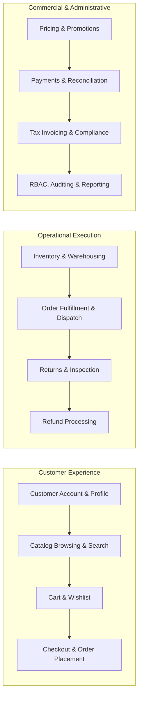
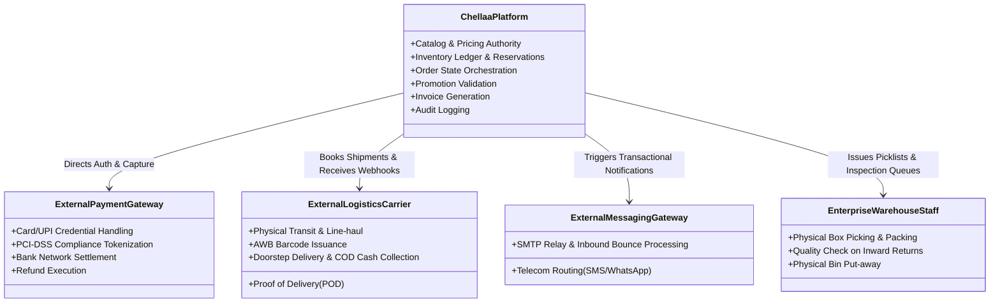
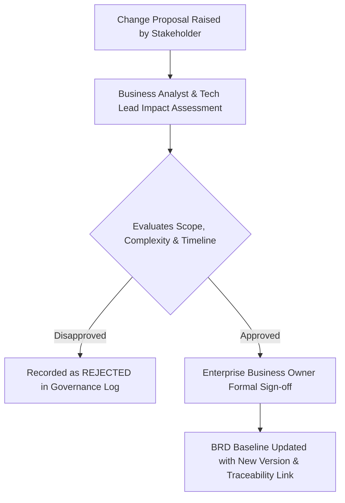

# Business Requirements Document (BRD)
## Document 01: Business Scope & Boundaries

| Document Attribute | Details |
| :--- | :--- |
| **Document ID** | BRD-DOC-01 |
| **Document Title** | Business Scope, Boundary Definition, and Exclusions |
| **Project Name** | Chellaa E-Commerce Platform |
| **Target Architecture** | Backend-First Microservices Ecosystem (Phase 1: Requirements Baseline) |
| **Business Model** | Single-Retailer Direct-to-Consumer (D2C) & Business-to-Consumer (B2C) |
| **Version** | 1.0.0-DRAFT |
| **Lifecycle Status** | `PENDING_APPROVAL` |
| **Author** | Senior Business Analyst & E-Commerce Requirements Engineering Team |

---

## 1. Purpose & Scope Boundary Overview

This document establishes the commercial and functional boundaries of the Chellaa E-Commerce Platform. It formalizes what business responsibilities the software platform owns, what tasks are delegated to external commercial partners, what workflows remain manual or human-operated, and what capabilities are strictly excluded from the baseline release.

---

## 2. In-Scope Capabilities (Phase 1 Baseline)

The following 16 core business domains are confirmed as **In-Scope** for the foundational backend platform:

1. **Customer Account & Security Governance:**
   * Customer registration, profile management, and multi-address management (home, office, billing, shipping).
   * Credential-based authentication, mobile OTP verification, session security, password reset, and account closure.
   * Customer privacy data export and deletion request workflows.
2. **Product Catalog & Electronics Merchandising:**
   * Multi-level hierarchical categories (e.g., Electronics > Mobiles & Tablets > Smartphones).
   * Brand governance (Apple, Dell, HP, Samsung, Lenovo, Sony, etc.).
   * Complex variant modeling (color, storage capacity, RAM, processor specifications).
   * Product technical specifications, warranty terms, and high-resolution media metadata.
3. **Inventory & Multi-Warehouse Operations:**
   * Stock tracking across one or more enterprise-owned fulfillment centers.
   * Real-time stock reservation at checkout with automated expiration/release.
   * Inward stock receiving, manual adjustments, damaged stock segregation, and low-stock threshold alerts.
4. **Product Search & Discovery Merchandising:**
   * Full-text search across titles, descriptions, brands, categories, and SKU codes.
   * Multi-faceted filtering (brand, price range, color, RAM, internal storage).
   * Product sorting (price low-to-high, price high-to-low, newest arrivals, customer rating).
5. **Shopping Cart & Wishlist Operations:**
   * Persistent shopping cart for authenticated users and session-based guest carts.
   * Automatic cart merge upon authentication with real-time stock and price revalidation.
   * Customer wishlists with stock availability and price-drop indicators.
6. **Checkout & Order Placement:**
   * Multi-step checkout validating delivery address serviceability, active item pricing, and inventory availability.
   * Idempotent order placement preventing duplicate charges and double order creation.
7. **Order Management & Fulfillment:**
   * Comprehensive order state machine (Placed, Confirmed, Processing, Picked, Packed, Dispatched, In-Transit, Out for Delivery, Delivered, Cancelled).
   * Warehouse pick-list and packing slip generation.
8. **Payment Processing & Gateway Orchestration:**
   * Integration with external payment gateways for Credit/Debit Cards, UPI, Net Banking, and digital wallets.
   * Webhook ingestion, delayed payment resolution, duplicate payment prevention, and payment status verification.
9. **Promotions, Coupons & Discounts:**
   * Percentage and fixed-amount coupon codes with minimum cart value requirements.
   * Cart-level and item-level promotional rules with non-stacking safeguards.
10. **Taxation & Financial Invoicing:**
    * Automatic tax calculation based on shipping address and product tax category (GST/VAT).
    * Sequential, tamper-evident tax invoice PDF generation and credit note issuance.
11. **Shipping & Logistics Coordination:**
    * Shipping fee calculation (flat rate, tiered by cart value, or weight-based).
    * Integration with courier logistics partners for automated consignment booking, AWB assignment, and live tracking webhooks.
12. **Returns, Replacements & Refunds:**
    * Customer-initiated return/replacement requests within defined return policy windows.
    * Warehouse return inspection, item grading (restockable vs defective), and automated refund processing to original payment source.
13. **Customer Support & Service Requests:**
    * Integrated customer inquiry and ticket management linked to customer orders.
14. **Multi-Channel Notification Management:**
    * Event-driven transactional messaging across Email, SMS, and WhatsApp for order lifecycle milestones.
15. **Business Administration & RBAC:**
    * Role-Based Access Control for business operators (Catalog Admin, Inventory Operator, Fulfillment Agent, Finance Officer, Support Agent).
16. **Audit Trails & Executive Reporting:**
    * Immutable audit logging for price changes, inventory overrides, order cancellations, and manual refunds.
    * Sales reports, GMV analytics, inventory turn ratios, and tax liability summaries.

---

## 3. Explicitly Out-of-Scope Capabilities (Anti-Scope)

To protect the single-retailer business model and prevent architectural distortion, the following capabilities are **Strictly Excluded**:

| Excluded Capability | Rationale for Exclusion | Impact on Architecture |
| :--- | :--- | :--- |
| **Third-Party Seller Registration / KYC** | Platform is 100% owned by a single enterprise. No external vendor onboarding. | Eliminates vendor onboarding pipelines, KYC document stores, and vendor status workflows. |
| **Seller Portals / Vendor Dashboards** | Only enterprise-authorized internal staff access administrative capabilities. | No multi-tenant admin portals or vendor-specific data partitioning required. |
| **Multi-Vendor "Buy Box" or Product Listings** | A single product SKU has only one inventory source, one price, and one owner. | Eliminates complex multi-merchant product catalog mapping and price competition engines. |
| **Marketplace Commissions & Fee Deductions** | All revenue belongs directly to the retailer. No transaction fee deduction. | Eliminates commission settlement calculators and multi-party revenue split logic. |
| **Vendor Payouts & Escrow Disbursement** | No funds are held in escrow for third parties or disbursed to external seller bank accounts. | Removes automated seller banking integrations, payout schedules, and vendor tax withholding. |
| **Buyer-Seller Dispute Arbitration** | Customer support is direct between customer and enterprise staff. | Eliminates multi-party arbitration workflows and vendor penalty systems. |
| **Vendor-Specific Logistics Management** | All shipping originates from enterprise-managed warehouses or fulfillment centers. | Eliminates vendor drop-shipping coordination and vendor-managed carrier accounts. |

---

## 4. Future-Phase Capabilities (Post-Baseline Roadmap)

The following capabilities represent potential strategic enhancements that are **deferred** to subsequent phases and must not be engineered during the initial backend foundation:

| Capability Group | Description | Target Phase | Status |
| :--- | :--- | :--- | :--- |
| **Customer Web & Mobile Client Applications** | React/TypeScript customer shopping web app and native mobile apps (iOS/Android). | Phase 2 | `DEFERRED` |
| **Admin Web Application UI** | Dedicated administrative single-page application (SPA) for internal operators. | Phase 2 | `DEFERRED` |
| **AI-Powered Recommendation Engine** | Machine-learning personalized product recommendations ("Customers who bought this also bought..."). | Phase 3 | `PROPOSED` |
| **Loyalty Rewards & Store Credit** | Customer points accumulation, tiered VIP memberships, and wallet store credits. | Phase 3 | `PROPOSED` |
| **Gift Cards & Voucher Management** | Purchasing and redeeming digital gift cards and promotional vouchers. | Phase 3 | `PROPOSED` |
| **Customer Referral Programs** | Unique referral links, invite-a-friend credits, and advocate rewards. | Phase 3 | `PROPOSED` |
| **Subscription & Recurring Orders** | Automated replenishment orders for consumable electronics (batteries, printer cartridges). | Phase 4 | `PROPOSED` |
| **Cross-Border / Multi-Currency Commerce** | Multi-currency pricing, international courier integration, and cross-border customs declarations. | Phase 4 | `UNDECIDED` |
| **Advanced Warehouse Automation** | Barcode/RFID scanner handheld integration, automated bin-picking, and robotic sortation. | Phase 4 | `PROPOSED` |

---

## 5. Business System Boundaries & Responsibility Model

The platform operates within a defined ecosystem where responsibilities are partitioned between internal software, external utility providers, and human operations:

| Domain | Chellaa Software Owns | External System Owns | Human Operator Owns |
| :--- | :--- | :--- | :--- |
| **Product Merchandising** | Catalog structure, variants, pricing, specifications, and inventory thresholds. | Media file storage / CDN delivery. | Product copywriting, image curation, and pricing strategy decisions. |
| **Inventory** | Logical inventory balance, reservations, stock movement ledger, safety stock alerts. | N/A | Physical unloading, bin placement, cycle counts, damaged item grading. |
| **Payments** | Payment transaction state, order link, cart amount validation, reconciliation ledger. | Cardholder data capture, PCI DSS compliance, banking network routing, 3D Secure OTP. | Manual chargeback review, dispute submission to merchant bank. |
| **Logistics** | Consignment booking, packing slip generation, AWB tracking updates, customer alerts. | Fleet routing, physical transportation, doorstep delivery, OTP-based delivery verification. | Physical packaging, courier handover, package weighment verification. |
| **Returns** | Return request validation, policy window check, refund calculation, replacement order creation. | Reverse logistics transit. | Physical package opening, serial number verification, cosmetic/functional grading. |
| **Customer Support** | Ticket creation, order linking, communication history, status changes. | Telephony/VoIP PBX infrastructure (if applicable). | Customer phone/chat conversation, investigation, goodwill voucher decisions. |

---

## 6. Geographic, Commercial & Regulatory Scope

The operational context for the platform baseline is defined below. Key unresolved decisions are explicitly highlighted.

| Scope Dimension | Specification / Baseline Parameter | Decision Status | Open Decision Reference |
| :--- | :--- | :--- | :--- |
| **Primary Operating Country** | India (Domestic Retail Operations). | `PROPOSED` | See [OQ-001](file:///d:/learning/Microservice/backend/docs/00-requirements/08-assumptions-dependencies-open-questions.md#oq-001) |
| **Transaction Currency** | Indian Rupee (INR - ₹). Single currency baseline. | `PROPOSED` | See [OQ-002](file:///d:/learning/Microservice/backend/docs/00-requirements/08-assumptions-dependencies-open-questions.md#oq-002) |
| **Pricing Convention** | Tax-Inclusive Retail Pricing (MRP / Display price includes applicable taxes). | `PROPOSED` | See [OQ-009](file:///d:/learning/Microservice/backend/docs/00-requirements/08-assumptions-dependencies-open-questions.md#oq-009) |
| **Tax Framework** | Goods and Services Tax (GST) compliant (CGST, SGST, IGST calculation based on origin and delivery states). | `PROPOSED` | See [OQ-009](file:///d:/learning/Microservice/backend/docs/00-requirements/08-assumptions-dependencies-open-questions.md#oq-009) |
| **Supported Languages** | English (en-IN) primary; multi-language localization deferred. | `PROPOSED` | See [OQ-002](file:///d:/learning/Microservice/backend/docs/00-requirements/08-assumptions-dependencies-open-questions.md#oq-002) |
| **Delivery Serviceability** | Pan-India domestic PIN-code serviceability via courier partner API check. | `PROPOSED` | See [OQ-005](file:///d:/learning/Microservice/backend/docs/00-requirements/08-assumptions-dependencies-open-questions.md#oq-005) |
| **Cash on Delivery (COD)** | Restricted to eligible PIN codes and order values under a confirmed threshold (e.g., ₹10,000). | `UNDECIDED` | See [OQ-006](file:///d:/learning/Microservice/backend/docs/00-requirements/08-assumptions-dependencies-open-questions.md#oq-006) |
| **Warehouse Architecture** | Single primary central fulfillment center at launch, with multi-warehouse ready schema. | `PROPOSED` | See [OQ-007](file:///d:/learning/Microservice/backend/docs/00-requirements/08-assumptions-dependencies-open-questions.md#oq-007) |
| **Data Privacy & Governance** | Compliance with Indian Digital Personal Data Protection Act (DPDPA 2023) and consumer protection rules. | `PROPOSED` | See [OQ-020](file:///d:/learning/Microservice/backend/docs/00-requirements/08-assumptions-dependencies-open-questions.md#oq-020) |

---

## 7. Scope Change Governance & Approval Workflow

Any proposed change to the defined scope (adding features, altering business rules, changing commercial parameters) must strictly adhere to the following governance procedure:

1. **Submission:** Stakeholder submits a Change Request (CR) specifying the business need, rationale, and urgency.
2. **Impact Assessment:** The Business Analyst and Technical Leads assess impacts on requirements traceability, security, timeline, and architectural complexity.
3. **Owner Review:** The Enterprise Business Owner evaluates commercial value and formally approves or rejects the CR.
4. **Documentation Baseline Revision:** If approved, the BRD documents, traceability matrix, and open questions registers are updated under formal version incrementation.
