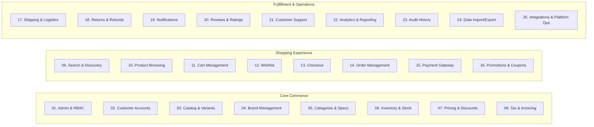

# Business Requirements Document (BRD)

## Document 03: Complete Business Feature Inventory

| Document Attribute            | Details                                                                |
| :---------------------------- | :--------------------------------------------------------------------- |
| **Document ID**         | BRD-DOC-03                                                             |
| **Document Title**      | Comprehensive Business Feature Inventory                               |
| **Project Name**        | Chellaa E-Commerce Platform                                            |
| **Target Architecture** | Backend-First Microservices Ecosystem (Phase 1: Requirements Baseline) |
| **Business Model**      | Single-Retailer Direct-to-Consumer (D2C) & Business-to-Consumer (B2C)  |
| **Version**             | 1.0.0-DRAFT                                                            |
| **Lifecycle Status**    | `PENDING_APPROVAL`                                                   |
| **Author**              | Senior Business Analyst & E-Commerce Requirements Engineering Team     |

---

## 1. Feature Inventory Structure & Classification

This document contains the complete business feature inventory for the Chellaa Single-Retailer E-Commerce platform. Every feature is categorized by business domain, assigned a stable identifier, and defined with its business value, actors, preconditions, capabilities, business rules, dependencies, priority, status, and linked functional requirements.

### Priority Definitions

* **P0 (Critical / Foundation):** Essential capabilities without which the core commercial business cannot operate (e.g., catalog, inventory reservation, checkout, payment capture, tax invoicing).
* **P1 (High Priority / Launch Scope):** Core commercial features required for a competitive, production-ready e-commerce experience (e.g., faceted search, coupons, returns, live tracking).
* **P2 (Medium Priority / Post-Launch Enhancement):** Valuable operational enhancements and merchandising tools (e.g., bulk spreadsheet updates, customer reviews, product comparisons).
* **P3 (Low Priority / Advanced Roadmap):** Optional capabilities deferred for future evaluation (e.g., bundles, pre-orders, gift wrapping).

### Status Taxonomy

* `CONFIRMED`: Formally established and agreed upon for the platform scope.
* `PROPOSED`: Highly recommended industry standard requirement awaiting stakeholder sign-off.
* `UNDECIDED`: Commercial policy parameter under business owner deliberation.
* `OUT_OF_SCOPE`: Explicitly excluded from the platform scope.

---

## 2. Feature Directory by Business Domain

---

## 3. Domain 01: Business Administration & Access Management

### FEAT-ADM-001: Administrative User & Role Governance

* **Domain:** Administration & RBAC
* **Description:** Provides centralized management of internal enterprise staff accounts and role-based permissions (Catalog Admin, Inventory Operator, Fulfillment Agent, Finance Specialist, Customer Support).
* **Business Value:** Prevents unauthorized business actions, protects customer privacy, and enforces operational separation of duties.
* **Primary Actor:** `ACT-002` (System Administrator)
* **Preconditions:** System administrator is authenticated with multi-factor authentication (MFA).
* **Main Capabilities:**
  * Create, update, suspend, and deactivate staff user accounts.
  * Define and assign granular business roles with specific domain read/write permissions.
  * Enforce strong password complexity, credential rotation, and session timeout policies.
* **Important Business Rules:**
  * No user can hold both "Finance Specialist" (refund authorization) and "Fulfillment Agent" without executive sign-off (`BR-ADM-001`).
  * Deactivated accounts immediately terminate all active sessions (`BR-ADM-002`).
* **Dependencies:** None.
* **Priority:** `P0`
* **Status:** `CONFIRMED`
* **Related Functional Requirements:** `FR-ADM-001`, `FR-ADM-002`.

### FEAT-ADM-002: Administrative Audit Trail & Privileged Action Logging

* **Domain:** Administration & RBAC
* **Description:** Records an immutable, tamper-evident audit entry for every sensitive business intervention (price changes, inventory overrides, order cancellations, manual refunds).
* **Business Value:** Ensures operational accountability, fraud deterrence, and statutory audit compliance.
* **Primary Actor:** `ACT-002` (System Administrator), `ACT-001` (Business Owner)
* **Preconditions:** Staff user executes a mutation operation on the platform.
* **Main Capabilities:**
  * Capture user ID, timestamp, IP address, previous value, new value, and mandatory business reason code.
  * Provide searchable, filterable audit log viewer for authorized leadership.
* **Important Business Rules:**
  * Audit logs are write-once, read-many (WORM); cannot be altered or deleted (`BR-AUD-001`).
* **Dependencies:** None.
* **Priority:** `P0`
* **Status:** `CONFIRMED`
* **Related Functional Requirements:** `FR-AUD-001`, `FR-AUD-002`.

---

## 4. Domain 02: Customer Account Management

### FEAT-CUST-001: Customer Registration & Credential Lifecycle

* **Domain:** Customer Accounts
* **Description:** Enables retail customers to register securely using their email and/or mobile phone number with mandatory OTP verification.
* **Business Value:** Builds a verified direct-to-consumer customer database while preventing bot registrations.
* **Primary Actor:** `ACT-009` (Registered Customer)
* **Preconditions:** Customer provides a valid phone number or email.
* **Main Capabilities:**
  * User registration via mobile phone + SMS OTP or email + verification link.
  * Secure credential management, self-service password reset, and session logout across devices.
  * Profile completion (first name, last name, communication preferences).
* **Important Business Rules:**
  * Phone numbers and email addresses must be strictly unique across active accounts (`BR-CUST-001`).
  * Account lock occurs after 5 consecutive failed login attempts (`BR-SEC-002`).
* **Dependencies:** `FEAT-NTF-001` (OTP dispatch).
* **Priority:** `P0`
* **Status:** `CONFIRMED`
* **Related Functional Requirements:** `FR-CUST-001`, `FR-CUST-003`.

### FEAT-CUST-002: Customer Address Book Management

* **Domain:** Customer Accounts
* **Description:** Allows customers to save, update, label, and manage multiple delivery and billing addresses.
* **Business Value:** Accelerates checkout speed and eliminates shipping errors caused by re-typing addresses.
* **Primary Actor:** `ACT-009` (Registered Customer)
* **Preconditions:** Customer is authenticated.
* **Main Capabilities:**
  * Add multiple addresses with labels (Home, Work, Other).
  * Designate default shipping and default billing addresses.
  * Address format validation (PIN code, state, city, street, landmark).
* **Important Business Rules:**
  * An in-transit order's delivery address cannot be edited once dispatched (`BR-ORD-004`).
* **Dependencies:** None.
* **Priority:** `P0`
* **Status:** `CONFIRMED`
* **Related Functional Requirements:** `FR-CUST-002`.

### FEAT-CUST-003: Customer Privacy & Data Protection Self-Service

* **Domain:** Customer Accounts
* **Description:** Provides customers with mechanisms to download their personal data, withdraw marketing consents, and request account deactivation.
* **Business Value:** Ensures compliance with statutory data protection regulations (DPDPA 2023).
* **Primary Actor:** `ACT-009` (Registered Customer)
* **Preconditions:** Customer is authenticated.
* **Main Capabilities:**
  * Request export of personal profile, address, and order transaction history.
  * Toggle transactional vs promotional marketing preferences.
  * Submit formal account closure and anonymization requests.
* **Important Business Rules:**
  * Financial transaction records (invoices, tax logs) must be retained for statutory periods even if an account is closed (`BR-DAT-001`).
* **Dependencies:** `FEAT-AUD-001`.
* **Priority:** `P1`
* **Status:** `PROPOSED`
* **Related Functional Requirements:** `FR-CUST-004`.

---

## 5. Domain 03: Product Catalog & Electronics Merchandising

### FEAT-CAT-001: Multi-Variant Product Catalog Governance

* **Domain:** Product Catalog
* **Description:** Enables administrators to manage complex consumer electronics with multiple variant axes (storage, color, RAM, processor).
* **Business Value:** Supports rich electronics merchandising (e.g., iPhone 15 Pro in 128GB/256GB with Titanium/Blue variants).
* **Primary Actor:** `ACT-003` (Catalog Manager)
* **Preconditions:** Brands and categories exist.
* **Main Capabilities:**
  * Define parent product and generate sellable child variants with distinct SKUs and barcodes.
  * Manage product status lifecycle: Draft, Under Review, Published, Unpublished, Discontinued.
  * Configure warranty duration, package contents, manufacturer details, and country of origin.
* **Important Business Rules:**
  * Every sellable variant must have a globally unique SKU and barcode (`BR-CAT-001`).
  * Unpublished products cannot be browsed, searched, or purchased by customers (`BR-CAT-002`).
* **Dependencies:** `FEAT-BRD-001`, `FEAT-CTG-001`.
* **Priority:** `P0`
* **Status:** `CONFIRMED`
* **Related Functional Requirements:** `FR-CAT-001`.

### FEAT-CAT-002: Product Media & Digital Asset Management

* **Domain:** Product Catalog
* **Description:** Associates high-resolution product photography, variant-specific images, dimension charts, and specification sheets.
* **Business Value:** Enhances customer purchasing confidence and reduces product return rates due to mismatched visual expectations.
* **Primary Actor:** `ACT-003` (Catalog Manager)
* **Preconditions:** Product or variant record exists.
* **Main Capabilities:**
  * Upload multiple images per product with designated primary thumbnail.
  * Map specific images to specific color variants.
  * Manage image display order and alt-text for accessibility.
* **Important Business Rules:**
  * Every published variant must have at least one valid primary image (`BR-CAT-003`).
* **Dependencies:** `FEAT-INT-001` (Object Storage).
* **Priority:** `P0`
* **Status:** `CONFIRMED`
* **Related Functional Requirements:** `FR-CAT-003`.

---

## 6. Domain 04: Brand Management

### FEAT-BRD-001: Brand Identity & Governance

* **Domain:** Brand Management
* **Description:** Maintains authorized manufacturer brand profiles (Apple, Dell, HP, Samsung, Sony, Lenovo).
* **Business Value:** Establishes credibility, enables brand-based customer filtering, and enforces brand warranty metadata.
* **Primary Actor:** `ACT-003` (Catalog Manager)
* **Preconditions:** Brand information verified.
* **Main Capabilities:**
  * Create, update, activate, and deactivate brand records with logo, description, and website.
  * Associate brands with products and category merchandising nodes.
* **Important Business Rules:**
  * A brand cannot be deleted if active published products are associated with it (`BR-BRD-001`).
* **Dependencies:** None.
* **Priority:** `P0`
* **Status:** `CONFIRMED`
* **Related Functional Requirements:** `FR-BRD-001`.

---

## 7. Domain 05: Category & Specification Management

### FEAT-CTG-001: Hierarchical Category Taxonomy

* **Domain:** Category Management
* **Description:** Manages multi-level category trees (e.g., Electronics > Mobiles & Tablets > Smartphones > 5G Phones).
* **Business Value:** Provides intuitive customer navigation and allows category-level promotional and tax assignments.
* **Primary Actor:** `ACT-003` (Catalog Manager)
* **Preconditions:** None.
* **Main Capabilities:**
  * Create root and nested child categories with display ordering and URL slugs.
  * Assign products to primary and secondary categories.
  * Reorder or re-parent categories without breaking active product URLs.
* **Important Business Rules:**
  * Circular category parent-child references are prohibited (`BR-CTG-001`).
* **Dependencies:** None.
* **Priority:** `P0`
* **Status:** `CONFIRMED`
* **Related Functional Requirements:** `FR-CTG-001`.

### FEAT-CTG-002: Dynamic Category Specification & Attribute Schemas

* **Domain:** Category Management
* **Description:** Configures category-specific technical attribute schemas (e.g., Laptops have Processor, RAM, GPU, Screen Size; Earphones have Battery Life, Bluetooth Version, Driver Size).
* **Business Value:** Ensures standardized, comparable technical specifications across diverse electronics categories.
* **Primary Actor:** `ACT-003` (Catalog Manager)
* **Preconditions:** Category exists.
* **Main Capabilities:**
  * Define attribute definitions (text, numeric, dropdown select, boolean).
  * Designate attributes as required, filterable, or variant-defining.
* **Important Business Rules:**
  * Products assigned to a category must provide values for all attributes marked as "Mandatory" before publication (`BR-CTG-002`).
* **Dependencies:** `FEAT-CTG-001`.
* **Priority:** `P1`
* **Status:** `CONFIRMED`
* **Related Functional Requirements:** `FR-CAT-002`, `FR-CTG-002`.

---

## 8. Domain 06: Inventory & Multi-Warehouse Operations

### FEAT-INV-001: Centralized Inventory Ledger & Availability Tracking

* **Domain:** Inventory & Warehousing
* **Description:** Maintains accurate real-time stock balances across enterprise fulfillment locations (Available to Sell, Reserved, Damaged, In-Transit).
* **Business Value:** Eliminates overselling, ensures stock integrity, and provides visibility into enterprise inventory assets.
* **Primary Actor:** `ACT-004` (Inventory Operator)
* **Preconditions:** Product variant SKU exists.
* **Main Capabilities:**
  * Track stock quantities: On-Hand, Allocated/Reserved, Safety Stock, Defective.
  * Record inward stock receipts against purchase delivery notes.
  * Log manual stock adjustments with mandatory reason codes (Shrinkage, Damage, Count Correction).
* **Important Business Rules:**
  * Available-to-Sell (ATS) is strictly calculated as: $\text{On-Hand} - \text{Reserved} - \text{Safety Stock}$ (`BR-INV-001`).
  * Available stock cannot drop below zero (`BR-INV-002`).
* **Dependencies:** `FEAT-CAT-001`.
* **Priority:** `P0`
* **Status:** `CONFIRMED`
* **Related Functional Requirements:** `FR-INV-001`.

### FEAT-INV-002: Real-Time Stock Reservation & Automated Release

* **Domain:** Inventory & Warehousing
* **Description:** Atomically reserves inventory when a customer enters checkout and releases reservations if payment is not completed within a configured timeout window.
* **Business Value:** Prevents inventory race conditions during high-demand flash sales while ensuring abandoned checkouts return stock to available inventory.
* **Primary Actor:** `ACT-009` (Customer / System)
* **Preconditions:** Customer initiates checkout on cart items.
* **Main Capabilities:**
  * Temporarily hold required SKU quantities for a configured TTL (e.g., 15 minutes).
  * Automatically release expired holds back to Available-to-Sell stock.
  * Permanently deduct reserved stock upon verified payment confirmation.
* **Important Business Rules:**
  * Checkout cannot proceed if requested quantity exceeds current ATS (`BR-INV-003`).
* **Dependencies:** `FEAT-CHK-001`.
* **Priority:** `P0`
* **Status:** `CONFIRMED`
* **Related Functional Requirements:** `FR-INV-002`, `FR-INV-003`.

### FEAT-INV-003: Low-Stock Thresholds & Replenishment Alerts

* **Domain:** Inventory & Warehousing
* **Description:** Automatically monitors stock levels against configured reorder thresholds and notifies warehouse operators when replenishment is required.
* **Business Value:** Prevents stockouts of high-velocity consumer electronics and protects sales continuity.
* **Primary Actor:** `ACT-004` (Inventory Operator)
* **Preconditions:** Reorder threshold configured for SKU.
* **Main Capabilities:**
  * Set SKU-level reorder point and minimum safety stock.
  * Generate automated daily low-stock exception reports.
* **Important Business Rules:**
  * Reorder threshold breaches trigger immediate administrative notification (`BR-INV-004`).
* **Dependencies:** `FEAT-NTF-001`.
* **Priority:** `P1`
* **Status:** `PROPOSED`
* **Related Functional Requirements:** `FR-INV-004`.

---

## 9. Domain 07: Pricing & Price Governance

### FEAT-PRC-001: Multi-Tier Retail Pricing Governance

* **Domain:** Pricing Management
* **Description:** Manages Maximum Retail Price (MRP / Compare-At Price), Selling Price (Offer Price), and cost price per variant.
* **Business Value:** Ensures transparent customer savings display ("Save 20%") while protecting gross profit margins.
* **Primary Actor:** `ACT-003` (Catalog Manager), `ACT-001` (Business Owner)
* **Preconditions:** Product variant exists.
* **Main Capabilities:**
  * Set variant Selling Price and MRP.
  * Validate that Selling Price never exceeds MRP.
  * Maintain price audit history documenting previous price, new price, effective date, and author.
* **Important Business Rules:**
  * Selling Price must be $\le \text{MRP}$ at all times (`BR-PRC-001`).
  * Price changes require explicit approval if margin drops below defined threshold (`BR-PRC-002`).
* **Dependencies:** `FEAT-AUD-001`.
* **Priority:** `P0`
* **Status:** `CONFIRMED`
* **Related Functional Requirements:** `FR-PRC-001`.

---

## 10. Domain 08: Tax, Invoicing & Financial Documentation

### FEAT-FIN-001: Statutory Tax Calculation Engine

* **Domain:** Financial Documents
* **Description:** Automatically computes applicable jurisdictional taxes (GST: CGST, SGST, IGST) based on product tax category and origin/destination shipping addresses.
* **Business Value:** Eliminates tax calculation errors and ensures complete statutory tax compliance.
* **Primary Actor:** System (Automated)
* **Preconditions:** Customer provides delivery shipping address during checkout.
* **Main Capabilities:**
  * Assign HSN (Harmonized System of Nomenclature) codes and tax rates to product categories.
  * Calculate intra-state (CGST + SGST) vs inter-state (IGST) tax amounts.
  * Calculate itemized tax components for each line item.
* **Important Business Rules:**
  * Product prices are tax-inclusive by default on the customer storefront (`BR-FIN-001`).
* **Dependencies:** `FEAT-CHK-001`.
* **Priority:** `P0`
* **Status:** `CONFIRMED`
* **Related Functional Requirements:** `FR-FIN-001`.

### FEAT-FIN-002: Sequential Tax Invoice & Credit Note Generation

* **Domain:** Financial Documents
* **Description:** Generates immutable, sequential, tamper-evident PDF tax invoices upon order confirmation and credit notes upon return/refund approval.
* **Business Value:** Provides legally compliant financial documentation for customers and tax authorities.
* **Primary Actor:** `ACT-007` (Finance Officer), `ACT-009` (Customer)
* **Preconditions:** Order payment confirmed or return approved.
* **Main Capabilities:**
  * Generate sequential financial document numbers (e.g., `INV-2026-00001`).
  * Include enterprise GSTIN, customer details, HSN breakdown, line items, and QR verification codes.
  * Enable customer self-service download from order history.
* **Important Business Rules:**
  * Invoice numbers must be strictly sequential with zero gaps or duplicates (`BR-FIN-002`).
  * An issued invoice cannot be modified; corrections require a formal Credit Note (`BR-FIN-003`).
* **Dependencies:** `FEAT-ORD-001`, `FEAT-PAY-001`.
* **Priority:** `P0`
* **Status:** `CONFIRMED`
* **Related Functional Requirements:** `FR-FIN-002`, `FR-FIN-003`.

---

## 11. Domain 09: Product Search & Discovery

### FEAT-SRCH-001: Full-Text Search & Multi-Faceted Filtering

* **Domain:** Search & Discovery
* **Description:** Enables fast, typo-tolerant full-text search across titles, brands, categories, and technical specifications, combined with dynamic faceted filtering.
* **Business Value:** Helps customers find target electronics within seconds, directly increasing conversion rates.
* **Primary Actor:** `ACT-009` (Customer), `ACT-010` (Guest)
* **Preconditions:** Catalog products are published and indexed.
* **Main Capabilities:**
  * Full-text search with prefix matching and misspelling tolerance.
  * Faceted filters: Brand, Price Slider, Internal Storage, RAM, Color, Screen Size, Rating.
  * Sorting options: Price Low to High, Price High to Low, Newest Arrivals, Popularity.
* **Important Business Rules:**
  * Unpublished and archived products must be excluded from search indices (`BR-SRCH-001`).
  * Out-of-stock items remain searchable but are visually flagged as "Out of Stock" (`BR-SRCH-002`).
* **Dependencies:** `FEAT-CAT-001`.
* **Priority:** `P0`
* **Status:** `CONFIRMED`
* **Related Functional Requirements:** `FR-SRCH-001`, `FR-SRCH-002`.

---

## 12. Domain 10: Product Details & Browsing Experience

### FEAT-PDP-001: Product Details Page (PDP) Merchandising

* **Domain:** Product Experience
* **Description:** Delivers comprehensive product information, interactive variant selectors, high-resolution galleries, and real-time delivery estimates.
* **Business Value:** Delivers a premium shopping experience that converts browsing intent into cart additions.
* **Primary Actor:** `ACT-009` (Customer), `ACT-010` (Guest)
* **Preconditions:** Product is published.
* **Main Capabilities:**
  * Real-time variant switching (e.g., selecting "256 GB" updates price, SKU, images, and stock availability).
  * PIN-code based delivery time estimator.
  * Display technical specification table, warranty terms, and box contents.
* **Important Business Rules:**
  * If a selected variant is out of stock, the "Add to Cart" button is disabled or toggled to "Notify Me" (`BR-PDP-001`).
* **Dependencies:** `FEAT-CAT-001`, `FEAT-INV-001`.
* **Priority:** `P0`
* **Status:** `CONFIRMED`
* **Related Functional Requirements:** `FR-PDP-001`.

---

## 13. Domain 11: Shopping Cart Management

### FEAT-CART-001: Persistent & Guest Shopping Cart Operations

* **Domain:** Shopping Cart
* **Description:** Manages customer shopping carts across sessions, supports guest cart creation, and seamlessly merges guest items upon login.
* **Business Value:** Minimizes cart abandonment across device transitions and session interruptions.
* **Primary Actor:** `ACT-009` (Customer), `ACT-010` (Guest)
* **Preconditions:** Product variant is published.
* **Main Capabilities:**
  * Add, update quantity, and remove variant items.
  * Enforce maximum purchase quantity per SKU (e.g., max 2 units during high-demand sales).
  * Automatically merge guest session cart into user account upon authentication.
  * Detect and alert customer if item prices or availability changed while items were in cart.
* **Important Business Rules:**
  * Cart items do not hold inventory reservations; reservation occurs at checkout initiation (`BR-CART-001`).
  * Inactive or unpublished variants are automatically flagged as unavailable in the cart (`BR-CART-002`).
* **Dependencies:** `FEAT-CAT-001`, `FEAT-PRC-001`.
* **Priority:** `P0`
* **Status:** `CONFIRMED`
* **Related Functional Requirements:** `FR-CART-001`, `FR-CART-002`.

---

## 14. Domain 12: Wishlist Management

### FEAT-WSH-001: Customer Wishlist & Saved Items

* **Domain:** Wishlist
* **Description:** Enables registered customers to save items for future consideration and monitor stock availability.
* **Business Value:** Captures purchasing intent and drives re-engagement when out-of-stock items are replenished.
* **Primary Actor:** `ACT-009` (Customer)
* **Preconditions:** Customer is authenticated.
* **Main Capabilities:**
  * Add and remove items from customer wishlist.
  * Move items directly from wishlist to shopping cart.
* **Important Business Rules:**
  * Wishlist items reflect current live pricing, not the price when added (`BR-WSH-001`).
* **Dependencies:** `FEAT-CAT-001`.
* **Priority:** `P1`
* **Status:** `CONFIRMED`
* **Related Functional Requirements:** `FR-WSH-001`.

---

## 15. Domain 13: Checkout & Order Placement

### FEAT-CHK-001: Validated Multi-Step Checkout Orchestration

* **Domain:** Checkout
* **Description:** Guides the customer through delivery address selection, shipping method choice, coupon application, price revalidation, and payment initiation.
* **Business Value:** Provides a frictionless, error-free checkout funnel that maximizes order completion rates.
* **Primary Actor:** `ACT-009` (Customer)
* **Preconditions:** Cart contains at least one available item.
* **Main Capabilities:**
  * Validate PIN code serviceability for the selected delivery address.
  * Revalidate active prices and available stock immediately prior to payment gateway handoff.
  * Create temporary stock reservation (`FEAT-INV-002`).
  * Enforce idempotent checkout requests to prevent duplicate orders.
* **Important Business Rules:**
  * Checkout cannot be initiated if any cart line item has insufficient ATS stock (`BR-CHK-001`).
  * Order total must be recalculated on the server; client-submitted totals are strictly ignored (`BR-CHK-002`).
* **Dependencies:** `FEAT-CART-001`, `FEAT-INV-002`, `FEAT-FIN-001`.
* **Priority:** `P0`
* **Status:** `CONFIRMED`
* **Related Functional Requirements:** `FR-CHK-001`, `FR-CHK-002`.

---

## 16. Domain 14: Order Management & Lifecycle

### FEAT-ORD-001: Order State Machine & Fulfillment Lifecycle

* **Domain:** Order Management
* **Description:** Orchestrates the complete order lifecycle from initial creation through warehouse fulfillment, courier handover, and final delivery.
* **Business Value:** Guarantees transparent order tracking, eliminates fulfillment bottlenecks, and ensures order state consistency.
* **Primary Actor:** `ACT-005` (Fulfillment Specialist), `ACT-009` (Customer)
* **Preconditions:** Order checkout completed and payment confirmed.
* **Main Capabilities:**
  * Generate unique, readable order reference numbers (e.g., `ORD-2026-98124`).
  * Capture immutable historical snapshot of ordered items (price, tax rate, product name, SKU) at the moment of order placement.
  * Enforce formal state transitions: `PENDING_PAYMENT` $\rightarrow$ `CONFIRMED` $\rightarrow$ `PROCESSING` $\rightarrow$ `PACKED` $\rightarrow$ `DISPATCHED` $\rightarrow$ `DELIVERED` (or `CANCELLED`).
* **Important Business Rules:**
  * Item prices in placed orders are locked and cannot change even if catalog prices are subsequently modified (`BR-ORD-001`).
  * Orders can only be cancelled by customers prior to warehouse dispatch (`BR-ORD-002`).
* **Dependencies:** `FEAT-PAY-001`, `FEAT-INV-001`.
* **Priority:** `P0`
* **Status:** `CONFIRMED`
* **Related Functional Requirements:** `FR-ORD-001`, `FR-ORD-002`, `FR-ORD-003`.

---

## 17. Domain 15: Payment Gateway Orchestration & Reconciliation

### FEAT-PAY-001: Multi-Channel Payment Gateway Integration

* **Domain:** Payment Management
* **Description:** Integrates with certified payment gateways to securely process Credit Cards, Debit Cards, UPI, Net Banking, and authorized digital wallets.
* **Business Value:** Provides maximum payment success rates with zero exposure to sensitive cardholder data.
* **Primary Actor:** `ACT-009` (Customer), `ACT-011` (Payment Gateway)
* **Preconditions:** Order created in `PENDING_PAYMENT` status.
* **Main Capabilities:**
  * Initialize payment intent session with payment gateway.
  * Ingest and verify signed asynchronous webhook notifications.
  * Handle edge cases: payment timeouts, gateway network failures, and duplicate webhook notifications.
* **Important Business Rules:**
  * Payment webhook processing must be strictly idempotent; duplicate webhooks must not cause double-crediting (`BR-PAY-001`).
  * If a payment succeeds after stock reservation has expired and stock is no longer available, an immediate automated refund must be initiated (`BR-PAY-002`).
* **Dependencies:** `FEAT-INT-001`.
* **Priority:** `P0`
* **Status:** `CONFIRMED`
* **Related Functional Requirements:** `FR-PAY-001`, `FR-PAY-002`.

### FEAT-PAY-002: Automated Payment Reconciliation

* **Domain:** Payment Management
* **Description:** Reconciles internal order payment records against daily gateway settlement files and bank deposit statements.
* **Business Value:** Identifies settlement variances, gateway fee discrepancies, and uncaptured payments automatically.
* **Primary Actor:** `ACT-007` (Finance Officer)
* **Preconditions:** Payment gateway settlement report available.
* **Main Capabilities:**
  * Match gateway transaction reference IDs against internal order payment records.
  * Highlight unmatched transactions and fee calculation variances.
* **Important Business Rules:**
  * All reconciliation discrepancies must be flagged in a daily exception report for financial review (`BR-PAY-003`).
* **Dependencies:** `FEAT-PAY-001`.
* **Priority:** `P1`
* **Status:** `CONFIRMED`
* **Related Functional Requirements:** `FR-PAY-003`.

---

## 18. Domain 16: Promotions, Coupons & Discounts

### FEAT-PRM-001: Promotional Coupon Engine & Discount Governance

* **Domain:** Promotions
* **Description:** Supports percentage and flat-amount discount coupon codes with configurable redemption rules (minimum order value, validity dates, usage limits).
* **Business Value:** Drives promotional sales velocity while protecting the retailer from runaway discount abuse.
* **Primary Actor:** `ACT-008` (Marketing Manager), `ACT-009` (Customer)
* **Preconditions:** Active promotional campaign configured.
* **Main Capabilities:**
  * Create single-use or multi-use coupon codes with start and end timestamps.
  * Configure eligibility criteria: minimum cart value, specific product/category inclusion or exclusion.
  * Enforce maximum total usage limits and per-customer usage limits (e.g., first order only).
* **Important Business Rules:**
  * Only one coupon code may be applied per order (no coupon stacking) unless explicitly authorized (`BR-PRM-001`).
  * Discounts are proportionally distributed across eligible order line items for tax and partial refund accuracy (`BR-PRM-002`).
* **Dependencies:** `FEAT-CHK-001`.
* **Priority:** `P1`
* **Status:** `CONFIRMED`
* **Related Functional Requirements:** `FR-PRM-001`, `FR-PRM-002`.

---

## 19. Domain 17: Shipping, Logistics & Delivery

### FEAT-SHP-001: Courier Partner Integration & Consignment Tracking

* **Domain:** Shipping & Fulfillment
* **Description:** Integrates with third-party logistics carriers to book consignments, generate Air Waybills (AWBs), and ingest real-time delivery tracking events.
* **Business Value:** Automates warehouse shipping label generation and provides customers with real-time delivery milestone visibility.
* **Primary Actor:** `ACT-005` (Fulfillment Specialist), `ACT-012` (Courier Partner)
* **Preconditions:** Order status is `PACKED`.
* **Main Capabilities:**
  * Automatically assign courier partner based on destination PIN code and package weight.
  * Generate printable carrier shipping labels with scannable AWB barcodes.
  * Ingest tracking webhooks (In-Transit, Out for Delivery, Delivered, Delivery Failed) and update order tracking status.
* **Important Business Rules:**
  * An order cannot transition to `DISPATCHED` without a valid carrier AWB number (`BR-SHP-001`).
  * Failed delivery attempts (up to 3 tries) must trigger customer communication before return-to-origin (RTO) (`BR-SHP-002`).
* **Dependencies:** `FEAT-INT-001`, `FEAT-ORD-001`.
* **Priority:** `P0`
* **Status:** `CONFIRMED`
* **Related Functional Requirements:** `FR-SHP-001`, `FR-SHP-002`.

---

## 20. Domain 18: Returns, Replacements & Refunds

### FEAT-RET-001: Customer Return & Replacement Workflow

* **Domain:** Returns & Refunds
* **Description:** Governs customer-initiated return and replacement requests within defined return policy windows (e.g., 7 days from delivery for electronics).
* **Business Value:** Protects customer trust while enforcing strict quality controls against return fraud and damaged goods abuse.
* **Primary Actor:** `ACT-009` (Customer), `ACT-004` (Warehouse Operator), `ACT-006` (Customer Support)
* **Preconditions:** Order status is `DELIVERED` within eligible return window.
* **Main Capabilities:**
  * Customer submits return request with mandatory reason code and condition photos.
  * Support or warehouse operator approves reverse logistics pickup.
  * Physical inspection at warehouse: check IMEI/serial number, packaging condition, and functional state.
  * Authorize either replacement order creation or refund initiation.
* **Important Business Rules:**
  * Return window is strictly enforced (e.g., 7 calendar days from delivery timestamp) (`BR-RET-001`).
  * Defective or wrong items verified at inspection are written off or returned to distributor; restockable items require supervisor approval before re-entering Available-to-Sell inventory (`BR-RET-002`).
* **Dependencies:** `FEAT-ORD-001`, `FEAT-INV-001`.
* **Priority:** `P1`
* **Status:** `CONFIRMED`
* **Related Functional Requirements:** `FR-RET-001`, `FR-RET-003`.

### FEAT-RET-002: Automated Refund Processing & Source Remittance

* **Domain:** Returns & Refunds
* **Description:** Initiates automated refunds back to the customer’s original payment source (Credit Card, UPI, Bank Account) upon approved return inspection or cancellation.
* **Business Value:** Accelerates customer refund timelines and maintains complete financial auditability.
* **Primary Actor:** `ACT-007` (Finance Officer), System (Automated)
* **Preconditions:** Return inspection approved or order cancelled prior to dispatch.
* **Main Capabilities:**
  * Calculate exact refund amount (pro-rata item price, taxes; deduct non-refundable shipping fees where applicable).
  * Direct payment gateway API to disburse funds to original payment instrument.
  * Issue official Credit Note for accounting records (`FEAT-FIN-002`).
* **Important Business Rules:**
  * Refunds are strictly disbursed to the original payment source; cash refunds for online payments are prohibited (`BR-RET-003`).
* **Dependencies:** `FEAT-PAY-001`, `FEAT-FIN-002`.
* **Priority:** `P0`
* **Status:** `CONFIRMED`
* **Related Functional Requirements:** `FR-RET-002`.

---

## 21. Domain 19: Notification & Communication Management

### FEAT-NTF-001: Multi-Channel Transactional Notification Relay

* **Domain:** Notifications
* **Description:** Delivers automated, event-driven transactional alerts across Email, SMS, and WhatsApp for critical order and account milestones.
* **Business Value:** Keeps customers informed in real-time, reducing customer support inquiries ("Where Is My Order?").
* **Primary Actor:** System (Automated), `ACT-013` (Messaging Gateway)
* **Preconditions:** Business event triggered (Order Confirmed, Dispatched, Delivered, OTP requested).
* **Main Capabilities:**
  * Render standardized notification templates with personalized order variables.
  * Route messages to appropriate channel (SMS for OTPs, Email for Invoices, WhatsApp for live tracking).
  * Maintain delivery status log (Sent, Delivered, Failed, Bounced).
* **Important Business Rules:**
  * Transactional security alerts and order confirmations bypass promotional opt-out restrictions (`BR-NTF-001`).
* **Dependencies:** `FEAT-INT-001`.
* **Priority:** `P0`
* **Status:** `CONFIRMED`
* **Related Functional Requirements:** `FR-NTF-001`.

---

## 22. Domain 20: Product Reviews & Ratings

### FEAT-REV-001: Verified-Purchase Customer Reviews & Moderation

* **Domain:** Customer Reviews
* **Description:** Enables customers who have purchased a product to submit numerical ratings (1-5 stars) and written reviews, subject to administrative moderation.
* **Business Value:** Provides social proof, boosts purchasing confidence, and provides valuable product feedback.
* **Primary Actor:** `ACT-009` (Customer), `ACT-003` (Catalog Manager)
* **Preconditions:** Customer has a completed and delivered order containing the product SKU.
* **Main Capabilities:**
  * Submit rating and textual review with "Verified Buyer" badge.
  * Administrative moderation queue to reject profanity, spam, or competitor abuse.
  * Calculate aggregated product ratings and review distribution breakdown.
* **Important Business Rules:**
  * Only verified purchasers can submit ratings and reviews (`BR-REV-001`).
* **Dependencies:** `FEAT-ORD-001`.
* **Priority:** `P2`
* **Status:** `PROPOSED`
* **Related Functional Requirements:** `FR-REV-001`.

---

## 23. Domain 21: Customer Support & Service Requests

### FEAT-SUP-001: Order Support Ticketing & Case Management

* **Domain:** Customer Support
* **Description:** Provides integrated customer service ticketing, allowing customers to raise issues against specific orders and support staff to track resolution.
* **Business Value:** Centralizes customer communications and prevents customer complaints from falling through the cracks.
* **Primary Actor:** `ACT-006` (Customer Support Agent), `ACT-009` (Customer)
* **Preconditions:** Customer has an active order or inquiry.
* **Main Capabilities:**
  * Create support tickets linked directly to order reference numbers.
  * Assign tickets to specific support agents with SLA tracking.
  * Add internal agent notes and communicate updates to the customer.
* **Important Business Rules:**
  * High-priority complaints (damaged goods, delivery failure) must be acknowledged within 2 business hours (`BR-SUP-001`).
* **Dependencies:** `FEAT-ORD-001`.
* **Priority:** `P1`
* **Status:** `CONFIRMED`
* **Related Functional Requirements:** `FR-SUP-001`.

---

## 24. Domain 22: Reporting & Business Analytics

### FEAT-RPT-001: Commercial Sales & Operational Intelligence Reporting

* **Domain:** Analytics & Reporting
* **Description:** Provides executive and operational reporting on revenue, gross merchandise value (GMV), order fulfillment latency, return rates, and stock velocity.
* **Business Value:** Empowers the business owner with actionable insights to optimize pricing, inventory procurement, and operational efficiency.
* **Primary Actor:** `ACT-001` (Business Owner), `ACT-007` (Finance Officer)
* **Preconditions:** Historical transaction and operational data exist.
* **Main Capabilities:**
  * Daily, weekly, and monthly sales performance reports (Revenue, AOV, Units Sold).
  * Product and brand velocity reports (top-sellers, slow-moving inventory).
  * Operational reports: fulfillment latency, return reason breakdown, courier on-time delivery rates.
  * Export reports to CSV/Excel format.
* **Important Business Rules:**
  * Sales reports must strictly reconcile with confirmed payment and invoice totals (`BR-RPT-001`).
* **Dependencies:** `FEAT-ORD-001`, `FEAT-FIN-001`.
* **Priority:** `P1`
* **Status:** `CONFIRMED`
* **Related Functional Requirements:** `FR-RPT-001`.

---

## 25. Domain 23: Audit & Historical Data Retention

### FEAT-AUD-001: Comprehensive Enterprise Activity Audit Logging

* **Domain:** Auditing & Compliance
* **Description:** Maintains immutable audit trails of all system configuration changes, role assignments, price revisions, and stock adjustments.
* **Business Value:** Guarantees total administrative transparency and compliance with legal accounting standards.
* **Primary Actor:** `ACT-002` (Administrator), `ACT-001` (Business Owner)
* **Preconditions:** Mutation operation performed on system.
* **Main Capabilities:**
  * Log operator ID, timestamp, before/after values, IP address, and change rationale.
  * Retain transaction audit records for statutory durations (minimum 7 years for financial records).
* **Important Business Rules:**
  * Audit records cannot be deleted, truncated, or modified by any user including administrators (`BR-AUD-001`).
* **Dependencies:** None.
* **Priority:** `P0`
* **Status:** `CONFIRMED`
* **Related Functional Requirements:** `FR-AUD-001`, `FR-AUD-002`.

---

## 26. Domain 24: Data Import, Export & Migration

### FEAT-DAT-001: Bulk Catalog & Inventory Data Exchange

* **Domain:** Data Management
* **Description:** Allows catalog managers to perform bulk creation and updates of products, categories, prices, and stock counts via standardized spreadsheet imports (CSV/Excel).
* **Business Value:** Drastically reduces manual data entry labor when onboarding large electronics product lines.
* **Primary Actor:** `ACT-003` (Catalog Manager), `ACT-004` (Inventory Operator)
* **Preconditions:** Valid CSV template used.
* **Main Capabilities:**
  * Validate uploaded files for schema compliance, data types, and SKU uniqueness before applying changes.
  * Provide atomic processing or detailed row-by-row error logs for partial failures.
* **Important Business Rules:**
  * Bulk price imports must not violate the condition $\text{Selling Price} \le \text{MRP}$ (`BR-PRC-001`).
* **Dependencies:** `FEAT-CAT-001`, `FEAT-INV-001`.
* **Priority:** `P1`
* **Status:** `CONFIRMED`
* **Related Functional Requirements:** `FR-DAT-001`.

---

## 27. Domain 25: External Integration Management

### FEAT-INT-001: Provider Resilience & Outage Isolation

* **Domain:** Integrations
* **Description:** Manages integrations with third-party gateways (payments, couriers, notifications) with timeout limits, automated retries, and circuit breaker protection.
* **Business Value:** Prevents third-party provider downtime from crashing core commerce browsing and checkout capabilities.
* **Primary Actor:** `ACT-014` (Operations / SRE)
* **Preconditions:** External provider API configured.
* **Main Capabilities:**
  * Monitor external provider health and latency.
  * Execute exponential backoff retries on transient network failures.
  * Isolate third-party failures to avoid cascading system degradation.
* **Important Business Rules:**
  * External provider failures must never cause silent data loss or unlogged transaction drops (`BR-INT-001`).
* **Dependencies:** None.
* **Priority:** `P0`
* **Status:** `CONFIRMED`
* **Related Functional Requirements:** `FR-INT-001`.

---

## 28. Domain 26: Security & Data Privacy

### FEAT-SEC-001: Comprehensive Security Governance & Threat Defense

* **Domain:** Platform Security
* **Description:** Enforces strict authentication security, credential hashing, rate limiting, and protection against unauthorized business actions.
* **Business Value:** Protects enterprise intellectual property, financial transactions, and customer data from cyber threats.
* **Primary Actor:** `ACT-002` (System Administrator)
* **Preconditions:** None.
* **Main Capabilities:**
  * Enforce bcrypt/Argon2 password hashing; zero plaintext credential storage.
  * Implement rate limiting on sensitive endpoints (login, OTP verification, checkout submission).
  * Restrict administrative access to verified enterprise networks or MFA-authenticated sessions.
* **Important Business Rules:**
  * Customer payment card numbers must never touch enterprise databases; full tokenization via payment gateway is mandatory (`BR-SEC-001`).
* **Dependencies:** None.
* **Priority:** `P0`
* **Status:** `CONFIRMED`
* **Related Functional Requirements:** `FR-SEC-001`, `FR-SEC-002`.

---

## 29. Domain 27: Operational Health & Observability

### FEAT-OPS-001: Platform Health Visibility & Operational Alerting

* **Domain:** Operations
* **Description:** Provides real-time visibility into business transaction velocity, API response latencies, background job processing, and error rates.
* **Business Value:** Allows operations teams to detect and remediate technical bottlenecks before they impact customer purchasing.
* **Primary Actor:** `ACT-014` (Operations / SRE)
* **Preconditions:** System services operational.
* **Main Capabilities:**
  * Expose service health check indicators and performance metrics.
  * Correlate transactions using unique distributed correlation IDs across asynchronous workflows.
  * Trigger automated alerts for critical operational anomalies (e.g., payment failure spike, order queue backlog).
* **Important Business Rules:**
  * All log entries must contain correlation IDs and must redact customer PII (`BR-OPS-001`).
* **Dependencies:** None.
* **Priority:** `P0`
* **Status:** `CONFIRMED`
* **Related Functional Requirements:** `FR-OPS-001`.

---

## 30. Domain 28: Release Management & CI/CD Quality Readiness

### FEAT-REL-001: Automated Release Verification & Quality Gates

* **Domain:** Release Management
* **Description:** Establishes automated testing verification, quality gating, and release traceability before any software deployment to production environments.
* **Business Value:** Prevents regression defects from reaching live customers and ensures deterministic release auditing.
* **Primary Actor:** `ACT-002` (Administrator), `ACT-014` (SRE)
* **Preconditions:** Code changes committed.
* **Main Capabilities:**
  * Enforce automated test execution (unit, integration, contract) prior to deployment qualification.
  * Maintain immutable deployment audit logs linking deployed artifact versions to specific release approvals.
* **Important Business Rules:**
  * No code deployment can proceed to production without explicit verification gate pass (`BR-REL-001`).
* **Dependencies:** None.
* **Priority:** `P1`
* **Status:** `CONFIRMED`
* **Related Functional Requirements:** `FR-REL-001`.

---

## 31. Domain 29: Business Continuity & Disaster Recovery

### FEAT-BCM-001: Business Continuity & Automated Disaster Recovery

* **Domain:** Business Continuity
* **Description:** Enforces continuous database backups, transaction log preservation, and recovery runbooks to guarantee rapid restoration in the event of infrastructure disasters.
* **Business Value:** Guarantees zero financial transaction loss and rapid business recovery during regional data center incidents.
* **Primary Actor:** `ACT-014` (SRE / Operations)
* **Preconditions:** Production data storage active.
* **Main Capabilities:**
  * Automated scheduled backups and point-in-time recovery capabilities.
  * Documented recovery runbooks for catastrophic infrastructure restoration.
* **Important Business Rules:**
  * Recovery Point Objective (RPO) and Recovery Time Objective (RTO) must meet business owner targets (`BR-BCM-001`).
* **Dependencies:** None.
* **Priority:** `P0`
* **Status:** `CONFIRMED`
* **Related Functional Requirements:** `FR-BCM-001`.

---

## 32. Domain 30: Additional / Value-Add Capabilities (Roadmap Candidates)

### FEAT-ADV-001: Electronics Product Bundles & Accessory Kits

* **Domain:** Advanced Merchandising
* **Description:** Allows merchandising staff to create curated product kits (e.g., Laptop bundled with Wireless Mouse, Laptop Sleeve, and USB-C Hub at a promotional bundled price).
* **Business Value:** Increases Average Order Value (AOV) and accelerates accessory sales.
* **Primary Actor:** `ACT-003` (Catalog Manager), `ACT-009` (Customer)
* **Preconditions:** Standalone products exist and are published.
* **Main Capabilities:**
  * Define bundle parent SKU linking multiple physical component SKUs.
  * Real-time inventory check verifying all bundle components are in stock.
  * Decompose bundle into constituent items for warehouse picking.
* **Important Business Rules:**
  * Bundle availability is limited by the component SKU with the lowest Available-to-Sell stock (`BR-ADV-001`).
* **Dependencies:** `FEAT-CAT-001`, `FEAT-INV-001`.
* **Priority:** `P2`
* **Status:** `PROPOSED`
* **Related Functional Requirements:** `FR-ADV-001`.

### FEAT-ADV-002: Back-in-Stock Customer Notification Alerts

* **Domain:** Customer Engagement
* **Description:** Allows customers to register their interest on out-of-stock electronics and automatically dispatches an alert (SMS/Email) when stock is replenished.
* **Business Value:** Recovers lost sales demand and gauges customer purchasing intent for inventory procurement.
* **Primary Actor:** `ACT-009` (Customer)
* **Preconditions:** Product variant is currently out of stock.
* **Main Capabilities:**
  * Customer clicks "Notify Me When Available" on the product details page.
  * Automated notification trigger fires when inward stock receipt increases ATS $> 0$.
* **Important Business Rules:**
  * Notifications are batched or throttled based on available replenished quantity to prevent immediate re-stockout disappointment (`BR-ADV-002`).
* **Dependencies:** `FEAT-INV-001`, `FEAT-NTF-001`.
* **Priority:** `P2`
* **Status:** `PROPOSED`
* **Related Functional Requirements:** `FR-ADV-002`.

---

## 33. Feature Inventory Summary & Statistics

|    Domain ID    | Business Domain Name             | Total Features | P0 (Critical) |  P1 (High)  | P2 (Medium) | Status Breakdown                   |
| :-------------: | :------------------------------- | :------------: | :-----------: | :----------: | :---------: | :--------------------------------- |
|  **01**  | Business Administration & RBAC   |       2       |       2       |      0      |      0      | 2 CONFIRMED                        |
|  **02**  | Customer Account Management      |       3       |       2       |      1      |      0      | 2 CONFIRMED, 1 PROPOSED            |
|  **03**  | Product Catalog & Variants       |       2       |       2       |      0      |      0      | 2 CONFIRMED                        |
|  **04**  | Brand Management                 |       1       |       1       |      0      |      0      | 1 CONFIRMED                        |
|  **05**  | Category & Specification Mgmt    |       2       |       1       |      1      |      0      | 2 CONFIRMED                        |
|  **06**  | Inventory & Warehousing          |       3       |       2       |      1      |      0      | 2 CONFIRMED, 1 PROPOSED            |
|  **07**  | Pricing & Price Governance       |       1       |       1       |      0      |      0      | 1 CONFIRMED                        |
|  **08**  | Tax, Invoicing & Financial Docs  |       2       |       2       |      0      |      0      | 2 CONFIRMED                        |
|  **09**  | Product Search & Discovery       |       1       |       1       |      0      |      0      | 1 CONFIRMED                        |
|  **10**  | Product Details (PDP) Experience |       1       |       1       |      0      |      0      | 1 CONFIRMED                        |
|  **11**  | Shopping Cart Operations         |       1       |       1       |      0      |      0      | 1 CONFIRMED                        |
|  **12**  | Wishlist Management              |       1       |       0       |      1      |      0      | 1 CONFIRMED                        |
|  **13**  | Checkout & Order Placement       |       1       |       1       |      0      |      0      | 1 CONFIRMED                        |
|  **14**  | Order Management & Lifecycle     |       1       |       1       |      0      |      0      | 1 CONFIRMED                        |
|  **15**  | Payment Gateway & Reconciliation |       2       |       1       |      1      |      0      | 2 CONFIRMED                        |
|  **16**  | Promotions, Coupons & Discounts  |       1       |       0       |      1      |      0      | 1 CONFIRMED                        |
|  **17**  | Shipping, Logistics & Delivery   |       1       |       1       |      0      |      0      | 1 CONFIRMED                        |
|  **18**  | Returns, Replacements & Refunds  |       2       |       1       |      1      |      0      | 2 CONFIRMED                        |
|  **19**  | Notification Management          |       1       |       1       |      0      |      0      | 1 CONFIRMED                        |
|  **20**  | Product Reviews & Ratings        |       1       |       0       |      0      |      1      | 1 PROPOSED                         |
|  **21**  | Customer Support & Ticketing     |       1       |       0       |      1      |      0      | 1 CONFIRMED                        |
|  **22**  | Reporting & Business Analytics   |       1       |       0       |      1      |      0      | 1 CONFIRMED                        |
|  **23**  | Audit & Historical Retention     |       1       |       1       |      0      |      0      | 1 CONFIRMED                        |
|  **24**  | Data Import / Export (Bulk)      |       1       |       0       |      1      |      0      | 1 CONFIRMED                        |
|  **25**  | External Integration Resilience  |       1       |       1       |      0      |      0      | 1 CONFIRMED                        |
|  **26**  | Security & Data Privacy          |       1       |       1       |      0      |      0      | 1 CONFIRMED                        |
|  **27**  | Operational Health & Monitoring  |       1       |       1       |      0      |      0      | 1 CONFIRMED                        |
|  **28**  | Release Management Readiness     |       1       |       0       |      1      |      0      | 1 CONFIRMED                        |
|  **29**  | Business Continuity & Backups    |       1       |       1       |      0      |      0      | 1 CONFIRMED                        |
|  **30**  | Value-Add Capabilities (Bundles) |       2       |       0       |      0      |      2      | 2 PROPOSED                         |
| **TOTAL** | **30 Domains Covered**     |  **41**  | **27** | **11** | **3** | **36 CONFIRMED, 5 PROPOSED** |
