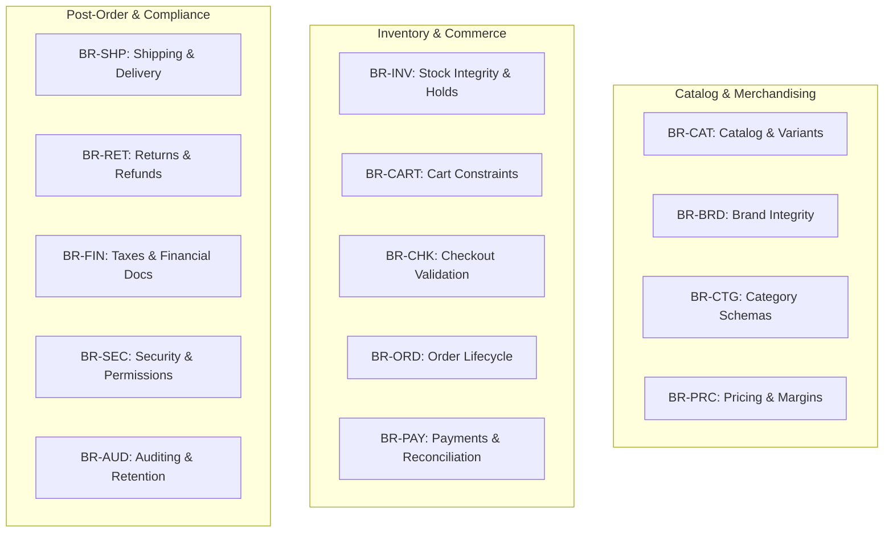

# Business Requirements Document (BRD)
## Document 05: Central Register of Business Rules

| Document Attribute | Details |
| :--- | :--- |
| **Document ID** | BRD-DOC-05 |
| **Document Title** | Enterprise Business Rules and Policy Catalog |
| **Project Name** | Chellaa E-Commerce Platform |
| **Target Architecture** | Backend-First Microservices Ecosystem (Phase 1: Requirements Baseline) |
| **Business Model** | Single-Retailer Direct-to-Consumer (D2C) & Business-to-Consumer (B2C) |
| **Version** | 1.0.0-DRAFT |
| **Lifecycle Status** | `PENDING_APPROVAL` |
| **Author** | Senior Business Analyst & E-Commerce Requirements Engineering Team |

---

## 1. Governance Principles for Business Rules

This document establishes the central, definitive register of commercial rules, constraints, and validation logic governing the Chellaa E-Commerce Platform.
1. **Business-Driven Enforcement:** Business rules reflect real-world commercial obligations, inventory protection, legal statutes, and consumer protection policies.
2. **Deterministic & Testable:** Every rule specifies an unambiguous condition, expected outcome, and strict failure handling.
3. **No Unapproved Assumptions:** Where an operational policy is not yet confirmed by the business owner, it is explicitly classified as `PROPOSED` or `UNDECIDED` and mapped to the Open Questions register.

---

## 2. Business Rules Catalog by Operational Domain

---

### 2.1 Catalog, Brand & Category Governance

#### BR-CAT-001: Global SKU and Barcode Uniqueness
* **Rule Statement:** Every sellable product variant must possess an enterprise-wide unique Stock Keeping Unit (SKU) code and an internationally valid unique barcode (EAN-13, UPC-A, or equivalent).
* **Business Rationale:** Ensures unambiguous identification across inventory receiving, warehouse bin picking, order fulfillment, and barcode scanning. Prevents cross-contamination of physical stock.
* **Applicable Domain:** Product Catalog & Inventory
* **Trigger / Condition:** Creation or update of a product variant.
* **Expected Outcome:** The system validates that neither the SKU nor barcode exists on any other active or archived variant. If duplicate, operation is rejected.
* **Exceptions:** None.
* **Related Requirements:** `FR-CAT-001`, `FR-INV-001`.
* **Severity / Strictness:** Critical (Hard Block).
* **Status:** `CONFIRMED`
* **Decision Owner:** Enterprise Business Owner / Catalog Lead.

#### BR-CAT-002: Product Publication Preconditions
* **Rule Statement:** A product cannot transition to `PUBLISHED` status unless it is linked to an active Brand, an active Leaf Category, has at least one active Variant with valid pricing ($\text{Selling Price} \le \text{MRP}$), has at least one high-resolution primary image, and fulfills all mandatory category specifications.
* **Business Rationale:** Protects storefront aesthetic quality and ensures customers have complete information before purchasing.
* **Applicable Domain:** Catalog Merchandising
* **Trigger / Condition:** Operator requests product publication.
* **Expected Outcome:** System executes pre-publication validation checklist. If any item is incomplete, status remains `DRAFT` and missing items are flagged.
* **Exceptions:** None.
* **Related Requirements:** `FR-CAT-001`, `FR-CAT-002`.
* **Severity / Strictness:** Critical (Hard Block).
* **Status:** `CONFIRMED`
* **Decision Owner:** Catalog Lead.

#### BR-BRD-001: Brand Deletion and Archival Constraint
* **Rule Statement:** A brand cannot be deleted or deactivated if there are active products currently associated with it.
* **Business Rationale:** Prevents orphaned catalog items and broken customer search filters.
* **Applicable Domain:** Brand Management
* **Trigger / Condition:** Operator requests brand deletion or deactivation.
* **Expected Outcome:** System checks for active products linked to the brand ID. If found, action is blocked with an explanatory error.
* **Exceptions:** Products must be reassigned to another brand or archived first.
* **Related Requirements:** `FR-BRD-001`.
* **Severity / Strictness:** High.
* **Status:** `CONFIRMED`
* **Decision Owner:** Catalog Lead.

#### BR-CTG-001: Circular Category Reference Prevention
* **Rule Statement:** Category hierarchy must maintain a strict directed acyclic tree structure; a category cannot be assigned as a parent or child of itself or any of its descendants.
* **Business Rationale:** Prevents infinite navigation loops on storefront menus and search aggregation failures.
* **Applicable Domain:** Category Management
* **Trigger / Condition:** Category parent reassignment.
* **Expected Outcome:** System validates proposed category tree for cycles; rejects update if a cycle is detected.
* **Exceptions:** None.
* **Related Requirements:** `FR-CTG-001`.
* **Severity / Strictness:** Critical.
* **Status:** `CONFIRMED`
* **Decision Owner:** Catalog Lead.

#### BR-CTG-002: Mandatory Specification Schema Enforcement
* **Rule Statement:** A product assigned to a category must provide validated values for all technical attributes designated as "Mandatory" in that category's schema.
* **Business Rationale:** Enables structured customer faceted search, side-by-side product comparisons, and complete technical transparency.
* **Applicable Domain:** Category & Catalog Management
* **Trigger / Condition:** Saving a product assigned to a category.
* **Expected Outcome:** Validation passes only when all required attributes have valid values adhering to data types (e.g., RAM size must be a positive integer).
* **Exceptions:** None.
* **Related Requirements:** `FR-CAT-002`.
* **Severity / Strictness:** High.
* **Status:** `CONFIRMED`
* **Decision Owner:** Merchandising Lead.

---

### 2.2 Pricing, Margins & Discounts

#### BR-PRC-001: Maximum Retail Price (MRP) Cap
* **Rule Statement:** The Selling Price (effective offer price) of any product variant must be less than or equal to its Maximum Retail Price ($\text{Selling Price} \le \text{MRP}$) at all times.
* **Business Rationale:** Strict statutory compliance with retail consumer protection laws in India (Legal Metrology Act) and truth-in-advertising guidelines.
* **Applicable Domain:** Pricing Management
* **Trigger / Condition:** Setting or updating variant pricing.
* **Expected Outcome:** If an operator attempts to input a Selling Price greater than MRP, the update is blocked with a validation error.
* **Exceptions:** None.
* **Related Requirements:** `FR-PRC-001`, `FR-CAT-001`.
* **Severity / Strictness:** Critical (Statutory Obligation).
* **Status:** `CONFIRMED`
* **Decision Owner:** Enterprise Business Owner / Legal.

#### BR-PRC-002: Minimum Margin Floor Alert
* **Rule Statement:** If an administrative price reduction causes the gross margin percentage to drop below a configured threshold (e.g., $8\%$), the price change cannot take effect without explicit secondary approval from the Finance Officer or Business Owner.
* **Business Rationale:** Prevents catastrophic revenue loss due to accidental data entry errors (e.g., typing ₹4,999 instead of ₹49,999 for a laptop).
* **Applicable Domain:** Pricing Management
* **Trigger / Condition:** Catalog price reduction request.
* **Expected Outcome:** If calculated margin $< \text{Threshold}$, the change is routed to the `PENDING_APPROVAL` pricing queue.
* **Exceptions:** Executive Business Owner override with mandatory reason code.
* **Related Requirements:** `FR-PRC-001`, `FR-AUD-001`.
* **Severity / Strictness:** High.
* **Status:** `PROPOSED`
* **Decision Owner:** Finance Lead / Business Owner.

---

### 2.3 Inventory Integrity, Reservations & Warehousing

#### BR-INV-001: Non-Negative Available Inventory Enforcement
* **Rule Statement:** Available-to-Sell (ATS) inventory can never become negative under any circumstances. Physical On-Hand stock cannot drop below zero.
* **Business Rationale:** Backorders and pre-orders are excluded from baseline launch scope. Zero inventory strictly halts order placement to prevent unfulfillable customer promises.
* **Applicable Domain:** Inventory Management
* **Trigger / Condition:** Order checkout, stock deduction, or inventory adjustment.
* **Expected Outcome:** If an operation would cause $\text{ATS} < 0$, the operation is immediately blocked.
* **Exceptions:** None for baseline launch.
* **Related Requirements:** `FR-INV-001`.
* **Severity / Strictness:** Critical (Core Commercial Invariant).
* **Status:** `CONFIRMED`
* **Decision Owner:** Enterprise Business Owner.

#### BR-INV-002: Available-to-Sell (ATS) Formula
* **Rule Statement:** The Available-to-Sell stock for any variant at any fulfillment location is strictly computed as:
$$\text{ATS} = \max(0, \text{On-Hand} - \text{Reserved} - \text{Safety Stock})$$
* **Business Rationale:** Ensures safety buffers (to absorb warehouse damage/theft) and active checkout reservations are strictly protected from duplicate sale.
* **Applicable Domain:** Inventory Management
* **Trigger / Condition:** Real-time stock queries and reservation attempts.
* **Expected Outcome:** The system computes ATS dynamically using the verified balance ledger.
* **Exceptions:** None.
* **Related Requirements:** `FR-INV-001`, `FR-INV-002`.
* **Severity / Strictness:** Critical.
* **Status:** `CONFIRMED`
* **Decision Owner:** Operations Lead.

#### BR-INV-003: Atomic Reservation and Reservation TTL Window
* **Rule Statement:** Inventory reservation occurs at the point of checkout initiation, holding stock for exactly 15 minutes ($\text{TTL} = 900\text{ seconds}$). If payment confirmation is not received within this window, the reservation expires automatically and stock is returned to ATS.
* **Business Rationale:** Protects customers during the active payment gateway interaction while preventing abandoned checkouts from permanently locking up high-demand electronics inventory.
* **Applicable Domain:** Inventory & Checkout
* **Trigger / Condition:** Customer navigates to payment submission.
* **Expected Outcome:** Atomic hold placed on SKU quantity. Scheduled expiration job releases holds if order remains unpaid at $T + 15\text{ mins}$.
* **Exceptions:** Configurable per-campaign TTL override by Business Owner.
* **Related Requirements:** `FR-INV-002`, `FR-CHK-001`.
* **Severity / Strictness:** Critical.
* **Status:** `CONFIRMED`
* **Decision Owner:** Operations Lead / Business Owner.

#### BR-INV-004: Inward Quality Segregation
* **Rule Statement:** Newly received inventory or returned customer goods cannot enter `Available-to-Sell` status until an authorized warehouse operator inspects the items and formally moves them from `QUARANTINE` or `RECEIVING` to `AVAILABLE`.
* **Business Rationale:** Prevents damaged, tampered, or opened-box electronics from being shipped to unsuspecting retail customers.
* **Applicable Domain:** Warehousing & Reverse Logistics
* **Trigger / Condition:** Physical receipt of inward shipments or return parcels.
* **Expected Outcome:** Goods are held in non-sellable staging locations until quality inspection sign-off.
* **Exceptions:** None.
* **Related Requirements:** `FR-INV-001`, `FR-RET-001`.
* **Severity / Strictness:** High.
* **Status:** `CONFIRMED`
* **Decision Owner:** Warehouse Operations Lead.

---

### 2.4 Shopping Cart, Wishlist & Checkout

#### BR-CART-001: Cart Inventory Reservation Exemption
* **Rule Statement:** Adding an item to a shopping cart or wishlist does NOT reserve inventory. Inventory is reserved only upon initiating checkout.
* **Business Rationale:** Prevents customers from hoarding limited inventory by keeping items in abandoned carts indefinitely.
* **Applicable Domain:** Shopping Cart
* **Trigger / Condition:** Customer adds product to cart.
* **Expected Outcome:** Item is added to customer's cart list, but Available-to-Sell stock remains unaffected.
* **Exceptions:** None.
* **Related Requirements:** `FR-CART-001`, `FR-INV-002`.
* **Severity / Strictness:** High.
* **Status:** `CONFIRMED`
* **Decision Owner:** Product Lead / Business Owner.

#### BR-CART-002: Maximum Purchase Quantity per SKU
* **Rule Statement:** The system enforces a configurable maximum purchase limit per SKU per customer per order (e.g., maximum 2 units for smartphones during flash sales).
* **Business Rationale:** Prevents unauthorized commercial resellers from buying up retail consumer inventory for unauthorized secondary reselling.
* **Applicable Domain:** Shopping Cart & Checkout
* **Trigger / Condition:** Customer increments item quantity in cart.
* **Expected Outcome:** Quantity selector is capped at the maximum limit (default: 5 units; restricted promotional SKUs: 1 or 2 units).
* **Exceptions:** Verified B2B bulk purchases authorized by Business Owner.
* **Related Requirements:** `FR-CART-001`, `FR-CHK-001`.
* **Severity / Strictness:** Medium.
* **Status:** `PROPOSED`
* **Decision Owner:** Commercial Lead.

#### BR-CHK-001: Mandatory Server-Side Total Recalculation
* **Rule Statement:** The final payable amount must be calculated entirely on the server immediately prior to payment gateway authorization. Any client-submitted prices, discounts, or tax totals are strictly ignored.
* **Business Rationale:** Prevents client-side price tampering or parameter manipulation cyber attacks.
* **Applicable Domain:** Checkout Security
* **Trigger / Condition:** Customer clicks "Proceed to Payment".
* **Expected Outcome:** Server evaluates current catalog price, re-runs coupon rules, computes exact delivery fee and statutory tax, and initiates payment intent strictly for the server-calculated sum.
* **Exceptions:** None.
* **Related Requirements:** `FR-CHK-001`, `FR-SEC-001`.
* **Severity / Strictness:** Critical (Zero Tolerance Security Rule).
* **Status:** `CONFIRMED`
* **Decision Owner:** System Architect / Security Lead.

#### BR-CHK-002: Cart Price Change Transparency
* **Rule Statement:** If the catalog price of an item changes while it resides in a customer’s cart, the checkout system must block order submission, update the cart to the new active price, and require explicit customer acknowledgment before allowing payment.
* **Business Rationale:** Transparent customer experience; prevents bait-and-switch accusations or unexpected billing charges.
* **Applicable Domain:** Shopping Cart & Checkout
* **Trigger / Condition:** Checkout validation detects price discrepancy between cart snapshot and live catalog.
* **Expected Outcome:** Checkout is interrupted; customer is presented with clear before/after price notice.
* **Exceptions:** None.
* **Related Requirements:** `FR-PRC-001`, `FR-CHK-001`.
* **Severity / Strictness:** High.
* **Status:** `CONFIRMED`
* **Decision Owner:** Product Lead / Legal.

---

### 2.5 Order Management & Fulfillment Lifecycle

#### BR-ORD-001: Order Snapshot Immutability
* **Rule Statement:** Once an order is placed, its line items, purchased SKUs, unit prices, applied discounts, and billing/shipping addresses are frozen as an immutable historical record. Subsequent changes to catalog prices or product descriptions do not alter historical orders.
* **Business Rationale:** Legal and accounting integrity; contracts of sale cannot be retroactively altered by catalog merchandising changes.
* **Applicable Domain:** Order Management
* **Trigger / Condition:** Order creation.
* **Expected Outcome:** System persists a complete JSON/data snapshot of item details, prices, and tax rates at the exact time of order placement.
* **Exceptions:** Customer address modification permitted only prior to warehouse packing, requiring explicit support intervention.
* **Related Requirements:** `FR-ORD-001`, `FR-FIN-001`.
* **Severity / Strictness:** Critical.
* **Status:** `CONFIRMED`
* **Decision Owner:** Legal / Finance Lead.

#### BR-ORD-002: Customer Cancellation Cut-off Window
* **Rule Statement:** A customer may self-cancel an order through self-service only while the order is in `CONFIRMED` or `PROCESSING` status. Once the order transitions to `PACKED` or `DISPATCHED`, customer self-service cancellation is blocked.
* **Business Rationale:** Once an order is packed, labeled, and staged on courier pallets, intercepting the physical box creates immense operational cost and logistics friction. Dispatched orders must follow the standard return process.
* **Applicable Domain:** Order Management
* **Trigger / Condition:** Customer attempts to cancel order in order history.
* **Expected Outcome:** If status $\in \{\text{CONFIRMED}, \text{PROCESSING}\}$, cancellation succeeds, inventory is released, and full refund is triggered. If $\ge \text{PACKED}$, cancellation is denied with instruction to refuse delivery or initiate a return.
* **Exceptions:** Administrative override by Customer Support Supervisor prior to vehicle departure.
* **Related Requirements:** `FR-ORD-001`, `FR-RET-002`.
* **Severity / Strictness:** High.
* **Status:** `CONFIRMED`
* **Decision Owner:** Operations Lead.

#### BR-ORD-003: Order Confirmation Definition
* **Rule Statement:** An order is legally and operationally considered `CONFIRMED` only when both of the following conditions are simultaneously met:
  1. Payment is successfully captured (or COD authorized);
  2. Inventory reservation is successfully committed to the order.
* **Business Rationale:** Prevents issuing order confirmations for uncollectible transactions or unfulfillable inventory.
* **Applicable Domain:** Order Management & Payments
* **Trigger / Condition:** Ingestion of payment success event.
* **Expected Outcome:** Order status transitions to `CONFIRMED`, tax invoice is generated, and customer confirmation notification is dispatched.
* **Exceptions:** None.
* **Related Requirements:** `FR-ORD-001`, `FR-PAY-001`, `FR-INV-002`.
* **Severity / Strictness:** Critical.
* **Status:** `CONFIRMED`
* **Decision Owner:** Enterprise Business Owner.

---

### 2.6 Payments, Gateways & Reconciliation

#### BR-PAY-001: Webhook Idempotency and Duplicate Event Handling
* **Rule Statement:** Payment gateway webhook events must be processed idempotently. Processing a duplicate webhook event for an already confirmed or refunded transaction must return HTTP 200 without executing duplicate business actions.
* **Business Rationale:** Payment gateways frequently retry webhooks over unreliable networks. Processing duplicate events could trigger double-orders, duplicate credits, or redundant notifications.
* **Applicable Domain:** Payment Gateway Integration
* **Trigger / Condition:** Inbound webhook received from payment gateway.
* **Expected Outcome:** System checks event ID against payment ledger. If already processed, system logs duplicate event and returns immediate success response.
* **Exceptions:** None.
* **Related Requirements:** `FR-PAY-001`.
* **Severity / Strictness:** Critical.
* **Status:** `CONFIRMED`
* **Decision Owner:** Technical Lead.

#### BR-PAY-002: Late Payment Success on Expired Reservation Policy
* **Rule Statement:** If a payment gateway reports successful payment capture after the 15-minute checkout reservation has expired, the system must inspect current Available-to-Sell stock:
  * **Case A (Stock still available):** System immediately creates a new reservation, confirms the order, and queues fulfillment.
  * **Case B (Stock exhausted/sold to another customer):** System transitions order to `PAYMENT_RECEIVED_OUT_OF_STOCK`, cancels the order, and automatically triggers a 100% full refund to the customer's source account within 1 hour.
* **Business Rationale:** Solves the critical edge case where slow banking networks or delayed 3D-Secure approvals confirm payment after stock has been released.
* **Applicable Domain:** Payment & Inventory Orchestration
* **Trigger / Condition:** Payment success event received on an expired checkout reservation.
* **Expected Outcome:** Automated resolution adhering to Case A or Case B; zero human intervention required.
* **Exceptions:** Customer support may offer alternative SKU with customer consent before refund execution.
* **Related Requirements:** `FR-PAY-001`, `FR-INV-002`, `FR-RET-002`.
* **Severity / Strictness:** Critical.
* **Status:** `CONFIRMED`
* **Decision Owner:** Enterprise Business Owner / Operations Lead.

#### BR-PAY-003: Unknown Payment Status Reconciliation
* **Rule Statement:** If an order remains in `PENDING_PAYMENT` for $> 30\text{ minutes}$ without a conclusive webhook, the system must actively query the payment gateway verification API to fetch the authoritative transaction status before terminating the order.
* **Business Rationale:** Prevents cancelling orders where the customer actually paid but the gateway webhook was dropped or delayed.
* **Applicable Domain:** Payment Management
* **Trigger / Condition:** Scheduled background job identifying stale `PENDING_PAYMENT` orders.
* **Expected Outcome:** Active server-to-server inquiry. If gateway status is `SUCCESS`, order is confirmed; if `FAILED` or `NOT_FOUND`, order is cancelled and inventory released.
* **Exceptions:** None.
* **Related Requirements:** `FR-PAY-001`.
* **Severity / Strictness:** High.
* **Status:** `CONFIRMED`
* **Decision Owner:** Finance Lead / Technical Lead.

---

### 2.7 Promotions, Coupons & Non-Stacking

#### BR-PRM-001: Strict Coupon Non-Stacking Policy
* **Rule Statement:** Only one promotional coupon code may be applied per order. Promotional coupons cannot be combined or stacked with other coupon codes unless explicitly authorized by a campaign override rule.
* **Business Rationale:** Protects retailer margins against compounding discount abuse.
* **Applicable Domain:** Promotions Management
* **Trigger / Condition:** Customer attempts to apply a coupon code while another code is already active.
* **Expected Outcome:** System prompts user: "A coupon is already applied. Would you like to replace it with this new coupon?"
* **Exceptions:** Automatic shipping fee discounts (e.g., "Free Shipping on orders above ₹1,000") may stack with a product coupon.
* **Related Requirements:** `FR-PRM-001`.
* **Severity / Strictness:** High.
* **Status:** `CONFIRMED`
* **Decision Owner:** Marketing Lead / Business Owner.

#### BR-PRM-002: Pro-Rata Line-Item Discount Distribution
* **Rule Statement:** When an order-level discount is applied, the total discount must be allocated proportionally across all eligible line items based on their relative item values:
$$\text{Line Discount}_i = \text{Total Discount} \times \left( \frac{\text{Line Item Price}_i}{\sum \text{Eligible Items}} \right)$$
* **Business Rationale:** Essential for accurate line-item statutory tax calculation (GST) and fair partial refund calculation if only one item from an order is returned.
* **Applicable Domain:** Promotions & Accounting
* **Trigger / Condition:** Order total calculation with active promotion.
* **Expected Outcome:** Each line item stores its gross price, proportional discount, net taxable value, and tax amount.
* **Exceptions:** Item-specific coupons apply 100% of their discount to the targeted SKU only.
* **Related Requirements:** `FR-PRM-001`, `FR-FIN-001`, `FR-RET-002`.
* **Severity / Strictness:** Critical.
* **Status:** `CONFIRMED`
* **Decision Owner:** Finance Lead / Accounting.

---

### 2.8 Shipping, Delivery & Couriers

#### BR-SHP-001: Mandatory Air Waybill (AWB) for Dispatch
* **Rule Statement:** An order cannot transition to `DISPATCHED` status unless it is linked to a verified, carrier-assigned Air Waybill (AWB) tracking number and courier carrier code.
* **Business Rationale:** Ensures 100% of dispatched parcels are physically trackable, preventing untraceable shipments and delivery disputes.
* **Applicable Domain:** Shipping & Logistics
* **Trigger / Condition:** Warehouse operator marks order as dispatched.
* **Expected Outcome:** System verifies presence of valid AWB. If absent, transition is blocked.
* **Exceptions:** None.
* **Related Requirements:** `FR-SHP-001`.
* **Severity / Strictness:** High.
* **Status:** `CONFIRMED`
* **Decision Owner:** Logistics Operations Lead.

#### BR-SHP-002: Multi-Attempt Delivery & RTO Protocol
* **Rule Statement:** Couriers must attempt delivery up to a maximum of 3 consecutive calendar days. If delivery fails on all 3 attempts, the courier initiates Return to Origin (RTO), and the order transitions to `RTO_IN_TRANSIT`.
* **Business Rationale:** Standard domestic courier operating procedure; allows customers multiple chances to receive parcels while bounding carrier warehouse holding costs.
* **Applicable Domain:** Shipping & Delivery
* **Trigger / Condition:** Inbound tracking event indicating failed delivery attempt.
* **Expected Outcome:** Customer is alerted via SMS/WhatsApp after each failed attempt to reschedule. On 3rd failure, return shipment is automatically booked.
* **Exceptions:** Customer explicitly requests hold-at-carrier-hub (max 48 hours).
* **Related Requirements:** `FR-SHP-001`.
* **Severity / Strictness:** Medium.
* **Status:** `CONFIRMED`
* **Decision Owner:** Logistics Lead.

---

### 2.9 Returns, Replacements & Refunds

#### BR-RET-001: Strict Electronics Return Window Policy
* **Rule Statement:** A return or replacement request for consumer electronics must be initiated within exactly 7 calendar days of verified carrier delivery ($T_{\text{delivered}} + 7\text{ days}$). After this window, the self-service return option is permanently closed, and the customer must seek manufacturer brand warranty support.
* **Business Rationale:** Standard electronics retail policy; limits enterprise exposure to customer-induced device wear, accidental drops, or software tampering.
* **Applicable Domain:** Returns & Customer Support
* **Trigger / Condition:** Customer attempts to submit return request.
* **Expected Outcome:** If current time $> T_{\text{delivered}} + 7\text{ days}$, the system disables return submission and displays manufacturer authorized service center contact details.
* **Exceptions:** Executive Customer Support override authorized for documented transit defects or courier misdelivery.
* **Related Requirements:** `FR-RET-001`.
* **Severity / Strictness:** High.
* **Status:** `CONFIRMED`
* **Decision Owner:** Enterprise Business Owner / Operations Lead.

#### BR-RET-002: Return Quality Grading & Resale Restocking Rule
* **Rule Statement:** A returned electronics item can only be returned to `Available-to-Sell` stock if:
  1. The box seal is verified intact/unopened; OR
  2. The item passes certified diagnostic inspection, is factory reset, repackaged, and approved by a Warehouse Supervisor. Opened or defective electronics must be moved to `REFURBISHED` or `DEFECTIVE_RTV` (Return to Vendor) inventory.
* **Business Rationale:** Selling opened, scratched, or previously activated electronics as brand-new violates consumer trade laws and destroys brand reputation.
* **Applicable Domain:** Reverse Logistics & Inventory
* **Trigger / Condition:** Physical return parcel inspection at warehouse.
* **Expected Outcome:** Inspector inputs grading: `SEALED_RESTOCKABLE`, `OPEN_BOX_REFURBISHED`, or `DEFECTIVE`. Only `SEALED_RESTOCKABLE` increments primary new ATS stock.
* **Exceptions:** None.
* **Related Requirements:** `FR-RET-001`, `FR-INV-001`.
* **Severity / Strictness:** Critical.
* **Status:** `CONFIRMED`
* **Decision Owner:** Operations Lead / Quality Assurance.

#### BR-RET-003: Source-Instrument Refund Remittance Rule
* **Rule Statement:** Refunds must be remitted strictly to the original payment instrument used for purchase (Card $\rightarrow$ Same Card; UPI $\rightarrow$ Same VPA). Cash refunds for online payments are strictly prohibited.
* **Business Rationale:** Compliance with anti-money laundering (AML) laws and payment gateway scheme operating regulations.
* **Applicable Domain:** Financial Compliance & Refunds
* **Trigger / Condition:** Refund execution.
* **Expected Outcome:** System directs gateway refund API to the original transaction ID.
* **Exceptions:** For Cash on Delivery (COD) orders, refunds are disbursed via direct bank transfer (NEFT/IMPS) or UPI to customer-verified accounts after identity verification.
* **Related Requirements:** `FR-RET-002`, `FR-FIN-003`.
* **Severity / Strictness:** Critical (Statutory AML Compliance).
* **Status:** `CONFIRMED`
* **Decision Owner:** Finance Lead / Legal.

---

### 2.10 Financial Invoices, Taxes & Credit Notes

#### BR-FIN-001: Tax-Inclusive Retail Price Display
* **Rule Statement:** All prices displayed on customer-facing storefronts (product listings, details, cart) must be gross tax-inclusive retail prices. The invoice and checkout summary must break out the embedded tax components (CGST, SGST, IGST).
* **Business Rationale:** Compliance with Indian consumer protection standards; prevents checkout price shock where taxes are unexpectedly added at the final step.
* **Applicable Domain:** Merchandising & Taxation
* **Trigger / Condition:** Price display and order calculation.
* **Expected Outcome:** Total payable matches display price; invoice displays net taxable value + itemized tax.
* **Exceptions:** None.
* **Related Requirements:** `FR-FIN-001`, `FR-PRC-001`.
* **Severity / Strictness:** Critical.
* **Status:** `CONFIRMED`
* **Decision Owner:** Finance Lead / Legal.

#### BR-FIN-002: Monotonic Sequential Invoice Numbering
* **Rule Statement:** Tax invoice numbers must be strictly sequential, monotonically increasing, unique, and continuous with zero gaps or duplicates within each financial year (e.g., `INV/2026-27/00001`).
* **Business Rationale:** Strict statutory tax requirement under GST legislation. Missing or duplicate invoice numbers incur severe regulatory penalties.
* **Applicable Domain:** Financial Invoicing
* **Trigger / Condition:** Invoicing on payment confirmation.
* **Expected Outcome:** Sequence generator provides atomic next number; failed order generation does not burn or skip numbers.
* **Exceptions:** None.
* **Related Requirements:** `FR-FIN-001`.
* **Severity / Strictness:** Critical (Statutory Obligation).
* **Status:** `CONFIRMED`
* **Decision Owner:** Finance Lead / Statutory Auditor.

#### BR-FIN-003: Invoice Immutability & Credit Note Mandate
* **Rule Statement:** Once a tax invoice is issued, it cannot be edited, overwritten, or deleted. Any modification, order cancellation, or product return must be accounted for by issuing an official, sequential Credit Note referencing the original invoice.
* **Business Rationale:** Preserves financial accounting auditability and satisfies statutory tax filing audits.
* **Applicable Domain:** Financial Accounting
* **Trigger / Condition:** Return approval, cancellation after invoice issuance, or financial adjustment.
* **Expected Outcome:** System issues linked Credit Note with unique number (e.g., `CN/2026-27/00001`), reversing the exact taxable amount and tax liabilities.
* **Exceptions:** None.
* **Related Requirements:** `FR-FIN-001`, `FR-RET-002`.
* **Severity / Strictness:** Critical (Statutory Obligation).
* **Status:** `CONFIRMED`
* **Decision Owner:** Finance Lead.

---

### 2.11 Security, Permissions, Auditing & Continuity

#### BR-SEC-001: Zero Raw Cardholder Data Storage (PCI-DSS)
* **Rule Statement:** The platform must never store, transmit, or process raw Primary Account Numbers (PAN), CVVs, or card PINs within enterprise databases, application memories, or log files.
* **Business Rationale:** Mandatory compliance with PCI-DSS guidelines. Eliminates enterprise liability for payment card data breaches.
* **Applicable Domain:** Platform Security
* **Trigger / Condition:** All payment interactions.
* **Expected Outcome:** Platform utilizes hosted checkout fields / SDK tokenization provided by certified payment gateways.
* **Exceptions:** None.
* **Related Requirements:** `FR-SEC-001`, `FR-PAY-001`.
* **Severity / Strictness:** Critical (Zero Tolerance).
* **Status:** `CONFIRMED`
* **Decision Owner:** Chief Information Security Officer / Technical Lead.

#### BR-SEC-002: Account Lockout on Credential Brute-Force
* **Rule Statement:** If an account experiences 5 consecutive failed login attempts within 15 minutes, the account is locked for 30 minutes, and a security notification is dispatched to the registered owner.
* **Business Rationale:** Prevents automated credential-stuffing and brute-force password cracking attacks.
* **Applicable Domain:** Account Security
* **Trigger / Condition:** 5th failed authentication attempt.
* **Expected Outcome:** Account status set to `TEMPORARILY_LOCKED`; subsequent attempts rejected with lockout timer notice.
* **Exceptions:** Self-service password reset via verified OTP unlocks account immediately.
* **Related Requirements:** `FR-CUST-001`, `FR-ADM-001`.
* **Severity / Strictness:** High.
* **Status:** `CONFIRMED`
* **Decision Owner:** Security Lead.

#### BR-AUD-001: Immutable Audit Trail (WORM Principle)
* **Rule Statement:** Audit log records are Write-Once, Read-Many (WORM). No user, including platform super-administrators, possesses software or operational permission to modify, edit, truncate, or delete audit records.
* **Business Rationale:** Ensures forensic integrity during fraud investigations and regulatory compliance inquiries.
* **Applicable Domain:** Auditing & Compliance
* **Trigger / Condition:** Mutation event on business entities.
* **Expected Outcome:** Audit records are appended to an immutable datastore.
* **Exceptions:** None.
* **Related Requirements:** `FR-AUD-001`, `FR-ADM-002`.
* **Severity / Strictness:** Critical.
* **Status:** `CONFIRMED`
* **Decision Owner:** Enterprise Business Owner / Legal.

#### BR-DAT-001: Statutory Financial Record Retention Mandate
* **Rule Statement:** Invoices, credit notes, payment records, and tax summaries must be retained in persistent archive storage for a minimum of 8 financial years (statutory requirement under Indian tax and companies law), even if the associated customer account is closed or deleted.
* **Business Rationale:** Compliance with corporate tax audit mandates overrides customer "Right to Erasure" under data privacy statutes.
* **Applicable Domain:** Data Retention & Privacy
* **Trigger / Condition:** Customer account deletion request or periodic data purge.
* **Expected Outcome:** Customer PII is anonymized from marketing and profile tables, but historical financial transaction documents are preserved in locked archives.
* **Exceptions:** None.
* **Related Requirements:** `FR-CUST-003`, `FR-FIN-001`.
* **Severity / Strictness:** Critical.
* **Status:** `CONFIRMED`
* **Decision Owner:** Legal / Statutory Auditor.

---

## 3. Business Rules Summary Table

| Rule ID | Rule Title | Applicable Domain | Strictness | Status |
| :--- | :--- | :--- | :--- | :--- |
| **BR-CAT-001** | Global SKU & Barcode Uniqueness | Catalog & Inventory | Critical | `CONFIRMED` |
| **BR-CAT-002** | Product Publication Checklist Preconditions | Catalog Merchandising | Critical | `CONFIRMED` |
| **BR-BRD-001** | Brand Deletion & Active Product Linkage | Brand Management | High | `CONFIRMED` |
| **BR-CTG-001** | Circular Category Reference Prevention | Category Management | Critical | `CONFIRMED` |
| **BR-CTG-002** | Mandatory Category Specification Schemas | Category Specifications | High | `CONFIRMED` |
| **BR-PRC-001** | Maximum Retail Price (MRP) Cap ($\text{Selling Price} \le \text{MRP}$) | Pricing Management | Critical | `CONFIRMED` |
| **BR-PRC-002** | Minimum Margin Floor Alert | Pricing Governance | High | `PROPOSED` |
| **BR-INV-001** | Non-Negative Available Inventory Enforcement | Inventory Integrity | Critical | `CONFIRMED` |
| **BR-INV-002** | Available-to-Sell (ATS) Calculation Formula | Inventory Management | Critical | `CONFIRMED` |
| **BR-INV-003** | Atomic Checkout Reservation & 15-Minute TTL | Inventory Reservations | Critical | `CONFIRMED` |
| **BR-INV-004** | Inward Quality Segregation (Quarantine Put-Away) | Warehousing & Inward | High | `CONFIRMED` |
| **BR-CART-001**| Cart Inventory Reservation Exemption | Shopping Cart | High | `CONFIRMED` |
| **BR-CART-002**| Maximum Purchase Quantity per SKU | Cart & Fraud Defense | Medium | `PROPOSED` |
| **BR-CHK-001** | Mandatory Server-Side Total Recalculation | Checkout Security | Critical | `CONFIRMED` |
| **BR-CHK-002** | Cart Price Change Transparency & Re-approval | Checkout Experience | High | `CONFIRMED` |
| **BR-ORD-001** | Historical Order Snapshot Immutability | Order Governance | Critical | `CONFIRMED` |
| **BR-ORD-002** | Customer Cancellation Cut-off Window | Order Lifecycle | High | `CONFIRMED` |
| **BR-ORD-003** | Order Confirmation Definition (Payment + Inventory)| Order Confirmation | Critical | `CONFIRMED` |
| **BR-PAY-001** | Webhook Idempotency & Duplicate Replay Defense | Payment Gateways | Critical | `CONFIRMED` |
| **BR-PAY-002** | Late Payment Success on Expired Reservation Policy | Payment Orchestration | Critical | `CONFIRMED` |
| **BR-PAY-003** | Unknown Payment Status Active Reconciliation | Financial Auditing | High | `CONFIRMED` |
| **BR-PRM-001** | Strict Coupon Non-Stacking Policy | Promotions | High | `CONFIRMED` |
| **BR-PRM-002** | Pro-Rata Line-Item Discount Distribution | Accounting & Tax | Critical | `CONFIRMED` |
| **BR-SHP-001** | Mandatory Air Waybill (AWB) for Dispatch | Logistics Fulfillment | High | `CONFIRMED` |
| **BR-SHP-002** | Multi-Attempt Delivery (3 Tries) & RTO Protocol| Courier Delivery | Medium | `CONFIRMED` |
| **BR-RET-001** | Strict 7-Day Electronics Return Window | Returns Management | High | `CONFIRMED` |
| **BR-RET-002** | Return Quality Grading & Sealed Restocking Rule | Reverse Logistics | Critical | `CONFIRMED` |
| **BR-RET-003** | Source-Instrument Refund Remittance Rule | Financial Compliance | Critical | `CONFIRMED` |
| **BR-FIN-001** | Tax-Inclusive Retail Price Display | Customer Merchandising| Critical | `CONFIRMED` |
| **BR-FIN-002** | Monotonic Sequential Invoice Numbering | Statutory Invoicing | Critical | `CONFIRMED` |
| **BR-FIN-003** | Invoice Immutability & Credit Note Mandate | Statutory Invoicing | Critical | `CONFIRMED` |
| **BR-SEC-001** | Zero Raw Cardholder Data Storage (PCI-DSS) | Security & Privacy | Critical | `CONFIRMED` |
| **BR-SEC-002** | Account Lockout on Credential Brute-Force | Platform Security | High | `CONFIRMED` |
| **BR-AUD-001** | Immutable Audit Trail (WORM Principle) | Regulatory Auditing | Critical | `CONFIRMED` |
| **BR-DAT-001** | Statutory Financial Record Retention Mandate (8 Yrs)| Legal Retention | Critical | `CONFIRMED` |
