# Business Requirements Document (BRD)
## Document 06: End-to-End Business Workflows

| Document Attribute | Details |
| :--- | :--- |
| **Document ID** | BRD-DOC-06 |
| **Document Title** | End-to-End Business Process and Workflow Specifications |
| **Project Name** | Chellaa E-Commerce Platform |
| **Target Architecture** | Backend-First Microservices Ecosystem (Phase 1: Requirements Baseline) |
| **Business Model** | Single-Retailer Direct-to-Consumer (D2C) & Business-to-Consumer (B2C) |
| **Version** | 1.0.0-DRAFT |
| **Lifecycle Status** | `PENDING_APPROVAL` |
| **Author** | Senior Business Analyst & E-Commerce Requirements Engineering Team |

---

## 1. Workflow Architecture & Modeling Standards

This document specifies the 16 core business workflows governing the Chellaa E-Commerce Platform. Each workflow captures the sequential and branching business logic connecting customers, internal business operators, and external service providers.

Workflows distinguish clearly between:
* **Synchronous Customer Interactions:** Actions requiring real-time response (e.g., searching products, adding to cart, submitting payment credentials).
* **Asynchronous Business Processing:** Background activities (e.g., inventory ledger reconciliation, invoice rendering, notification dispatch).
* **Human Operator Tasks:** Manual interventions (e.g., warehouse picking, physical item inspection, dispute arbitration).
* **External Provider Callbacks:** Incoming webhooks and notifications (e.g., payment capture confirmations, courier tracking scans).
* **Compensation & Reversal Paths:** Rollback logic (e.g., releasing reservations upon checkout abandonment, initiating refunds on damaged goods).

---

## 2. Directory of Core Business Workflows

| Workflow ID | Workflow Name | Primary Actors | Business Goal |
| :--- | :--- | :--- | :--- |
| **WF-001** | Customer Registration & Verification | Customer, SMS Gateway | Secure customer identity onboarding |
| **WF-002** | Product Catalog Management & Publishing | Catalog Manager | Authoring and publishing electronics SKUs |
| **WF-003** | Inventory Inwarding & Stock Adjustment | Warehouse Operator | Inward stock receipt and count reconciliation |
| **WF-004** | Product Discovery, Search & Filtering | Customer, Guest Shopper | Fast, faceted electronics browsing |
| **WF-005** | Cart Management & Price Revalidation | Customer, Guest Shopper | Cart maintenance and price delta detection |
| **WF-006** | Checkout & Order Placement | Customer, System | Order validation and atomic stock reservation |
| **WF-007** | Payment Processing & Gateway Handling | Customer, Payment Gateway | Secure payment capture and status resolution |
| **WF-008** | Order Fulfillment, Packing & Dispatch | Warehouse Staff, Courier | Pick, pack, label, and carrier handover |
| **WF-009** | Order Cancellation & Inventory Release | Customer, Support Agent | Pre-dispatch cancellation and refund |
| **WF-010** | Return, Inspection & Refund Processing | Customer, Warehouse Staff | Reverse logistics, grading, and refund |
| **WF-011** | Promotions & Coupon Redemption | Customer, Marketing Lead | Validating and allocating coupon discounts |
| **WF-012** | Multi-Channel Notification Delivery | System, Messaging Gateway | Delivering transactional alerts (SMS/Email/WA) |
| **WF-013** | Customer Support Ticket Resolution | Customer, Support Agent | In-flight order inquiry and dispute handling |
| **WF-014** | Daily Financial Reconciliation & Reports | Finance Officer, System | Reconciling gateway settlements and GMV |
| **WF-015** | External Provider Outage Recovery | System, SRE Operations | Handling payment/courier service failures |
| **WF-016** | Administrative Access & Privileged Audit | System Admin, Auditor | Enforcing RBAC and logging sensitive actions |
| **WF-017** | Verified-Buyer Review Submission & Moderation | Customer, Moderator, System | Verify purchase, moderate review, publish approved ratings |

---

## 3. Workflow Specifications

### WF-001: Customer Registration and Verification
* **Workflow ID:** `WF-001`
* **Workflow Name:** Customer Registration and Account Verification
* **Business Objective:** `OBJ-001`, `OBJ-008`
* **Trigger:** Customer submits registration form on storefront.
* **Participating Actors:** `ACT-009` (Customer), `ACT-013` (Messaging Gateway), System.
* **Preconditions:** Customer possesses a valid, unblocked mobile phone number.
* **Main Success Path:**
  1. Customer inputs full name, mobile number, and desired password.
  2. System validates phone number format and confirms it is not linked to an existing account.
  3. System generates a secure 6-digit OTP with a 5-minute expiration window and sends an SMS request to the messaging gateway (`ACT-013`).
  4. Customer enters OTP on storefront verification screen.
  5. System validates OTP; transitions account status to `ACTIVE`.
  6. System creates customer address book repository and establishes authenticated session.
  7. System logs marketing consent timestamp and sends a welcome notification via SMS/Email.
* **Alternative Paths:**
  * **Email-based registration:** System issues a secure magic verification link via email; customer clicks link to activate.
  * **Guest checkout conversion:** Customer placed an order as guest; system prompts them to set a password to automatically convert guest record into a full registered account.
* **Failure Paths:**
  * **Incorrect OTP:** Customer enters wrong code; system increments failure counter. If 3 failures occur, OTP is invalidated.
  * **OTP Expiration:** Customer submits after 5 minutes; system rejects and requires customer to click "Resend OTP".
  * **Duplicate Mobile Number:** System informs customer that the number is already registered and redirects to login/password reset.
* **Business Rules Applied:** `BR-CUST-001`, `BR-SEC-002`, `BR-NTF-001`.
* **Expected Final Business State:** Account is `ACTIVE`; Customer is authenticated; Audit record created.
* **Dependencies:** `FEAT-CUST-001`, `FEAT-NTF-001`.
* **Related Functional Requirements:** `FR-CUST-001`.
* **Unresolved Decisions:** See [OQ-010](./08-assumptions-dependencies-open-questions.md#oq-010).

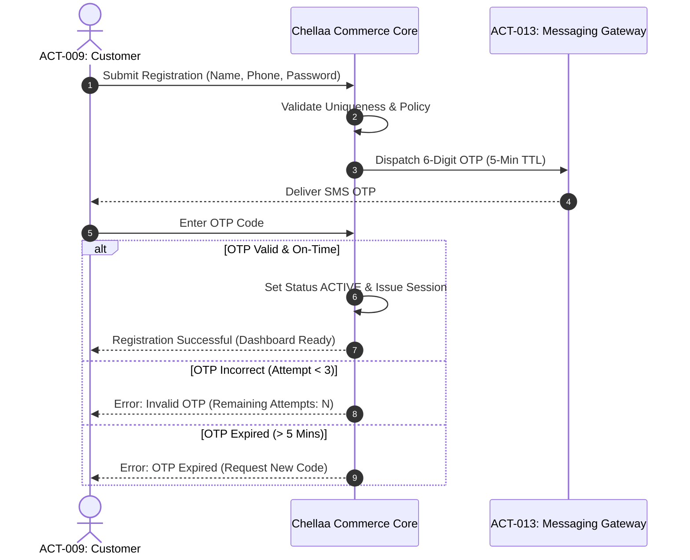

---

### WF-002: Product Catalog Management and Publishing
* **Workflow ID:** `WF-002`
* **Workflow Name:** Product Catalog Authoring, Variant Matrix Generation & Publishing
* **Business Objective:** `OBJ-002`
* **Trigger:** Catalog Manager creates or updates an electronics product line.
* **Participating Actors:** `ACT-003` (Catalog Manager), System.
* **Preconditions:** Brand record and Category tree nodes exist.
* **Main Success Path:**
  1. Catalog Manager defines parent product (Name, Brand, Category, Warranty, Model Number).
  2. Manager defines variant attributes (e.g., Color: Titanium Black; Storage: 512GB; RAM: 12GB).
  3. System generates variant matrix and requires unique SKU, Barcode (EAN-13), MRP, and Selling Price for each variant.
  4. Manager populates category-mandated technical specifications (e.g., Screen Size, Battery Capacity, Processor).
  5. Manager uploads high-resolution photography, designates primary thumbnail, and maps images to specific color variants.
  6. Manager saves product in `DRAFT` status and reviews preview.
  7. Manager clicks "Publish".
  8. System validates publication checklist (`BR-CAT-002`), transitions product to `PUBLISHED`, and publishes data to search indices.
* **Alternative Paths:**
  * **Bulk Import:** Manager uploads formatted CSV/Excel spreadsheet containing 500 SKUs; system executes batch validation and stages items for review (`FEAT-DAT-001`).
* **Failure Paths:**
  * **Duplicate SKU / Barcode:** System halts publication and highlights exact conflicting SKU in inventory.
  * **Price Violation ($\text{Selling Price} > \text{MRP}$):** System halts save and flags pricing error (`BR-PRC-001`).
  * **Missing Mandatory Specs:** System blocks publication until missing specifications are provided (`BR-CTG-002`).
* **Business Rules Applied:** `BR-CAT-001`, `BR-CAT-002`, `BR-PRC-001`, `BR-CTG-002`.
* **Expected Final Business State:** Product is `PUBLISHED`; SKUs are active; Search indices updated; Audit log written.
* **Dependencies:** `FEAT-CAT-001`, `FEAT-BRD-001`, `FEAT-CTG-001`.
* **Related Functional Requirements:** `FR-CAT-001`, `FR-CAT-002`.
* **Unresolved Decisions:** None recorded for the catalog-authoring workflow; catalog data readiness remains a separate operational dependency.

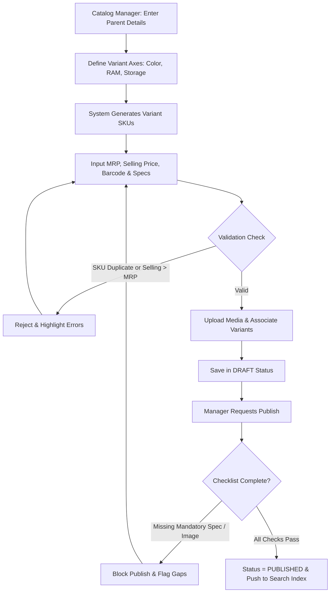

---

### WF-003: Inventory Receiving and Stock Adjustment
* **Workflow ID:** `WF-003`
* **Workflow Name:** Inward Inventory Receiving, Put-Away & Cycle Count Adjustment
* **Business Objective:** `OBJ-003`
* **Trigger:** Physical arrival of supplier purchase consignment or manual cycle count variance.
* **Participating Actors:** `ACT-004` (Warehouse Operator), System.
* **Preconditions:** Purchase Order / Delivery Note reference exists.
* **Main Success Path:**
  1. Supplier truck arrives at enterprise warehouse dock.
  2. Warehouse Operator verifies delivery challan against Purchase Order.
  3. Operator physically scans variant barcodes on arriving boxes into inward staging (`QUARANTINE`).
  4. Operator performs physical quality inspection (checks box seals, verifies no carton crushing).
  5. Operator enters accepted quantity and assigns items to designated warehouse bin locations.
  6. System increments `On-Hand` inventory balance and calculates new `Available-to-Sell` (ATS) stock (`BR-INV-002`).
  7. System checks for active back-in-stock alert subscribers and queues replenishment notifications (`FEAT-ADV-002`).
* **Alternative Paths:**
  * **Manual Cycle Count Reconciliation:** Operator conducts weekly audit and discovers 2 missing units; operator inputs adjustment with mandatory reason code "SHRINKAGE_THEFT"; system decrements `On-Hand` and logs immutable audit trail.
* **Failure Paths:**
  * **Damaged Inward Stock:** Operator discovers crushed cartons; operator inputs damaged count into `DEFECTIVE_RTV` (Return to Vendor) staging; stock is excluded from Available-to-Sell inventory (`BR-INV-004`).
* **Business Rules Applied:** `BR-INV-001`, `BR-INV-002`, `BR-INV-004`, `BR-AUD-001`.
* **Expected Final Business State:** Inventory balances updated; Stock movement ledger recorded; Audit log written.
* **Dependencies:** `FEAT-INV-001`, `FEAT-AUD-001`.
* **Related Functional Requirements:** `FR-INV-001`.
* **Unresolved Decisions:** None.

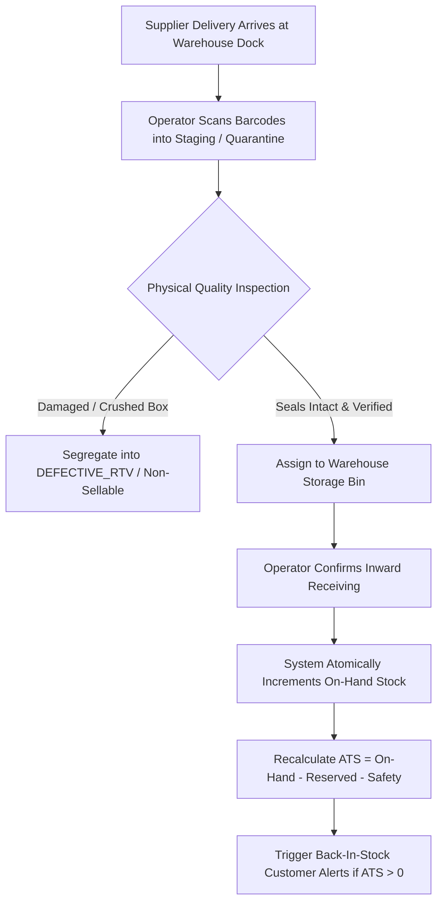

---

### WF-004: Product Discovery, Search and Filtering
* **Workflow ID:** `WF-004`
* **Workflow Name:** Product Discovery, Full-Text Search, Faceted Filtering & Selection
* **Business Objective:** `OBJ-001`, `OBJ-002`
* **Trigger:** Customer searches for a product or navigates category taxonomy.
* **Participating Actors:** `ACT-009` (Customer), `ACT-010` (Guest Shopper), System.
* **Preconditions:** Products are in `PUBLISHED` status.
* **Main Success Path:**
  1. Customer enters search term (e.g., "Gaming Laptop 16GB") or clicks category "Laptops".
  2. System queries search index with typo-tolerant full-text matching.
  3. System renders matching products and computes dynamic aggregation facets (Brands: Dell, ASUS, HP; RAM: 16GB, 32GB; GPU: RTX 4060, RTX 4070; Price Sliders).
  4. Customer toggles facet "RAM: 16GB" and sorts by "Price: Low to High".
  5. System refines results to matching products within $< 200\text{ms}$.
  6. Customer clicks product card to view Product Details Page (PDP).
  7. System displays real-time variant selections, live stock availability, high-res images, and PIN-code delivery estimator.
* **Alternative Paths:**
  * **Typo / Synonym Handling:** Customer types "aple phon"; system returns Apple iPhone items with "Showing results for Apple Phone".
* **Failure Paths:**
  * **Zero Results:** Search term yields no direct matches; system displays popular trending electronics and suggested related categories.
* **Business Rules Applied:** `BR-SRCH-001`, `BR-SRCH-002`, `BR-PDP-001`.
* **Expected Final Business State:** Customer successfully navigates to target product details.
* **Dependencies:** `FEAT-SRCH-001`, `FEAT-CAT-001`.
* **Related Functional Requirements:** `FR-SRCH-001`.
* **Unresolved Decisions:** None.

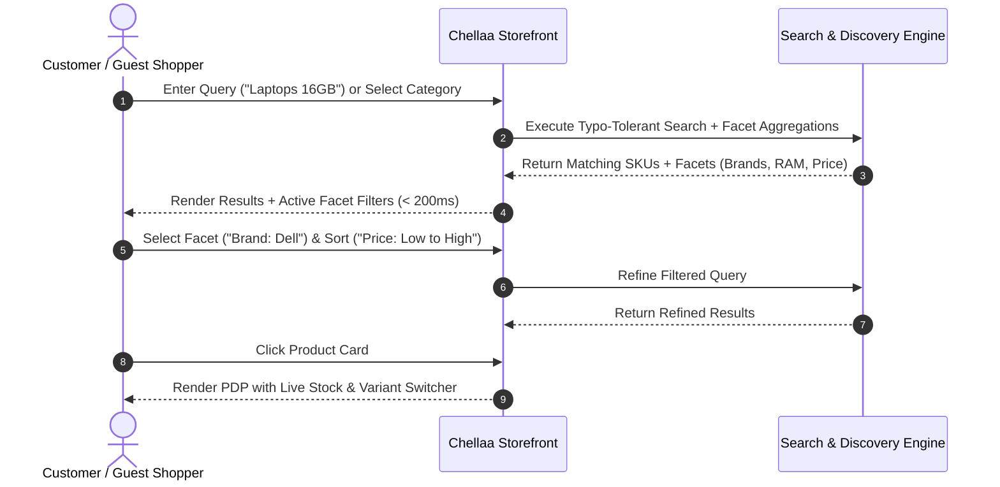

---

### WF-005: Shopping Cart Management and Price/Stock Revalidation
* **Workflow ID:** `WF-005`
* **Workflow Name:** Shopping Cart Lifecycle, Guest Merge & Real-Time Price Revalidation
* **Business Objective:** `OBJ-001`
* **Trigger:** Customer adds, updates, or views shopping cart.
* **Participating Actors:** `ACT-009` (Customer), `ACT-010` (Guest Shopper), System.
* **Preconditions:** Product variant exists and is published.
* **Main Success Path:**
  1. Customer selects variant (e.g., 256GB Black) and clicks "Add to Cart".
  2. System checks Available-to-Sell stock ($\text{ATS} > 0$).
  3. System creates or updates cart item record (stores SKU, quantity, current catalog price snapshot).
  4. Customer views cart; system verifies current catalog price and stock against cart snapshots.
  5. Prices and availability match; system displays subtotal, estimated taxes, and shipping fees.
* **Alternative Paths:**
  * **Guest-to-Customer Cart Merge:** Guest shopper adds items to anonymous cart, then logs in; system matches guest session, merges items into customer's persistent cart, and re-checks active pricing.
* **Failure Paths:**
  * **Price Changed While in Cart:** Catalog price changed while item was in cart; system highlights the modified item, updates to active price, and alerts customer (`BR-CHK-002`).
  * **Item Out of Stock:** Stock dropped to 0 while item was in cart; system disables checkout for that item and marks it "Out of Stock - Please remove to proceed".
  * **Exceeds Max Quantity Limit:** Customer attempts to add 10 units of a flash-sale phone; system restricts quantity to maximum 2 units (`BR-CART-002`).
* **Business Rules Applied:** `BR-CART-001`, `BR-CART-002`, `BR-CHK-002`, `BR-INV-001`.
* **Expected Final Business State:** Cart is updated and verified; Customer ready to enter checkout.
* **Dependencies:** `FEAT-CART-001`, `FEAT-CAT-001`, `FEAT-INV-001`.
* **Related Functional Requirements:** `FR-PRC-001`, `FR-INV-001`.
* **Unresolved Decisions:** None.

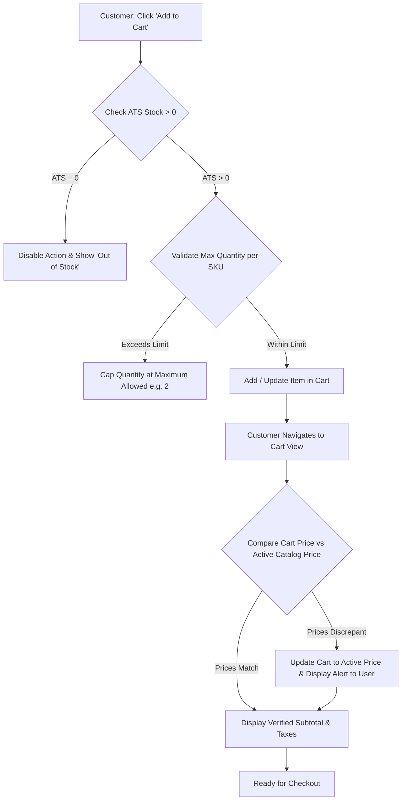

---

### WF-006: Checkout and Order Placement
* **Workflow ID:** `WF-006`
* **Workflow Name:** Checkout Orchestration, Address Validation & Atomic Stock Hold
* **Business Objective:** `OBJ-001`, `OBJ-003`, `OBJ-004`
* **Trigger:** Customer clicks "Proceed to Checkout" from verified shopping cart.
* **Participating Actors:** `ACT-009` (Customer), System.
* **Preconditions:** Cart contains at least one active, in-stock item; customer is authenticated.
* **Main Success Path:**
  1. Customer selects verified delivery address from address book or enters new address.
  2. System validates PIN code against courier serviceability registry (`FEAT-SHP-001`).
  3. System recalculates order total on server: Line Items + Delivery Fees - Promotional Discounts + Statutory Taxes (CGST/SGST/IGST).
  4. Customer enters checkout submission with a client-generated Idempotency Key.
  5. System verifies idempotency key has not been previously executed (`FR-CHK-001`).
  6. System executes atomic inventory reservation holding requested SKU quantities for 15 minutes (`BR-INV-003`).
  7. System creates Order record in `PENDING_PAYMENT` status.
  8. System initializes Payment Gateway session and redirects customer to payment gateway interface.
* **Alternative Paths:**
  * **Cash on Delivery (COD) Selected (If enabled):** System verifies order meets COD eligibility criteria ($\text{Total} \le ₹10,000$ and PIN serviceable for COD); system creates order in `CONFIRMED` status, commits inventory reservation, and triggers warehouse fulfillment directly.
* **Failure Paths:**
  * **Insufficient Stock during Checkout:** Concurrent customer bought the last unit; system halts checkout, releases any partial holds, and alerts customer to update cart.
  * **Duplicate Submission (Double Click):** System detects identical Idempotency Key; halts duplicate processing and returns existing pending order reference.
* **Business Rules Applied:** `BR-CHK-001`, `BR-CHK-002`, `BR-INV-001`, `BR-INV-002`, `BR-INV-003`, `BR-FIN-001`.
* **Expected Final Business State:** Order created in `PENDING_PAYMENT`; Inventory held in `RESERVED` status for 15 minutes; Payment intent active.
* **Dependencies:** `FEAT-CHK-001`, `FEAT-INV-002`, `FEAT-FIN-001`, `FEAT-PAY-001`.
* **Related Functional Requirements:** `FR-CHK-001`, `FR-INV-002`.
* **Unresolved Decisions:** See [OQ-006](./08-assumptions-dependencies-open-questions.md#oq-006) (COD Policy).

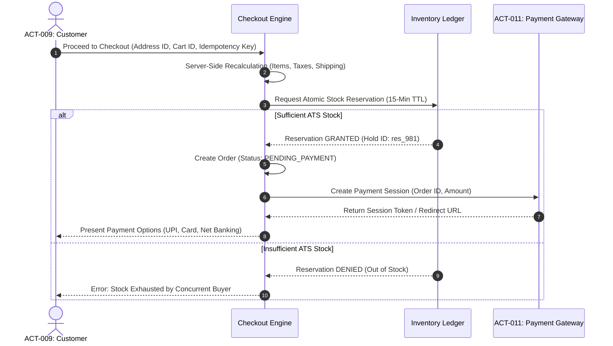

---

### WF-007: Payment Processing and Gateway Reconciliation
* **Workflow ID:** `WF-007`
* **Workflow Name:** Payment Gateway Authorization, Webhook Verification & Order Confirmation
* **Business Objective:** `OBJ-005`, `OBJ-008`
* **Trigger:** Customer completes payment on gateway interface, or gateway sends asynchronous webhook.
* **Participating Actors:** `ACT-009` (Customer), `ACT-011` (Payment Gateway), System.
* **Preconditions:** Order exists in `PENDING_PAYMENT` with active inventory reservation.
* **Main Success Path:**
  1. Customer completes 3D-Secure authentication on gateway interface.
  2. Payment gateway dispatches signed cryptographic webhook (`payment.captured`) to Chellaa platform.
  3. System verifies HMAC webhook signature using gateway secret (`BR-PAY-001`).
  4. System executes idempotency check; matches payment reference against internal Order ID.
  5. System transitions Order status from `PENDING_PAYMENT` to `CONFIRMED`.
  6. System permanently commits inventory reservation into deducted stock (`BR-ORD-003`).
  7. System allocates sequential tax invoice number (`BR-FIN-002`) and renders PDF invoice.
  8. System sends order confirmation SMS/WhatsApp with invoice link to customer and queues order for warehouse fulfillment.
* **Alternative Paths:**
  * **Customer Browser Redirect arrives before Webhook:** System verifies status via synchronous return token, displays "Payment Received - Confirming Order", and waits for authoritative webhook.
* **Failure Paths:**
  * **Payment Failed / Declined:** Gateway webhook reports `payment.failed`; system marks payment attempt as failed, alerts customer, and keeps reservation open until 15-minute TTL expires to allow retry.
  * **Late Payment on Expired Reservation:** Payment confirmation captures after 15-minute TTL:
    * **Case A (Stock Still Available):** System attempts to immediately re-reserve available on-hand stock (`ATS >= order quantity`) and transitions order to `CONFIRMED`.
    * **Case B (Stock Exhausted):** If stock has been claimed by concurrent shoppers, system executes `BR-PAY-002`: marks order `PAYMENT_RECEIVED_OUT_OF_STOCK`, cancels order, and triggers automatic 100% refund remittance to original payment source.
  * **Dropped Webhook / Stale Pending:** Webhook is lost; background job detects order pending $> 30\text{ mins}$, queries gateway status API (`BR-PAY-003`), and synchronizes authoritative state.
* **Business Rules Applied:** `BR-PAY-001`, `BR-PAY-002`, `BR-PAY-003`, `BR-ORD-003`, `BR-FIN-002`.
* **Expected Final Business State:** Order is `CONFIRMED` (or refunded if out of stock); Stock is permanently allocated; Invoice is issued; Customer notified.
* **Dependencies:** `FEAT-PAY-001`, `FEAT-ORD-001`, `FEAT-FIN-001`, `FEAT-INV-002`.
* **Related Functional Requirements:** `FR-PAY-001`, `FR-PAY-002`, `FR-FIN-001`.
* **Unresolved Decisions:** None.

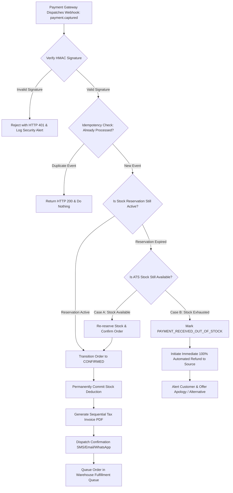

---

### WF-008: Order Fulfillment, Packing and Dispatch
* **Workflow ID:** `WF-008`
* **Workflow Name:** Hybrid Order Fulfillment, Shipment Assignment, Delivery and Proof of Delivery
* **Business Objective:** `OBJ-004`, `OBJ-006`
* **Trigger:** Order status becomes `CONFIRMED` and the order is released for fulfillment.
* **Participating Actors:** `ACT-005` (Fulfillment Specialist), Customer, Shipping Operations Lead, Dispatcher / Route Coordinator, Delivery Associate, direct courier partner, shipping aggregator, Customer Support Agent, COD / Finance Reconciler, System.
* **Preconditions:** Order is `CONFIRMED`; inventory is allocated; destination is in Chellaa's approved internal service area; applicable COD policy is satisfied.
* **Main Success Path:**
  1. System creates an internal Shipment ID linked to the order, immutable delivery address snapshot, package items, declared value, and COD due if applicable. The operation is idempotent.
  2. Fulfillment Specialist views the fulfillment dashboard and selects confirmed orders.
  3. System generates a picklist by warehouse bin and moves the order to `PROCESSING`.
  4. Specialist picks items, scans each SKU/variant, and verifies quantity and serial/IMEI where applicable.
  5. Specialist records package weight/dimensions, packs and seals the parcel, and records the packing operator and timestamp. Barcode/serial mismatch or damage blocks progression and creates an exception.
  6. System moves the shipment to `READY_FOR_DISPATCH` after packing checks pass and checks the enabled provider lanes for the destination.
  7. The dispatcher/system selects an approved lane under the configured serviceability, capacity, cost and delivery-promise rules: Chellaa's own team, a directly integrated courier, or an approved shipping aggregator. Provider routing/fallback rules must be configured before the lane is enabled.
  8. For own-team delivery, warehouse staff and Delivery Associate acknowledge parcel custody and a run manifest is recorded. For direct courier/aggregator delivery, record provider booking/label, external AWB/reference, pickup manifest and provider handover evidence. All lanes retain the internal Shipment ID as the canonical reference.
  9. Shipment milestones are ingested from authenticated own-team actions or validated provider API/webhook updates. The system deduplicates provider events, maps them to the common internal lifecycle, and sends the customer a safe tracking link/status update.
  10. Associate records the delivery attempt. For successful delivery, the system validates the required delivery OTP, records recipient confirmation and timestamp, and changes shipment/order to `DELIVERED` only after evidence is complete.
  11. System sends delivery confirmation and starts the 7-calendar-day return eligibility window from the verified delivery timestamp.
  12. For eligible COD, the collection channel (own associate/direct courier/aggregator), amount, receipt/reference and timestamp are recorded. Finance reconciles own-team handovers or provider remittance statements against the COD due, including provider fees/deductions. Online prepaid payments continue under the existing Razorpay-only policy.
* **Alternative Paths:**
  * **Customer unavailable / address issue / reschedule:** Record a standardized failed-attempt reason, notify Customer Support and customer, and assign a retry within the existing maximum of three consecutive calendar-day attempts.
  * **Third failed attempt:** Escalate to Shipping Operations Lead, return the parcel to warehouse custody, record the return handover, and move shipment to the approved internal return-to-warehouse/RTO state.
  * **Customer refuses or return is authorized:** Follow existing order cancellation/returns rules; scan the parcel into warehouse custody and link the event to the return/order record.
* **Failure Paths:**
  * **Barcode / serial mismatch:** Block packing and dispatch until corrected or formally resolved by an authorized supervisor.
  * **Damaged item or parcel:** Quarantine the item/parcel, create an exception, and do not dispatch until disposition is recorded.
  * **No associate / missed run / device or network outage:** Keep the shipment in a non-delivered state, retain the assignment/exception audit, and escalate to the Operations Lead for re-planning.
  * **Delivery OTP failure or disputed delivery:** Do not mark delivered; create an exception and route to supervisor/Support review.
  * **COD variance:** Preserve shipment/order completion separately from financial reconciliation; create a finance incident with variance amount, custodian, evidence, and resolution.
* **Business Rules Applied:** `BR-ORD-001`, `BR-SHP-001`, `BR-SHP-002`, `BR-ORD-002`, and OQ-006 COD policy.
* **Expected Final Business State:** Shipment is `DELIVERED` with auditable proof of delivery, or enters an explicit failed-attempt / return-to-warehouse exception path. COD reconciliation is separately tracked.
* **Dependencies:** `FEAT-ORD-001`, `FEAT-SHP-001`, `FEAT-NTF-001`, `DEP-002`, and `DEP-006`.
* **Related Functional Requirements:** `FR-ORD-001`, `FR-SHP-001`, `FR-SHP-002`.
* **Open Operational Decisions:** Launch service area, delivery hours, staffing/capacity, vehicle model, and proof-of-delivery media/retention remain to be approved under `DEP-002`. No carrier or aggregator is selected.

```mermaid
sequenceDiagram
    autonumber
    actor Warehouse as Fulfillment Specialist
    participant SMS as Chellaa Shipping Management System
    actor Dispatcher as Dispatcher / Route Coordinator
    actor Associate as Delivery Associate
    actor Customer as Customer
    participant Finance as COD / Finance Reconciliation

    Warehouse->>SMS: Pick, scan SKU/serial, pack and seal
    SMS->>SMS: Create Shipment ID; set READY_FOR_DISPATCH
    Dispatcher->>SMS: Assign run and Delivery Associate
    Warehouse->>Associate: Handover parcel and manifest
    Associate->>SMS: Acknowledge custody; start delivery run
    SMS->>Customer: Send out-for-delivery notification
    Associate->>Customer: Attempt delivery
    alt Delivery succeeds
        Associate->>SMS: Submit delivery OTP and proof metadata
        SMS->>SMS: Validate evidence; set DELIVERED
        SMS->>Customer: Send delivery confirmation
        opt COD order
            Associate->>SMS: Record collected amount and receipt
            Associate->>Finance: Handover cash / collection evidence
            Finance->>SMS: Record reconciliation result or variance
        end
    else Delivery fails
        Associate->>SMS: Record attempt reason and timestamp
        SMS->>Customer: Send failed-attempt notice
        alt Attempts remain
            Dispatcher->>SMS: Schedule permitted retry
        else Retry limit reached
            Associate->>Warehouse: Return parcel and handover custody
            SMS->>SMS: Record RETURN_TO_WAREHOUSE / RTO state
        end
    end
```

---

### WF-009: Order Cancellation and Inventory Release
* **Workflow ID:** `WF-009`
* **Workflow Name:** Customer / Administrative Order Cancellation & Inventory Release
* **Business Objective:** `OBJ-004`, `OBJ-005`
* **Trigger:** Customer requests cancellation via order history or Customer Support intervenes.
* **Participating Actors:** `ACT-009` (Customer), `ACT-006` (Support Agent), System.
* **Preconditions:** Order status is `CONFIRMED` or `PROCESSING`.
* **Main Success Path:**
  1. Customer navigates to order details and clicks "Cancel Order".
  2. Customer selects cancellation reason from dropdown (e.g., "Ordered by mistake", "Found better price").
  3. System evaluates cancellation eligibility rule (`BR-ORD-002`): Order status $\le \text{PROCESSING}$.
  4. System transitions Order status to `CANCELLED`.
  5. System immediately releases allocated inventory, returning quantities to `Available-to-Sell` stock (`FEAT-INV-001`).
  6. System issues an official Credit Note referencing original invoice (`BR-FIN-003`).
  7. System triggers automated full refund to customer's original payment source (`FR-RET-002`).
  8. System dispatches cancellation confirmation notification with Credit Note link.
* **Alternative Paths:**
  * **Support-initiated cancellation:** Customer calls support to cancel before packing; support agent verifies identity and executes cancellation with administrative reason code.
* **Failure Paths:**
  * **Order Already Packed / Dispatched:** Order status is $\ge \text{PACKED}$; system blocks self-service cancellation with notice: "Your order is already packed and staged for shipping. Please refuse delivery at doorstep or initiate a return upon receipt" (`BR-ORD-002`).
* **Business Rules Applied:** `BR-ORD-002`, `BR-FIN-003`, `BR-RET-003`, `BR-INV-001`.
* **Expected Final Business State:** Order is `CANCELLED`; Inventory restored to ATS; Credit note issued; Refund initiated.
* **Dependencies:** `FEAT-ORD-001`, `FEAT-INV-001`, `FEAT-FIN-002`, `FEAT-RET-002`.
* **Related Functional Requirements:** `FR-ORD-001`, `FR-RET-002`.
* **Unresolved Decisions:** None.

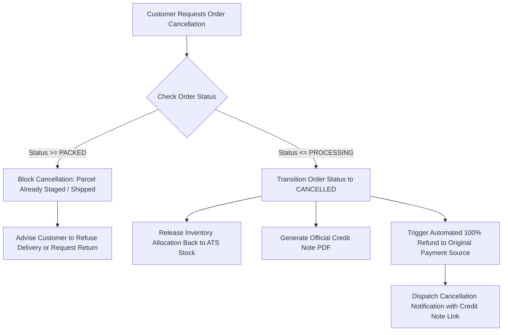

---

### WF-010: Return, Replacement and Refund Processing
* **Workflow ID:** `WF-010`
* **Workflow Name:** Reverse Logistics, Warehouse Inspection, Restocking & Refund Remittance
* **Business Objective:** `OBJ-007`, `OBJ-005`, `OBJ-003`
* **Trigger:** Customer submits return request for a delivered order.
* **Participating Actors:** `ACT-009` (Customer), `ACT-004` (Warehouse Operator), `ACT-007` (Finance Officer), System.
* **Preconditions:** Order status is `DELIVERED`; Current time $\le \text{Delivery Timestamp} + 7\text{ days}$.
* **Main Success Path:**
  1. Customer selects delivered item, chooses reason (e.g., "Defective item", "Wrong color"), uploads condition photos, and selects "Refund".
  2. System validates 7-day policy window (`BR-RET-001`) and approves reverse pickup.
  3. Reverse courier collects package from customer and delivers to enterprise warehouse.
  4. Warehouse Operator inspects parcel: verifies serial number/IMEI matches shipped item and inspects condition.
  5. Operator approves inspection as `APPROVED_DEFECTIVE` (genuine hardware issue) or `SEALED_RESTOCKABLE`.
  6. System issues Credit Note reversing original tax invoice (`BR-FIN-003`).
  7. System executes automated refund to original payment source (`BR-RET-003`).
  8. If item was `SEALED_RESTOCKABLE`, stock is returned to ATS; if defective, item is routed to vendor warranty claim (`BR-RET-002`).
  9. Customer receives SMS/Email with refund transaction reference and Credit Note PDF.
* **Alternative Paths:**
  * **Customer Requests Replacement:** Customer wants same item replaced; upon inspection approval, system automatically spawns a new `CONFIRMED` replacement fulfillment order at zero charge.
* **Failure Paths:**
  * **Inspection Rejection (Fraud / Mismatch):** Operator discovers returned phone is old model with mismatched IMEI or shows physical water damage; operator marks inspection `REJECTED` with photographic proof; refund is denied, and item is returned to customer.
  * **Expired Return Window:** Customer requests return on day 8; system blocks request with notice: "Return window has expired. Please contact authorized manufacturer service center."
* **Business Rules Applied:** `BR-RET-001`, `BR-RET-002`, `BR-RET-003`, `BR-FIN-003`, `BR-INV-004`.
* **Expected Final Business State:** Return closed; Credit Note issued; Refund remitted; Stock appropriately quarantined or restocked.
* **Dependencies:** `FEAT-RET-001`, `FEAT-RET-002`, `FEAT-FIN-002`, `FEAT-PAY-001`.
* **Related Functional Requirements:** `FR-RET-001`, `FR-RET-002`.
* **Unresolved Decisions:** See [OQ-008](./08-assumptions-dependencies-open-questions.md#oq-008).

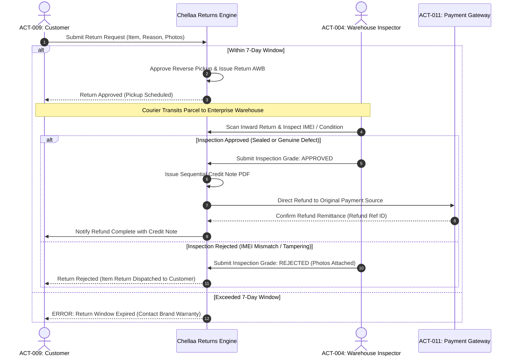

---

### WF-011: Promotions and Coupon Redemption
* **Workflow ID:** `WF-011`
* **Workflow Name:** Promotional Coupon Validation, Usage Limits & Discount Allocation
* **Business Objective:** `OBJ-001`, `OBJ-008`
* **Trigger:** Customer inputs a promo code in cart or checkout.
* **Participating Actors:** `ACT-009` (Customer), System.
* **Preconditions:** Customer has items in shopping cart.
* **Main Success Path:**
  1. Customer types coupon code (e.g., `DIWALI2026`) and clicks "Apply".
  2. System checks coupon validity: active status, current date within start/end dates, global redemption limit not exhausted.
  3. System checks customer usage limit: customer has not previously redeemed this code (`BR-PRM-001`).
  4. System verifies cart meets minimum purchase threshold (e.g., cart value $\ge ₹15,000$).
  5. System calculates discount (e.g., 10% off capped at ₹2,000).
  6. System proportionally allocates discount across eligible line items for tax compliance (`BR-PRM-002`).
  7. System displays discounted cart total and informs customer of exact savings.
* **Alternative Paths:**
  * **Replacing Active Coupon:** Customer applies a second code; system asks if they wish to replace the existing coupon (`BR-PRM-001`).
* **Failure Paths:**
  * **Expired or Inactive Code:** System rejects with "Coupon expired or invalid".
  * **Minimum Order Value Not Met:** System informs customer: "Add ₹3,200 more of eligible items to use this coupon".
  * **Excluded Category:** Coupon applies only to Audio; cart contains only Mobiles; system rejects with category restriction notice.
* **Business Rules Applied:** `BR-PRM-001`, `BR-PRM-002`, `BR-CHK-001`.
* **Expected Final Business State:** Coupon applied; Pro-rata discounts allocated; Order total updated.
* **Dependencies:** `FEAT-PRM-001`, `FEAT-CART-001`.
* **Related Functional Requirements:** `FR-PRM-001`.
* **Unresolved Decisions:** None.

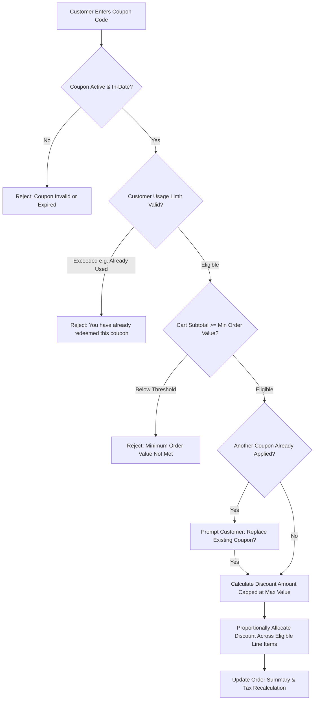

---

### WF-012: Multi-Channel Notification Delivery
* **Workflow ID:** `WF-012`
* **Workflow Name:** Event-Driven Transactional Notification Delivery
* **Business Objective:** `OBJ-006`, `OBJ-007`
* **Trigger:** Domain event published (e.g., `OrderConfirmedEvent`, `ShipmentDispatchedEvent`, `OTPRequestedEvent`).
* **Participating Actors:** System (Automated), `ACT-013` (Messaging Gateway), `ACT-009` (Customer).
* **Preconditions:** Event contains recipient contact information.
* **Main Success Path:**
  1. System listens to domain event and matches event type to registered notification template.
  2. System applies the approved event-to-channel matrix. The selected scope includes SMS, Email and WhatsApp Business API for order lifecycle events; per-event mandatory channels remain to be specified.
  3. System renders the approved template using contextual parameters (Customer Name, Order Number, Tracking URL).
  4. System dispatches through the configured channel gateway(s) selected by the approved policy.
  5. Gateway responses and delivery timestamps are recorded per channel in the notification log.
* **Alternative Paths:**
  * A channel failure is recorded and handled according to the retry/fallback policy once that policy is approved; this workflow does not assume a particular channel order or timeout.
* **Failure Paths:**
  * **Gateway Network Error:** The gateway failure is logged and escalated/retried according to the policy to be specified. Retry intervals, fallback order and timing remain open under OQ-015.
* **Business Rules Applied:** `BR-NTF-001`.
* **Expected Final Business State:** Notification delivered; Delivery audit record saved.
* **Dependencies:** `FEAT-NTF-001`, `FEAT-INT-001`.
* **Related Functional Requirements:** `FR-NTF-001`.
* **Unresolved Decisions:** OQ-015 channel selection is recorded; event-to-channel mapping, retries, fallback behavior and provider readiness remain open.

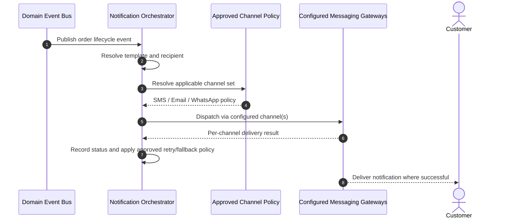

---

### WF-013: Customer Support Ticket Resolution
* **Workflow ID:** `WF-013`
* **Workflow Name:** Customer Support Inquiry, Order Investigation & Escalation
* **Business Objective:** `OBJ-007`
* **Trigger:** Customer raises help ticket on an order or support contact form.
* **Participating Actors:** `ACT-009` (Customer), `ACT-006` (Customer Support Agent), System.
* **Preconditions:** Customer has an active account or order reference.
* **Main Success Path:**
  1. Customer submits inquiry: "Shipment delayed past promised delivery date".
  2. System generates ticket `TKT-2026-1042` linked directly to Order ID, Customer ID, and Courier AWB.
  3. Support agent opens unified support view displaying live order tracking, courier milestone history, and payment status.
  4. Agent identifies courier hub delay; contacts logistics coordinator; posts internal update note on ticket.
  5. Agent sends update to customer via ticket interface: "Courier experiencing regional transport delay; priority delivery scheduled tomorrow".
  6. Shipment delivered next day; agent marks ticket `RESOLVED`.
* **Alternative Paths:**
  * **Goodwill Compensation:** Delay exceeded SLA by 48 hours; agent issues a ₹200 apology promotional voucher with supervisor sign-off.
* **Failure Paths:**
  * **Lost In Transit:** Courier confirms parcel lost in transit; agent escalates ticket to Logistics Lead; system triggers replacement order dispatch at zero charge to customer.
* **Business Rules Applied:** `BR-SUP-001`.
* **Expected Final Business State:** Ticket is `RESOLVED`; Customer communication logged; Audit trail complete.
* **Dependencies:** `FEAT-SUP-001`, `FEAT-ORD-001`, `FEAT-SHP-001`.
* **Related Functional Requirements:** `FR-SUP-001`.
* **Unresolved Decisions:** None.

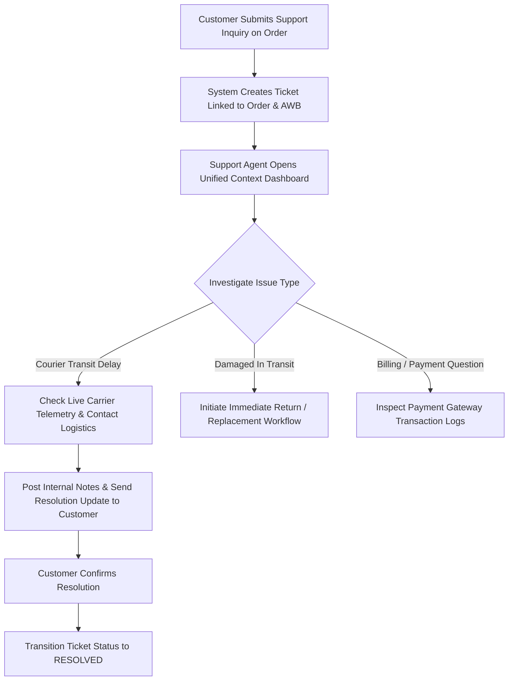

---

### WF-014: Reporting and Daily Financial Reconciliation
* **Workflow ID:** `WF-014`
* **Workflow Name:** Gateway Settlement Reconciliation and Business Reporting
* **Business Objective:** `OBJ-008`, `OBJ-009`
* **Trigger:** Settlement reconciliation or report generation is requested or scheduled according to the approved operational cadence; exact run times remain open.
* **Participating Actors:** `ACT-007` (Finance Officer), `ACT-001` (Business Owner), System.
* **Preconditions:** Transaction logs and payment gateway settlement files available.
* **Main Success Path:**
  1. Scheduled job ingests daily settlement statement from payment gateway.
  2. System automatically matches each gateway settlement record against internal Order ID and payment transaction ID (`FEAT-PAY-002`).
  3. System compares collected net funds minus gateway processing fee against bank deposit credit.
  4. System verifies that issued tax invoices match confirmed orders and credit notes match refunds (`BR-FIN-003`).
  5. System compiles the selected standard reports (sales/GMV and net sales, product velocity, low stock and GST tax liability) and supports the selected real-time BI, predictive replenishment and customer cohort retention scope as those specifications are defined.
  6. Finance Officer reviews reconciliation exceptions and report outputs against approved calculation and acceptance rules; no assumption of a 100% match is made when discrepancies exist.
* **Alternative Paths:**
  * **Executive Digest / Export:** A report may be exported or delivered through an approved channel once format, permissions, cadence and delivery policy are specified; a fixed 07:00 AM digest is not selected.
* **Failure Paths:**
  * **Settlement Discrepancy (Unmatched Transaction):** Gateway records a payment with no matching internal confirmed order (e.g., late payment dropped in network); system flags exception in `DISCREPANCY_QUEUE` for finance investigation (`BR-PAY-003`).
* **Business Rules Applied:** `BR-PAY-003`, `BR-RPT-001`, `BR-FIN-002`.
* **Expected Final Business State:** Daily reconciliation ledger closed; Executive reports generated.
* **Dependencies:** `FEAT-PAY-002`, `FEAT-FIN-001`, `FEAT-RPT-001`.
* **Related Functional Requirements:** `FR-PAY-003`, `FR-RPT-001`.
* **Unresolved Decisions:** OQ-018 Option B scope is recorded; KPI formulas, refresh latency, cadence, permissions, exports, predictive methodology and validation criteria remain open.

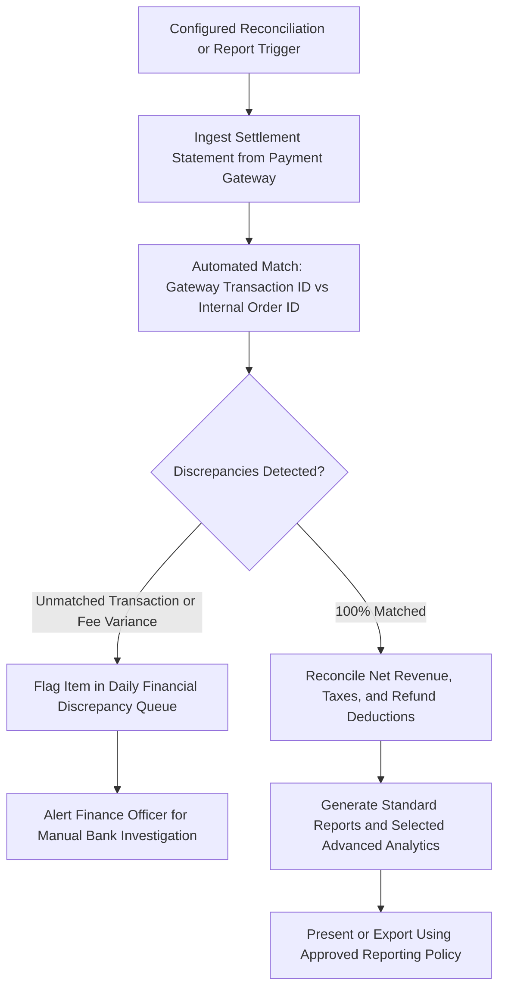

---

### WF-015: External Provider Failure and Recovery
* **Workflow ID:** `WF-015`
* **Workflow Name:** Third-Party Gateway Failure Isolation, Retries & Circuit Breaker Recovery
* **Business Objective:** `OBJ-010`
* **Trigger:** Third-party API (Payment Gateway, Courier, SMS) experiences elevated latency or returns HTTP 5xx errors.
* **Participating Actors:** System (Automated), `ACT-014` (Operations / SRE).
* **Preconditions:** Core platform is running.
* **Main Success Path:**
  1. Core service calls courier API to generate shipping label; timeout set to 3 seconds.
  2. Transient network blip causes call to time out.
  3. Resilience handler intercepts error; executes exponential backoff retry at 1s, 2s, 4s.
  4. Second retry succeeds; shipment is booked without customer-facing impact.
* **Alternative Paths:**
  * **Failover to Secondary Provider:** Primary SMS provider fails consistently; system automatically routes outgoing OTPs through secondary configured SMS gateway.
* **Failure Paths:**
  * **Sustained Outage (Circuit Breaker Trips):** Primary payment gateway suffers a complete regional outage ($> 50\%$ failure rate over 20 calls); circuit breaker trips to `OPEN`. System diverts new checkouts to secondary payment gateway or presents clean maintenance notice without thread pool exhaustion.
  * **Unsent Notification Queuing:** Notifications failing all retries are saved to dead-letter queue; SRE alerts fire; background replay worker processes queue once gateway recovers (`FR-INT-001`).
* **Business Rules Applied:** `BR-INT-001`.
* **Expected Final Business State:** Core platform remains operational; Zero data loss; Transactions safely queued or rerouted.
* **Dependencies:** `FEAT-INT-001`, `FEAT-OPS-001`.
* **Related Functional Requirements:** `FR-INT-001`.
* **Unresolved Decisions:** None.

```mermaid
flowchart TD
    A[Service Calls External Provider API e.g. Courier] --> B{Call Succeeds within 3s?}
    B -->|Yes| C[Process Normal Business Outcome]
    B -->|Timeout / HTTP 5xx| D{Retry Count < 3?}
    D -->|Yes| E[Wait Exponential Backoff 1s, 2s, 4s & Retry]
    E --> A
    D -->|No (All Retries Exhausted)| F{Check Failure Rate over Window}
    F -->|Failure Rate > 50%| G[Trip Circuit Breaker to OPEN]
    G --> H[Divert Requests to Secondary Provider or Queue Asynchronously]
    H --> I[Trigger SRE High-Severity Alert]
    G --> J[Periodic Health Ping: Half-Open State when Provider Recovers]
    J -->|Healthy| K[Reset Circuit Breaker to CLOSED]
```

---

### WF-016: Administrative Access and Privileged Audit Review
* **Workflow ID:** `WF-016`
* **Workflow Name:** Privileged Administrative Action Execution and Immutable Audit Logging
* **Business Objective:** `OBJ-008`
* **Trigger:** Internal operator attempts a privileged mutation (e.g., modifying product price, manual stock adjustment, role permission update).
* **Participating Actors:** Internal Staff (`ACT-002`, `ACT-003`, `ACT-004`, `ACT-007`), System.
* **Preconditions:** Operator is authenticated with valid administrative session.
* **Main Success Path:**
  1. Operator submits request to reduce catalog selling price of an iPhone from ₹79,999 to ₹74,999.
  2. System checks Role-Based Access Control (RBAC): verifies user holds "Catalog Manager" role.
  3. System prompts for mandatory change reason code (e.g., "Festival Weekend Promotional Markdown").
  4. System executes database mutation.
  5. System atomically constructs an audit log entry: User ID, Timestamp, IP Address, Entity Type ("PRODUCT_VARIANT"), Entity ID, Old Value (79999), New Value (74999), Reason.
  6. Audit record is appended to immutable write-once audit storage (`BR-AUD-001`).
  7. Operation completes with success confirmation to operator.
* **Alternative Paths:**
  * **Audit Inspection:** Business Owner or Auditor queries audit trail by entity ID or date range; system presents chronological before/after change timeline.
* **Failure Paths:**
  * **Unauthorized Role:** Warehouse Operator attempts to alter catalog price; system halts action, denies access with HTTP 403 Forbidden, and writes security violation event to audit log (`BR-ADM-001`).
* **Business Rules Applied:** `BR-ADM-001`, `BR-ADM-002`, `BR-AUD-001`.
* **Expected Final Business State:** Privileged change executed; Tamper-evident audit record permanently stored.
* **Dependencies:** `FEAT-ADM-001`, `FEAT-AUD-001`.
* **Related Functional Requirements:** `FR-ADM-001`, `FR-AUD-001`.
* **Unresolved Decisions:** None.

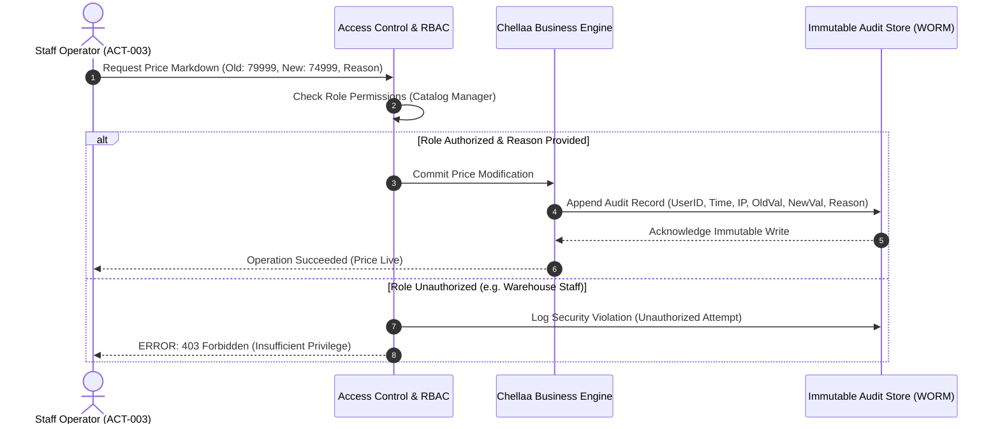


### WF-017: Verified-Buyer Review Submission and Moderation
* **Workflow ID:** `WF-017`
* **Workflow Name:** Verified-Buyer Product Review Submission and Administrative Moderation
* **Business Objective:** `OBJ-007`
* **Trigger:** A customer submits a product rating and written review for a purchased SKU.
* **Participating Actors:** `ACT-009` (Customer), authorized Moderator / Catalog Manager, System.
* **Preconditions:** Customer is authenticated; the order and SKU history are available for verification.
* **Main Success Path:**
  1. Customer submits a 1–5 star rating, title and review body for a product SKU.
  2. System verifies the customer has a completed, delivered order containing that SKU.
  3. If verification succeeds, the system marks the submission as verified and queues it as `PENDING_MODERATION`; otherwise, submission is rejected.
  4. An authorized moderator reviews the submission and records approval or rejection with an auditable reason.
  5. Only an approved review is published, and the system recalculates the product's aggregate rating.
* **Alternative Paths:** A moderator may reject a review that violates the approved content policy; detailed criteria and appeal handling remain to be specified.
* **Failure Paths:** If order/SKU verification cannot be completed, the review is not published and the system records a retryable or supportable verification error.
* **Business Rules Applied:** `BR-REV-001`.
* **Expected Final Business State:** Review is rejected, awaiting moderation, or published only after approval; aggregate rating reflects published reviews.
* **Dependencies:** `FEAT-REV-001`, `FEAT-ORD-001`.
* **Related Functional Requirements:** `FR-REV-001`.
* **Unresolved Decisions:** Photo-review support, detailed moderation criteria, moderator permissions, appeal/rejection handling, retention, abuse escalation and review edit/delete rules remain open under the OQ-012 follow-up.

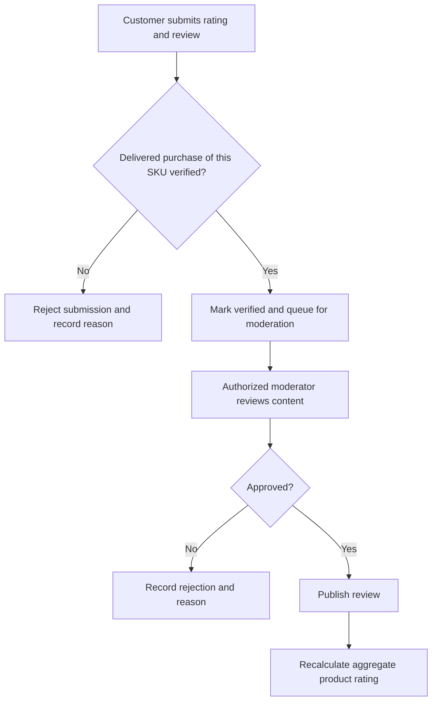

---
