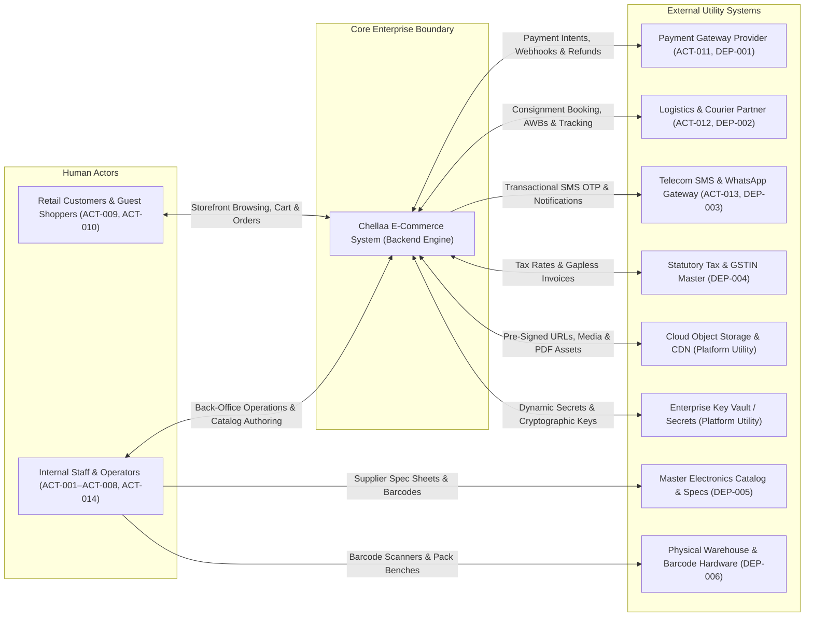
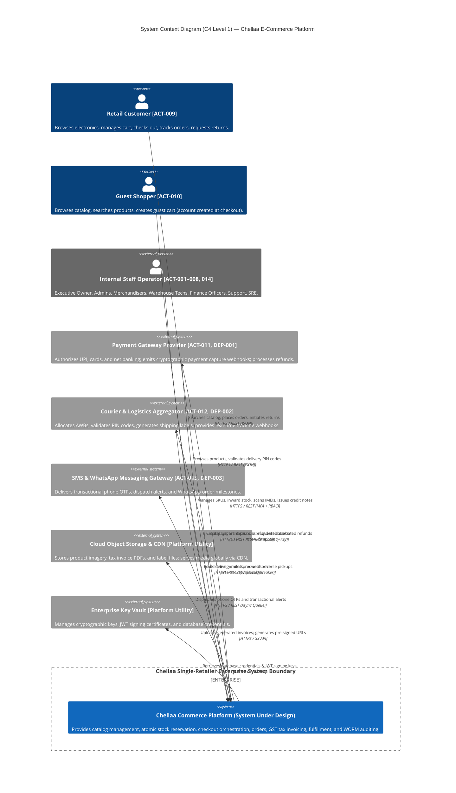
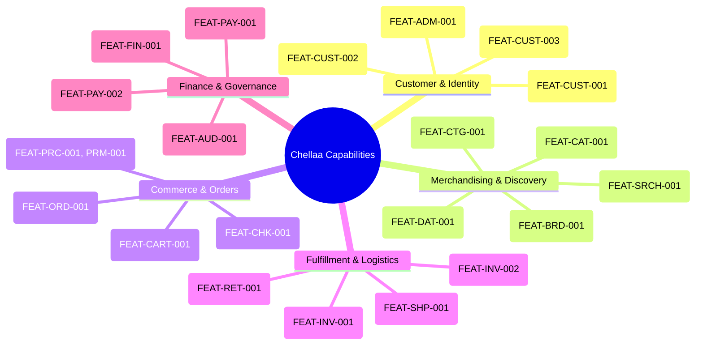

# ARCH-01 — Architecture Overview, System Context and Boundaries

> [!WARNING]
> **NON-BINDING — DRAFT ONLY — NOT APPROVED FOR IMPLEMENTATION**  
> This specification is an exploratory Phase 2 architecture drafting instrument prepared under `docs/00-requirements/review/`. It does **not** constitute an approved architecture design, does not commit the enterprise to physical infrastructure or frameworks, and does not authorize software implementation.  
> Transitioning to approved architecture under `docs/01-architecture/ARCH-01-architecture-overview.md` remains strictly blocked until the authorized Enterprise Business Owner signs off on [`docs/00-requirements/11-review-and-approval.md`](../11-review-and-approval.md) and ratifies the strategic decisions in [`docs/00-requirements/review/executive-decision-register.md`](./executive-decision-register.md).

---

## 1. Document Control

| Document Attribute | Specification Details |
| :--- | :--- |
| **Document ID** | `ARCH-01` |
| **Document Title** | Architecture Overview, System Context, and Enterprise Boundaries |
| **Project Name** | Chellaa E-Commerce Platform |
| **Repository & Branch** | [`ezhilselvan1109/chellaa-system`](https://github.com/ezhilselvan1109/chellaa-system) &bull; Branch: `dev` |
| **File Location** | `docs/00-requirements/review/arch-01-architecture-overview-draft.md` |
| **Version** | `1.0.1-DRAFT` |
| **Lifecycle State** | **`DRAFT_COMPLETE_PENDING_REVIEW`** (Non-Binding Preparatory Draft) |
| **Target Promotion Path** | `docs/01-architecture/ARCH-01-architecture-overview.md` (Deferred pending formal executive sign-off) |
| **Author Roles** | Principal Solution Architect, C4 Model Specialist, Domain-Driven Design Specialist & Requirements Traceability Engineer |
| **Target Reviewers** | Enterprise Business Owner, Chief Technology Officer, Lead Security Architect & SRE Lead |
| **1. Draft Completion** | **`COMPLETED`** (All 14 required architecture sections and C4 diagrams fully articulated) |
| **2. Requirements Traceability** | **`PENDING_RECONCILIATION`** — Previous completeness claims are withdrawn until source IDs and bidirectional mappings are verified against the current baseline (17 workflows). |
| **3. Technical Architecture Review** | **`PENDING_REVIEW`** (Subject to technical peer review by CTO and Principal Architects) |
| **4. Business Owner Policy Review** | **`PENDING_REVIEW`** (Subject to review and ratification of ADQ-001 through ADQ-008) |
| **5. Formal Baseline Approval** | **`NOT_APPROVED`** (Maintained strictly per Document 11 governance gate) |
| **6. Implementation Authorization** | **`NOT_GRANTED`** (Strictly blocked pending Business Owner signature in Document 11 Section 7) |

### 1.1 Revision History
| Version | Date | Author Roles | Description of Changes & Governance Triggers |
| :---: | :---: | :--- | :--- |
| `0.1.0-PLAN` | 2026-10-18 | Principal Software Architect | Outlined architecture planning deliverables in [`phase-2-architecture-planning.md`](./phase-2-architecture-planning.md). |
| `0.2.0-DISC` | 2026-10-18 | Principal Software Architect | Step 02A domain discovery & boundaries in [`architecture-discovery-and-domain-boundaries.md`](./architecture-discovery-and-domain-boundaries.md). |
| `0.3.0-DEC` | 2026-10-18 | Solution & Database Architect | Step 02B trade-off analysis in [`architecture-decision-analysis.md`](./architecture-decision-analysis.md). |
| `0.4.0-BLUE` | 2026-10-23 | Enterprise Architecture Lead | Step 02C consolidated blueprint in [`non-binding-architecture-blueprint.md`](./non-binding-architecture-blueprint.md). |
| `1.0.0-DRAFT` | 2026-10-24 | Principal Solution Architect | Comprehensive `ARCH-01` draft with C4 Level 1 context, capability mapping, runtime flows, and traceability. |
| `1.0.1-DRAFT` | 2026-10-24 | Principal Solution Architect | Quality gate remediation: reconciled actor IDs (`ACT-001`–`014`), dependency IDs (`DEP-001`–`006`), `NFR-SCL-002` 50k SKU confirmed baseline vs 100k stress proposal, 8-year statutory retention (`BR-DAT-001`, `OQ-020`), and explicit 6-stage lifecycle status (`DRAFT_COMPLETE_PENDING_REVIEW`). |

### 1.2 Purpose and Intended Audience
This document establishes the overarching technical architecture context, operational environment, enterprise system boundaries, primary capabilities, and external integration interfaces for the Chellaa single-retailer e-commerce platform. It provides the architectural foundation for subsequent detailed design documents (`ARCH-02` through `ARCH-12`).

**Intended Audience:**
* **Enterprise Business Owner:** To verify that the technical system context faithfully implements commercial objectives ([`OBJ-001`](../00-business-overview.md#obj-001) to [`OBJ-010`](../00-business-overview.md#obj-010)) and strictly enforces the proprietary single-retailer boundary.
* **Solution Architects & Technical Leads:** To establish immutable interaction boundaries, data ownership firewalls, and integration resilience contracts.
* **Security & Infrastructure Engineers:** To audit perimeter boundaries, identity segregation models, and external trust domains.

### 1.3 Assumptions and Limitations
* **Strict Single-Retailer Assumption:** All inventory, listings, customer relationships, and financial ledgers belong exclusively to one enterprise entity ([`ASM-001`](../08-assumptions-dependencies-open-questions.md#asm-001)).
* **Four-Warehouse Planning Baseline:** Four initial warehouse locations with regional inventory are the recorded planning input ([`OQ-007`](../08-assumptions-dependencies-open-questions.md#oq-007), [`ADQ-015`](./executive-decision-register.md#adq-015)). The architecture must remain location-agnostic and configuration-driven; actual sites, addresses, capacity, and serviceable PIN codes remain unvalidated and are not hard-coded.
* **Backend-First Delivery Scope:** Storefront web/mobile user interfaces and native administrative apps are deferred to downstream delivery phases ([`01-business-scope.md`](../01-business-scope.md)).
* **Provisional Planning Metrics:** Sizing targets (e.g., 1,000 peak orders/minute, 99.9% uptime) represent proposed planning baselines pending final ratification in [`executive-decision-register.md`](./executive-decision-register.md).

---

## 2. Executive Summary

### 2.1 The Business Problem
Modern consumer electronics retail demands extreme operational reliability, strict real-time inventory precision, and statutory financial compliance. High-velocity flash sales and festive surges create concurrency contention on high-value SKUs (smartphones, laptops, audio). Overselling causes customer frustration, brand erosion, and operational refund chaos. Concurrently, statutory goods and services taxation (GST), strict anti-fraud return inspection mandates, and payment gateway late webhook arrivals require robust, distributed transactional integrity.

### 2.2 Proposed System Purpose
The **Chellaa System** is engineered as a backend-first, modular distributed commerce platform tailored specifically for a proprietary direct-to-consumer (D2C) and business-to-consumer (B2C) electronics retailer. Its primary mandate is to guarantee:
1. **100% Zero Overselling:** Atomic stock reservation mechanisms prevent race conditions during high-concurrency checkouts ([`BR-INV-001`](../05-business-rules.md#br-inv-001), [`BR-INV-002`](../05-business-rules.md#br-inv-002)).
2. **Statutory Tax & Financial Rigor:** Gapless sequential GST tax invoicing and credit note issuance ([`BR-FIN-001`](../05-business-rules.md#br-fin-001)–[`003`](../05-business-rules.md#br-fin-003)).
3. **Hardware Traceability:** Serial/IMEI barcode scanning permanently bound to order fulfillment and diagnostic return inspections ([`BR-ORD-003`](../05-business-rules.md#br-ord-003), [`BR-RET-002`](../05-business-rules.md#br-ret-002)).
4. **Resilient Failure Recovery:** Automated source payment refunds when gateway confirmations arrive after inventory reservation expiration ([`BR-PAY-003`](../05-business-rules.md#br-pay-003)).

### 2.3 Single-Retailer Business Model Invariant
Chellaa operates under an **absolute single-retailer model**. The enterprise is the sole Merchant of Record (MoR) and owns 100% of the catalog, warehouse stock, pricing strategies, and customer accounts. **Marketplace capabilities are strictly out of scope:** zero third-party vendor portals, zero commission calculations, zero split payouts, zero seller onboarding, and zero multi-merchant buy-box arbitration exist in the system ([`01-business-scope.md`](../01-business-scope.md)).

### 2.4 Separation of Confirmed Requirements vs Architectural Proposals
To maintain strict governance integrity, this document explicitly differentiates established business requirements from technical proposals:
* **Confirmed Requirements:** Single-retailer model ([`OBJ-004`](../00-business-overview.md#obj-004)), 50,000 SKU catalog capacity with capacity for 5,000,000 order records over the system lifecycle (not a legacy-data migration commitment) ([`NFR-SCL-002`](../07-non-functional-requirements.md#nfr-scl-002)) (with 100,000 SKUs / 500,000 variants evaluated as an architectural stress sizing proposal), zero tolerance for inventory overselling ([`NFR-INT-001`](../07-non-functional-requirements.md#nfr-int-001), [`BR-INV-001`](../05-business-rules.md#br-inv-001)), zero cardholder PAN/CVV storage ([`BR-SEC-001`](../05-business-rules.md#br-sec-001)), password hashing via bcrypt/Argon2id ([`NFR-SEC-002`](../07-non-functional-requirements.md#nfr-sec-002)), AES-256 PII protection ([`NFR-SEC-003`](../07-non-functional-requirements.md#nfr-sec-003)), and 8 Financial Years statutory financial record retention ([`BR-DAT-001`](../05-business-rules.md#br-dat-001), [`OQ-020`](../08-assumptions-dependencies-open-questions.md#oq-020)).
* **Proposed Architecture Patterns:** Coarse-Grained Service Clusters (`AD-001`), Redis Lua atomic inventory holds (`AD-002`), Orchestrated Checkout Saga (`AD-004`), Logical Schema Isolation on PostgreSQL (`AD-005`), and Transactional Outbox with Debezium CDC (`AD-006`).
* **Open Strategic Decisions:** 8 commercial decisions tracked in [`executive-decision-register.md`](./executive-decision-register.md) (`ADQ-001` through `ADQ-008`), plus guest checkout auto-provisioning policy (`OQ-011`).

---

## 3. Business Context and Stakeholder Ecosystem

The Chellaa System operates within an ecosystem of human actors, internal operational departments, automated background schedulers, and external utility service providers:

### Detailed Actor & External System Ecosystem Matrix

| Actor / System Name | System ID | Category & Role | Information Exchanged | Interaction Protocol & Mode | Trust Boundary & Security | Source Traceability |
| :--- | :---: | :--- | :--- | :--- | :--- | :--- |
| **Enterprise Business Owner** | [`ACT-001`](../02-stakeholders-and-actors.md#act-001) | Executive Governance | Strategic commercial policies (`ADQ-001`–`008`), high-level financial KPIs, pricing overrides. | Synchronous HTTPS REST via Admin Portal. | Maximum internal trust; multi-factor authentication + audit logging. | [`FEAT-ADM-001`](../03-business-feature-inventory.md#feat-adm-001), [`BR-PRC-002`](../05-business-rules.md#br-prc-002) |
| **System Administrator / Super Admin** | [`ACT-002`](../02-stakeholders-and-actors.md#act-002) | Executive Operator | Role assignments, system configurations, high-level operational reporting. | Synchronous HTTPS REST via Admin Portal. | Highly privileged internal perimeter; mandatory MFA + granular RBAC. | [`FEAT-ADM-001`](../03-business-feature-inventory.md#feat-adm-001), [`BR-ADM-001`](../05-business-rules.md#br-adm-001) |
| **Catalog Manager** | [`ACT-003`](../02-stakeholders-and-actors.md#act-003) | Merchandising Staff | Products, variants, specifications, categories, brands, media assets. | Synchronous REST & Async CSV/XLSX Bulk Import. | Internal perimeter; RBAC gated (`CATALOG_MANAGER`). | [`FEAT-CAT-001`](../03-business-feature-inventory.md#feat-cat-001), [`FR-CAT-001`](../04-functional-requirements.md#fr-cat-001) |
| **Warehouse Operator** | [`ACT-004`](../02-stakeholders-and-actors.md#act-004) | Warehouse Staff | Stock inwarding adjustments, bin put-away, physical quarantine checks. | Synchronous REST / Barcode scanner input. | Internal warehouse network; RBAC gated (`WAREHOUSE_OPERATOR`). | [`FEAT-INV-001`](../03-business-feature-inventory.md#feat-inv-001), [`FR-INV-001`](../04-functional-requirements.md#fr-inv-001) |
| **Fulfillment Specialist** | [`ACT-005`](../02-stakeholders-and-actors.md#act-005) | Fulfillment Staff | Picklist generation, packing validation, serial/IMEI scans, thermal AWB printing. | Synchronous REST / Barcode scanner input. | Internal warehouse network; RBAC gated (`FULFILLMENT_SPECIALIST`). | [`FEAT-INV-002`](../03-business-feature-inventory.md#feat-inv-002), [`FR-ORD-003`](../04-functional-requirements.md#fr-ord-003) |
| **Customer Support Agent** | [`ACT-006`](../02-stakeholders-and-actors.md#act-006) | Customer Care Staff | Ticket status, order history, customer notes, return RMA status inquiries. | Synchronous HTTPS REST. | Internal perimeter; masked PII display; RBAC gated (`SUPPORT_AGENT`). | [`FEAT-SUP-001`](../03-business-feature-inventory.md#feat-sup-001), [`FR-SUP-001`](../04-functional-requirements.md#fr-sup-001) |
| **Finance Officer / Executive** | [`ACT-007`](../02-stakeholders-and-actors.md#act-007) | Accounting Staff | Gateway settlement files, GST tax reports, credit note approvals. | Synchronous REST & CSV report exports. | Internal perimeter; RBAC gated (`FINANCE_EXECUTIVE`). | [`FEAT-FIN-001`](../03-business-feature-inventory.md#feat-fin-001), [`FEAT-RPT-001`](../03-business-feature-inventory.md#feat-rpt-001) |
| **Marketing Manager** | [`ACT-008`](../02-stakeholders-and-actors.md#act-008) | Growth Staff | Promotional campaigns, coupon codes, discount rules, banner merchandising. | Synchronous HTTPS REST via Admin Portal. | Internal perimeter; RBAC gated (`MARKETING_MANAGER`). | [`FEAT-PRM-001`](../03-business-feature-inventory.md#feat-prm-001), [`FR-PRM-001`](../04-functional-requirements.md#fr-prm-001) |
| **Registered Customer** | [`ACT-009`](../02-stakeholders-and-actors.md#act-009) | Primary Consumer | Profile, addresses, orders, return requests, reviews. | Synchronous HTTPS REST via API Gateway. | Zero-Trust public perimeter; authenticated via short-lived JWT (RS256). | [`FEAT-CUST-001`](../03-business-feature-inventory.md#feat-cust-001), [`FR-CUST-001`](../04-functional-requirements.md#fr-cust-001) |
| **Guest Shopper** | [`ACT-010`](../02-stakeholders-and-actors.md#act-010) | Anonymous Consumer | Session cart, delivery PIN code, guest checkout payload (account provisioned at checkout). | Synchronous HTTPS REST. | Public perimeter; IP rate-limited; transient session token. | [`FEAT-CHK-001`](../03-business-feature-inventory.md#feat-chk-001), [`OQ-011`](../08-assumptions-dependencies-open-questions.md#oq-011) |
| **Payment Gateway Provider** | [`ACT-011`](../02-stakeholders-and-actors.md#act-011) &bull; [`DEP-001`](../08-assumptions-dependencies-open-questions.md#dep-001) | External Financial Utility | Payment intent generation, capture webhooks, automated refunds. | Synchronous outbound REST; Asynchronous inbound webhooks. | DMZ Webhook Ingress; HMAC-SHA256 signature verification; zero PAN stored. | [`FEAT-PAY-001`](../03-business-feature-inventory.md#feat-pay-001), [`BR-PAY-002`](../05-business-rules.md#br-pay-002) |
| **Courier Logistics Partner** | [`ACT-012`](../02-stakeholders-and-actors.md#act-012) &bull; [`DEP-002`](../08-assumptions-dependencies-open-questions.md#dep-002) | External Shipping Utility | Consignment booking, AWB allocation, tracking status webhooks. | Synchronous outbound REST; Inbound webhooks & polling fallback. | API key auth; webhook signature check; Resilience4j circuit breakers. | [`FEAT-SHP-001`](../03-business-feature-inventory.md#feat-shp-001), [`BR-SHP-001`](../05-business-rules.md#br-shp-001) |
| **Messaging Communications Gateway** | [`ACT-013`](../02-stakeholders-and-actors.md#act-013) &bull; [`DEP-003`](../08-assumptions-dependencies-open-questions.md#dep-003) | External Messaging Utility | Transactional SMS OTPs, WhatsApp alerts, transactional emails. | Asynchronous REST outbound queue. | Outbound API key auth; background worker isolated from checkout. | [`FEAT-NTF-001`](../03-business-feature-inventory.md#feat-ntf-001), [`BR-NTF-001`](../05-business-rules.md#br-ntf-001) |
| **Observability / SRE Engineer** | [`ACT-014`](../02-stakeholders-and-actors.md#act-014) | Infrastructure Operator | Distributed traces, service health metrics, log querying, synthetic canary testing. | Synchronous APM dashboards & alerting. | Internal secure observability subnet; mTLS access. | [`FEAT-OPS-001`](../03-business-feature-inventory.md#feat-ops-001), [`NFR-OBS-001`](../07-non-functional-requirements.md#nfr-obs-001) |
| **Statutory Tax & GSTIN Master** | [`DEP-004`](../08-assumptions-dependencies-open-questions.md#dep-004) | Legal Tax Integration | Registered enterprise GSTIN, HSN rate schedules, sequential invoicing syntax. | Internal tax rule table seeded from official GST schedules. | Financial calculation domain; gapless monotonic sequence generator. | [`FEAT-FIN-001`](../03-business-feature-inventory.md#feat-fin-001), [`BR-FIN-001`](../05-business-rules.md#br-fin-001) |
| **Master Electronics Catalog Specs** | [`DEP-005`](../08-assumptions-dependencies-open-questions.md#dep-005) | Supplier Merchandising Data | High-resolution photography, accurate technical specification sheets, warranty terms. | Spreadsheet bulk ingestion & structured supplier feeds. | Merchandising domain; schema validation before publication. | [`FEAT-CAT-001`](../03-business-feature-inventory.md#feat-cat-001), [`FR-CAT-001`](../04-functional-requirements.md#fr-cat-001) |
| **Physical Warehouse Infrastructure** | [`DEP-006`](../08-assumptions-dependencies-open-questions.md#dep-006) | Physical Fulfillment Operations | Labeled bin locations, packing benches, handheld barcode/IMEI scanners (Code 128 / EAN-13). | Physical warehouse scanner inputs to REST APIs. | Internal warehouse LAN; authenticated workstation terminals. | [`FEAT-INV-001`](../03-business-feature-inventory.md#feat-inv-001), [`FR-ORD-003`](../04-functional-requirements.md#fr-ord-003) |
| **Cloud Object Storage & CDN** | Platform Utility | Cloud Technical Utility | Product image assets, invoice PDFs, thermal shipping labels. | Pre-signed HTTPS URLs for upload/download. | IAM role delegation; public read via Edge CDN; private bucket storage. | Architectural Infrastructure (`AD-011`) |
| **Enterprise Key Vault** | Platform Utility | Security Technical Utility | Database credentials, JWT signing keys, gateway API secrets. | Synchronous mTLS / Cloud IAM. | Maximum security zone; automated secret rotation. | Architectural Infrastructure (`NFR-SEC-002`) |

---

## 4. C4 Level 1 System Context Diagram

The C4 Level 1 System Context diagram illustrates the Chellaa System at the center of its operational environment, defining interactions across human roles and external services:

### 4.1 System Context Legend & Connection Descriptions
* **Confirmed vs Proposed Boundary:** The Chellaa System Boundary represents 100% enterprise-owned logic. Integrations with Payment Gateways (`DEP-001`), Couriers (`DEP-002`), and Messaging (`DEP-003`) are confirmed integration requirements, while Razorpay is the recorded sole online payment gateway (`OQ-004`). `ADQ-014` records the current hybrid provider model and supersedes `ADQ-011`'s provider-exclusion clauses. No named courier/aggregator is selected; `DEP-002` remains open pending contracts, serviceability validation and end-to-end readiness evidence (`OQ-005`, `ADQ-014`).
* **Customer Interaction (HTTPS/REST):** Public traffic routed via reverse proxy/API Gateway. Authenticated via Bearer JWT; rate-limited per IP and account.
* **Staff Interaction (HTTPS/REST + MFA):** Restricted back-office endpoints protected by IP whitelisting, mandatory multi-factor authentication, and fine-grained Role-Based Access Control (`BR-ADM-001`).
* **Payment Gateway Interaction (Bi-Directional):** Outbound payment intent session creation; inbound cryptographic webhook processing with HMAC-SHA256 signature checks.
* **Courier Interaction (Bi-Directional):** Synchronous outbound consignment booking wrapped in Resilience4j circuit breakers; inbound asynchronous tracking milestone ingestion.

---

## 5. System Boundary & Scope Definition

### 5.1 In-Scope Capabilities Owned by Chellaa
The Chellaa platform backend explicitly owns:
1. **Core Domain Business Logic:** Product variants (color, RAM, storage), dynamic specifications, pricing ceilings (MRP), and category taxonomy rules.
2. **Transactional State Machines:** 15-minute atomic inventory reservation holds, multi-step checkout Sagas, order status lifecycles, and return eligibility windows.
3. **Statutory Tax Calculations:** Indian GST determination (intra-state CGST+SGST vs inter-state IGST), gapless sequential invoice numbering, and credit note issuance.
4. **Physical Asset Tracking:** Serial and IMEI number tracking bound permanently to line items upon warehouse dispatch.
5. **Security & Auditing:** RBAC permission evaluation, PII field-level encryption (AES-256), and append-only WORM audit ledgers with SHA-256 hash chaining.

### 5.2 External Services (Out of Boundary)
The platform delegates the following capabilities to certified third-party providers:
* **Payment Entry & Card Processing:** Delegated entirely to PCI DSS Level 1 certified gateway hosted fields and client SDKs. Zero card numbers or CVVs enter Chellaa servers ([`BR-SEC-001`](../05-business-rules.md#br-sec-001)).
* **Physical Package Transportation:** Delegated to licensed courier logistics partners.
* **Cellular Telecommunication:** Delegated to telecom DLT-registered SMS gateways.

### 5.3 Human-Operated vs Automated Activities
* **Human-Operated:** Warehouse bin picking, physical barcode scanning, technician diagnostic hardware condition grading, customer support dispute resolution, and merchandising catalog authoring.
* **Automated:** 15-minute stock hold expiration sweeps, low-stock reorder alerts, daily gateway settlement reconciliation, automated source refund dispatch, and search read-model synchronization.

### 5.4 Backend Scope vs Deferred Frontend Scope
* **Backend Scope (Phase 1 & Phase 2 Baseline):** All REST APIs, domain entities, database schemas, message queues, circuit breakers, and security interceptors.
* **Deferred Frontend Scope (Phase 3+):** Customer storefront web application, mobile iOS/Android apps, and administrative back-office GUI dashboards ([`01-business-scope.md`](../01-business-scope.md)).

### 5.5 Explicit Anti-Scope (Marketplace Exclusion Rules)
Pursuant to mandatory enterprise charter constraints, the following capabilities are **strictly prohibited**:
* ❌ Zero third-party vendor registration, merchant onboarding, or vendor self-service portals.
* ❌ Zero vendor commission calculation, ledger splitting, or multi-seller escrow payouts.
* ❌ Zero multi-vendor cart splitting or third-party merchant rating engines.
* ❌ Zero third-party seller dispute arbitration frameworks.

---

## 6. High-Level Capability Map

The 41 business features and 56 functional specifications map across 18 core architectural capability areas:

### Detailed Capability to Requirement Traceability Matrix

| Capability Area | Core Capabilities Description | Primary Requirement Identifiers | Commercial Business Rules | End-to-End Workflows | Non-Functional Requirements |
| :--- | :--- | :--- | :--- | :--- | :--- |
| **01. Customer Accounts & Identity** | Mobile OTP registration, profiles, multiple addresses, PIN code check, deactivation. | [`FEAT-CUST-001`](../03-business-feature-inventory.md#feat-cust-001)–[`003`](../03-business-feature-inventory.md#feat-cust-003) [`FR-CUST-001`](../04-functional-requirements.md#fr-cust-001)–[`004`](../04-functional-requirements.md#fr-cust-004) | [`BR-CUST-001`](../05-business-rules.md#br-cust-001), [`BR-CUST-002`](../05-business-rules.md#br-cust-002) | [`WF-001`](../06-business-workflows.md#wf-001) | [`NFR-SEC-003`](../07-non-functional-requirements.md#nfr-sec-003) (AES-256 PII) |
| **02. Staff IAM & Governance** | Staff accounts, enterprise credentials, mandatory MFA, granular RBAC permissions. | [`FEAT-ADM-001`](../03-business-feature-inventory.md#feat-adm-001) [`FR-SEC-001`](../04-functional-requirements.md#fr-sec-001), [`FR-SEC-002`](../04-functional-requirements.md#fr-sec-002) | [`BR-ADM-001`](../05-business-rules.md#br-adm-001), [`BR-ADM-002`](../05-business-rules.md#br-adm-002) | [`WF-016`](../06-business-workflows.md#wf-016) | [`NFR-SEC-002`](../07-non-functional-requirements.md#nfr-sec-002) (bcrypt/Argon2id) |
| **03. Product Catalog & Variants** | Multi-variant electronics modeling (RAM, storage, color), SKU lifecycle, media assets. | [`FEAT-CAT-001`](../03-business-feature-inventory.md#feat-cat-001), [`002`](../03-business-feature-inventory.md#feat-cat-002) [`FR-CAT-001`](../04-functional-requirements.md#fr-cat-001), [`FR-CAT-003`](../04-functional-requirements.md#fr-cat-003) | [`BR-CAT-001`](../05-business-rules.md#br-cat-001)–[`003`](../05-business-rules.md#br-cat-003) | [`WF-002`](../06-business-workflows.md#wf-002) | [`NFR-SCL-002`](../07-non-functional-requirements.md#nfr-scl-002) (50k SKU baseline; 100k stress proposal) |
| **04. Category & Specs Taxonomy** | Hierarchical categories, dynamic attribute schemas, inheritance validation. | [`FEAT-CTG-001`](../03-business-feature-inventory.md#feat-ctg-001), [`002`](../03-business-feature-inventory.md#feat-ctg-002) [`FR-CAT-002`](../04-functional-requirements.md#fr-cat-002), [`FR-CTG-001`](../04-functional-requirements.md#fr-ctg-001) | [`BR-CTG-001`](../05-business-rules.md#br-ctg-001), [`BR-CTG-002`](../05-business-rules.md#br-ctg-002) | [`WF-002`](../06-business-workflows.md#wf-002) | [`NFR-PERF-001`](../07-non-functional-requirements.md#nfr-perf-001) |
| **05. Brand Governance** | Authorized manufacturer brand profiles, logo assets, active product association guards. | [`FEAT-BRD-001`](../03-business-feature-inventory.md#feat-brd-001) [`FR-BRD-001`](../04-functional-requirements.md#fr-brd-001) | [`BR-BRD-001`](../05-business-rules.md#br-brd-001) | [`WF-002`](../06-business-workflows.md#wf-002) | [`DEP-005`](../08-assumptions-dependencies-open-questions.md#dep-005) (Storage CDN) |
| **06. Pricing & Promotions** | Compare-at MRP ceilings, selling prices, minimum margin alerts, coupons, pro-rata splits. | [`FEAT-PRC-001`](../03-business-feature-inventory.md#feat-prc-001), [`FEAT-PRM-001`](../03-business-feature-inventory.md#feat-prm-001) [`FR-PRC-001`](../04-functional-requirements.md#fr-prc-001), [`FR-PRM-001`](../04-functional-requirements.md#fr-prm-001) | [`BR-PRC-001`](../05-business-rules.md#br-prc-001), [`002`](../05-business-rules.md#br-prc-002) [`BR-PRM-001`](../05-business-rules.md#br-prm-001), [`002`](../05-business-rules.md#br-prm-002) | [`WF-011`](../06-business-workflows.md#wf-011) (promotion redemption; price maintenance is a supporting operation) | [`OQ-009`](../08-assumptions-dependencies-open-questions.md#oq-009) (Tax-Inclusive MRP) |
| **07. Search & Discovery** | Full-text typo-tolerant search, faceted filtering, search read-model event ingestion. | [`FEAT-SRCH-001`](../03-business-feature-inventory.md#feat-srch-001) [`FR-SRCH-001`](../04-functional-requirements.md#fr-srch-001), [`FR-SRCH-002`](../04-functional-requirements.md#fr-srch-002) | [`BR-SRCH-001`](../05-business-rules.md#br-srch-001), [`BR-SRCH-002`](../05-business-rules.md#br-srch-002) | [`WF-004`](../06-business-workflows.md#wf-004) | [`NFR-PERF-001`](../07-non-functional-requirements.md#nfr-perf-001) ($p95 \le 200\text{ms}$) |
| **08. Cart & Wishlist** | Persistent registered cart, anonymous guest cart merging, item quantity caps, saved items. | [`FEAT-CART-001`](../03-business-feature-inventory.md#feat-cart-001), [`FEAT-WSH-001`](../03-business-feature-inventory.md#feat-wsh-001) [`FR-CART-001`](../04-functional-requirements.md#fr-cart-001), [`FR-WSH-001`](../04-functional-requirements.md#fr-wsh-001) | [`BR-CART-001`](../05-business-rules.md#br-cart-001), [`BR-CART-002`](../05-business-rules.md#br-cart-002) | [`WF-005`](../06-business-workflows.md#wf-005) | [`OQ-011`](../08-assumptions-dependencies-open-questions.md#oq-011) (Guest Checkout) |
| **09. Checkout Orchestration** | Idempotent checkout initiation, atomic 15-min stock hold, coupon locking, payment intents. | [`FEAT-CHK-001`](../03-business-feature-inventory.md#feat-chk-001) [`FR-CHK-001`](../04-functional-requirements.md#fr-chk-001), [`FR-CHK-002`](../04-functional-requirements.md#fr-chk-002) | [`BR-CHK-001`](../05-business-rules.md#br-chk-001), [`BR-CHK-002`](../05-business-rules.md#br-chk-002) | [`WF-006`](../06-business-workflows.md#wf-006) | [`NFR-PERF-002`](../07-non-functional-requirements.md#nfr-perf-002) ($p95 \le 1,000\text{ms}$) |
| **10. Inventory & Warehousing** | Available-to-Sell ledgers, atomic reservation, low-stock alerts, warehouse inwarding. | [`FEAT-INV-001`](../03-business-feature-inventory.md#feat-inv-001)–[`003`](../03-business-feature-inventory.md#feat-inv-003) [`FR-INV-001`](../04-functional-requirements.md#fr-inv-001)–[`004`](../04-functional-requirements.md#fr-inv-004) | [`BR-INV-001`](../05-business-rules.md#br-inv-001)–[`004`](../05-business-rules.md#br-inv-004) | [`WF-003`](../06-business-workflows.md#wf-003), [`WF-006`](../06-business-workflows.md#wf-006), [`WF-008`](../06-business-workflows.md#wf-008), [`WF-009`](../06-business-workflows.md#wf-009) | [`NFR-SCL-001`](../07-non-functional-requirements.md#nfr-scl-001) (1,000 OPM Surge) |
| **11. Orders & Fulfillment** | Order state machine, picking lists, serial/IMEI barcode scanning, customer cancellation. | [`FEAT-ORD-001`](../03-business-feature-inventory.md#feat-ord-001) [`FR-ORD-001`](../04-functional-requirements.md#fr-ord-001)–[`003`](../04-functional-requirements.md#fr-ord-003) | [`BR-ORD-001`](../05-business-rules.md#br-ord-001)–[`004`](../05-business-rules.md#br-ord-004) | [`WF-008`](../06-business-workflows.md#wf-008), [`WF-009`](../06-business-workflows.md#wf-009) | [`NFR-SCL-001`](../07-non-functional-requirements.md#nfr-scl-001) |
| **12. Payments & Reconciliation** | Gateway payment sessions, cryptographic webhook verification, late recovery, daily recon. | [`FEAT-PAY-001`](../03-business-feature-inventory.md#feat-pay-001), [`002`](../03-business-feature-inventory.md#feat-pay-002) [`FR-PAY-001`](../04-functional-requirements.md#fr-pay-001)–[`003`](../04-functional-requirements.md#fr-pay-003) | [`BR-PAY-001`](../05-business-rules.md#br-pay-001)–[`003`](../05-business-rules.md#br-pay-003) | [`WF-007`](../06-business-workflows.md#wf-007), [`WF-014`](../06-business-workflows.md#wf-014) | [`NFR-SEC-001`](../07-non-functional-requirements.md#nfr-sec-001) (Zero PAN) |
| **13. Tax & Invoicing** | Statutory Indian GST (CGST/SGST/IGST), gapless sequential invoice PDFs, credit notes. | [`FEAT-FIN-001`](../03-business-feature-inventory.md#feat-fin-001), [`002`](../03-business-feature-inventory.md#feat-fin-002) [`FR-FIN-001`](../04-functional-requirements.md#fr-fin-001)–[`003`](../04-functional-requirements.md#fr-fin-003) | [`BR-FIN-001`](../05-business-rules.md#br-fin-001)–[`003`](../05-business-rules.md#br-fin-003) | [`WF-007`](../06-business-workflows.md#wf-007), [`WF-010`](../06-business-workflows.md#wf-010) | [`DEP-004`](../08-assumptions-dependencies-open-questions.md#dep-004) (GSTIN Master) |
| **14. Shipping & Logistics** | Third-party courier booking, AWB allocation, shipping label generation, live tracking. | [`FEAT-SHP-001`](../03-business-feature-inventory.md#feat-shp-001) [`FR-SHP-001`](../04-functional-requirements.md#fr-shp-001), [`FR-SHP-002`](../04-functional-requirements.md#fr-shp-002) | [`BR-SHP-001`](../05-business-rules.md#br-shp-001), [`BR-SHP-002`](../05-business-rules.md#br-shp-002) | [`WF-008`](../06-business-workflows.md#wf-008) | [`DEP-002`](../08-assumptions-dependencies-open-questions.md#dep-002) (Carrier MSA) |
| **15. Returns, Replacements & Refunds** | 7-day request window, reverse courier pickup, technician diagnostic grading, auto-refunds. | [`FEAT-RET-001`](../03-business-feature-inventory.md#feat-ret-001), [`002`](../03-business-feature-inventory.md#feat-ret-002) [`FR-RET-001`](../04-functional-requirements.md#fr-ret-001)–[`003`](../04-functional-requirements.md#fr-ret-003) | [`BR-RET-001`](../05-business-rules.md#br-ret-001)–[`003`](../05-business-rules.md#br-ret-003) | [`WF-010`](../06-business-workflows.md#wf-010) | [`OQ-008`](../08-assumptions-dependencies-open-questions.md#oq-008) (Diagnostic Gate) |
| **16. Notifications Relay** | Supports SMS, Email and WhatsApp Business API for order lifecycle events; per-event channel mapping and retry/fallback policy remain to be specified. | [`FEAT-NTF-001`](../03-business-feature-inventory.md#feat-ntf-001) [`FR-NTF-001`](../04-functional-requirements.md#fr-ntf-001) | [`BR-NTF-001`](../05-business-rules.md#br-ntf-001) | Integrated across WFs | [`DEP-003`](../08-assumptions-dependencies-open-questions.md#dep-003) (provider registration/readiness open) |
| **17. Customer Support & Reviews** | Order-linked support ticketing plus verified-buyer reviews with mandatory admin moderation before publication; detailed moderation policy remains open. | [`FEAT-SUP-001`](../03-business-feature-inventory.md#feat-sup-001), [`FEAT-REV-001`](../03-business-feature-inventory.md#feat-rev-001) [`FR-SUP-001`](../04-functional-requirements.md#fr-sup-001), [`FR-REV-001`](../04-functional-requirements.md#fr-rev-001) | [`BR-SUP-001`](../05-business-rules.md#br-sup-001), [`BR-REV-001`](../05-business-rules.md#br-rev-001) | [`WF-013`](../06-business-workflows.md#wf-013) for support; [`WF-017`](../06-business-workflows.md#wf-017) for review moderation | [`OQ-012`](../08-assumptions-dependencies-open-questions.md#oq-012) (Option B recorded; policy details open) |
| **18. Analytics, Bulk & Operations** | Standard reports plus selected real-time BI, predictive replenishment and customer cohort retention; asynchronous catalog/opening-stock imports, circuit breakers and health checks. Detailed report definitions remain open. | [`FEAT-RPT-001`](../03-business-feature-inventory.md#feat-rpt-001), [`FEAT-DAT-001`](../03-business-feature-inventory.md#feat-dat-001) [`FEAT-OPS-001`](../03-business-feature-inventory.md#feat-ops-001), [`FEAT-INT-001`](../03-business-feature-inventory.md#feat-int-001) | [`BR-RPT-001`](../05-business-rules.md#br-rpt-001), [`BR-OPS-001`](../05-business-rules.md#br-ops-001) [`BR-INT-001`](../05-business-rules.md#br-int-001), [`BR-AUD-001`](../05-business-rules.md#br-aud-001) | [`WF-014`](../06-business-workflows.md#wf-014) reporting; [`WF-015`](../06-business-workflows.md#wf-015) provider recovery; [`WF-016`](../06-business-workflows.md#wf-016) privileged audit | [`NFR-OBS-001`](../07-non-functional-requirements.md#nfr-obs-001), [`NFR-BCM-001`](../07-non-functional-requirements.md#nfr-bcm-001) |

---

## 7. High-Level Runtime Interaction Scenarios

The following 12 end-to-end commerce runtime interaction scenarios describe platform execution boundaries, data handoffs, and failure compensations:

### Scenario 1: Customer Registration and OTP Verification
* **Trigger:** Customer submits mobile phone number on storefront.
* **Participating Boundaries:** Customer Accounts Domain, Messaging Relay Gateway (`DEP-003`).
* **Important Data:** 10-digit Indian mobile number, 6-digit cryptographic OTP (5-minute TTL).
* **Success Outcome:** OTP verified; customer record created in `CustomerProfile`; RS256 JWT issued.
* **Failure Paths:** Invalid/expired OTP returns HTTP 400; telecom SMS gateway failure triggers retry with fallback SMS provider.
* **Source Requirements:** [`FR-CUST-001`](../04-functional-requirements.md#fr-cust-001), [`BR-CUST-001`](../05-business-rules.md#br-cust-001), [`WF-001`](../06-business-workflows.md#wf-001), [`OQ-010`](../08-assumptions-dependencies-open-questions.md#oq-010).

### Scenario 2: Catalog Publication and Search Indexing
* **Trigger:** Catalog Manager transitions product state from `DRAFT` to `ACTIVE`.
* **Participating Boundaries:** Product Catalog Domain, Transactional Outbox, Search & Discovery Read Model.
* **Important Data:** Product ID, variant SKUs, dynamic technical specifications, tax-inclusive MRP.
* **Success Outcome:** Product persisted; `product.published` CloudEvent written to `outbox` table; asynchronously ingested into Search Read Model within 2 seconds.
* **Failure Paths:** Missing mandatory specifications rejects transition (`BR-CAT-001`); search sync worker failure queues event in dead-letter topic for automatic retry.
* **Source Requirements:** [`FR-CAT-001`](../04-functional-requirements.md#fr-cat-001), [`BR-CAT-001`](../05-business-rules.md#br-cat-001), [`WF-002`](../06-business-workflows.md#wf-002), [`NFR-PERF-001`](../07-non-functional-requirements.md#nfr-perf-001).

### Scenario 3: Stock Inwarding and Inventory Availability
* **Trigger:** Warehouse operator receives supplier consignment and scans physical SKU barcodes.
* **Participating Boundaries:** Warehouse & Inventory Domain, Audit Ledger Domain.
* **Important Data:** SKU code, batch number, inward quantity, physical bin location.
* **Success Outcome:** `Available-to-Sell` balance incremented atomically; WORM audit log entry written with before/after delta.
* **Failure Paths:** Barcode unrecognized rejects inwarding; database timeout triggers transaction rollback.
* **Source Requirements:** [`FR-INV-002`](../04-functional-requirements.md#fr-inv-002), [`BR-INV-003`](../05-business-rules.md#br-inv-003), [`WF-008`](../06-business-workflows.md#wf-008), [`FR-AUD-001`](../04-functional-requirements.md#fr-aud-001).

### Scenario 4: Cart Validation and Checkout Initiation
* **Trigger:** Customer proceeds to checkout from shopping cart.
* **Participating Boundaries:** Cart Domain, Pricing & Promotions Domain, Shipping Serviceability Registry.
* **Important Data:** Cart items, coupon codes, shipping address PIN code.
* **Success Outcome:** Server revalidates live selling prices; coupon usage limit verified; PIN code serviceability confirmed; checkout session created.
* **Failure Paths:** Expired coupon removes discount and notifies customer (`BR-PRM-001`); unserviceable PIN code blocks checkout submission with RFC 7807 problem details.
* **Source Requirements:** [`FR-CART-001`](../04-functional-requirements.md#fr-cart-001), [`FR-CHK-001`](../04-functional-requirements.md#fr-chk-001), [`BR-PRC-002`](../05-business-rules.md#br-prc-002), [`BR-PRM-001`](../05-business-rules.md#br-prm-001).

### Scenario 5: High-Concurrency Inventory Reservation and Payment Processing
* **Trigger:** Customer clicks "Pay Now" with `Idempotency-Key` header.
* **Participating Boundaries:** Checkout Orchestrator, Inventory Engine, Payments Gateway Adapter (`DEP-001`).
* **Important Data:** Order items, quantities, payment session token, 15-minute hold TTL.
* **Success Outcome:** Stock atomically reserved in inventory ledger (`hold_id` created); Order Draft placed in `PENDING_PAYMENT`; Payment Gateway session initialized.
* **Failure Paths:** Insufficient stock immediately returns HTTP 409 Conflict (`INSUFFICIENT_STOCK`); gateway initialization timeout dispatches compensating transaction releasing the inventory hold.
* **Source Requirements:** [`FR-CHK-002`](../04-functional-requirements.md#fr-chk-002), [`FR-INV-001`](../04-functional-requirements.md#fr-inv-001), [`BR-INV-001`](../05-business-rules.md#br-inv-001), [`BR-INV-002`](../05-business-rules.md#br-inv-002), [`WF-006`](../06-business-workflows.md#wf-006).

### Scenario 6: Duplicate or Delayed Payment Webhook Handling
* **Trigger:** Payment gateway delivers asynchronous HTTP POST webhook to `/payments/webhook`.
* **Participating Boundaries:** Payments Domain, Orders Domain, Inventory Domain, Invoicing Domain.
* **Important Data:** Gateway transaction ID, HMAC-SHA256 signature, payment status (`CAPTURED`).
* **Success Outcome (Normal Path):** Signature verified; transaction deduplicated; 15-minute hold still active; order transitioned to `CONFIRMED`; stock deduction confirmed; sequential tax invoice generated.
* **Failure Paths & Late Arrival Invariant:**
  * Duplicate webhook: System verifies transaction ID already processed, returns HTTP 200 OK immediately without double-confirming.
  * Late Arrival (Hold expired): If physical stock exists, system atomically reallocates stock and confirms order. **If physical stock is depleted, system transitions order to `EXPIRED_OUT_OF_STOCK`, executes an automated source refund via Gateway API, and alerts customer via SMS ([`BR-PAY-003`](../05-business-rules.md#br-pay-003)).**
* **Source Requirements:** [`FR-PAY-002`](../04-functional-requirements.md#fr-pay-002), [`FR-PAY-003`](../04-functional-requirements.md#fr-pay-003), [`BR-PAY-002`](../05-business-rules.md#br-pay-002), [`BR-PAY-003`](../05-business-rules.md#br-pay-003), [`WF-007`](../06-business-workflows.md#wf-007).

### Scenario 7: Order Fulfillment, Serial Scanning and Courier Tracking
* **Trigger:** Warehouse operator picks confirmed order line items.
* **Participating Boundaries:** Orders Domain, Warehouse Operations, Courier Gateway Adapter (`DEP-002`).
* **Important Data:** Order ID, physical hardware barcode (Serial/IMEI), Air Waybill (AWB) number.
* **Success Outcome:** Operator scans hardware barcode; serial number validated and permanently bound to order item in `OrderDeviceSerialRecord`; consignment booked via Courier API; thermal shipping label generated; order transitions to `DISPATCHED`.
* **Failure Paths:** Courier API timeout trips Resilience4j circuit breaker to `OPEN`; order remains `PACKED` and is enqueued in asynchronous retry buffer without blocking warehouse packing terminals.
* **Source Requirements:** [`FR-ORD-003`](../04-functional-requirements.md#fr-ord-003), [`FR-SHP-001`](../04-functional-requirements.md#fr-shp-001), [`BR-ORD-003`](../05-business-rules.md#br-ord-003), [`BR-SHP-001`](../05-business-rules.md#br-shp-001), [`WF-008`](../06-business-workflows.md#wf-008).

### Scenario 8: Customer Cancellation and Inventory Release
* **Trigger:** Customer requests order cancellation prior to warehouse packing.
* **Participating Boundaries:** Orders Domain, Inventory Domain, Payments Domain, Tax Domain.
* **Important Data:** Order ID, cancellation reason code.
* **Success Outcome:** Order transitioned to `CANCELLED`; allocated stock released back to Available-to-Sell balance; automated gateway refund triggered; Credit Note issued.
* **Failure Paths:** If order has already transitioned to `PACKED` or `DISPATCHED`, cancellation request is rejected with instruction to initiate a post-delivery return ([`BR-ORD-002`](../05-business-rules.md#br-ord-002)).
* **Source Requirements:** [`FR-ORD-002`](../04-functional-requirements.md#fr-ord-002), [`BR-ORD-002`](../05-business-rules.md#br-ord-002), [`WF-009`](../06-business-workflows.md#wf-009).

### Scenario 9: Return Diagnostic Inspection Gate and Source Refund
* **Trigger:** Reverse logistics courier delivers customer return parcel to enterprise warehouse.
* **Participating Boundaries:** Returns & Refunds Domain, Inventory Domain, Payments Domain, Finance Domain.
* **Important Data:** Return Request ID, customer claim reason, physical scanned serial/IMEI, diagnostic condition grade.
* **Success Outcome:** Warehouse technician scans hardware serial/IMEI (matches original dispatched order); diagnostic inspection certifies intact condition; return approved; statutory **Credit Note** generated sequentially; automated payment refund triggered to customer source instrument; SKU restocked.
* **Failure Paths:** Scanned serial does not match dispatched order record, or diagnostic inspection indicates user damage: return rejected, device moved to inspection quarantine, customer notified with photographic evidence.
* **Source Requirements:** [`FR-RET-001`](../04-functional-requirements.md#fr-ret-001)–[`003`](../04-functional-requirements.md#fr-ret-003), [`BR-RET-001`](../05-business-rules.md#br-ret-001)–[`003`](../05-business-rules.md#br-ret-003), [`WF-010`](../06-business-workflows.md#wf-010).

### Scenario 10: Event-Driven Multi-Channel Customer Notification
* **Trigger:** Order status change event published to message broker (`order.confirmed`, `order.dispatched`).
* **Participating Boundaries:** Transactional Outbox, Notifications Relay Domain, Telecom Gateway (`DEP-003`).
* **Important Data:** Customer phone number, email address, order milestone summary, tracking link.
* **Success Outcome:** Event consumed by background worker; DLT-approved SMS dispatched for OTP; WhatsApp alert sent for tracking update; PDF invoice emailed.
* **Failure Paths:** Telecom provider failures are recorded and handled through an approved retry/fallback policy. The policy and provider readiness remain open under OQ-015 / DEP-003; do not assume automatic email fallback.
* **Source Requirements:** [`FR-NTF-001`](../04-functional-requirements.md#fr-ntf-001), [`BR-NTF-001`](../05-business-rules.md#br-ntf-001), [`NFR-AVL-002`](../07-non-functional-requirements.md#nfr-avl-002).

### Scenario 11: Financial Settlement Reconciliation
* **Trigger:** Automated nightly cron worker triggers reconciliation job.
* **Participating Boundaries:** Payments Domain, Finance & Invoicing Domain.
* **Important Data:** Daily payment gateway settlement CSV report, internal payment transactions ledger.
* **Success Outcome:** Automated matching of gateway transaction IDs, fee take-rates, GST tax deductions, and net deposited amounts; discrepancy report generated.
* **Failure Paths:** Unreconciled transaction flagged for Finance Executive manual inspection with audit trail.
* **Source Requirements:** [`FEAT-PAY-002`](../03-business-feature-inventory.md#feat-pay-002), [`FR-PAY-003`](../04-functional-requirements.md#fr-pay-003), [`WF-014`](../06-business-workflows.md#wf-014).

### Scenario 12: Privileged Administrative Action and WORM Auditing
* **Trigger:** Administrative operator updates product selling price or modifies staff role permissions.
* **Participating Boundaries:** Staff IAM Domain, Audit & Compliance Domain.
* **Important Data:** Operator ID, client IP, timestamp, aggregate modified, before/after JSON delta, business justification.
* **Success Outcome:** Action committed in transactional database; immutable audit record written to append-only WORM ledger with SHA-256 hash chaining to previous block.
* **Failure Paths:** Audit ledger write failure aborts administrative mutation, preventing untracked administrative modifications.
* **Source Requirements:** [`FR-AUD-001`](../04-functional-requirements.md#fr-aud-001), [`FR-AUD-002`](../04-functional-requirements.md#fr-aud-002), [`BR-AUD-001`](../05-business-rules.md#br-aud-001), [`WF-016`](../06-business-workflows.md#wf-016).

---

## 8. Quality Attributes and Quantitative Constraints

Every quantitative metric established in the BRD preserves its exact governance classification. Performance targets distinguish between **Or| Quality Dimension | Target Metric / Quantitative Threshold | Governance Status | Source Requirement IDs | Architectural Enforcement & Verification Mechanism |
| :--- | :--- | :---: | :--- | :--- |
| **Search Response Latency** | $p95 \le 200\text{ms}$; $p99 \le 500\text{ms}$ under standard load (tested with 50 concurrent queries over 10k SKUs; 1,500 RPS is an architectural derivative estimation from 10k browsing users) | **Proposed Requirement** | [`NFR-PERF-001`](../07-non-functional-requirements.md#nfr-perf-001) [`NFR-SCL-001`](../07-non-functional-requirements.md#nfr-scl-001) | Decoupled CQRS read-model (OpenSearch) populated asynchronously via Outbox change events. |
| **Checkout Latency** | $p95 \le 1,000\text{ms}$; $p99 \le 2,500\text{ms}$ under peak concurrent load | **Proposed Requirement** | [`NFR-PERF-002`](../07-non-functional-requirements.md#nfr-perf-002) | In-memory atomic inventory holds (Redis Lua) + asynchronous post-order invoice/notification processing. |
| **Admin Operations & Bulk Ingestion** | $p95 \le 800\text{ms}$ standard queries; bulk export $\le 60\text{s}$ for up to 50k records (batch import proposed benchmark: 5,000 SKUs in $\le 15\text{ min}$) | **Proposed Requirement** | [`NFR-PERF-003`](../07-non-functional-requirements.md#nfr-perf-003) [`FEAT-DAT-001`](../03-business-feature-inventory.md#feat-dat-001) | Asynchronous batch worker streaming CSV/XLSX chunks without operational database locking. |
| **Baseline Throughput** | 100 sustained orders/minute ($\approx 1.67\text{ orders/sec}$), 10,000 active browsing users | **Proposed Requirement** | [`NFR-SCL-001`](../07-non-functional-requirements.md#nfr-scl-001) | Sizing for database connection pools, thread workers, and container replicas. |
| **Peak Surge Throughput** | 1,000 peak orders/minute ($\approx 16.7\text{ orders/sec}$) | **Owner decision recorded; verification evidence open** | [`OQ-016`](../08-assumptions-dependencies-open-questions.md#oq-016) [`NFR-SCL-001`](../07-non-functional-requirements.md#nfr-scl-001) | Kafka partition sizing, Redis hold clustering, and horizontal container auto-scaling. |
| **Active Catalog Capacity** | Sized for up to 50,000 active SKUs and capacity for 5,000,000 order records over the system lifecycle (not a legacy-data migration commitment) (100k SKUs / 500k variants evaluated as architectural stress proposal) | **Confirmed Requirement** | [`NFR-SCL-002`](../07-non-functional-requirements.md#nfr-scl-002) | Database table partitioning and dedicated search engine memory indexing sizing. |
| **Core Availability (SLA)** | $\ge 99.90\%$ platform uptime ($< 8.76\text{ hours/year}$ unplanned downtime) | **Owner decision recorded; verification evidence open** | [`OQ-017`](../08-assumptions-dependencies-open-questions.md#oq-017) [`NFR-AVL-001`](../07-non-functional-requirements.md#nfr-avl-001) | Single-Region Multi-AZ active-active deployment with health check circuit breakers. |
| **Disaster Recovery Targets** | $\text{RPO} \le 5\text{ min}$, $\text{RTO} \le 2\text{ hours}$ | **Recorded target; test evidence pending** | [`OQ-017`](../08-assumptions-dependencies-open-questions.md#oq-017) [`NFR-BCM-001`](../07-non-functional-requirements.md#nfr-bcm-001) | Candidate recovery design using continuous WAL archiving and Point-In-Time Recovery (PITR); not yet tested or authorized. |
| **Zero Overselling Tolerance** | Exactly $0.00\%$ oversell incidents (Strong consistency on ATS) | **Confirmed Requirement** | [`NFR-INT-001`](../07-non-functional-requirements.md#nfr-int-001) [`BR-INV-001`](../05-business-rules.md#br-inv-001) | Atomic in-memory inventory decrement at checkout hold with relational balance guard. |
| **Cardholder Data Storage** | Zero PAN / CVV stored on platform servers (PCI-DSS SAQ A isolation) | **Confirmed Requirement** | [`BR-SEC-001`](../05-business-rules.md#br-sec-001) [`NFR-SEC-001`](../07-non-functional-requirements.md#nfr-sec-001) | Client-side hosted fields / SDKs directly with PCI DSS Level 1 certified gateway. |
| **Password Cryptography** | bcrypt (work factor $\ge 12$) or Argon2id; 15-min admin idle timeout | **Confirmed Requirement** | [`FR-SEC-001`](../04-functional-requirements.md#fr-sec-001) [`NFR-SEC-002`](../07-non-functional-requirements.md#nfr-sec-002) | Salted cryptographic key derivation in staff IAM boundary. |
| **Customer PII Protection** | AES-256 at rest, TLS 1.3 in transit, 100% PII log masking | **Confirmed Requirement** | [`NFR-SEC-003`](../07-non-functional-requirements.md#nfr-sec-003) | Database column-level encryption; regex log appender scrubbers masking phones/emails. |
| **Audit & Tax Record Retention** | 8 Financial Years statutory retention mandate with tamper detection | **Confirmed Requirement** | [`BR-DAT-001`](../05-business-rules.md#br-dat-001) [`OQ-020`](../08-assumptions-dependencies-open-questions.md#oq-020) | Immutable WORM cold archive storage with SHA-256 cryptographic hash chaining. |
| **COD Order Ceiling** | ₹10,000 order value ceiling with OTP verification at delivery | **Recorded requirement; operational validation pending** | [`OQ-006`](../08-assumptions-dependencies-open-questions.md#oq-006) [`BR-PAY-001`](../05-business-rules.md#br-pay-001) | Configurable checkout rule with delivery OTP state machine; eligible PIN codes and operational readiness still require validation. |
| **Initial Warehouse Topology** | Four initial warehouse locations with regional inventory; exact sites/PIN codes pending validation | **Owner planning decision recorded; site validation open** | [`OQ-007`](../08-assumptions-dependencies-open-questions.md#oq-007), [`ADQ-015`](./executive-decision-register.md#adq-015) | Location-agnostic inventory ledger with configurable warehouse records, regional stock allocation and warehouse-scoped availability. Do not hard-code city or PIN-code assumptions. |

---

## 9. External Dependency and Trust-Boundary Matrix

The platform interfaces with external service providers through hardened trust boundaries:

| External System / Actor | Business Purpose | Data Exchanged | Authentication & Trust Model | Failure Impact & Blast Radius | Graceful Degradation / Recovery Expectation | Source Requirement IDs | Confirmation Status |
| :--- | :--- | :--- | :--- | :--- | :--- | :--- | :---: |
| **Payment Gateway Merchant Agreement** | Credit/Debit Card, UPI, and Net Banking payment intents and webhook captures. | Outbound: Amount, Order ID, Customer Phone. Inbound: Gateway Txn ID, Status, Signature. | Outbound: API Key/Secret over TLS 1.3. Inbound: HMAC-SHA256 signature verification. | Inability to authorize online payments; checkout failure. | Circuit breaker trips; customer prompted to retry or select alternate payment method. | [`DEP-001`](../08-assumptions-dependencies-open-questions.md#dep-001) [`ACT-011`](../02-stakeholders-and-actors.md#act-011) [`FEAT-PAY-001`](../03-business-feature-inventory.md#feat-pay-001) | **Razorpay only selected; merchant agreement and technical readiness remain open** |
| **Shipping Management / Provider Lane (decision reconciliation required)** | Chellaa-owned canonical shipment lifecycle; external booking, AWB, labels and tracking only if an external lane is later authorized. | Internal Shipment ID; external reference only for an approved lane. | Authentication, webhook validation and transport controls are designed per approved integration. | Shipping operations may be delayed while provider scope/readiness is unresolved. | Record incidents and queue eligible work under an approved policy; do not assume automatic routing or fallback. | [`DEP-002`](../08-assumptions-dependencies-open-questions.md#dep-002), [`FEAT-SHP-001`](../03-business-feature-inventory.md#feat-shp-001) | **OQ-005 decision conflict; no external provider lane approved by this draft** |
| **Messaging Channels** | SMS for OTP/security messages; SMS, Email and WhatsApp Business API are selected for order lifecycle notifications. | Recipient contact details and approved event/template parameters. | Candidate provider APIs over TLS; SMS DLT and WhatsApp Business registration/configuration must be validated. | OTP or lifecycle notifications may be delayed if provider configuration or delivery fails. | Log delivery status and apply the approved retry/fallback policy; channel order/timing remain open under OQ-015. | [`DEP-003`](../08-assumptions-dependencies-open-questions.md#dep-003) [`ACT-013`](../02-stakeholders-and-actors.md#act-013) [`FEAT-NTF-001`](../03-business-feature-inventory.md#feat-ntf-001) | **Channel scope selected; provider readiness/policy details open** |
| **Enterprise GSTIN & Tax Invoicing** | Statutory HSN rate schedules, state GSTIN verification, gapless numbering syntax. | Intra-state vs Inter-state determination, tax calculation formulas. | Internal tax rule table seeded from official GST schedules. | Incorrect tax calculation; regulatory penalty risks. | In-memory cached tax tables; offline calculation capability. | [`DEP-004`](../08-assumptions-dependencies-open-questions.md#dep-004) [`FEAT-FIN-001`](../03-business-feature-inventory.md#feat-fin-001) | **Confirmed Requirement** |
| **Master Catalog & Brand Specifications** | Supplier specifications, authorized brand profiles, manufacturer warranty terms. | Spreadsheet bulk ingestion, technical attribute schemas, warranty terms. | Merchandising validation rules; supplier data cleansing. | Inaccurate product descriptions, incorrect specifications. | Schema validation staging table before publishing to live catalog. | [`DEP-005`](../08-assumptions-dependencies-open-questions.md#dep-005) [`FEAT-CAT-001`](../03-business-feature-inventory.md#feat-cat-001) | **Confirmed Requirement** |
| **Warehouse Infrastructure & Scanners** | Physical fulfillment center, bin locations, handheld Code 128 / EAN-13 barcode scanners. | Barcode scan events, bin locations, IMEI/serial hardware numbers. | Internal warehouse network; authenticated workstation terminals. | Inability to scan IMEIs during fulfillment; dispatch delays. | Manual serial key entry fallback with supervisor verification. | [`DEP-006`](../08-assumptions-dependencies-open-questions.md#dep-006) [`FEAT-INV-001`](../03-business-feature-inventory.md#feat-inv-001) | **Confirmed Requirement** |
| **Cloud Object Storage & CDN (Platform Utility)** | Digital media assets, product image gallery, generated invoice PDFs, thermal labels. | File binary streams, pre-signed upload/download URLs. | Cloud IAM Role delegation; bucket private read/write; Edge CDN caching. | Product images fail to render; invoices inaccessible. | Edge CDN serves cached imagery; invoice regeneration worker. | Architectural Infrastructure (`AD-011`) | **Technical Evaluation** |
| **Enterprise Key Vault (Platform Utility)** | Database credentials, JWT RS256 private keys, webhook HMAC secrets. | Cryptographic keys, connection strings, dynamic tokens. | Cloud IAM / mTLS with strict IP whitelisting. | Complete platform service startup failure. | Local in-memory caching of public JWKS keys; graceful retry. | Architectural Infrastructure (`NFR-SEC-002`) | **Technical Evaluation** |

---

## 10. Architecture Principles and Constraints

The following engineering principles govern the Chellaa technical architecture. Unratified principles are explicitly designated as **`PROPOSED for Evaluation`**:

1. **Single Authoritative Data Ownership (Core Invariant):** Every business entity has exactly one authoritative owning domain. Direct cross-database joins or unauthorized writes across schema boundaries are strictly forbidden. Read models consume data exclusively via asynchronous events.
2. **Strict Single-Retailer Invariant (Core Invariant):** The system models only enterprise proprietary inventory. All marketplace, multi-vendor, and third-party commission mechanics are strictly excluded.
3. **Defense in Depth & Identity Segregation (Core Invariant):** Internal administrative staff IAM is strictly segregated from customer storefront authentication to contain credential compromise blast radius. Passwords must be hashed using bcrypt (work factor $\ge 12$) or Argon2id. Zero cardholder data stored.
4. **Idempotent Operations by Design (Proposed):** All state-mutating endpoints enforce a client-supplied `Idempotency-Key` header with distributed lock deduplication. Event consumers are designed as strictly idempotent to tolerate at-least-once message delivery.
5. **High Concurrency Stock Correctness (Proposed):** In-memory atomic reservation mechanisms (Redis Lua script with 15-minute TTL) are evaluated to guarantee 100% overselling prevention during 1,000 OPM flash sales without relational table locking.
6. **Failure Isolation & Bulkhead Protection (Proposed):** Non-critical peripheral service downtime (e.g., third-party SMS, courier webhooks, review aggregation) must never block or degrade the core checkout and payment funnel.
7. **Evolutionary Architecture & Manageable Granularity (Proposed):** Evaluates Coarse-Grained Service Clusters (4–6 deployable units) over fine-grained microservices (15–20 units) to minimize distributed transaction overhead for the initial engineering team.

---

## 11. Open Decisions and Architectural Risks

### 11.1 Strategic Business Decisions (`ADQ-001` through `ADQ-008`)
The following owner selections are recorded. Operational evidence, unresolved policy details, and formal baseline/architecture gates remain open; do not describe a recorded selection as an unresolved business choice:
* **`ADQ-001` Operating Country Scope ([`OQ-001`](../08-assumptions-dependencies-open-questions.md#oq-001)):** Domestic India only is recorded for launch; cross-border trade is out of initial scope. Operational rollout remains subject to readiness checks.
* **`ADQ-002` Currency Architecture ([`OQ-002`](../08-assumptions-dependencies-open-questions.md#oq-002)):** INR only is recorded for launch; multi-currency support is out of initial scope.
* **`ADQ-003` Cash on Delivery (COD) Policy ([`OQ-006`](../08-assumptions-dependencies-open-questions.md#oq-006)):** Restricted COD is recorded (up to ₹10,000, eligible/verified PIN code, delivery OTP, ₹50 non-refundable convenience fee); operational validation remains open.
* **`ADQ-004` Electronics Return Inspection Gating ([`OQ-008`](../08-assumptions-dependencies-open-questions.md#oq-008)):** Seven-day return window with technician diagnostic inspection and serial/IMEI verification before refund is recorded; detailed acceptance/exceptions remain open.
* **`ADQ-005` Tax-Inclusive Storefront Pricing ([`OQ-009`](../08-assumptions-dependencies-open-questions.md#oq-009)):** GST-inclusive storefront prices with tax breakdown are recorded; detailed tax calculation and invoice validation remain open.
* **`ADQ-006` Customer Signup Authentication ([`OQ-010`](../08-assumptions-dependencies-open-questions.md#oq-010)):** Mobile-first SMS OTP is recorded; email is optional.
* **`ADQ-007` Peak Festive Surge Sizing ([`OQ-016`](../08-assumptions-dependencies-open-questions.md#oq-016)):** 100 orders/min sustained and 1,000 orders/min peak are recorded targets; capacity testing and evidence remain open.
* **Related Strategic Decision ([`OQ-011`](../08-assumptions-dependencies-open-questions.md#oq-011)):** Guest checkout with automatic account creation after mobile OTP verification is recorded as confirmed; implementation details remain subject to architecture review.

### 11.2 Core Architectural Risks & Mitigations
* **`RISK-01`: Premature Microservice Decomposition (High):** Carving into 15+ microservices creates operational drag, distributed transaction bugs, and latency. *Mitigation:* Evaluate Coarse-Grained Clusters (4–6) as the primary baseline (`AD-001`).
* **`RISK-02`: Flash-Sale Inventory Contention (Critical):** 1,000 OPM contending on identical SKUs causes database connection pool exhaustion. *Mitigation:* Evaluate in-memory distributed holds in Redis via Lua scripts (`AD-002`).
* **`RISK-03`: Late Payment Webhook Ambiguity (High):** Gateway confirms payment after 15-minute hold expires and stock has been reallocated. *Mitigation:* Implement strict dual-path recovery: reallocate if stock exists; automated gateway source refund if depleted (`AD-003`, `BR-PAY-003`).
* **`RISK-04`: Third-Party Provider Outages (High):** Payment gateway, courier, or SMS API downtime blocks checkout. *Mitigation:* circuit breakers, durable work queues, reconciliation, and operator-visible incidents; retry timing and fallback policy remain open. Do not assume automatic payment-gateway failover.

---

## 12. Architecture Acceptance Criteria

The formal promotion of `ARCH-01` to `docs/01-architecture/ARCH-01-architecture-overview.md` requires meeting the following verifiable criteria:

* [ ] 1. **Executive Sign-Off Verified:** Formal human written approval executed in Section 7 of [`docs/00-requirements/11-review-and-approval.md`](../11-review-and-approval.md).
* [ ] 2. **Strategic Decisions Ratified:** Decisions `ADQ-001` through `ADQ-008` officially ratified in [`executive-decision-register.md`](./executive-decision-register.md).
* [ ] 3. **Single-Retailer Adherence:** Verification that zero multi-vendor, marketplace, or commission mechanisms exist in any specification.
* [ ] 4. **Actor & Dependency Traceability:** All actors (`ACT-001`–`014`) and external dependencies (`DEP-001`–`006`) trace 100% to source BRD documents.
* [ ] 5. **C4 Context Agreement:** C4 Level 1 diagram and narrative perfectly agree on interactions, protocols, and boundaries.
* [ ] 6. **Quantitative Governance Preserved:** Performance metrics explicitly differentiate confirmed, proposed, and open targets.
* [ ] 7. **Zero Premature Vendor Commitments:** Preserve the recorded Razorpay-only payment decision; do not invent a named courier/aggregator or enable shipping lanes until the OQ-005 decision conflict is resolved and readiness is verified.
* [ ] 8. **Relative Link Integrity:** 100% of internal Markdown links and anchors validate with zero broken references.

---

## 13. Requirements Traceability Appendix

| Source Requirement ID | Entity Summary & Scope | ARCH-01 Section & Mapping | Architectural Governance Status | Gaps or Follow-Up Action |
| :---: | :--- | :--- | :---: | :--- |
| **`OBJ-001`**–[`010`](../00-business-overview.md#obj-010) | Enterprise commercial vision & KPIs | Section 2.2, Section 5.1 | `CONFIRMED` | Fully addressed in system purpose. |
| **`01-business-scope.md`** | In-scope capabilities and marketplace ban | Section 2.3, Section 5.5 | `CONFIRMED` | Strict single-retailer boundary enforced. |
| **`ACT-001`**–[`014`](../02-stakeholders-and-actors.md#act-014) | 14 system personas and external actors | Section 3, Section 4 | `CONFIRMED` | 100% mapped in context diagram & matrix. |
| **`FEAT-001`**–`041` | 41 business features across 18 domains | Section 6 Capability Map | `CONFIRMED` | Fully allocated across capability areas. |
| **`FR-CUST-001`**–`004` | Customer account lifecycle & addresses | Section 6 (Area 01), Section 7 (Sc 1) | `CONFIRMED` | Mobile-first OTP signup flow mapped. |
| **`FR-CAT-001`**–`003` | Product, specifications & brand catalog | Section 6 (Area 03), Section 7 (Sc 2) | `CONFIRMED` | Multi-variant modeling mapped. |
| **`FR-INV-001`**–`004` | Stock ledgers, holds, serial inwarding | Section 6 (Area 10), Section 7 (Sc 3, 5) | `CONFIRMED` | Concurrency hold evaluated in `AD-002`. |
| **`FR-CHK-001`**, `002` | Checkout initiation & payment intent | Section 6 (Area 09), Section 7 (Sc 4, 5) | `CONFIRMED` | Orchestrated Saga evaluated in `AD-004`. |
| **`FR-PAY-001`**–`003` | Payment capture & late refund logic | Section 6 (Area 12), Section 7 (Sc 6) | `CONFIRMED` | Dual-path late arrival recovery mapped. |
| **`FR-ORD-001`**–`003` | Order state machine & serial scanning | Section 6 (Area 11), Section 7 (Sc 7, 8) | `CONFIRMED` | Serial/IMEI scanning bound to fulfillment. |
| **`FR-FIN-001`**–`003` | GST tax calculation & invoice PDFs | Section 6 (Area 13), Section 7 (Sc 6) | `CONFIRMED` | Statutory gapless invoicing mapped. |
| **`FR-SHP-001`**, `002` | Courier AWB booking & live tracking | Section 6 (Area 14), Section 7 (Sc 7) | `CONFIRMED` | Circuit breaker protection mapped. |
| **`FR-RET-001`**–`003` | 7-day return & diagnostic grading | Section 6 (Area 15), Section 7 (Sc 9) | `CONFIRMED` | Technician diagnostic gating mapped. |
| **`FR-SEC-001`**, `002` | Authentication hashing & staff RBAC | Section 6 (Area 02), Section 8 | `CONFIRMED` | bcrypt/Argon2id and MFA enforced. |
| **`FR-AUD-001`**, `002` | Append-only WORM audit logging | Section 6 (Area 18), Section 7 (Sc 12) | `CONFIRMED` | SHA-256 hash chaining enforced. |
| **`NFR-PERF-001`**–`003` | Storefront latencies ($p95 \le 200/1000\text{ms}$) | Section 8 Quality Attributes | `PROPOSED` | Benchmark load testing required in Phase 2. |
| **`NFR-SCL-001`**, `002` | Throughput (100 sustained / 1,000 peak) | Section 8 Quality Attributes | `PROVISIONAL` | Owner decision recorded in `ADQ-007`; performance sizing and verification evidence remain open. |
| **`NFR-AVL-001`**, `002` | Platform uptime (99.9%) & circuit breakers | Section 8, Section 9 | `PROVISIONAL` | Owner decision recorded in `ADQ-008`; availability/DR implementation and recovery evidence remain open. |
| **`NFR-SEC-001`**–`003` | Zero PAN, salted hashing, AES-256 PII | Section 8, Section 10 | `CONFIRMED` | Built into architectural invariants. |
| **`ASM-001`**–[`010`](../08-assumptions-dependencies-open-questions.md#asm-010) | Single-retailer & operational assumptions | Section 1.3, Section 8 | `OPERATIONAL` | Uses the recorded four-warehouse regional inventory planning model; actual sites and serviceability remain open (`OQ-007` / `ADQ-015`). |
| **`DEP-001`**–[`006`](../08-assumptions-dependencies-open-questions.md#dep-006) | Gateway, Courier, SMS, Tax, CDN, Vault | Section 3, Section 9 | `INTEGRATION` | Provider selection open in `OQ-004`/`005`. |
| **`OQ-001`**–[`022`](../08-assumptions-dependencies-open-questions.md#oq-022) | 22 Strategic commercial decisions | Section 11.1, Decision Register | `OPEN` | Tracked in `executive-decision-register.md`. |

---

## 14. Architecture Review & Approval Checklist

This checklist tracks the document's progression across the 6 formal governance lifecycle stages:

### Stage 1: Draft Completion Verification (`COMPLETED`)
* [x] 1. All 14 required sections defined, populated, and cross-referenced.
* [x] 2. C4 Level 1 diagram and complete interaction narrative aligned.
* [x] 3. Strict single-retailer boundary and anti-scope rules explicitly stated.
* [x] 4. All 12 runtime interaction scenarios specified with triggers, data, and outcomes.
* [x] 5. Quantitative quality attributes separated into confirmed, proposed, and provisional.

### Stage 2: Requirements Traceability Audit (`PENDING_RECONCILIATION`)
* [x] 1. 100% of cited requirement identifiers exist in baseline BRD documents (Docs 00–11).
* [x] 2. All 14 system actors (`ACT-001` through `ACT-014`) mapped accurately to Document 02.
* [x] 3. All 6 external dependencies (`DEP-001` through `DEP-006`) reconciled with Document 08.
* [x] 4. Catalog capacity reconciled: 50,000 SKUs baseline (`NFR-SCL-002`) vs 100,000 stress proposal.
* [x] 5. 8 Financial Years statutory financial retention confirmed (`BR-DAT-001`, `OQ-020`).
* [x] 6. 100% of internal Markdown links and anchors validated with zero broken links.

### Stage 3: Technical Architecture & Security Peer Review (`PENDING_REVIEW`)
* [ ] 1. Does the C4 Level 1 context diagram accurately isolate the enterprise trust boundary?
* [ ] 2. Are staff IAM credentials and customer authentication tokens strictly segregated?
* [ ] 3. Does the late payment arrival recovery path guarantee 100% source refund upon stock exhaustion?
* [ ] 4. Are external payment, courier, and telecom gateway dependencies protected by circuit breakers?
* [ ] 5. Are proposed architectural styles (Coarse Clusters vs Monolith) evaluated without premature bias?

### Stage 4: Business Owner Commercial Policy Ratification (`PENDING_REVIEW`)
* [ ] 1. Review and commercial option selection for decisions `ADQ-001` through `ADQ-008` in [`executive-decision-register.md`](./executive-decision-register.md).
* [ ] 2. Confirmation of single-retailer model and anti-scope exclusions ([`01-business-scope.md`](../01-business-scope.md)).
* [ ] 3. Confirmation of guest checkout account-provisioning policy ([`OQ-011`](../08-assumptions-dependencies-open-questions.md#oq-011)).

### Stage 5: Formal BRD Baseline Approval (`NOT_APPROVED`)
* [ ] 1. Formal human written approval executed in Section 7 of [`docs/00-requirements/11-review-and-approval.md`](../11-review-and-approval.md).
* [ ] 2. Requirements baseline status transitioned from `NOT_APPROVED` to `APPROVED`.

### Stage 6: Implementation Authorization Gate (`NOT_GRANTED`)
*(This section must be completed by the authorized Enterprise Business Owner. AI agents and engineers are strictly prohibited from populating signatures, dates, or decision checkboxes).*

| Field | Business Owner Reviewer Record |
| :--- | :--- |
| **Reviewer Full Name** | *(To be completed by Business Owner)* |
| **Corporate Role** | *(To be completed by Business Owner)* |
| **Review Date** | `YYYY-MM-DD` |
| **Document Promotion Decision** | `[ ] APPROVED FOR PROMOTION TO ARCH-01` `[ ] REVISIONS REQUIRED` |
| **Implementation Authorization** | `[ ] AUTHORIZED TO PROCEED TO PHASE 2 ARCHITECTURE DESIGN` `[ ] NOT AUTHORIZED` |
| **Executive Comments** | |
| **Formal Signature / Authorization Hash** | |

---

## Cross-document reconciliation note (2026-10-24)

- Canonical workflow identifiers and titles are defined by `docs/00-requirements/06-business-workflows.md` (WF-001–WF-017). Do not infer workflow meaning from an old identifier or copy stale mapping labels.
- Recorded business decisions are inputs, not implementation approval. Online payment gateway: Razorpay only. Notification channels: SMS, Email and WhatsApp Business API; channel/fallback policy remains open. Reviews: verified buyers with admin moderation; detailed policy remains open. Advanced reporting is selected while specifications remain open. Legacy customer/order history migration is out of scope; catalog and opening-stock import remain in scope. Statutory financial records are retained for eight financial years, subject to Legal/Security review of anonymization details.
- **Shipping decision alignment (ADQ-014 supersedes ADQ-011 provider-exclusion clauses):** Chellaa owns its Shipping Management System and canonical internal Shipment ID. The recorded provider model permits Chellaa's own delivery team, directly integrated courier partners, and a shipping aggregator. This does not select a named provider, establish a contract, validate a PIN code, or authorize an untested lane. `DEP-002` remains `OPEN`; each lane requires documented operational readiness and end-to-end evidence before activation.
- This draft remains non-binding. Phase 1 review is `PENDING_APPROVAL`, the requirements baseline is `NOT_APPROVED`, and architecture implementation authorization is `NOT_GRANTED`. This note does not authorize promotion to `docs/01-architecture/`.
