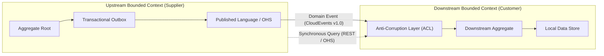
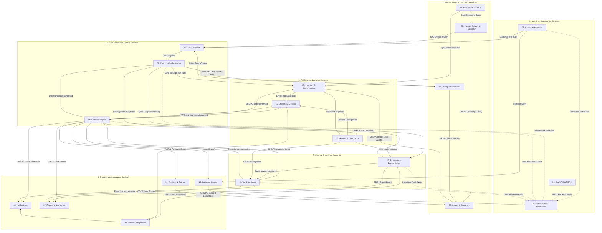
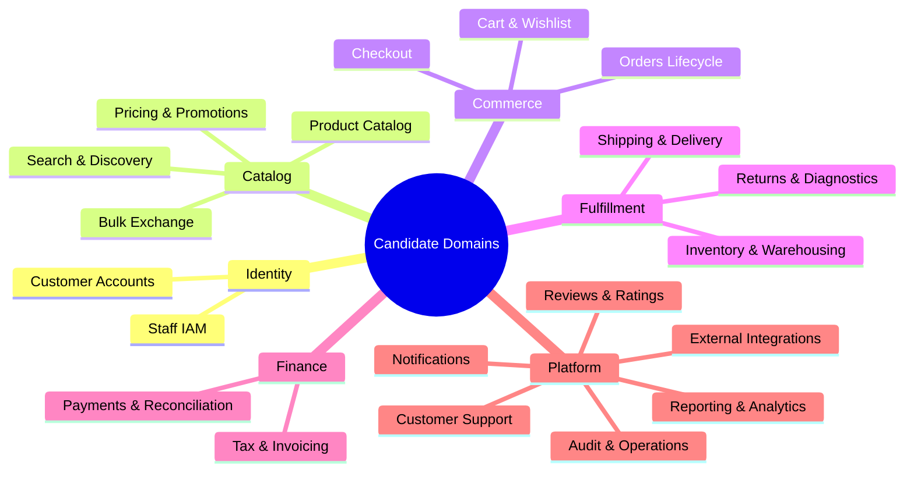
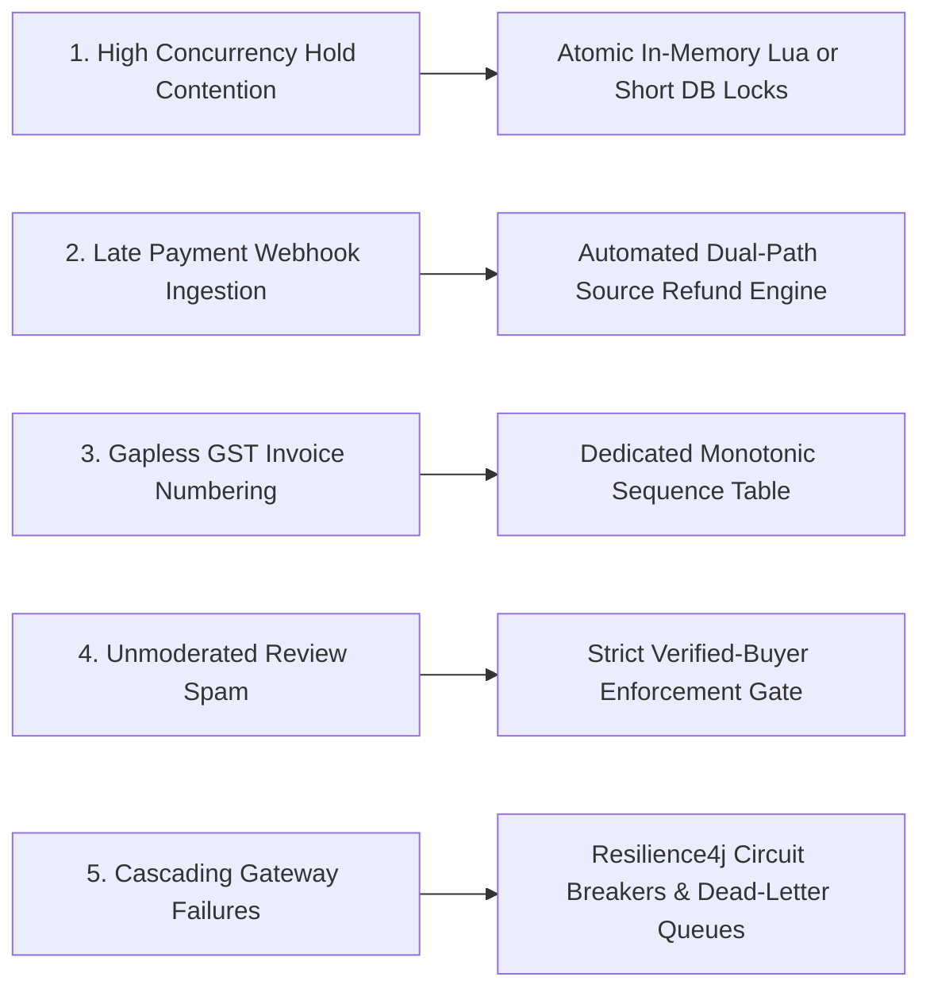

# ARCH-02 — Domain Decomposition, Bounded Contexts, and Ubiquitous Language

> [!WARNING]
> **NON-BINDING — DRAFT ONLY — NOT APPROVED FOR IMPLEMENTATION**  
> This specification is an exploratory Phase 2 architecture drafting instrument prepared under `docs/00-requirements/review/`. It does **not** constitute an approved architecture design, does not commit the enterprise to physical infrastructure or frameworks, and does not authorize software implementation.  
> Transitioning to approved architecture under `docs/01-architecture/ARCH-02-domain-decomposition.md` remains strictly blocked until the authorized Enterprise Business Owner signs off on [`docs/00-requirements/11-review-and-approval.md`](../11-review-and-approval.md) and ratifies the strategic decisions in [`docs/00-requirements/review/executive-decision-register.md`](./executive-decision-register.md).

---

## 1. Document Control

| Document Attribute | Specification Details |
| :--- | :--- |
| **Document ID** | `ARCH-02` |
| **Document Title** | Domain Decomposition, Bounded Contexts, and Ubiquitous Language |
| **Project Name** | Chellaa E-Commerce Platform |
| **Repository & Branch** | [`ezhilselvan1109/chellaa-system`](https://github.com/ezhilselvan1109/chellaa-system) &bull; Branch: `dev` |
| **File Location** | `docs/00-requirements/review/arch-02-domain-decomposition-draft.md` |
| **Version** | `1.0.0-DRAFT` |
| **Lifecycle State** | **`DRAFT_COMPLETE_PENDING_REVIEW`** (Non-Binding Preparatory Draft) |
| **Target Promotion Path** | `docs/01-architecture/ARCH-02-domain-decomposition.md` (Deferred pending formal executive sign-off) |
| **Author Roles** | Principal Domain-Driven Design Architect, Senior Solution Architect, Data Ownership Specialist & Requirements Traceability Engineer |
| **Target Reviewers** | Enterprise Business Owner, Chief Technology Officer, Lead Security Architect, Domain Engineering Leads & Lead Business Analyst |
| **Upstream Baseline Documents** | [`00-business-overview.md`](../00-business-overview.md) through [`11-review-and-approval.md`](../11-review-and-approval.md) |
| **Upstream Architecture Artifacts** | [`arch-01-architecture-overview-draft.md`](./arch-01-architecture-overview-draft.md), [`architecture-discovery-and-domain-boundaries.md`](./architecture-discovery-and-domain-boundaries.md), [`architecture-decision-analysis.md`](./architecture-decision-analysis.md), [`phase-2-document-status-register.md`](./phase-2-document-status-register.md) |

### 1.1 Document Lifecycle & Governance Checkpoint

The Chellaa technical architecture governance framework enforces a strict six-stage lifecycle gate. The current progress status for `ARCH-02` is recorded below:

| Lifecycle Stage | Stage Status | Evaluation Criteria & Operational Verification |
| :--- | :---: | :--- |
| **1. Draft Completion** | **`COMPLETED`** | All 11 required sections, 20 candidate domains, entity ownership matrices, and domain event catalogs are fully specified. |
| **2. Requirements Traceability** | **`PENDING_RECONCILIATION`** — Previous completeness claims are withdrawn until source IDs and bidirectional mappings are verified against the current baseline (17 workflows). |
| **3. Technical Architecture Review** | **`PENDING_REVIEW`** | Subject to peer review by CTO, Lead Security Architect, and Domain Engineering Leads. |
| **4. Business Owner Policy Review** | **`PENDING_REVIEW`** | Subject to review of business invariants, return policies, and commercial decisions ([`ADQ-001`](./executive-decision-register.md#adq-001) through [`ADQ-008`](./executive-decision-register.md#adq-008)). |
| **5. Formal Baseline Approval** | **`NOT_APPROVED`** | Maintained strictly per Document 11 governance gate ([`11-review-and-approval.md`](../11-review-and-approval.md)). |
| **6. Implementation Authorization** | **`NOT_GRANTED`** | Strictly blocked pending Business Owner signature in Document 11 Section 7. |

### 1.2 Revision History

| Version | Date | Author Roles | Description of Changes & Governance Triggers |
| :---: | :---: | :--- | :--- |
| `0.1.0-PLAN` | 2026-10-18 | Principal Software Architect | Preliminary domain modeling plan in [`phase-2-architecture-planning.md`](./phase-2-architecture-planning.md). |
| `0.2.0-DISC` | 2026-10-18 | DDD Specialist & Solution Architect | Initial candidate domain boundary discovery in [`architecture-discovery-and-domain-boundaries.md`](./architecture-discovery-and-domain-boundaries.md). |
| `0.3.0-REG` | 2026-10-24 | Architecture Governance Lead | Detailed specification plan, scope boundaries, and acceptance checklist in [`phase-2-document-status-register.md`](./phase-2-document-status-register.md). |
| `1.0.0-DRAFT` | 2026-10-24 | Principal DDD Architect & Solution Architect | Initial comprehensive draft of `ARCH-02`: 20 candidate domains analyzed, entity ownership matrix, domain event catalog, consistency matrix, context map, and traceability. |

### 1.3 Purpose and Intended Audience

This document establishes the formal Domain-Driven Design (DDD) strategic and tactical decomposition for the Chellaa single-retailer e-commerce platform. It defines the logical bounded contexts, aggregate consistency boundaries, ubiquitous language dictionaries, domain events, authoritative data ownership, and inter-context relationship maps.

**Intended Audience:**
* **Enterprise Business Owner:** To verify that commercial business rules ([`BR-001`](../05-business-rules.md#br-cust-001) to [`BR-055`](../05-business-rules.md#br-ops-001)) and customer journey invariants are accurately captured within domain boundaries.
* **Domain Engineering Leads & Backend Developers:** To establish aggregate boundaries, invariants, and command-event signatures before writing schema migrations or application code.
* **Integration & API Architects:** To govern inter-domain synchronous contracts, asynchronous events, and read-model projections.

---

## 2. Domain Modeling Principles

The domain architecture of the Chellaa platform adheres to the foundational tenets of Strategic and Tactical Domain-Driven Design (DDD), tailored to the operational realities of a high-concurrency, single-retailer electronics enterprise:

### 2.1 Bounded Contexts
A **Bounded Context** is an explicit conceptual and linguistic boundary within which a specific domain model applies. Inside the boundary, all terms in the Ubiquitous Language have an unambiguous, rigorously defined meaning. For example, the term `Product` within the *Product Catalog Domain* represents a rich merchandising entity with marketing copy, multi-media assets, category hierarchies, and technical specification sheets. In contrast, within the *Inventory and Warehouse Operations Domain*, the same physical item is modeled strictly as a `StockKeepingUnit` (SKU) associated with bin locations, available-to-sell counts, and serialized hardware assets (IMEI/Serial numbers). Conflating these two perspectives into a single global model corrupts domain boundaries and creates brittle coupling.

### 2.2 Ubiquitous Language
The **Ubiquitous Language** is a shared, rigorous vocabulary co-created by domain experts (inventory managers, fulfillment specialists, tax accountants, customer support agents) and software architects. It is applied consistently and without synonym drift across business discussions, requirements specifications, code class names, database schemas, domain event payloads, and API contracts. Domain terms defined in [`10-glossary.md`](../10-glossary.md) are strictly binding across all design artifacts.

### 2.3 Aggregate Consistency Boundaries
An **Aggregate** is a cluster of associated domain objects (entities and value objects) that are treated as a single transactional unit for state mutations. Every aggregate has exactly one **Aggregate Root** (an entity with a global identity). The aggregate root acts as the sole gatekeeper for all internal state modifications, ensuring that:
1. External objects may only hold a transient reference to the aggregate root, never to internal entities.
2. Invariants (business rules that must always hold true) are enforced atomically within the boundary of the aggregate root.
3. A single transaction must never modify more than one aggregate instance directly. Cross-aggregate consistency across distinct boundaries is achieved exclusively through asynchronous domain events or orchestrated Saga workflows.

### 2.4 Domain Events as Decoupled Integration Contracts
A **Domain Event** is an immutable record of a significant business occurrence that took place within a domain context. Events are named in the past tense (e.g., `inventory.hold_created`, `order.confirmed`, `tax_invoice.generated`). They encapsulate the minimal necessary logical payload required for downstream contexts to react autonomously without requiring synchronous RPC callbacks to the issuing aggregate.

### 2.5 Ownership and Integration Contracts
Inter-context relationships are governed by explicit Strategic DDD integration patterns:
* **Customer / Supplier (C/S):** Upstream domain (Supplier) must deliver capabilities required by the downstream domain (Customer) within agreed delivery cadences.
* **Conformist (CF):** Downstream domain accepts the domain model of the upstream domain without translation.
* **Open Host Service (OHS) / Published Language (PL):** Upstream provides a stable, documented public API (REST/JSON with RFC 7807) and standard message format (CloudEvents v1.0) for any downstream consumer.
* **Anti-Corruption Layer (ACL):** Downstream implements an explicit translation adapter to isolate its internal domain model from external upstream schema volatility.
* **Shared Kernel (SK):** A strictly controlled, co-owned subset of the domain model shared between two contexts (minimized or eliminated in Chellaa to avoid deployment lock-in).

### 2.6 Core Architectural Invariant: Logical Domains $\ne$ Physical Microservices

> [!IMPORTANT]
> **Decoupled Deployment Invariant for ARCH-02:**  
> The 20 candidate domains identified in this document represent **pure logical boundaries of business responsibility and ubiquitous language**. They do **NOT** mandate or represent an immutable list of 20 separately deployed physical microservices.  
> Conflating logical domain boundaries with physical microservices is a well-known architectural anti-pattern that leads to microservice sprawl, excessive network hops, distributed transaction hell, and high operational overhead.  
> The physical packaging of these 20 logical domains into deployable units (e.g., Modular Monolith vs Coarse-Grained Service Clusters vs Fine-Grained Microservices) is strictly governed by [`ARCH-03`](./phase-2-document-status-register.md) and Architecture Decision [`AD-001`](./architecture-decision-analysis.md). `ARCH-02` establishes conceptual clarity, aggregate invariants, and data ownership independent of the final runtime deployment topology.

---

## 3. Domain Context Map

The strategic Context Map below visualizes the boundaries, upstream/downstream dependencies, and integration relationships across all 20 candidate business domains of the Chellaa platform.

### 3.1 Context Relationship Catalog

The table below explains every boundary connection in the context map, classifying the integration pattern, communication medium, and governance status:

| Upstream Context (Supplier) | Downstream Context (Customer) | Strategic Pattern | Communication Mechanism | Business Purpose & Integration Invariant | Status |
| :--- | :--- | :---: | :---: | :--- | :---: |
| **03. Product Catalog** | **05. Search & Discovery** | OHS / PL | Async Domain Event (`product.published`) | Synchronizes catalog changes to Elasticsearch read-model ($\le 5\text{s}$ SLA per [`NFR-INT-002`](../07-non-functional-requirements.md#nfr-int-002)). | `CONFIRMED` |
| **04. Pricing & Promotions** | **05. Search & Discovery** | OHS / PL | Async Domain Event (`price.updated`) | Updates active selling price on search index cards. | `CONFIRMED` |
| **07. Inventory** | **05. Search & Discovery** | OHS / PL | Async Domain Event (`inventory.stock_level_changed`) | Updates in-stock / out-of-stock search badges and ranking penalties. | `CONFIRMED` |
| **18. Bulk Data Exchange** | **03. Product Catalog** | Command | Chunked Batch RPC / Internal Service Call | Ingests bulk spreadsheet catalog items (up to 5,000 SKUs per [`NFR-PERF-003`](../07-non-functional-requirements.md#nfr-perf-003)). | `CONFIRMED` |
| **18. Bulk Data Exchange** | **07. Inventory** | Command | Chunked Batch RPC / Internal Service Call | Executes batch physical stock count adjustments from warehouse audits. | `CONFIRMED` |
| **01. Customer Accounts** | **06. Cart & Wishlist** | Customer / Supplier | Internal Query / JWT Claims | Associates cart instance with authenticated customer ID upon login merge. | `CONFIRMED` |
| **06. Cart & Wishlist** | **08. Checkout Orchestration** | Conformist | In-Memory / Session DTO | Hands off frozen cart line items to initiate the checkout session. | `CONFIRMED` |
| **08. Checkout Orchestration** | **07. Inventory** | Customer / Supplier | Synchronous RPC (REST/gRPC) | Acquires 15-minute atomic inventory reservation hold ([`BR-INV-001`](../05-business-rules.md#br-inv-001), [`BR-CHK-001`](../05-business-rules.md#br-chk-001)). | `CONFIRMED` |
| **08. Checkout Orchestration** | **04. Pricing & Promotions** | Customer / Supplier | Synchronous RPC (REST/gRPC) | Mandatory server-side price & coupon recalculation ([`BR-CHK-002`](../05-business-rules.md#br-chk-002)). | `CONFIRMED` |
| **08. Checkout Orchestration** | **10. Payments** | Customer / Supplier | Synchronous RPC (REST/gRPC) | Initiates payment gateway transaction intent session ([`FEAT-PAY-001`](../03-business-feature-inventory.md#feat-pay-001)). | `CONFIRMED` |
| **10. Payments** | **08. Checkout Orchestration** | OHS / PL | Async Domain Event (`payment.captured`) | Signals successful customer payment to trigger Saga completion. | `CONFIRMED` |
| **08. Checkout Orchestration** | **09. Orders Lifecycle** | OHS / PL | Async Domain Event (`checkout.completed`) | Creates persistent immutable CustomerOrder aggregate ([`BR-ORD-001`](../05-business-rules.md#br-ord-001)). | `CONFIRMED` |
| **09. Orders Lifecycle** | **07. Inventory** | OHS / PL | Async Domain Event (`order.confirmed`) | Converts temporary 15-minute hold to permanent stock deduction. | `CONFIRMED` |
| **09. Orders Lifecycle** | **11. Tax & Invoicing** | OHS / PL | Async Domain Event (`order.confirmed`) | Triggers sequential tax invoice generation ([`BR-FIN-001`](../05-business-rules.md#br-fin-001)). | `CONFIRMED` |
| **09. Orders Lifecycle** | **12. Shipping & Delivery** | OHS / PL | Async Domain Event (`order.confirmed`) | Initiates consignment fulfillment booking with carrier ([`WF-008`](../06-business-workflows.md#wf-008)). | `CONFIRMED` |
| **09. Orders Lifecycle** | **14. Notifications** | OHS / PL | Async Domain Event (`order.confirmed`) | Dispatches transactional SMS/WhatsApp/Email to customer ([`WF-012`](../06-business-workflows.md#wf-012)). | `CONFIRMED` |
| **12. Shipping & Delivery** | **09. Orders Lifecycle** | OHS / PL | Async Domain Event (`shipment.dispatched`) | Updates order state to `DISPATCHED` with tracking URL ([`WF-009`](../06-business-workflows.md#wf-009)). | `CONFIRMED` |
| **13. Returns & Diagnostics** | **07. Inventory** | OHS / PL | Async Domain Event (`return.graded`) | Routes inspected unit to refurbished stock or scrap quarantine. | `CONFIRMED` |
| **13. Returns & Diagnostics** | **10. Payments** | OHS / PL | Async Domain Event (`return.graded`) | Triggers automated source-instrument refund dispatch ([`BR-RET-003`](../05-business-rules.md#br-ret-003)). | `CONFIRMED` |
| **13. Returns & Diagnostics** | **11. Tax & Invoicing** | OHS / PL | Async Domain Event (`return.graded`) | Issues statutory Credit Note with sequential numbering ([`BR-FIN-002`](../05-business-rules.md#br-fin-002)). | `CONFIRMED` |
| **09. Orders Lifecycle** | **16. Reviews & Ratings** | Customer / Supplier | Internal Query / RPC | Validates verified-buyer status before allowing review post ([`BR-REV-001`](../05-business-rules.md#br-rev-001)). | `CONFIRMED` |
| **16. Reviews & Ratings** | **05. Search & Discovery** | OHS / PL | Async Domain Event (`rating.aggregated`) | Updates average rating and review counts on search index. | `CONFIRMED` |
| **All State Domains** | **20. Audit & Operations** | Published Language | Async Outbox CDC / WORM Append | Transmits state transition log blocks for SHA-256 hash chaining. | `CONFIRMED` |
| **10, 12, 14 Domains** | **19. External Integrations** | Anti-Corruption Layer | Outbound HTTP / Resilience4j | Adapts proprietary domain models to third-party gateway APIs. | `PROPOSED` |

---

## 4. Complete Analysis of the 20 Candidate Domains

Every candidate domain is analyzed across its full architectural specification:

---

### 4.1 Domain 01: Customer Accounts Domain

* **Business Responsibility:** Governs retail customer identity lifecycles, phone OTP authentication, credential verification, profile data, multiple structured shipping addresses, PIN code serviceability validation, and customer-initiated self-service account deactivation.
* **Explicit Exclusions:**
  * Internal staff operator identities and admin permissions (owned strictly by *02. Staff IAM and RBAC* per [`NFR-SEC-002`](../07-non-functional-requirements.md#nfr-sec-002)).
  * Active shopping cart sessions and wishlists (owned by *06. Cart and Wishlist*).
* **Business Capabilities & Requirement IDs:**
  * Capabilities: Customer Registration, OTP Login, Address Management, Account Deactivation.
  * Requirements: [`FEAT-CUST-001`](../03-business-feature-inventory.md#feat-cust-001), [`FEAT-CUST-002`](../03-business-feature-inventory.md#feat-cust-002), [`FEAT-CUST-003`](../03-business-feature-inventory.md#feat-cust-003), [`FR-CUST-001`](../04-functional-requirements.md#fr-cust-001), [`FR-CUST-002`](../04-functional-requirements.md#fr-cust-002), [`FR-CUST-003`](../04-functional-requirements.md#fr-cust-003), [`FR-CUST-004`](../04-functional-requirements.md#fr-cust-004), [`BR-CUST-001`](../05-business-rules.md#br-cust-001), [`BR-CUST-002`](../05-business-rules.md#br-cust-002), [`WF-001`](../06-business-workflows.md#wf-001).
* **Candidate Aggregate Roots, Entities, and Value Objects:**
  * `CustomerProfile` (Aggregate Root): Global identity, primary mobile phone, email, full name, account lifecycle state (`REGISTERED`, `ACTIVE`, `DEACTIVATED`, `SUSPENDED`).
  * `CustomerAddress` (Entity): Address ID, street line 1, street line 2, city, state, postal PIN code, address type (`HOME`, `WORK`), default flag.
  * `PhoneNumber` (Value Object): E.164 validated Indian mobile number (`+91XXXXXXXXXX`).
  * `PostalPinCode` (Value Object): 6-digit Indian postal code.
* **Invariants Owned by the Domain:**
  * Mobile phone number must be unique across all active customer profiles.
  * A customer may have at most one default shipping address and one default billing address.
  * Account deactivation is prohibited if the customer has an active order in `PENDING`, `CONFIRMED`, `PROCESSING`, or `DISPATCHED` state ([`BR-CUST-002`](../05-business-rules.md#br-cust-002)).
* **Commands and Important State Transitions:**
  * `RegisterCustomer(Phone, Name, Email)` $\rightarrow$ Emits `customer.registered`
  * `VerifyPhoneOTP(Phone, OTP)` $\rightarrow$ Transition `REGISTERED` $\rightarrow$ `ACTIVE`
  * `AddCustomerAddress(CustomerID, AddressDetails)` $\rightarrow$ Emits `customer.address_added`
  * `DeactivateAccount(CustomerID, Reason)` $\rightarrow$ Transition `ACTIVE` $\rightarrow$ `DEACTIVATED`
* **Events Published and Consumed:**
  * *Published:* `customer.registered`, `customer.phone_verified`, `customer.address_added`, `customer.address_updated`, `customer.deactivated`.
  * *Consumed:* `order.confirmed` (increments customer order counter), `order.delivered` (checks outstanding orders).
* **Data Ownership:**
  * Authoritative Owner: `customers`, `customer_addresses`, `customer_auth_credentials`, `customer_deactivation_logs`.
* **Consistency Model and Transaction Boundary:**
  * Immediate ACID consistency within the `CustomerProfile` aggregate boundary.
  * Eventual consistency for downstream notification dispatches and search profile synchronization.
* **External Dependencies:**
  * [`DEP-003`](../08-assumptions-dependencies-open-questions.md#dep-003) (Telecom SMS Gateway for OTP transmission).
  * [`ACT-009`](../02-stakeholders-and-actors.md#act-009) (Customer Persona), [`ACT-010`](../02-stakeholders-and-actors.md#act-010) (Guest Persona), [`ACT-013`](../02-stakeholders-and-actors.md#act-013) (Telecom Gateway).
* **Failure and Recovery Concerns:**
  * Telecom SMS Gateway outage: Implement retry with exponential backoff; fallback to WhatsApp/Email OTP channel.
  * PII data leakage: AES-256 field-level encryption for customer address and phone at rest per [`NFR-SEC-003`](../07-non-functional-requirements.md#nfr-sec-003).
* **Open Business and Technical Decisions:**
  * [`ADQ-006`](./executive-decision-register.md#adq-006) / [`OQ-010`](../08-assumptions-dependencies-open-questions.md#oq-010): Primary customer authentication mechanism (Mobile OTP-only vs Hybrid Password + OTP).
* **Validation and Acceptance Criteria:**
  * Customer can register with a 10-digit Indian phone number and receive an OTP in $\le 60\text{ seconds}$.
  * System rejects deactivation requests when active orders exist.

---

### 4.2 Domain 02: Staff IAM and RBAC Domain

* **Business Responsibility:** Manages enterprise administrative staff identities, credential lifecycles, mandatory Multi-Factor Authentication (MFA), role definitions, and fine-grained Role-Based Access Control (RBAC) permission enforcement.
* **Explicit Exclusions:**
  * Retail customer identity and authentication (strictly segregated per [`NFR-SEC-002`](../07-non-functional-requirements.md#nfr-sec-002)).
  * End-user activity auditing (owned by *20. Audit and Platform Operations*).
* **Business Capabilities & Requirement IDs:**
  * Capabilities: Staff Credential Governance, MFA Enforcement, RBAC Permission Matrix, Session Expiry.
  * Requirements: [`FEAT-ADM-001`](../03-business-feature-inventory.md#feat-adm-001), [`FR-SEC-001`](../04-functional-requirements.md#fr-sec-001), [`FR-SEC-002`](../04-functional-requirements.md#fr-sec-002), [`BR-ADM-001`](../05-business-rules.md#br-adm-001), [`BR-ADM-002`](../05-business-rules.md#br-adm-002), [`WF-016`](../06-business-workflows.md#wf-016).
* **Candidate Aggregate Roots, Entities, and Value Objects:**
  * `StaffUser` (Aggregate Root): Staff ID, enterprise email, password hash (Argon2id/bcrypt), account status (`ACTIVE`, `LOCKED`, `SUSPENDED`), assigned roles.
  * `Role` (Entity): Role ID, name (`SUPER_ADMIN`, `CATALOG_MANAGER`, `WAREHOUSE_OPERATOR`, `FINANCE_OFFICER`, `SUPPORT_AGENT`), permission grants.
  * `Permission` (Value Object): Domain-scoped action string (`catalog:write`, `order:cancel`, `refund:approve`, `audit:read`).
  * `MFACredential` (Entity): TOTP secret key, backup recovery codes, device enrollment status.
* **Invariants Owned by the Domain:**
  * Mandatory MFA enforcement: All staff users must complete TOTP second factor before receiving authorization tokens ([`BR-ADM-001`](../05-business-rules.md#br-adm-001)).
  * Inactivity timeout: Staff sessions expire after 15 minutes of inactivity ([`BR-ADM-002`](../05-business-rules.md#br-adm-002)).
  * Staff identity database and token signing keys are strictly isolated from customer auth systems ([`NFR-SEC-002`](../07-non-functional-requirements.md#nfr-sec-002)).
* **Commands and Important State Transitions:**
  * `AuthenticateStaff(Email, Password)` $\rightarrow$ Issue transient challenge token
  * `ValidateStaffMFA(ChallengeToken, TOTPCode)` $\rightarrow$ Issue scoped staff JWT
  * `AssignRole(StaffID, RoleID)` $\rightarrow$ Emits `staff.role_assigned`
  * `RevokeStaffAccess(StaffID, Reason)` $\rightarrow$ Immediate token invalidation via Redis blocklist
* **Events Published and Consumed:**
  * *Published:* `staff.authenticated`, `staff.mfa_enforced`, `staff.role_assigned`, `staff.access_revoked`, `staff.account_locked`.
  * *Consumed:* None (Identity authority).
* **Data Ownership:**
  * Authoritative Owner: `staff_users`, `roles`, `permissions`, `staff_mfa_credentials`, `staff_revoked_tokens`.
* **Consistency Model and Transaction Boundary:**
  * Immediate ACID consistency for role and credential mutations.
  * Sub-second cache invalidation across API Gateway instances upon role revocation.
* **External Dependencies:**
  * [`ACT-001`](../02-stakeholders-and-actors.md#act-001) through [`ACT-008`](../02-stakeholders-and-actors.md#act-008) (Internal Enterprise Staff Personas).
* **Failure and Recovery Concerns:**
  * Brute force attacks: Lock account for 30 minutes after 5 consecutive failed login attempts.
  * Gateway token verification failure: Reject all staff requests with `401 Unauthorized` if signing key rotation fails.
* **Open Business and Technical Decisions:**
  * [`AD-008`](./architecture-decision-analysis.md#ad-008): IAM architecture selection (Internal Custom Spring Security vs External Keycloak/Ory Kratos).
* **Validation and Acceptance Criteria:**
  * Staff cannot execute administrative endpoints without a verified MFA claim in the JWT.
  * Inactive session terminates exactly after 15 minutes.

---

### 4.3 Domain 03: Product Catalog, Categories, Brands and Variants Domain

* **Business Responsibility:** Governs the hierarchical category taxonomy, dynamic category-specific specification attributes, authorized brand master profiles, product parent models, variant matrix modeling (RAM, storage, color combinations), and SKU lifecycle states (`DRAFT`, `PUBLISHED`, `ARCHIVED`).
* **Explicit Exclusions:**
  * Selling price amounts and active discounts (owned strictly by *04. Pricing and Promotions*).
  * Real-time physical inventory balances and reservation holds (owned by *07. Inventory and Warehouse Operations*).
* **Business Capabilities & Requirement IDs:**
  * Capabilities: Product Hierarchy, Category Taxonomy, Dynamic Specs, Brand Governance, Variant Lifecycle.
  * Requirements: [`FEAT-CAT-001`](../03-business-feature-inventory.md#feat-cat-001), [`FEAT-CAT-002`](../03-business-feature-inventory.md#feat-cat-002), [`FEAT-CTG-001`](../03-business-feature-inventory.md#feat-ctg-001), [`FEAT-CTG-002`](../03-business-feature-inventory.md#feat-ctg-002), [`FEAT-BRD-001`](../03-business-feature-inventory.md#feat-brd-001), [`FR-CAT-001`](../04-functional-requirements.md#fr-cat-001), [`FR-CAT-002`](../04-functional-requirements.md#fr-cat-002), [`FR-CAT-003`](../04-functional-requirements.md#fr-cat-003), [`BR-CAT-001`](../05-business-rules.md#br-cat-001), [`BR-CAT-002`](../05-business-rules.md#br-cat-002), [`BR-CAT-003`](../05-business-rules.md#br-cat-003), [`WF-002`](../06-business-workflows.md#wf-002).
* **Candidate Aggregate Roots, Entities, and Value Objects:**
  * `Product` (Aggregate Root): Product ID, title, description, category ID, brand ID, dynamic attributes JSON, status (`DRAFT`, `PUBLISHED`, `ARCHIVED`).
  * `ProductVariant` (Entity): Variant ID, SKU string, variant attributes (e.g., `color: Black`, `ram: 8GB`, `storage: 256GB`), barcode/EAN, weight, dimensions.
  * `Category` (Aggregate Root): Category ID, name, slug, parent category ID, depth level, specification schema template.
  * `Brand` (Aggregate Root): Brand ID, name, slug, logo URL, authorized distributor certificate.
  * `SKUCode` (Value Object): Globally unique stock-keeping unit string ([`BR-CAT-001`](../05-business-rules.md#br-cat-001)).
* **Invariants Owned by the Domain:**
  * Every SKU code must be globally unique across the entire catalog ([`BR-CAT-001`](../05-business-rules.md#br-cat-001)).
  * Category hierarchy cannot exceed 3 nested levels (`Root` $\rightarrow$ `Subcategory` $\rightarrow$ `Leaf`) ([`BR-CAT-002`](../05-business-rules.md#br-cat-002)).
  * A product cannot be moved to `PUBLISHED` state unless all mandatory specification attributes defined by its category template are fully populated ([`BR-CAT-003`](../05-business-rules.md#br-cat-003)).
* **Commands and Important State Transitions:**
  * `CreateProduct(Title, CategoryID, BrandID)` $\rightarrow$ Emits `product.created`
  * `AddVariant(ProductID, SKU, Attributes)` $\rightarrow$ Emits `sku.created`
  * `PublishProduct(ProductID)` $\rightarrow$ Transition `DRAFT` $\rightarrow$ `PUBLISHED` (Emits `product.published`)
  * `ArchiveSKU(SKU)` $\rightarrow$ Transition to `ARCHIVED` (Emits `sku.archived`)
* **Events Published and Consumed:**
  * *Published:* `product.created`, `product.published`, `product.updated`, `sku.created`, `sku.archived`, `category.created`, `brand.created`.
  * *Consumed:* None (Upstream catalog master).
* **Data Ownership:**
  * Authoritative Owner: `categories`, `brands`, `products`, `product_variants`, `category_attribute_schemas`.
* **Consistency Model and Transaction Boundary:**
  * Immediate ACID consistency across a `Product` and its internal `ProductVariant` entities.
  * Eventual consistency for search index projections ($\le 5\text{s}$) and cart item title snapshots.
* **External Dependencies:**
  * [`DEP-005`](../08-assumptions-dependencies-open-questions.md#dep-005) (Master Electronics Product Catalogs & Supplier Technical Specs).
  * [`ACT-003`](../02-stakeholders-and-actors.md#act-003) (Catalog Manager Persona).
* **Failure and Recovery Concerns:**
  * Invalid schema attribute entry: Validated via JSON Schema validators before persisting.
  * Catalog sync latency: Downstream search engines utilize outbox CDC to avoid data loss.
* **Open Business and Technical Decisions:**
  * [`OQ-011`](../08-assumptions-dependencies-open-questions.md#oq-011): Electronics category taxonomy and dynamic specification attributes schema design.
* **Validation and Acceptance Criteria:**
  * System prevents publishing a product with missing mandatory dynamic attributes.
  * Duplicate SKU creation throws an unhandled conflict exception.

---

### 4.4 Domain 04: Pricing and Promotions Domain

* **Business Responsibility:** Governs Maximum Retail Price (MRP) ceilings, active selling prices, cost prices, minimum margin safeguard rules, promotional discount coupon codes, usage caps, non-stacking validation, and pro-rata line-item discount distribution.
* **Explicit Exclusions:**
  * Final checkout total calculation orchestration (orchestrated by *08. Checkout Orchestration*).
  * Invoicing GST tax rate calculation (owned by *11. Tax and Invoicing*).
* **Business Capabilities & Requirement IDs:**
  * Capabilities: Price Ceiling Governance, Active Pricing, Promotional Coupon Engine, Pro-Rata Discount Distribution.
  * Requirements: [`FEAT-PRC-001`](../03-business-feature-inventory.md#feat-prc-001), [`FEAT-PRM-001`](../03-business-feature-inventory.md#feat-prm-001), [`FR-PRC-001`](../04-functional-requirements.md#fr-prc-001), [`FR-PRM-001`](../04-functional-requirements.md#fr-prm-001), [`FR-PRM-002`](../04-functional-requirements.md#fr-prm-002), [`BR-PRC-001`](../05-business-rules.md#br-prc-001), [`BR-PRC-002`](../05-business-rules.md#br-prc-002), [`BR-PRM-001`](../05-business-rules.md#br-prm-001), [`BR-PRM-002`](../05-business-rules.md#br-prm-002), [`WF-005`](../06-business-workflows.md#wf-005), [`WF-011`](../06-business-workflows.md#wf-011).
* **Candidate Aggregate Roots, Entities, and Value Objects:**
  * `PriceRecord` (Aggregate Root): Price ID, SKU string, MRP, selling price, cost price, currency (`INR`), effective start timestamp, effective end timestamp.
  * `Coupon` (Aggregate Root): Coupon code, discount type (`PERCENTAGE`, `FLAT`), discount value, minimum order value (MOV), max discount cap, global usage limit, per-customer usage limit, validity period.
  * `CouponRedemptionLedger` (Entity): Redemption ID, coupon ID, customer ID, order ID, redeemed at timestamp.
  * `Money` (Value Object): Precise integer paise representation to eliminate floating-point rounding errors.
* **Invariants Owned by the Domain:**
  * Selling price cannot exceed MRP under any circumstance ([`BR-PRC-001`](../05-business-rules.md#br-prc-001)).
  * Selling price below cost price requires explicit administrative authorization bypass ([`BR-PRC-002`](../05-business-rules.md#br-prc-002)).
  * Multiple coupon codes cannot be stacked on a single order ([`BR-PRM-001`](../05-business-rules.md#br-prm-001)).
  * Basket discounts must be distributed pro-rata across eligible line items based on item price ratios ([`BR-PRM-002`](../05-business-rules.md#br-prm-002)).
* **Commands and Important State Transitions:**
  * `SetSKUPrice(SKU, MRP, SellingPrice, CostPrice)` $\rightarrow$ Emits `price.updated`
  * `CreateCoupon(Code, DiscountRules)` $\rightarrow$ Emits `coupon.created`
  * `ValidateAndApplyCoupon(CouponCode, CartTotal, CustomerID)` $\rightarrow$ Returns discount breakdown
  * `RecordCouponRedemption(CouponCode, CustomerID, OrderID)` $\rightarrow$ Emits `coupon.redeemed`
* **Events Published and Consumed:**
  * *Published:* `price.updated`, `coupon.created`, `coupon.redeemed`, `coupon.exhausted`.
  * *Consumed:* `order.cancelled` (reverses coupon redemption counter).
* **Data Ownership:**
  * Authoritative Owner: `sku_prices`, `price_history_logs`, `coupons`, `coupon_redemptions`.
* **Consistency Model and Transaction Boundary:**
  * Immediate ACID consistency for coupon redemption counters to prevent double-spending race conditions during flash sales.
  * Eventual consistency for storefront price display caching ($\le 30\text{ seconds}$).
* **External Dependencies:**
  * [`ACT-007`](../02-stakeholders-and-actors.md#act-007) (Finance Officer Persona), [`ACT-008`](../02-stakeholders-and-actors.md#act-008) (Marketing Manager Persona).
* **Failure and Recovery Concerns:**
  * High-concurrency coupon redemption contention: Use optimistic locking or atomic database decrement on coupon budget limits.
* **Open Business and Technical Decisions:**
  * None open (Rules confirmed in BRD Document 05).
* **Validation and Acceptance Criteria:**
  * System rejects any selling price greater than MRP with a `400 Bad Request`.
  * Attempting to apply a second coupon code overwrites or rejects the transaction.

---

### 4.5 Domain 05: Search and Discovery Domain

* **Business Responsibility:** Governs high-performance full-text catalog search, typo-tolerant keyword queries, multi-attribute faceted filtering (brand, category, price range, RAM, storage), search result relevance ranking, and out-of-stock badge demotion.
* **Explicit Exclusions:**
  * Authoritative catalog master record creation or editing (owned by *03. Product Catalog*).
  * Direct price or inventory mutations (Search maintains read-only projections).
* **Business Capabilities & Requirement IDs:**
  * Capabilities: Full-Text Typo Search, Faceted Filtering, Relevance Ranking, Stockout Demotion.
  * Requirements: [`FEAT-SRCH-001`](../03-business-feature-inventory.md#feat-srch-001), [`FR-SRCH-001`](../04-functional-requirements.md#fr-srch-001), [`FR-SRCH-002`](../04-functional-requirements.md#fr-srch-002), [`BR-SRCH-001`](../05-business-rules.md#br-srch-001), [`BR-SRCH-002`](../05-business-rules.md#br-srch-002), [`WF-002`](../06-business-workflows.md#wf-002), [`NFR-PERF-001`](../07-non-functional-requirements.md#nfr-perf-001), [`NFR-INT-002`](../07-non-functional-requirements.md#nfr-int-002).
* **Candidate Aggregate Roots, Entities, and Value Objects:**
  * `SearchCatalogView` (Read-Model Aggregate Root): Product ID, SKU, title, brand name, category path, searchable keywords, dynamic spec facets, current selling price, stock availability status, average review rating.
  * `SearchQueryCriteria` (Value Object): Keyword term, facet filter pairs, price range min/max, sort order (`RELEVANCE`, `PRICE_ASC`, `PRICE_DESC`, `NEWEST`), page offset.
* **Invariants Owned by the Domain:**
  * Catalog read-model updates must reflect changes from upstream catalog, price, and inventory domains within $\le 5\text{ seconds}$ ([`NFR-INT-002`](../07-non-functional-requirements.md#nfr-int-002)).
  * Out-of-stock SKUs must be badged and demoted to the bottom of default search relevance rankings ([`BR-SRCH-001`](../05-business-rules.md#br-srch-001)).
  * Faceted attribute counts must accurately reflect live matching document counts ([`BR-SRCH-002`](../05-business-rules.md#br-srch-002)).
* **Commands and Important State Transitions:**
  * `IndexProductDocument(ProductData)` $\rightarrow$ Update Elasticsearch document
  * `DemoteStockoutProduct(SKU)` $\rightarrow$ Set `in_stock = false` and recalculate ranking
  * `ExecuteSearch(SearchQueryCriteria)` $\rightarrow$ Return paginated matching results
* **Events Published and Consumed:**
  * *Published:* None (Search is a query-optimized read-model).
  * *Consumed:* `product.published`, `product.updated`, `sku.archived`, `price.updated`, `inventory.stock_level_changed`, `rating.aggregated`.
* **Data Ownership:**
  * Authoritative Owner: `search_catalog_index` (Elasticsearch / OpenSearch cluster).
* **Consistency Model and Transaction Boundary:**
  * Eventual consistency ($\le 5\text{ seconds}$ propagation latency).
* **External Dependencies:**
  * [`ACT-009`](../02-stakeholders-and-actors.md#act-009) (Customer), [`ACT-010`](../02-stakeholders-and-actors.md#act-010) (Guest).
* **Failure and Recovery Concerns:**
  * Search cluster degradation: Circuit-break to a cached direct database read fallback with limited filtering to ensure storefront availability.
* **Open Business and Technical Decisions:**
  * [`AD-010`](./architecture-decision-analysis.md#ad-010): Search read-model sync strategy (Transactional Outbox Debezium CDC vs Direct Event Consumer).
* **Validation and Acceptance Criteria:**
  * 95% of catalog search queries execute in $\le 200\text{ ms}$ under 500 RPS load ([`NFR-PERF-001`](../07-non-functional-requirements.md#nfr-perf-001)).
  * Out-of-stock items appear after in-stock items in default search listings.

---

### 4.6 Domain 06: Cart and Wishlist Domain

* **Business Responsibility:** Governs temporary guest shopping carts, persistent authenticated customer carts, guest-to-customer cart line item merging upon authentication, maximum purchase quantity enforcement per SKU, and customer product wishlist management.
* **Explicit Exclusions:**
  * Inventory reservation hold allocation (items in cart do **not** reserve stock; holds occur only at checkout initiation per [`BR-CART-001`](../05-business-rules.md#br-cart-001)).
  * Final order placement and payment execution (owned by *08. Checkout Orchestration*).
* **Business Capabilities & Requirement IDs:**
  * Capabilities: Persistent Customer Cart, Guest Session Cart, Cart Merging, Max SKU Quantity Caps, Wishlist.
  * Requirements: [`FEAT-CART-001`](../03-business-feature-inventory.md#feat-cart-001), [`FEAT-WSH-001`](../03-business-feature-inventory.md#feat-wsh-001), [`FR-CART-001`](../04-functional-requirements.md#fr-cart-001), [`FR-WSH-001`](../04-functional-requirements.md#fr-wsh-001), [`BR-CART-001`](../05-business-rules.md#br-cart-001), [`BR-CART-002`](../05-business-rules.md#br-cart-002), [`WF-001`](../06-business-workflows.md#wf-001).
* **Candidate Aggregate Roots, Entities, and Value Objects:**
  * `ShoppingCart` (Aggregate Root): Cart ID, customer ID (or guest session UUID), status (`ACTIVE`, `CONVERTED`, `ABANDONED`), updated at timestamp.
  * `CartItem` (Entity): Item ID, SKU string, quantity, added at timestamp.
  * `Wishlist` (Aggregate Root): Wishlist ID, customer ID, saved SKU entries.
* **Invariants Owned by the Domain:**
  * Cart items do not hold or reserve physical warehouse inventory ([`BR-CART-001`](../05-business-rules.md#br-cart-001)).
  * Quantity per SKU within a single cart cannot exceed the configured maximum purchase cap (e.g., max 2 units for high-demand smartphones per [`BR-CART-002`](../05-business-rules.md#br-cart-002)).
  * Upon customer login, any items in the guest session cart must be merged into the customer's persistent cart without exceeding maximum quantity caps.
* **Commands and Important State Transitions:**
  * `AddToCart(CartID, SKU, Quantity)` $\rightarrow$ Emits `cart.item_added`
  * `UpdateCartItemQuantity(CartID, SKU, NewQuantity)` $\rightarrow$ Enforces quantity caps
  * `MergeGuestCart(GuestSessionID, CustomerID)` $\rightarrow$ Emits `cart.merged`
  * `ClearCart(CartID)` $\rightarrow$ Emits `cart.cleared`
* **Events Published and Consumed:**
  * *Published:* `cart.item_added`, `cart.item_removed`, `cart.merged`, `cart.cleared`.
  * *Consumed:* `checkout.completed` (triggers cart clearing), `sku.archived` (purges archived item from active carts).
* **Data Ownership:**
  * Authoritative Owner: `shopping_carts`, `cart_items`, `customer_wishlists`.
* **Consistency Model and Transaction Boundary:**
  * Immediate ACID consistency per individual shopping cart aggregate.
* **External Dependencies:**
  * [`ACT-009`](../02-stakeholders-and-actors.md#act-009) (Customer), [`ACT-010`](../02-stakeholders-and-actors.md#act-010) (Guest).
* **Failure and Recovery Concerns:**
  * Session loss: Guest carts stored with 30-day TTL in Redis/database; automatically merged upon authentication.
* **Open Business and Technical Decisions:**
  * None open (Cart behavior confirmed in BRD Document 05).
* **Validation and Acceptance Criteria:**
  * Customer attempting to add a 3rd unit of a capped SKU receives a validation error.
  * Adding an item to a guest cart and subsequently logging in preserves the item in the user's active cart.

---

### 4.7 Domain 07: Inventory and Warehouse Operations Domain

* **Business Responsibility:** Governs Available-to-Sell (ATS) stock computation, 15-minute temporary checkout reservation holds, warehouse bin put-away, high-value serial/IMEI hardware scanning, safety stock buffers, damaged stock quarantine, and physical inventory reconciliations.
* **Explicit Exclusions:**
  * Parcel packing and shipping label carrier assignment (owned by *12. Shipping and Delivery*).
  * Customer return diagnostic grading logic (owned by *13. Returns, Diagnostics and Refunds*).
* **Business Capabilities & Requirement IDs:**
  * Capabilities: Available-to-Sell (ATS) Calculation, 15-Minute Reservation Holds, Serial/IMEI Tracking, Safety Stock Buffers, Warehouse Put-Away.
  * Requirements: [`FEAT-INV-001`](../03-business-feature-inventory.md#feat-inv-001), [`FEAT-INV-002`](../03-business-feature-inventory.md#feat-inv-002), [`FEAT-INV-003`](../03-business-feature-inventory.md#feat-inv-003), [`FR-INV-001`](../04-functional-requirements.md#fr-inv-001), [`FR-INV-002`](../04-functional-requirements.md#fr-inv-002), [`FR-INV-003`](../04-functional-requirements.md#fr-inv-003), [`FR-INV-004`](../04-functional-requirements.md#fr-inv-004), [`BR-INV-001`](../05-business-rules.md#br-inv-001), [`BR-INV-002`](../05-business-rules.md#br-inv-002), [`BR-INV-003`](../05-business-rules.md#br-inv-003), [`BR-INV-004`](../05-business-rules.md#br-inv-004), [`WF-006`](../06-business-workflows.md#wf-006), [`WF-008`](../06-business-workflows.md#wf-008), [`NFR-INT-001`](../07-non-functional-requirements.md#nfr-int-001).
* **Candidate Aggregate Roots, Entities, and Value Objects:**
  * `InventoryLedger` (Aggregate Root): SKU string, physical on-hand quantity, allocated quantity, reserved hold quantity, safety stock threshold, available-to-sell calculated balance ($\text{ATS} = \text{On-Hand} - \text{Allocated} - \text{Holds} - \text{Safety}$).
  * `StockHold` (Entity): Hold ID, checkout session ID, SKU, quantity held, expiration timestamp (current time + 15 mins), status (`ACTIVE`, `COMMITTED`, `RELEASED`, `EXPIRED`).
  * `SerialAssetRecord` (Entity): Serial/IMEI number, SKU, bin location, asset status (`IN_STOCK`, `HOLD`, `PICKED`, `DISPATCHED`, `RETURNED_QUARANTINE`).
* **Invariants Owned by the Domain:**
  * **Zero Overselling Mandate:** Available-to-Sell (ATS) must never drop below zero under any concurrency level ([`NFR-INT-001`](../07-non-functional-requirements.md#nfr-int-001)).
  * Temporary stock reservation holds expire automatically after exactly 15 minutes if payment is not confirmed ([`BR-INV-001`](../05-business-rules.md#br-inv-001), [`BR-CHK-001`](../05-business-rules.md#br-chk-001)).
  * High-value consumer electronics (smartphones, laptops) require unique serial/IMEI scanning during pick-and-pack operations before shipment dispatch ([`BR-INV-002`](../05-business-rules.md#br-inv-002)).
  * Safety stock buffer units cannot be allocated to online checkout holds ([`BR-INV-003`](../05-business-rules.md#br-inv-003)).
* **Commands and Important State Transitions:**
  * `AcquireStockHold(CheckoutSessionID, SKU, Quantity)` $\rightarrow$ Emits `inventory.hold_created`
  * `CommitStockHold(CheckoutSessionID)` $\rightarrow$ Converts hold to permanent allocated deduction (Emits `inventory.stock_deducted`)
  * `ReleaseStockHold(CheckoutSessionID)` $\rightarrow$ Emits `inventory.hold_released`
  * `ScanSerialAsset(SKU, SerialNumber, OrderID)` $\rightarrow$ Transition `PICKED` $\rightarrow$ `ALLOCATED_TO_ORDER`
* **Events Published and Consumed:**
  * *Published:* `inventory.hold_created`, `inventory.hold_released`, `inventory.hold_expired`, `inventory.stock_deducted`, `inventory.stock_level_changed`, `inventory.safety_breached`.
  * *Consumed:* `order.confirmed` (triggers hold commitment), `checkout.aborted` (triggers immediate hold release), `return.graded` (restocks inspected items).
* **Data Ownership:**
  * Authoritative Owner: `inventory_ledgers`, `stock_holds`, `serial_asset_records`, `warehouse_bin_locations`.
* **Consistency Model and Transaction Boundary:**
  * **Strict Immediate ACID Consistency** on `InventoryLedger` and `StockHold` updates to prevent race conditions during flash sales.
* **External Dependencies:**
  * [`DEP-006`](../08-assumptions-dependencies-open-questions.md#dep-006) (Warehouse Physical Infrastructure & Barcode/2D Scanners).
  * [`ACT-004`](../02-stakeholders-and-actors.md#act-004) (Warehouse Operator Persona), [`ACT-005`](../02-stakeholders-and-actors.md#act-005) (Fulfillment Specialist Persona).
* **Failure and Recovery Concerns:**
  * Flash sale database lock contention: Utilize atomic SQL conditional decrements or distributed Redis reservation scripts with DB outbox reconciliation ([`AD-002`](./architecture-decision-analysis.md#ad-002)).
  * Abandoned checkout sessions: Automated background sweeper / TTL expiry worker releases expired holds every 60 seconds.
* **Open Business and Technical Decisions:**
  * [`AD-002`](./architecture-decision-analysis.md#ad-002): Inventory hold mechanism selection (Redis TTL Key Eviction vs PostgreSQL Row Locking).
* **Validation and Acceptance Criteria:**
  * Synthetic 1,000 orders/minute concurrent checkout test demonstrates zero negative ATS inventory records.
  * Expired stock holds release locked stock back to ATS exactly upon timer expiration.

---

### 4.8 Domain 08: Checkout Orchestration Domain

* **Business Responsibility:** Coordinates the end-to-end multi-step checkout state machine, orchestrates atomic inventory reservation holds, enforces mandatory server-side price and coupon recalculation, detects price drift, initiates payment gateway sessions, and executes compensating rollbacks upon payment failure.
* **Explicit Exclusions:**
  * Direct payment gateway card processing (delegated to *10. Payments and Reconciliation*).
  * Post-checkout order shipment fulfillment tracking (owned by *09. Orders Lifecycle*).
* **Business Capabilities & Requirement IDs:**
  * Capabilities: Multi-Step Checkout Flow, Server-Side Recalculation, Price Drift Guard, Reservation Orchestration, Checkout Saga.
  * Requirements: [`FEAT-CHK-001`](../03-business-feature-inventory.md#feat-chk-001), [`FR-CHK-001`](../04-functional-requirements.md#fr-chk-001), [`FR-CHK-002`](../04-functional-requirements.md#fr-chk-002), [`BR-CHK-001`](../05-business-rules.md#br-chk-001), [`BR-CHK-002`](../05-business-rules.md#br-chk-002), [`WF-006`](../06-business-workflows.md#wf-006), [`NFR-PERF-002`](../07-non-functional-requirements.md#nfr-perf-002).
* **Candidate Aggregate Roots, Entities, and Value Objects:**
  * `CheckoutSession` (Aggregate Root): Checkout ID, customer ID, delivery address ID, shipping method, status (`INITIATED`, `HOLD_ACQUIRED`, `PAYMENT_PENDING`, `COMPLETED`, `FAILED`, `ABORTED`), expires at timestamp.
  * `CheckoutSagaState` (Entity): Current Saga step, compensating actions pending, retry counters, external payment intent ID.
* **Invariants Owned by the Domain:**
  * Server-side recalculation mandate: Checkout totals cannot trust client-submitted prices; prices and discounts must be fetched authoritatively from upstream domains ([`BR-CHK-002`](../05-business-rules.md#br-chk-002)).
  * Payment cannot be requested without first successfully acquiring an atomic 15-minute inventory hold ([`BR-CHK-001`](../05-business-rules.md#br-chk-001)).
  * Any price drift between cart submission and checkout confirmation must prompt explicit customer acknowledgement before proceeding.
* **Commands and Important State Transitions:**
  * `InitiateCheckout(CustomerID, AddressID, CartItems)` $\rightarrow$ Emits `checkout.initiated`
  * `RequestPaymentSession(CheckoutID, PaymentMethod)` $\rightarrow$ Emits `checkout.payment_requested`
  * `CompleteCheckout(CheckoutID, PaymentDetails)` $\rightarrow$ Emits `checkout.completed`
  * `AbortCheckout(CheckoutID, Reason)` $\rightarrow$ Triggers hold release compensation
* **Events Published and Consumed:**
  * *Published:* `checkout.initiated`, `checkout.payment_requested`, `checkout.completed`, `checkout.aborted`.
  * *Consumed:* `payment.captured` (triggers checkout completion), `payment.failed` (triggers checkout abort and hold release).
* **Data Ownership:**
  * Authoritative Owner: `checkout_sessions`, `checkout_saga_states`, `checkout_audit_snapshots`.
* **Consistency Model and Transaction Boundary:**
  * Distributed Saga consistency pattern with compensating steps (orchestrated Saga).
* **External Dependencies:**
  * [`ACT-009`](../02-stakeholders-and-actors.md#act-009) (Customer Persona).
* **Failure and Recovery Concerns:**
  * Network partition during payment gateway handshake: Checkout Saga state machine executes idempotent status checks before timing out.
  * Payment timeout: Background sweeper aborts checkout session and releases stock holds.
* **Open Business and Technical Decisions:**
  * [`AD-004`](./architecture-decision-analysis.md#ad-004): Distributed transaction coordination pattern (Orchestrated Saga vs Choreographed Events).
  * [`ADQ-003`](./executive-decision-register.md#adq-003): Cash-on-Delivery (COD) policy and verification limits.
* **Validation and Acceptance Criteria:**
  * Modifying client-side request body payload prices is detected and overridden by authoritative server-side totals.
  * Payment gateway failure releases the associated warehouse inventory hold in $\le 5\text{ seconds}$.

---

### 4.9 Domain 09: Orders Lifecycle Domain

* **Business Responsibility:** Governs the creation of permanent, immutable historical customer order snapshots, the operational order lifecycle state machine (`PENDING` $\rightarrow$ `CONFIRMED` $\rightarrow$ `PROCESSING` $\rightarrow$ `PACKED` $\rightarrow$ `DISPATCHED` $\rightarrow$ `DELIVERED` $\rightarrow$ `CANCELLED`), cancellation window enforcement, and line-item delivery tracking.
* **Explicit Exclusions:**
  * In-flight checkout orchestration (owned by *08. Checkout Orchestration*).
  * Warehouse physical bin picking and serial scanning (owned by *07. Inventory and Warehouse Operations*).
* **Business Capabilities & Requirement IDs:**
  * Capabilities: Order Snapshot Immutability, Lifecycle State Machine, Cancellation Governance, Line-Item Fulfillment Tracking.
  * Requirements: [`FEAT-ORD-001`](../03-business-feature-inventory.md#feat-ord-001), [`FR-ORD-001`](../04-functional-requirements.md#fr-ord-001), [`FR-ORD-002`](../04-functional-requirements.md#fr-ord-002), [`FR-ORD-003`](../04-functional-requirements.md#fr-ord-003), [`BR-ORD-001`](../05-business-rules.md#br-ord-001), [`BR-ORD-002`](../05-business-rules.md#br-ord-002), [`BR-ORD-003`](../05-business-rules.md#br-ord-003), [`BR-ORD-004`](../05-business-rules.md#br-ord-004), [`WF-008`](../06-business-workflows.md#wf-008), [`WF-009`](../06-business-workflows.md#wf-009).
* **Candidate Aggregate Roots, Entities, and Value Objects:**
  * `CustomerOrder` (Aggregate Root): Order ID, customer ID, order date, current state, subtotal, tax amount, discount amount, grand total, delivery address snapshot, cancellation reason.
  * `OrderLineItem` (Entity): Line item ID, SKU, product title snapshot, quantity, unit price snapshot, tax rate snapshot, serial/IMEI number.
  * `OrderStatusHistory` (Entity): Status transition record, previous status, new status, changed by staff/system, timestamp.
* **Invariants Owned by the Domain:**
  * **Order Snapshot Immutability:** Once an order is created, its financial figures, line-item titles, and historical address snapshots are permanently frozen and cannot be updated ([`BR-ORD-001`](../05-business-rules.md#br-ord-001)).
  * Customer-initiated cancellation is strictly prohibited once the order transitions to `PACKED` or `DISPATCHED` status ([`BR-ORD-002`](../05-business-rules.md#br-ord-002)).
  * Order status transitions must strictly follow valid lifecycle state paths ([`BR-ORD-003`](../05-business-rules.md#br-ord-003)).
* **Commands and Important State Transitions:**
  * `CreateOrderFromCheckout(CheckoutSnapshot)` $\rightarrow$ Transition to `CONFIRMED` (Emits `order.confirmed`)
  * `AdvanceOrderStatus(OrderID, NewStatus, StaffID)` $\rightarrow$ Validates state transition graph
  * `CancelOrder(OrderID, Reason)` $\rightarrow$ Transition to `CANCELLED` (Emits `order.cancelled`)
  * `MarkOrderDelivered(OrderID, DeliveryProof)` $\rightarrow$ Transition to `DELIVERED` (Emits `order.delivered`)
* **Events Published and Consumed:**
  * *Published:* `order.created`, `order.confirmed`, `order.processing`, `order.packed`, `order.dispatched`, `order.delivered`, `order.cancelled`.
  * *Consumed:* `checkout.completed` (triggers order creation), `shipment.dispatched` (advances order to `DISPATCHED`), `shipment.delivered` (advances order to `DELIVERED`).
* **Data Ownership:**
  * Authoritative Owner: `customer_orders`, `order_line_items`, `order_status_history`, `order_cancellation_records`.
* **Consistency Model and Transaction Boundary:**
  * Immediate ACID consistency within the `CustomerOrder` aggregate.
  * Downstream fulfillment, tax, and notification operations are triggered asynchronously via domain events.
* **External Dependencies:**
  * [`ACT-005`](../02-stakeholders-and-actors.md#act-005) (Fulfillment Specialist Persona), [`ACT-009`](../02-stakeholders-and-actors.md#act-009) (Customer Persona).
* **Failure and Recovery Concerns:**
  * Duplicate order creation: Enforce unique constraint on checkout session ID in `customer_orders` table.
* **Open Business and Technical Decisions:**
  * None open (Order lifecycle confirmed in BRD Document 06).
* **Validation and Acceptance Criteria:**
  * Customer cancellation request received after order status is `PACKED` is rejected with `409 Conflict`.
  * Historical prices on confirmed orders remain unaffected by subsequent catalog price changes.

---

### 4.10 Domain 10: Payments and Reconciliation Domain

* **Business Responsibility:** Governs payment intent generation, cryptographic webhook signature verification (HMAC-SHA256), late payment webhook dual-path recovery, automated refund dispatches to original source instruments, and daily gateway settlement reconciliation batches.
* **Explicit Exclusions:**
  * Raw cardholder Primary Account Number (PAN) or CVV storage (strictly banned per [`NFR-SEC-001`](../07-non-functional-requirements.md#nfr-sec-001)).
  * General corporate bank ledger bookkeeping.
* **Business Capabilities & Requirement IDs:**
  * Capabilities: Payment Intent Management, Cryptographic Webhook Processing, Late Webhook Recovery, Source Refunds, Gateway Settlement Reconciliation.
  * Requirements: [`FEAT-PAY-001`](../03-business-feature-inventory.md#feat-pay-001), [`FEAT-PAY-002`](../03-business-feature-inventory.md#feat-pay-002), [`FR-PAY-001`](../04-functional-requirements.md#fr-pay-001), [`FR-PAY-002`](../04-functional-requirements.md#fr-pay-002), [`FR-PAY-003`](../04-functional-requirements.md#fr-pay-003), [`BR-PAY-001`](../05-business-rules.md#br-pay-001), [`BR-PAY-002`](../05-business-rules.md#br-pay-002), [`BR-PAY-003`](../05-business-rules.md#br-pay-003), [`WF-007`](../06-business-workflows.md#wf-007), [`WF-012`](../06-business-workflows.md#wf-012), [`NFR-SEC-001`](../07-non-functional-requirements.md#nfr-sec-001).
* **Candidate Aggregate Roots, Entities, and Value Objects:**
  * `PaymentTransaction` (Aggregate Root): Transaction ID, order ID, gateway transaction reference, amount, currency (`INR`), payment method (`UPI`, `CARD`, `NET_BANKING`), status (`INITIATED`, `AUTHORIZED`, `CAPTURED`, `FAILED`, `REFUNDED`), attempt counter.
  * `GatewayWebhookEvent` (Entity): Event ID, raw payload, HMAC signature header, received at timestamp, processing status (`PROCESSED`, `DUPLICATE`, `FAILED`).
  * `SettlementBatch` (Aggregate Root): Batch ID, gateway provider, settlement date, total settled amount, fee deduction, net deposit, reconciliation status.
* **Invariants Owned by the Domain:**
  * **Zero Raw PAN Storage Mandate:** No credit/debit card numbers, CVVs, or bank PINs may be logged or persisted in any database, cache, or log file ([`NFR-SEC-001`](../07-non-functional-requirements.md#nfr-sec-001)).
  * Idempotent webhook processing: Duplicate webhook notifications from payment gateways must be recognized and deduplicated without re-executing business logic ([`BR-PAY-001`](../05-business-rules.md#br-pay-001)).
  * Late Webhook Rule: If a capture webhook arrives after checkout hold expiration, the system must automatically initiate an immediate full refund to the source instrument ([`BR-PAY-002`](../05-business-rules.md#br-pay-002)).
  * Refunds must be credited exclusively to the original payment instrument; cash refunds are strictly prohibited ([`BR-PAY-003`](../05-business-rules.md#br-pay-003)).
* **Commands and Important State Transitions:**
  * `CreatePaymentIntent(OrderID, Amount)` $\rightarrow$ Emits `payment.intent_created`
  * `ProcessGatewayWebhook(Payload, Signature)` $\rightarrow$ Verifies HMAC-SHA256 (Emits `payment.captured` or `payment.failed`)
  * `InitiateSourceRefund(TransactionID, RefundAmount, Reason)` $\rightarrow$ Emits `refund.initiated`
  * `ReconcileSettlementBatch(BatchFile)` $\rightarrow$ Compares gateway records with internal ledger
* **Events Published and Consumed:**
  * *Published:* `payment.intent_created`, `payment.authorized`, `payment.captured`, `payment.failed`, `refund.initiated`, `refund.completed`.
  * *Consumed:* `checkout.payment_requested`, `order.cancelled` (triggers refund), `return.graded` (triggers refund).
* **Data Ownership:**
  * Authoritative Owner: `payment_transactions`, `gateway_webhook_events`, `refund_disbursements`, `settlement_batches`.
* **Consistency Model and Transaction Boundary:**
  * Immediate ACID consistency within `PaymentTransaction`.
  * Strict idempotency enforced via gateway reference unique keys.
* **External Dependencies:**
  * [`DEP-001`](../08-assumptions-dependencies-open-questions.md#dep-001) (Payment Gateway Agreement, e.g., Razorpay).
  * [`ACT-011`](../02-stakeholders-and-actors.md#act-011) (Payment Gateway Persona), [`ACT-007`](../02-stakeholders-and-actors.md#act-007) (Finance Officer Persona).
* **Failure and Recovery Concerns:**
  * Gateway network timeout: Implement dual-path polling worker to query gateway API directly for ambiguous transaction statuses.
  * Late webhook arrival: Automated refund state machine handles expired session captures safely ([`AD-003`](./architecture-decision-analysis.md#ad-003)).
* **Open Business and Technical Decisions:**
  * [`AD-003`](./architecture-decision-analysis.md#ad-003): Late payment webhook reconciliation and automated refund strategy.
* **Validation and Acceptance Criteria:**
  * System rejects unsigned or forged webhook payloads with `401 Unauthorized`.
  * Re-delivering the exact same webhook payload 10 times results in exactly 1 payment capture record.

---

### 4.11 Domain 11: Tax and Invoicing Domain

* **Business Responsibility:** Governs Indian Goods and Services Tax (GST) calculation, intra-state (CGST + SGST) vs inter-state (IGST) tax split determination, monotonic gapless sequential invoice numbering (`INV/YYYY-YY/XXXXX`), immutable invoice PDF rendering, and statutory Credit Note generation (`CN/YYYY-YY/XXXXX`).
* **Explicit Exclusions:**
  * Payment collection processing (owned by *10. Payments and Reconciliation*).
  * Corporate annual financial statement auditing.
* **Business Capabilities & Requirement IDs:**
  * Capabilities: Statutory Indian GST Calculation, Monotonic Gapless Invoicing, Immutable Invoice Archival, Statutory Credit Notes.
  * Requirements: [`FEAT-FIN-001`](../03-business-feature-inventory.md#feat-fin-001), [`FEAT-FIN-002`](../03-business-feature-inventory.md#feat-fin-002), [`FR-FIN-001`](../04-functional-requirements.md#fr-fin-001), [`FR-FIN-002`](../04-functional-requirements.md#fr-fin-002), [`FR-FIN-003`](../04-functional-requirements.md#fr-fin-003), [`BR-FIN-001`](../05-business-rules.md#br-fin-001), [`BR-FIN-002`](../05-business-rules.md#br-fin-002), [`BR-FIN-003`](../05-business-rules.md#br-fin-003), [`WF-007`](../06-business-workflows.md#wf-007), [`WF-010`](../06-business-workflows.md#wf-010).
* **Candidate Aggregate Roots, Entities, and Value Objects:**
  * `TaxInvoice` (Aggregate Root): Invoice ID, sequential invoice number, order ID, enterprise GSTIN, customer delivery state, place of supply, total taxable value, CGST amount, SGST amount, IGST amount, total invoice value, generated timestamp, immutable PDF storage URL.
  * `InvoiceLine` (Entity): Line number, SKU, HSN code, taxable amount, tax rate percentage, tax breakdown.
  * `CreditNote` (Aggregate Root): Credit note ID, sequential credit note number, original invoice ID, return ID, credit taxable value, tax adjustment, issue date.
* **Invariants Owned by the Domain:**
  * **Gapless Monotonic Sequence Mandate:** Tax invoice numbers must increment sequentially without gaps or resets within a financial year ([`BR-FIN-001`](../05-business-rules.md#br-fin-001)).
  * Intra-State vs Inter-State Tax Rule: If customer shipping state matches enterprise warehouse state, charge CGST (9%) + SGST (9%); if different, charge IGST (18%) ([`BR-FIN-003`](../05-business-rules.md#br-fin-003)).
  * Invoices are permanently immutable once generated; corrections must be issued via formal Credit Notes ([`BR-FIN-002`](../05-business-rules.md#br-fin-002)).
* **Commands and Important State Transitions:**
  * `GenerateTaxInvoice(OrderSnapshot)` $\rightarrow$ Allocates next sequential number, emits `invoice.generated`
  * `IssueCreditNote(ReturnSnapshot)` $\rightarrow$ Allocates next sequential credit note number, emits `credit_note.issued`
* **Events Published and Consumed:**
  * *Published:* `invoice.generated`, `credit_note.issued`.
  * *Consumed:* `order.confirmed` (triggers invoice generation), `return.graded` (triggers credit note generation).
* **Data Ownership:**
  * Authoritative Owner: `tax_invoices`, `invoice_lines`, `credit_notes`, `gst_rate_schedules`, `invoice_number_sequences`.
* **Consistency Model and Transaction Boundary:**
  * **Strict Atomic Immediate Consistency** on sequence counter allocation to guarantee gapless numbers.
* **External Dependencies:**
  * [`DEP-004`](../08-assumptions-dependencies-open-questions.md#dep-004) (Enterprise GSTIN Registration Scheme & State Jurisdictions).
  * [`ACT-007`](../02-stakeholders-and-actors.md#act-007) (Finance Officer Persona).
* **Failure and Recovery Concerns:**
  * Sequence allocation deadlocks: Use a dedicated PostgreSQL sequence table with `SELECT FOR UPDATE` inside a short transaction, isolated from external network calls.
* **Open Business and Technical Decisions:**
  * None open (GST rules confirmed in BRD Document 05).
* **Validation and Acceptance Criteria:**
  * Concurrent order invoice generation creates strictly consecutive numbers (`INV/2026-27/00001`, `00002`, `00003`) with zero gaps.
  * Shipping within Tamil Nadu produces equal CGST and SGST splits; shipping to Karnataka produces IGST.

---

### 4.12 Domain 12: Shipping and Delivery Domain

* **Business Responsibility:** Governs carrier consignment booking, Air Waybill (AWB) generation, thermal shipping label generation, delivery PIN code serviceability verification, carrier status webhook ingestion, delivery attempt tracking, and Return-to-Origin (RTO) execution.
* **Explicit Exclusions:**
  * Physical road/air package transit (delegated to 3PL logistics couriers, named shipping provider not selected).
  * Internal warehouse bin picking (owned by *07. Inventory and Warehouse Operations*).
* **Business Capabilities & Requirement IDs:**
  * Capabilities: Carrier Consignment Booking, AWB Generation, Thermal Label Generation, Tracking Webhook Ingestion, RTO Management.
  * Requirements: [`FEAT-SHP-001`](../03-business-feature-inventory.md#feat-shp-001), [`FR-SHP-001`](../04-functional-requirements.md#fr-shp-001), [`FR-SHP-002`](../04-functional-requirements.md#fr-shp-002), [`BR-SHP-001`](../05-business-rules.md#br-shp-001), [`BR-SHP-002`](../05-business-rules.md#br-shp-002), [`WF-008`](../06-business-workflows.md#wf-008), [`WF-009`](../06-business-workflows.md#wf-009).
* **Candidate Aggregate Roots, Entities, and Value Objects:**
  * `Shipment` (Aggregate Root): Shipment ID, order ID, courier partner code, AWB number, shipping label URL, shipment status (`BOOKED`, `MANIFESTED`, `IN_TRANSIT`, `OUT_FOR_DELIVERY`, `DELIVERED`, `RTO_INITIATED`, `RTO_DELIVERED`), attempt count.
  * `ConsignmentTrackingLog` (Entity): Log ID, AWB, status update, location description, checkpoint timestamp.
* **Invariants Owned by the Domain:**
  * Consignment cannot be booked for a postal PIN code not present in the verified serviceability registry ([`BR-SHP-001`](../05-business-rules.md#br-shp-001)).
  * Maximum 3 delivery attempts: A shipment must be marked `RTO_INITIATED` and returned to warehouse after 3 failed delivery attempts ([`BR-SHP-002`](../05-business-rules.md#br-shp-002)).
* **Commands and Important State Transitions:**
  * `BookConsignment(OrderID, Weight, Dimensions)` $\rightarrow$ Emits `shipment.booked`
  * `IngestCarrierTrackingWebhook(AWB, StatusUpdate)` $\rightarrow$ Emits `shipment.in_transit`, `shipment.delivered`, or `shipment.rto_initiated`
* **Events Published and Consumed:**
  * *Published:* `shipment.booked`, `shipment.dispatched`, `shipment.out_for_delivery`, `shipment.delivered`, `shipment.rto_initiated`, `shipment.rto_delivered`.
  * *Consumed:* `order.confirmed` (triggers booking), `return.requested` (books reverse logistics AWB).
* **Data Ownership:**
  * Authoritative Owner: `shipments`, `consignment_tracking_logs`, `pin_code_serviceability_cache`.
* **Consistency Model and Transaction Boundary:**
  * Immediate ACID consistency within the `Shipment` aggregate.
  * Resilient integration with external courier APIs protected by Resilience4j circuit breakers and exponential retry.
* **External Dependencies:**
  * [`DEP-002`](../08-assumptions-dependencies-open-questions.md#dep-002) (shipping lane/provider readiness; provider model requires reconciliation before a named provider is selected).
  * [`ACT-012`](../02-stakeholders-and-actors.md#act-012) (Courier Logistics Partner Persona), [`ACT-005`](../02-stakeholders-and-actors.md#act-005) (Fulfillment Specialist Persona).
* **Failure and Recovery Concerns:**
  * 3PL carrier API outage: Queue booking requests in a dead-letter retry topic; fallback to secondary courier partner.
* **Open Business and Technical Decisions:**
  * None open (Shipping rules confirmed in BRD Document 05).
* **Validation and Acceptance Criteria:**
  * Booking an order destined for an unserviceable PIN code returns an explicit rejection.
  * Receiving a 3rd failed delivery webhook automatically transitions shipment to `RTO_INITIATED`.

---

### 4.13 Domain 13: Returns, Diagnostics and Refunds Domain

* **Business Responsibility:** Governs the customer return request lifecycle, 7-day electronics return policy window enforcement, reverse logistics AWB booking, warehouse technician diagnostic condition grading gate (`UNOPENED`, `FUNCTIONAL`, `DAMAGED`, `COUNTERFEIT`), and automated refund approval gating.
* **Explicit Exclusions:**
  * Direct cash refund payouts (prohibited per [`BR-RET-003`](../05-business-rules.md#br-ret-003)).
  * Warehouse put-away into forward pick bins (delegated to *07. Inventory and Warehouse Operations*).
* **Business Capabilities & Requirement IDs:**
  * Capabilities: 7-Day Return Window Enforcement, Reverse Logistics AWB, Mandatory Diagnostic Grading Gate, Refund Authorization.
  * Requirements: [`FEAT-RET-001`](../03-business-feature-inventory.md#feat-ret-001), [`FR-RET-001`](../04-functional-requirements.md#fr-ret-001), [`FR-RET-002`](../04-functional-requirements.md#fr-ret-002), [`FR-RET-003`](../04-functional-requirements.md#fr-ret-003), [`BR-RET-001`](../05-business-rules.md#br-ret-001), [`BR-RET-002`](../05-business-rules.md#br-ret-002), [`BR-RET-003`](../05-business-rules.md#br-ret-003), [`WF-010`](../06-business-workflows.md#wf-010).
* **Candidate Aggregate Roots, Entities, and Value Objects:**
  * `ReturnRequest` (Aggregate Root): Return ID, order ID, SKU, customer reason, return status (`REQUESTED`, `PICKUP_SCHEDULED`, `RECEIVED_AT_WAREHOUSE`, `DIAGNOSTIC_COMPLETED`, `REFUND_APPROVED`, `REJECTED`), requested timestamp.
  * `DiagnosticInspectionReport` (Entity): Inspection ID, serial/IMEI verified, physical condition grade, operational test pass/fail, technician staff ID, report timestamp.
* **Invariants Owned by the Domain:**
  * **7-Day Return Window Rule:** Return requests must be rejected if submitted more than 7 days following the verified delivery timestamp ([`BR-RET-001`](../05-business-rules.md#br-ret-001)).
  * **Mandatory Diagnostic Gate:** No refund may be approved or disbursed until a certified warehouse technician records a passing diagnostic condition report ([`BR-RET-002`](../05-business-rules.md#br-ret-002)).
  * Refunds must be disbursed strictly to the original payment source instrument; cash payouts are prohibited ([`BR-RET-003`](../05-business-rules.md#br-ret-003)).
* **Commands and Important State Transitions:**
  * `SubmitReturnRequest(OrderID, SKU, Reason)` $\rightarrow$ Emits `return.requested`
  * `RecordDiagnosticReport(ReturnID, ConditionGrade, StaffID)` $\rightarrow$ Emits `return.graded`
  * `ApproveRefund(ReturnID)` $\rightarrow$ Emits `refund.approved`
* **Events Published and Consumed:**
  * *Published:* `return.requested`, `return.received`, `return.graded`, `refund.approved`, `return.rejected`.
  * *Consumed:* `order.delivered` (starts 7-day timer).
* **Data Ownership:**
  * Authoritative Owner: `return_requests`, `diagnostic_inspection_reports`, `return_dispute_logs`.
* **Consistency Model and Transaction Boundary:**
  * Immediate ACID consistency within `ReturnRequest`.
  * Refund execution and inventory restocking are orchestrated asynchronously via domain events.
* **External Dependencies:**
  * [`ACT-004`](../02-stakeholders-and-actors.md#act-004) (Warehouse Operator Persona), [`ACT-006`](../02-stakeholders-and-actors.md#act-006) (Support Agent Persona), [`ACT-009`](../02-stakeholders-and-actors.md#act-009) (Customer Persona).
* **Failure and Recovery Concerns:**
  * Fraudulent return submission: Serial/IMEI verified against original order snapshot before diagnostic sign-off.
* **Open Business and Technical Decisions:**
  * [`ADQ-001`](./executive-decision-register.md#adq-001): Restocking fee deduction policy on opened non-defective electronics.
  * [`ADQ-004`](./executive-decision-register.md#adq-004): Damaged-in-transit liability policy and courier dispute workflows.
* **Validation and Acceptance Criteria:**
  * Return requested on day 8 post-delivery is rejected with an explicit policy window explanation.
  * Refund disbursement API refuses execution without a linked passing diagnostic report ID.

---

### 4.14 Domain 14: Notifications Domain

* **Business Responsibility:** Governs multi-channel transactional messaging dispatches (Transactional SMS, WhatsApp Business API, Transactional Email), TRAI Distributed Ledger Technology (DLT) template registration, message delivery status tracking, and marketing preference bypass for critical transactional notices.
* **Explicit Exclusions:**
  * Promotional marketing email blasts or newsletters.
  * Core synchronous checkout processing (Notifications must execute strictly asynchronously).
* **Business Capabilities & Requirement IDs:**
  * Capabilities: Multi-Channel Messaging, DLT Template Compliance, Asynchronous Alert Queue, Transactional Priority Routing.
  * Requirements: [`FEAT-NTF-001`](../03-business-feature-inventory.md#feat-ntf-001), [`FR-NTF-001`](../04-functional-requirements.md#fr-ntf-001), [`BR-NTF-001`](../05-business-rules.md#br-ntf-001), [`WF-012`](../06-business-workflows.md#wf-012).
* **Candidate Aggregate Roots, Entities, and Value Objects:**
  * `NotificationMessage` (Aggregate Root): Message ID, recipient phone/email, channel (`SMS`, `WHATSAPP`, `EMAIL`), template ID, rendered content, delivery status (`QUEUED`, `SENT`, `DELIVERED`, `FAILED`), sent timestamp.
  * `NotificationTemplate` (Entity): Template ID, DLT registration ID, channel, header, body pattern, variable schema.
* **Invariants Owned by the Domain:**
  * Commercial SMS messages in India must strictly map to registered TRAI DLT template IDs ([`BR-NTF-001`](../05-business-rules.md#br-ntf-001)).
  * Notification dispatch failures must never block or roll back upstream commerce transactions.
* **Commands and Important State Transitions:**
  * `QueueNotification(Recipient, Channel, TemplateID, Variables)` $\rightarrow$ Enqueues message
  * `ProcessOutboundMessage(MessageID)` $\rightarrow$ Emits `notification.dispatched`
  * `RecordDeliveryStatus(MessageID, DeliveryStatus)` $\rightarrow$ Emits `notification.delivered`
* **Events Published and Consumed:**
  * *Published:* `notification.dispatched`, `notification.delivered`, `notification.failed`.
  * *Consumed:* `customer.registered`, `order.confirmed`, `order.dispatched`, `refund.completed`, `ticket.opened`.
* **Data Ownership:**
  * Authoritative Owner: `notification_messages`, `notification_templates`, `notification_delivery_logs`.
* **Consistency Model and Transaction Boundary:**
  * Asynchronous queue-based eventual consistency; completely decoupled from synchronous order paths.
* **External Dependencies:**
  * [`DEP-003`](../08-assumptions-dependencies-open-questions.md#dep-003) (Telecom SMS Gateway & DLT Registration).
  * [`ACT-013`](../02-stakeholders-and-actors.md#act-013) (Telecom Gateway Persona).
* **Failure and Recovery Concerns:**
  * Telecom provider outage: Implement retry with dead-letter queue; fallback from SMS to WhatsApp/Email.
* **Open Business and Technical Decisions:**
  * None open (Notification patterns confirmed in BRD Document 06).
* **Validation and Acceptance Criteria:**
  * An unhandled exception in the SMS gateway has zero impact on order confirmation success.

---

### 4.15 Domain 15: Customer Support Domain

* **Business Responsibility:** Governs customer inquiry tickets, transit damage claims, dispute tracking, agent assignment, resolution history, customer service SLA timers (2-hour initial response for complaints), and customer communication audit logs.
* **Explicit Exclusions:**
  * Direct refund authorization bypass (Support can initiate return requests, but refunds remain gated by *13. Returns, Diagnostics and Refunds*).
* **Business Capabilities & Requirement IDs:**
  * Capabilities: Support Ticket Lifecycle, Transit Dispute Intake, Support SLA Timers, Agent Workflows.
  * Requirements: [`FEAT-SUP-001`](../03-business-feature-inventory.md#feat-sup-001), [`FR-SUP-001`](../04-functional-requirements.md#fr-sup-001), [`BR-SUP-001`](../05-business-rules.md#br-sup-001), [`WF-013`](../06-business-workflows.md#wf-013).
* **Candidate Aggregate Roots, Entities, and Value Objects:**
  * `SupportTicket` (Aggregate Root): Ticket ID, customer ID, order ID, issue category (`DELIVERY_DELAY`, `TRANSIT_DAMAGE`, `DEFECTIVE_PRODUCT`, `BILLING`), priority (`LOW`, `MEDIUM`, `HIGH`, `CRITICAL`), status (`OPEN`, `ASSIGNED`, `IN_PROGRESS`, `RESOLVED`, `CLOSED`), SLA deadline.
  * `TicketMessage` (Entity): Message ID, sender type (`CUSTOMER`, `STAFF`), message body, attachment URLs.
* **Invariants Owned by the Domain:**
  * Critical complaints must receive an initial human agent response in $\le 2\text{ hours}$ ([`BR-SUP-001`](../05-business-rules.md#br-sup-001)).
  * Customer PII displayed to support agents must mask phone numbers and full payment details per privacy regulations.
* **Commands and Important State Transitions:**
  * `OpenTicket(CustomerID, OrderID, Category, Description)` $\rightarrow$ Emits `ticket.opened`
  * `AssignTicket(TicketID, AgentID)` $\rightarrow$ Emits `ticket.assigned`
  * `ResolveTicket(TicketID, ResolutionDetails)` $\rightarrow$ Emits `ticket.resolved`
* **Events Published and Consumed:**
  * *Published:* `ticket.opened`, `ticket.assigned`, `ticket.escalated`, `ticket.resolved`.
  * *Consumed:* `order.delivered` (provides context for dispute claims).
* **Data Ownership:**
  * Authoritative Owner: `support_tickets`, `ticket_messages`, `support_sla_trackers`.
* **Consistency Model and Transaction Boundary:**
  * Immediate ACID consistency within `SupportTicket`.
* **External Dependencies:**
  * [`ACT-006`](../02-stakeholders-and-actors.md#act-006) (Support Agent Persona), [`ACT-009`](../02-stakeholders-and-actors.md#act-009) (Customer Persona).
* **Failure and Recovery Concerns:**
  * High ticket surge during festive deliveries: Automated categorization routing rules balance agent queues.
* **Open Business and Technical Decisions:**
  * None open (Support workflow confirmed in BRD Document 06).
* **Validation and Acceptance Criteria:**
  * High-priority tickets open for $> 120\text{ minutes}$ without response automatically trigger manager escalation alerts.

---

### 4.16 Domain 16: Reviews and Ratings Domain

* **Business Responsibility:** Governs verified-buyer product reviews, 1-to-5 star rating submissions, automated profanity/abuse moderation filtering, manual moderation queues, and product average rating read-model aggregation.
* **Explicit Exclusions:**
  * Unverified anonymous public review submissions (strictly restricted to verified purchasers per [`BR-REV-001`](../05-business-rules.md#br-rev-001)).
* **Business Capabilities & Requirement IDs:**
  * Capabilities: Verified-Buyer Review Submission, Abuse Moderation Queue, Star Rating Aggregation.
  * Requirements: [`FEAT-REV-001`](../03-business-feature-inventory.md#feat-rev-001), [`FR-REV-001`](../04-functional-requirements.md#fr-rev-001), [`BR-REV-001`](../05-business-rules.md#br-rev-001), [`WF-017`](../06-business-workflows.md#wf-017).
* **Candidate Aggregate Roots, Entities, and Value Objects:**
  * `ProductReview` (Aggregate Root): Review ID, SKU, customer ID, order ID, rating (integer 1 to 5), review title, review body, status (`SUBMITTED`, `APPROVED`, `FLAGGED`, `REJECTED`), verified buyer flag.
  * `ReviewRatingAggregate` (Read-Model): SKU, total review count, star distribution (1 to 5), weighted average rating score.
* **Invariants Owned by the Domain:**
  * Only customers with a verified `DELIVERED` order status for the given SKU may submit a product review ([`BR-REV-001`](../05-business-rules.md#br-rev-001)).
  * A customer may submit at most one active review per purchased SKU.
* **Commands and Important State Transitions:**
  * `SubmitReview(CustomerID, OrderID, SKU, Rating, Body)` $\rightarrow$ Emits `review.submitted`
  * `ModerateReview(ReviewID, Decision, StaffID)` $\rightarrow$ Emits `review.approved` or `review.rejected`
* **Events Published and Consumed:**
  * *Published:* `review.submitted`, `review.approved`, `review.rejected`, `rating.aggregated`.
  * *Consumed:* `order.delivered` (activates review submission eligibility for the customer).
* **Data Ownership:**
  * Authoritative Owner: `product_reviews`, `review_moderation_logs`, `sku_rating_aggregates`.
* **Consistency Model and Transaction Boundary:**
  * Immediate ACID consistency for review submission and moderation decisions.
  * Eventual consistency for public catalog average rating score updates ($\le 60\text{ seconds}$).
* **External Dependencies:**
  * [`ACT-009`](../02-stakeholders-and-actors.md#act-009) (Customer Persona).
* **Failure and Recovery Concerns:**
  * Review spam / competitor trolling: Automated regex profanity and link filter holds suspicious reviews for manual staff moderation.
* **Open Business and Technical Decisions:**
  * [`ADQ-005`](./executive-decision-register.md#adq-005): Rating calculation policy (Simple arithmetic mean vs Bayesian weighted average) and spam moderation rules.
* **Validation and Acceptance Criteria:**
  * System rejects review submissions from customers who have not had the specified SKU delivered.

---

### 4.17 Domain 17: Reporting and Analytics Domain

* **Business Responsibility:** Governs executive business intelligence reporting, Gross Merchandise Value (GMV) metrics, net invoiced sales, return and refund take-rates, fast-moving vs dead inventory velocity analytics, and sales reconciliation aggregates.
* **Explicit Exclusions:**
  * Real-time operational transaction processing (Reporting consumes read-only data streams).
* **Business Capabilities & Requirement IDs:**
  * Capabilities: Commercial KPI Aggregation, Sales Reconciliation, Inventory Turnover BI, Exportable Analytics.
  * Requirements: [`FEAT-RPT-001`](../03-business-feature-inventory.md#feat-rpt-001), [`FR-RPT-001`](../04-functional-requirements.md#fr-rpt-001), [`BR-RPT-001`](../05-business-rules.md#br-rpt-001), [`WF-014`](../06-business-workflows.md#wf-014).
* **Candidate Aggregate Roots, Entities, and Value Objects:**
  * `DailySalesReport` (Read Projection): Report date, total orders placed, GMV, total invoiced value, total discounts given, net sales.
  * `ReconciliationSummary` (Read Projection): Date, order payments captured, tax invoices booked, settled funds deposited, unreconciled delta.
* **Invariants Owned by the Domain:**
  * Reporting queries must run against dedicated read replicas or analytics warehouses to guarantee zero resource contention on online transactional checkout paths ([`BR-RPT-001`](../05-business-rules.md#br-rpt-001)).
* **Commands and Important State Transitions:**
  * `GenerateDailyReport(Date)` $\rightarrow$ Emits `report.generated`
  * `ExportSalesData(DateRange, Format)` $\rightarrow$ Returns exportable CSV/Excel file
* **Events Published and Consumed:**
  * *Published:* `report.generated`.
  * *Consumed:* `order.confirmed`, `invoice.generated`, `payment.captured`, `refund.completed`, `inventory.stock_deducted`.
* **Data Ownership:**
  * Authoritative Owner: `daily_sales_aggregates`, `inventory_velocity_reports`, `analytics_staging_views`.
* **Consistency Model and Transaction Boundary:**
  * Eventual consistency generated via streaming Change Data Capture (CDC) or scheduled batch aggregates.
* **External Dependencies:**
  * [`ACT-001`](../02-stakeholders-and-actors.md#act-001) (Business Owner Persona), [`ACT-007`](../02-stakeholders-and-actors.md#act-007) (Finance Officer Persona).
* **Failure and Recovery Concerns:**
  * Long-running analytical query crashes: Completely isolated on read replicas; zero impact on primary database write performance.
* **Open Business and Technical Decisions:**
  * None open (Analytics reporting confirmed in BRD Document 06).
* **Validation and Acceptance Criteria:**
  * Running an annual sales aggregate report creates zero query lock waits on the transactional `customer_orders` table.

---

### 4.18 Domain 18: Bulk Data Exchange Domain

* **Business Responsibility:** Governs asynchronous bulk ingestion of supplier product spreadsheets (up to 5,000 SKUs in $\le 15\text{ minutes}$ per [`NFR-PERF-003`](../07-non-functional-requirements.md#nfr-perf-003)), batch warehouse inventory adjustment uploads, data formatting validation, chunked staging queues, and administrative bulk CSV export generation.
* **Explicit Exclusions:**
  * Direct synchronous table locking during large file uploads.
  * Front-facing single-product catalog forms (owned by *03. Product Catalog*).
* **Business Capabilities & Requirement IDs:**
  * Capabilities: Bulk Catalog Spreadsheet Ingestion, Chunked Staging Queue, Batch Inventory Adjustments, CSV Export Generation.
  * Requirements: [`FEAT-DAT-001`](../03-business-feature-inventory.md#feat-dat-001), [`FR-CAT-001`](../04-functional-requirements.md#fr-cat-001), [`FR-INV-001`](../04-functional-requirements.md#fr-inv-001), [`NFR-PERF-003`](../07-non-functional-requirements.md#nfr-perf-003).
* **Candidate Aggregate Roots, Entities, and Value Objects:**
  * `BulkJobBatch` (Aggregate Root): Batch ID, job type (`CATALOG_IMPORT`, `INVENTORY_ADJUSTMENT`, `ORDER_EXPORT`), file storage URL, total rows, processed rows, failed rows, status (`QUEUED`, `PROCESSING`, `COMPLETED`, `COMPLETED_WITH_ERRORS`, `FAILED`), initiated by staff ID.
  * `BulkRowErrorRecord` (Entity): Error ID, batch ID, row number, SKU, field name, validation error message.
* **Invariants Owned by the Domain:**
  * Bulk catalog import must process a 5,000-SKU file in $\le 15\text{ minutes}$ without degrading live online storefront query response times ([`NFR-PERF-003`](../07-non-functional-requirements.md#nfr-perf-003)).
  * Ingestion must execute in isolated staging tables; invalid rows must be recorded in an error ledger without aborting valid rows in the batch.
* **Commands and Important State Transitions:**
  * `UploadBulkFile(File, JobType, StaffID)` $\rightarrow$ Emits `bulk_job.started`
  * `ProcessBatchChunk(BatchID, ChunkIndex)` $\rightarrow$ Validates and publishes records
  * `FinalizeBatchJob(BatchID)` $\rightarrow$ Emits `bulk_job.completed`
* **Events Published and Consumed:**
  * *Published:* `bulk_job.started`, `bulk_job.chunk_processed`, `bulk_job.completed`, `bulk_job.failed`.
  * *Consumed:* None.
* **Data Ownership:**
  * Authoritative Owner: `bulk_job_batches`, `bulk_row_error_records`, `bulk_staging_tables`.
* **Consistency Model and Transaction Boundary:**
  * Chunked batch transactions (e.g., 200 rows per chunk) with isolated staging persistence.
* **External Dependencies:**
  * [`ACT-003`](../02-stakeholders-and-actors.md#act-003) (Catalog Manager Persona), [`ACT-004`](../02-stakeholders-and-actors.md#act-004) (Warehouse Operator Persona).
* **Failure and Recovery Concerns:**
  * Malformed spreadsheet / corrupted data: Row-level error logging allows operators to download a targeted CSV error report containing only failed rows.
* **Open Business and Technical Decisions:**
  * [`ADQ-002`](./executive-decision-register.md#adq-002): Bulk upload size limits, validation SLAs, and error tolerance thresholds.
* **Validation and Acceptance Criteria:**
  * Ingesting 5,000 SKUs completes within 15 minutes and generates an error report for invalid rows.

---

### 4.19 Domain 19: External Integrations Domain

* **Business Responsibility:** Governs outbound third-party API proxying, protocol adaptation, API secret credential injection, Resilience4j circuit breaking, exponential backoff with jitter, rate limiting, and inbound third-party webhook signature parsing.
* **Explicit Exclusions:**
  * Internal enterprise business domain logic evaluation.
* **Business Capabilities & Requirement IDs:**
  * Capabilities: Outbound Gateway Proxying, Circuit Breaking, Secret Management, Rate Limiting, Signature Verification.
  * Requirements: [`FEAT-INT-001`](../03-business-feature-inventory.md#feat-int-001), [`FR-INT-001`](../04-functional-requirements.md#fr-int-001), [`BR-INT-001`](../05-business-rules.md#br-int-001), [`NFR-AVL-002`](../07-non-functional-requirements.md#nfr-avl-002).
* **Candidate Aggregate Roots, Entities, and Value Objects:**
  * `IntegrationPartnerConfig` (Aggregate Root): Partner code (`RAZORPAY`, `DIRECT_COURIER`, `SHIPPING_AGGREGATOR`, `TELECOM_SMS`, `WHATSAPP_BUSINESS`, `EMAIL_PROVIDER`), endpoint URL, timeout thresholds, circuit breaker state (`CLOSED`, `OPEN`, `HALF_OPEN`), rate limit quota.
  * `OutboundCallAudit` (Entity): Call ID, partner code, endpoint, response status, duration ms, retry attempt.
* **Invariants Owned by the Domain:**
  * Third-party gateway network latency or outages must be isolated via circuit breakers to prevent cascading thread pool exhaustion ([`NFR-AVL-002`](../07-non-functional-requirements.md#nfr-avl-002)).
  * All external webhook signatures must be cryptographically validated before payload propagation ([`BR-INT-001`](../05-business-rules.md#br-int-001)).
* **Commands and Important State Transitions:**
  * `DispatchPartnerCall(PartnerCode, RequestPayload)` $\rightarrow$ Executes call with circuit breaker
  * `TripCircuitBreaker(PartnerCode)` $\rightarrow$ Transition `CLOSED` $\rightarrow$ `OPEN`
* **Events Published and Consumed:**
  * *Published:* `circuit_breaker.opened`, `circuit_breaker.closed`.
  * *Consumed:* Outbound requests from payment, shipping, and notification domains.
* **Data Ownership:**
  * Authoritative Owner: `integration_partner_configs`, `outbound_api_call_logs`.
* **Consistency Model and Transaction Boundary:**
  * Stateless fault-tolerant adapter gateway pattern.
* **External Dependencies:**
  * [`DEP-001`](../08-assumptions-dependencies-open-questions.md#dep-001) (Payment Gateway), [`DEP-002`](../08-assumptions-dependencies-open-questions.md#dep-002) (Courier Aggregator), [`DEP-003`](../08-assumptions-dependencies-open-questions.md#dep-003) (Telecom SMS).
* **Failure and Recovery Concerns:**
  * Upstream third-party degradation: Automatic circuit breaker trip stops calls after 50% failure rate over 20 calls, avoiding thread starvation.
* **Open Business and Technical Decisions:**
  * [`AD-007`](./architecture-decision-analysis.md#ad-007): Gateway pattern and external reverse proxy selection.
* **Validation and Acceptance Criteria:**
  * Injecting a 10-second artificial delay on courier APIs trips the circuit breaker and triggers graceful fallback in $\le 5\text{ seconds}$.

---

### 4.20 Domain 20: Audit and Platform Operations Domain

* **Business Responsibility:** Governs append-only Write-Once-Read-Many (WORM) audit ledgers with SHA-256 cryptographic hash chaining, 8 Financial Years statutory compliance retention ([`BR-DAT-001`](../05-business-rules.md#br-dat-001), [`OQ-020`](../08-assumptions-dependencies-open-questions.md#oq-020)), health check metrics, and W3C distributed trace context propagation (`traceparent`).
* **Explicit Exclusions:**
  * Application business workflow orchestration.
* **Business Capabilities & Requirement IDs:**
  * Capabilities: Cryptographic WORM Audit Trail, 8-Year Compliance Retention, Health Checks, Distributed Trace Propagation.
  * Requirements: [`FEAT-AUD-001`](../03-business-feature-inventory.md#feat-aud-001), [`FEAT-OPS-001`](../03-business-feature-inventory.md#feat-ops-001), [`FR-AUD-001`](../04-functional-requirements.md#fr-aud-001), [`FR-AUD-002`](../04-functional-requirements.md#fr-aud-002), [`BR-AUD-001`](../05-business-rules.md#br-aud-001), [`BR-DAT-001`](../05-business-rules.md#br-dat-001), [`WF-016`](../06-business-workflows.md#wf-016), [`NFR-OBS-001`](../07-non-functional-requirements.md#nfr-obs-001), [`NFR-OBS-002`](../07-non-functional-requirements.md#nfr-obs-002).
* **Candidate Aggregate Roots, Entities, and Value Objects:**
  * `AuditEventBlock` (Aggregate Root): Block ID, sequence index, actor ID, action type, domain entity ID, state diff payload, previous block SHA-256 hash, current block SHA-256 hash, timestamp.
  * `AuditChainAnchor` (Value Object): Daily cryptographic hash anchor written to immutable cloud storage.
* **Invariants Owned by the Domain:**
  * **Immutable WORM Audit Trail:** Audit logs must be append-only; updates and deletions are cryptographically prohibited and detectable ([`BR-AUD-001`](../05-business-rules.md#br-aud-001)).
  * **8-Year Retention Mandate:** Financial and security audit logs must be retained for 8 Financial Years to comply with Indian statutory requirements ([`BR-DAT-001`](../05-business-rules.md#br-dat-001), [`OQ-020`](../08-assumptions-dependencies-open-questions.md#oq-020)).
  * Distributed trace headers (`traceparent`) must be propagated across 100% of inter-service calls ([`NFR-OBS-001`](../07-non-functional-requirements.md#nfr-obs-001)).
* **Commands and Important State Transitions:**
  * `AppendAuditEvent(ActorID, Action, EntityID, Diff)` $\rightarrow$ Calculates SHA-256 and appends block
  * `VerifyChainIntegrity(StartDate, EndDate)` $\rightarrow$ Validates cryptographic hash continuity
* **Events Published and Consumed:**
  * *Published:* `audit_chain.tamper_detected`.
  * *Consumed:* 100% of state-mutating events across all 19 other domains.
* **Data Ownership:**
  * Authoritative Owner: `audit_event_blocks`, `audit_chain_anchors`, `platform_health_metrics`.
* **Consistency Model and Transaction Boundary:**
  * Write-once immutable persistence; asynchronous queue-based ingestion to ensure zero latency overhead on business workflows.
* **External Dependencies:**
  * [`ACT-002`](../02-stakeholders-and-actors.md#act-002) (System Administrator Persona), [`ACT-014`](../02-stakeholders-and-actors.md#act-014) (SRE Persona).
* **Failure and Recovery Concerns:**
  * Tampering attempt: Broken hash chain immediately fires critical security alerts and locks the audit partition.
* **Open Business and Technical Decisions:**
  * [`OQ-020`](../08-assumptions-dependencies-open-questions.md#oq-020) Option A is recorded: retain statutory financial records for eight financial years while supporting appropriate profile/marketing-data anonymization. Archive tiering and technical/legal evidence remain subject to review.
* **Validation and Acceptance Criteria:**
  * Any direct database modification to an existing audit record causes `VerifyChainIntegrity` to fail with exact row location.

---

## 5. Aggregate and Entity Ownership Matrix

To eliminate shared database tables, race conditions, and architectural coupling, every business entity within the Chellaa platform is assigned to exactly **one authoritative owning domain**. 

> [!NOTE]
> Ownership designations derived from candidate modeling are designated **`PROPOSED for Evaluation`** pending final technical review and architecture approval.

| Business Entity | Candidate Authoritative Owning Domain | Ownership Status | Permitted State Mutation Operations | Permitted Read Access Pattern | Invariant Enforced by Owning Domain | Prohibited Anti-Patterns (Banned Actions) |
| :--- | :--- | :---: | :--- | :--- | :--- | :--- |
| **`CustomerProfile`** | 01. Customer Accounts | `PROPOSED for Evaluation` | Register, Update Name/Email, Verify Phone, Deactivate | Sync REST by Customer ID; Token claims | Unique active phone; Deactivation blocked if active orders exist. | Updating profile from Orders or Support domains. |
| **`CustomerAddress`** | 01. Customer Accounts | `PROPOSED for Evaluation` | Add, Edit, Delete, Set Default | Sync REST by Address ID | Max 1 default shipping address; PIN code validated. | Direct mutation during checkout address selection. |
| **`StaffUser`** | 02. Staff IAM and RBAC | `PROPOSED for Evaluation` | Create, Lock, Suspend, Reset Credential | Sync JWT token validation | Mandatory MFA enrollment; 15-minute inactivity session expiry. | Sharing user table with retail customers. |
| **`Role` & `Permission`** | 02. Staff IAM and RBAC | `PROPOSED for Evaluation` | Define Role, Assign Permission, Grant to Staff | Cached in Gateway token validator | Segregated administrative scopes. | Hardcoding permissions in frontend UI bundles. |
| **`Product` & `ProductVariant`** | 03. Product Catalog | `PROPOSED for Evaluation` | Create, Edit, Publish, Archive SKU | Cached Catalog Query; Async CDC Events | Mandatory category specs filled before publishing. | Storing inventory balances or prices in Product table. |
| **`Category` & `Brand`** | 03. Product Catalog | `PROPOSED for Evaluation` | Add, Edit, Re-parent, Activate | Cached Hierarchy Query; Read-Model | Max 3 nested category depth levels; Unique slug. | Cyclic category parenting graphs. |
| **`PriceRecord`** | 04. Pricing & Promotions | `PROPOSED for Evaluation` | Set Selling Price, Update MRP, Schedule Sale | Sync RPC by SKU; Async Price Events | Selling price $\le$ MRP; Below-cost price requires authorization. | Checkout modifying prices directly in database. |
| **`Coupon` & `CouponRedemptionLedger`** | 04. Pricing & Promotions | `PROPOSED for Evaluation` | Create Coupon, Validate, Record Redemption | Sync RPC Validation; Outbox Events | No stacking of multiple coupons; Pro-rata line-item discount distribution. | Cart domain decrementing coupon usage counters. |
| **`ShoppingCart` & `CartItem`** | 06. Cart & Wishlist | `PROPOSED for Evaluation` | Add Item, Update Qty, Merge Guest, Clear | Sync REST Session; Redis In-Memory | Max purchase quantity cap per SKU; No inventory reservation. | Deducting warehouse stock upon cart addition. |
| **`Wishlist`** | 06. Cart & Wishlist | `PROPOSED for Evaluation` | Save Item, Remove Item | Sync REST by Customer ID | Customer-scoped saved items. | Coupling wishlist queries to live checkout flows. |
| **`InventoryLedger`** | 07. Inventory & Warehousing | `PROPOSED for Evaluation` | Adjust Physical Stock, Deduct, Restock | Sync RPC ATS Query; Stock Events | Zero Overselling Mandate: $\text{ATS} \ge 0$ under all concurrency. | Orders domain directly mutating inventory stock rows. |
| **`StockHold`** | 07. Inventory & Warehousing | `PROPOSED for Evaluation` | Create Hold, Commit Hold, Release Hold | Sync RPC; TTL Expiry Worker | 15-minute strict hold duration; Auto-release upon expiry. | Retaining stock holds past 15-minute payment window. |
| **`SerialAssetRecord`** | 07. Inventory & Warehousing | `PROPOSED for Evaluation` | Ingest Serial, Scan to Bin, Allocate to Order | Barcode Scanner RPC; Fulfillment Events | Unique serial/IMEI; Mandatory scan before dispatch. | Generating shipping labels without scanned serial numbers. |
| **`CheckoutSession`** | 08. Checkout Orchestration | `PROPOSED for Evaluation` | Initiate, Transition Step, Complete, Abort | In-Memory / DB State Machine | Server-side price recalculation; 15-min hold prerequisite. | Trusting client-submitted totals or discount figures. |
| **`CheckoutSagaState`** | 08. Checkout Orchestration | `PROPOSED for Evaluation` | Log Saga Step, Record Compensation, Finalize | Internal Saga Orchestrator | Forward progress or automated compensating rollbacks. | Leaving orphaned holds after gateway payment failures. |
| **`CustomerOrder` & `OrderLineItem`** | 09. Orders Lifecycle | `PROPOSED for Evaluation` | Create from Checkout, Advance Status, Cancel | Sync Order Query; Order Events | Permanent Snapshot Immutability; Cancellation blocked after PACKED. | Mutating order prices when catalog prices change. |
| **`PaymentTransaction`** | 10. Payments & Reconciliation | `PROPOSED for Evaluation` | Create Intent, Process Webhook, Capture, Refund | Sync Status RPC; Webhook Ingestion | Idempotent webhook processing; Zero raw PAN storage. | Logging credit card CVVs or cardholder numbers. |
| **`SettlementBatch`** | 10. Payments & Reconciliation | `PROPOSED for Evaluation` | Ingest Batch, Reconcile, Flag Delta | Internal Reconciliation Job | 100% daily transaction reconciliation against bank deposits. | Manual un-audited ledger balance overrides. |
| **`TaxInvoice` & `InvoiceLine`** | 11. Tax & Invoicing | `PROPOSED for Evaluation` | Allocate Number, Generate PDF, Archive | Secure PDF Download; Invoice Events | Monotonic gapless sequential numbering (`INV/YYYY-YY/XXXXX`). | Editing or deleting an invoice after generation. |
| **`CreditNote`** | 11. Tax & Invoicing | `PROPOSED for Evaluation` | Allocate Number, Link to Invoice, Generate | Secure PDF Download; Credit Note Events | Sequential numbering (`CN/YYYY-YY/XXXXX`); Linked to original invoice. | Issuing refund payments without an official Credit Note. |
| **`Shipment` & `ConsignmentTrackingLog`** | 12. Shipping & Delivery | `PROPOSED for Evaluation` | Book Consignment, Generate Label, Ingest Update | Tracking URL; Carrier Webhooks | Max 3 delivery attempts before automatic RTO transition. | Shipping to unverified postal PIN codes. |
| **`ReturnRequest`** | 13. Returns, Diagnostics & Refunds | `PROPOSED for Evaluation` | Submit Request, Schedule Pickup, Close | Sync Customer Status; Return Events | 7-day return policy window; Gated by diagnostic grading. | Issuing cash refunds or bypassing diagnostic reports. |
| **`DiagnosticInspectionReport`** | 13. Returns, Diagnostics & Refunds | `PROPOSED for Evaluation` | Inspect Serial, Grade Condition, Sign Off | Internal Technician UI; Read-only | Certified technician physical and operational grading. | Re-shelving damaged customer returns into brand-new stock. |
| **`NotificationMessage` & `Template`** | 14. Notifications | `PROPOSED for Evaluation` | Format, Enqueue, Dispatch, Log Delivery | Outbound Worker; Status Callback | Commercial SMS must use registered TRAI DLT template IDs. | Blocking synchronous checkout while waiting for SMS delivery. |
| **`SupportTicket` & `TicketMessage`** | 15. Customer Support | `PROPOSED for Evaluation` | Create Ticket, Assign, Add Message, Resolve | Agent Dashboard; Customer View | 2-hour first response SLA for critical complaints; Masked PII. | Direct unmonitored refund execution by support agents. |
| **`ProductReview` & `RatingAggregate`** | 16. Reviews & Ratings | `PROPOSED for Evaluation` | Submit Review, Moderate, Aggregate Score | Public Catalog Query; Search Read-Model | Verified buyers only; Profanity moderation filter. | Allowing anonymous unverified review spam. |
| **`DailySalesReport` & `Summary`** | 17. Reporting & Analytics | `PROPOSED for Evaluation` | Aggregate Daily KPIs, Generate BI Views | Executive BI Dashboard | Queries isolated to read replicas; Zero checkout locking. | Executing analytical reports directly against OLTP write DB. |
| **`BulkJobBatch` & `RowErrorRecord`** | 18. Bulk Data Exchange | `PROPOSED for Evaluation` | Upload File, Chunk Ingest, Log Errors | Async Job Status; CSV Error Export | 5,000 SKUs processed in $\le 15\text{ mins}$; Isolated staging. | Synchronously locking products table during massive uploads. |
| **`IntegrationPartnerConfig`** | 19. External Integrations | `PROPOSED for Evaluation` | Configure Endpoint, Trip Breaker, Update Key | Internal Admin / SRE Config | Resilience4j circuit breaking; Automated credential injection. | Storing third-party API secret tokens in cleartext code. |
| **`AuditEventBlock`** | 20. Audit & Operations | `PROPOSED for Evaluation` | Compute SHA-256 Hash, Chain Block, Append | Immutable Compliance Query | Write-Once-Read-Many (WORM); 8 Financial Years retention. | Modifying or deleting any historical audit log entry. |

---

## 6. Domain Event Catalog

Domain events represent decoupled, immutable integration facts published to the platform event bus (Kafka / RabbitMQ / CloudEvents v1.0). The table below specifies the candidate domain events across the platform:

> [!NOTE]
> Event names and payloads are **proposed drafting specifications**. Final wire contracts, OpenAPI schemas, and JSON schema evolution rules belong to [`ARCH-06`](./phase-2-document-status-register.md).

| Proposed Event Name | Owning Domain | Business Trigger | Logical Payload (Minimum Required Attributes) | Aggregate Root ID | Consumers | Delivery & Ordering Requirement | Sensitive Data Restriction |
| :--- | :--- | :--- | :--- | :--- | :--- | :--- | :--- |
| **`customer.registered`** | 01. Customer Accounts | Customer completes registration form | `{ customer_id, phone, email, registered_at }` | `customer_id` | 14. Notifications, 20. Audit | Partition by `customer_id`; At-least-once | PII (Phone/Email) must be masked in transit logs |
| **`customer.deactivated`** | 01. Customer Accounts | Customer deactivates account | `{ customer_id, reason, deactivated_at }` | `customer_id` | 06. Cart, 14. Notifications, 20. Audit | Partition by `customer_id`; At-least-once | None |
| **`product.published`** | 03. Product Catalog | Catalog manager publishes product | `{ product_id, skus: [...], category_id, brand_id, specs: {...} }` | `product_id` | 05. Search, 17. Analytics | Partition by `product_id`; Ordered stream | Public catalog data; No PII |
| **`sku.archived`** | 03. Product Catalog | SKU reaches end of life | `{ sku, product_id, archived_at }` | `product_id` | 05. Search, 06. Cart, 07. Inventory | Partition by `sku`; Ordered stream | Public catalog data |
| **`price.updated`** | 04. Pricing & Promotions | Selling price or MRP modified | `{ sku, mrp, selling_price, effective_from }` | `price_id` | 05. Search, 06. Cart, 17. Analytics | Partition by `sku`; Sequential ordering | Internal commercial pricing |
| **`coupon.redeemed`** | 04. Pricing & Promotions | Order placed with coupon code | `{ coupon_code, customer_id, order_id, discount_amount }` | `coupon_id` | 17. Analytics, 20. Audit | Partition by `coupon_code`; Strict idempotency | None |
| **`inventory.hold_created`** | 07. Inventory | Customer initiates checkout | `{ hold_id, checkout_id, sku, quantity, expires_at }` | `sku` | 08. Checkout, 20. Audit | Partition by `sku`; At-least-once | Internal inventory balances |
| **`inventory.hold_released`** | 07. Inventory | Hold expires or checkout aborted | `{ hold_id, checkout_id, sku, quantity, released_at }` | `sku` | 08. Checkout, 05. Search | Partition by `sku`; At-least-once | Internal inventory balances |
| **`inventory.stock_deducted`** | 07. Inventory | Order confirmed | `{ order_id, sku, quantity, remaining_ats }` | `sku` | 05. Search, 17. Analytics | Partition by `sku`; Ordered stream | Internal inventory balances |
| **`checkout.initiated`** | 08. Checkout | Customer enters checkout flow | `{ checkout_id, customer_id, cart_snapshot }` | `checkout_id` | 20. Audit | Partition by `checkout_id`; At-least-once | Delivery address PII |
| **`checkout.completed`** | 08. Checkout | Payment captured & Saga finishes | `{ checkout_id, order_id, customer_id, total_amount }` | `checkout_id` | 06. Cart, 09. Orders, 20. Audit | Partition by `checkout_id`; Strict idempotency | Total amount only |
| **`order.confirmed`** | 09. Orders Lifecycle | Order created from checkout | `{ order_id, customer_id, items: [...], total, address }` | `order_id` | 07. Inv, 11. Tax, 12. Ship, 14. Ntf, 20. Audit | Partition by `order_id`; Strict ordering | Address PII encrypted |
| **`order.cancelled`** | 09. Orders Lifecycle | Order cancelled by customer/admin | `{ order_id, reason, cancelled_by, cancelled_at }` | `order_id` | 07. Inv, 10. Pay, 11. Tax, 14. Ntf, 20. Audit | Partition by `order_id`; At-least-once | None |
| **`order.dispatched`** | 09. Orders Lifecycle | Consignment picked up by courier | `{ order_id, awb, courier_partner, tracking_url }` | `order_id` | 14. Notifications, 20. Audit | Partition by `order_id`; At-least-once | Tracking URL |
| **`order.delivered`** | 09. Orders Lifecycle | Courier confirms parcel delivery | `{ order_id, customer_id, delivered_at }` | `order_id` | 13. Returns, 14. Ntf, 16. Reviews | Partition by `order_id`; At-least-once | Starts 7-day return window |
| **`payment.captured`** | 10. Payments | Gateway webhook confirms capture | `{ transaction_id, order_id, amount, gateway_ref }` | `transaction_id` | 08. Checkout, 11. Tax, 20. Audit | Partition by `order_id`; Strict idempotency | Zero PAN / card data |
| **`payment.failed`** | 10. Payments | Gateway webhook reports failure | `{ transaction_id, checkout_id, error_code, reason }` | `transaction_id` | 08. Checkout, 20. Audit | Partition by `checkout_id`; At-least-once | Zero card details |
| **`refund.initiated`** | 10. Payments | Refund dispatched to gateway | `{ refund_id, order_id, amount, source_ref }` | `transaction_id` | 14. Notifications, 17. Analytics | Partition by `order_id`; Strict idempotency | Bank ref only |
| **`invoice.generated`** | 11. Tax & Invoicing | Sequential tax invoice generated | `{ invoice_id, invoice_number, order_id, total, pdf_url }` | `invoice_id` | 09. Orders, 14. Ntf, 17. Analytics, 20. Audit | Partition by `invoice_id`; Monotonic ordering | Financial data |
| **`credit_note.issued`** | 11. Tax & Invoicing | Credit note generated for return | `{ credit_note_id, credit_note_number, invoice_id, total }` | `credit_note_id` | 17. Analytics, 20. Audit | Partition by `credit_note_id`; Monotonic ordering | Financial data |
| **`shipment.dispatched`** | 12. Shipping & Delivery | Carrier manifests parcel | `{ shipment_id, order_id, awb, courier_code }` | `shipment_id` | 09. Orders, 14. Notifications | Partition by `order_id`; At-least-once | None |
| **`shipment.rto_initiated`** | 12. Shipping & Delivery | 3 failed delivery attempts reached | `{ shipment_id, order_id, awb, rto_reason }` | `shipment_id` | 09. Orders, 14. Ntf, 15. Support | Partition by `order_id`; At-least-once | Triggers RTO processing |
| **`return.requested`** | 13. Returns & Diagnostics | Customer requests product return | `{ return_id, order_id, sku, reason, requested_at }` | `return_id` | 12. Ship, 14. Notifications | Partition by `return_id`; At-least-once | Customer return reason |
| **`return.graded`** | 13. Returns & Diagnostics | Technician signs off diagnostic | `{ return_id, condition_grade, serial_number, passed }` | `return_id` | 07. Inv, 10. Pay, 11. Tax, 20. Audit | Partition by `return_id`; Strict ordering | Mandatory refund gate |
| **`rating.aggregated`** | 16. Reviews & Ratings | Review approved, score updated | `{ sku, average_rating, total_reviews }` | `sku` | 05. Search & Discovery | Partition by `sku`; Latest-state overwriting | Public score |
| **`bulk_job.completed`** | 18. Bulk Data Exchange | Bulk catalog import finishes | `{ batch_id, total_rows, success_count, error_count }` | `batch_id` | 14. Notifications, 20. Audit | Partition by `batch_id`; At-least-once | Summary counts only |

---

## 7. Domain Consistency and Failure Matrix

The table below documents the transactional boundaries, consistency expectations, error handling, and compensation mechanics for the 7 critical end-to-end commerce flows:

> [!IMPORTANT]
> **No Global Distributed ACID Transactions:**  
> The Chellaa architecture strictly avoids distributed two-phase commit (2PC) transactions across service boundaries. Global consistency across distinct aggregate roots is achieved exclusively through **local ACID transactions combined with Transactional Outbox event publishing and compensating Saga orchestration**.

| Commerce Workflow & Description | Authoritative Transaction Boundary | Invariant to Guarantee | Sync vs Async Interaction Profile | Target Consistency Model | Retry & Duplicate Handling | Compensation / Reconciliation Mechanism | Primary Failure Scenarios | Relevant BRD Requirements |
| :--- | :--- | :--- | :--- | :--- | :--- | :--- | :--- | :--- |
| **1. 15-Minute Inventory Hold Allocation** | `InventoryLedger` & `StockHold` (Local DB ACID) | Zero Overselling: $\text{ATS} = \text{On-Hand} - \text{Holds} \ge 0$ | Synchronous REST/gRPC from Checkout to Inventory | **Strict Immediate Consistency** | Idempotency token keyed on `checkout_session_id` | Background sweeper auto-releases hold after 15 minutes if uncommitted | High flash sale lock contention; Checkout network disconnect | [`BR-INV-001`](../05-business-rules.md#br-inv-001), [`BR-CHK-001`](../05-business-rules.md#br-chk-001), [`NFR-INT-001`](../07-non-functional-requirements.md#nfr-int-001) |
| **2. Checkout & Payment Intent Creation** | `CheckoutSession` & `CheckoutSagaState` (Local DB ACID) | Server-side price recalculation; Mandatory 15-min hold before payment | Sync RPC for hold & price; Async webhook for capture | **Distributed Saga Eventual Consistency** | Gateway intent reference deduplication | Compensating action: Release inventory hold if payment session fails | Client tampering with request body prices; Payment gateway timeout | [`BR-CHK-002`](../05-business-rules.md#br-chk-002), [`BR-PAY-001`](../05-business-rules.md#br-pay-001), [`WF-006`](../06-business-workflows.md#wf-006) |
| **3. Late Payment Webhook Ingestion** | `PaymentTransaction` (Local DB ACID) | Zero duplicate captures; No unfulfilled captured payments | Inbound asynchronous HTTPS webhook from Gateway | **Immediate Idempotent Consistency** | HMAC-SHA256 verification; Deduplicated on Gateway Payment ID | Dual-Path: If hold active $\rightarrow$ confirm order. If hold expired $\rightarrow$ automated full source refund | Webhook delayed by $> 15\text{ mins}$; Duplicate webhook deliveries | [`BR-PAY-001`](../05-business-rules.md#br-pay-001), [`BR-PAY-002`](../05-business-rules.md#br-pay-002), [`AD-003`](./architecture-decision-analysis.md#ad-003) |
| **4. Gapless Monotonic Tax Invoicing** | `TaxInvoice` & Sequence Counter (Local DB ACID) | Gapless strict monotonic increment (`INV/YYYY-YY/XXXXX`) | Asynchronous consumer triggered by `order.confirmed` | **Strict Immediate Consistency** on sequence allocation | Unique constraint on `invoice_number` and `order_id` | If PDF render fails, retry generation using already allocated number | Database deadlock on sequence row; PDF generator service crash | [`BR-FIN-001`](../05-business-rules.md#br-fin-001), [`BR-FIN-003`](../05-business-rules.md#br-fin-003), [`WF-007`](../06-business-workflows.md#wf-007) |
| **5. Reverse Diagnostic & Refund Gate** | `ReturnRequest` & `DiagnosticReport` (Local DB ACID) | No refund disbursed without passing technician diagnostic grade | Async event `return.graded` triggers `refund.initiated` | **Strict Gated Eventual Consistency** | Unique constraint on `return_id` in refund ledger | Rejection compensation: If item damaged/counterfeit $\rightarrow$ close return without refund | Customer returns empty box; Technician fails to inspect serial/IMEI | [`BR-RET-001`](../05-business-rules.md#br-ret-001), [`BR-RET-002`](../05-business-rules.md#br-ret-002), [`BR-RET-003`](../05-business-rules.md#br-ret-003) |
| **6. Courier 3-Attempt RTO Handling** | `Shipment` aggregate (Local DB ACID) | Exactly 3 delivery attempts before marking parcel `RTO_INITIATED` | Inbound asynchronous HTTPS tracking webhook from 3PL | **Eventual Consistency** | Tracking log deduplicated by `awb` + `checkpoint_time` | Automated restock: When RTO reaches warehouse, technician inspects and restocks | Carrier webhook delivers out-of-order tracking events | [`BR-SHP-001`](../05-business-rules.md#br-shp-001), [`BR-SHP-002`](../05-business-rules.md#br-shp-002), [`WF-009`](../06-business-workflows.md#wf-009) |
| **7. Catalog to Search Read-Model Projection** | Elasticsearch `SearchCatalogView` index | Search reflects catalog/price/stock updates in $\le 5\text{ seconds}$ | Asynchronous Outbox CDC stream from Catalog/Price/Inv | **Eventual Consistency** ($\le 5\text{s}$ SLA) | Elasticsearch document versioning (`_seq_no` / `primary_term`) | Resync worker: Full reindex job re-populates search cluster from DB master | Search cluster network partition; Outbox CDC consumer crash | [`FEAT-SRCH-001`](../03-business-feature-inventory.md#feat-srch-001), [`NFR-INT-002`](../07-non-functional-requirements.md#nfr-int-002), [`AD-010`](./architecture-decision-analysis.md#ad-010) |

---

## 8. Candidate Bounded Context Groupings

To prepare for physical service decomposition in [`ARCH-03`](./phase-2-document-status-register.md) without prematurely prescribing deployable container counts, this section evaluates **six high-cohesion logical bounded context clusters**:

```mermaid
flowchart TD
  subgraph Cluster1["Cluster 1: Identity & Governance"]
    D01["01. Customer Accounts"] --- D02["02. Staff IAM & RBAC"]
  end

  subgraph Cluster2["Cluster 2: Merchandising & Discovery"]
    D03["03. Product Catalog"] --- D04["04. Pricing & Promotions"]
    D04 --- D05["05. Search & Discovery"]
    D03 --- D18["18. Bulk Data Exchange"]
  end

  subgraph Cluster3["Cluster 3: Core Commerce Funnel"]
    D06["06. Cart & Wishlist"] --- D08["08. Checkout Orchestration"]
    D08 --- D09["09. Orders Lifecycle"]
  end

  subgraph Cluster4["Cluster 4: Fulfillment & Logistics"]
    D07["07. Inventory & Warehousing"] --- D12["12. Shipping & Delivery"]
    D12 --- D13["13. Returns & Diagnostics"]
  end

  subgraph Cluster5["Cluster 5: Finance & Legal"]
    D10["10. Payments & Reconciliation"] --- D11["11. Tax & Invoicing"]
  end

  subgraph Cluster6["Cluster 6: Platform & Operations"]
    D14["14. Notifications"] --- D15["15. Customer Support"]
    D15 --- D16["16. Reviews & Ratings"]
    D16 --- D17["17. Reporting & Analytics"]
    D17 --- D19["19. External Integrations"]
    D19 --- D20["20. Audit & Operations"]
  end
```

### 8.1 Cluster Evaluation & Architectural Trade-Offs

| Candidate Cluster | Enclosed Logical Domains | Cohesion & Business Affinity | Coupling & Inter-Context Communication | Failure Isolation & Blast Radius | Deployment Packaging Recommendation |
| :--- | :--- | :--- | :--- | :--- | :--- |
| **Cluster 1: Identity & Governance** | 01. Customer Accounts 02. Staff IAM and RBAC | **High security affinity.** Encapsulates all authentication, password hashing, and token signing. | Low runtime coupling with commerce flows once JWT is issued. High audit event volume to Cluster 6. | Isolating identity prevents credential exposure during application crashes. | Highly suitable as an independent identity cluster with strict database access controls. |
| **Cluster 2: Merchandising & Discovery** | 03. Product Catalog 04. Pricing & Promotions 05. Search & Discovery 18. Bulk Data Exchange | **Extremely high data affinity.** Products, categories, dynamic specs, prices, and bulk ingestion share ubiquitous concepts. | Read-heavy public query traffic. Publishes CDC events to Search. Ingests bulk uploads without locking storefront. | Isolating bulk ingestion prevents memory spikes from impacting live customer browsing. | Candidate for a cohesive Merchandising service cluster; search deployed as an adjacent read-replica engine. |
| **Cluster 3: Core Commerce Funnel** | 06. Cart and Wishlist 08. Checkout Orchestration 09. Orders Lifecycle | **Mission-critical transactional core.** Manages the customer conversion funnel, state machines, and order snapshots. | High-velocity synchronous calls to Inventory (holds) and Payments (intents). Event publication to fulfillment. | Checkout must be shielded from non-critical failures (reviews, notifications, analytics). | Critical high-availability cluster; auto-scaled to handle festive surges (1,000 OPM). |
| **Cluster 4: Fulfillment & Logistics** | 07. Inventory & Warehousing 12. Shipping & Delivery 13. Returns & Diagnostics | **High operational affinity.** Physical warehouse assets, bin put-away, barcode scanning, carrier AWBs, and returns. | Tight local consistency between inventory deduction and dispatch. Asynchronous 3PL carrier webhooks. | Warehouse operations can continue scanning and packing even if customer web storefront is temporarily degraded. | Cohesive warehouse operations cluster; inventory ledger isolated to protect zero-overselling invariant. |
| **Cluster 5: Finance & Invoicing** | 10. Payments & Reconciliation 11. Tax & Invoicing | **High statutory & monetary precision.** Strict double-entry accounting ledgers, gapless GST invoices, and credit notes. | Inbound cryptographic webhooks from Razorpay. Outbox event dispatches to Orders and Notifications. | Financial errors (duplicate captures, skipped invoice numbers) cause legal non-compliance. Strict isolation. | Isolated finance cluster with dedicated database schemas and restricted staff network access. |
| **Cluster 6: Platform & Operations** | 14. Notifications 15. Customer Support 16. Reviews & Ratings 17. Reporting & Analytics 19. External Integrations 20. Audit & Operations | **Asynchronous platform bulkheads.** Cross-cutting peripheral capabilities that support primary business functions. | Purely event-driven consumption. Zero synchronous dependencies on the critical checkout path. | Failure in notifications (SMS provider down) has zero impact on order placement availability. | Decoupled background worker pools and analytical read models. |

---

## 9. Domain-to-Requirement Traceability

The matrix below is a working domain-to-requirement map, not a verified completeness claim. The prior 260-element count is withdrawn; canonical workflow IDs WF-001–WF-017 and the source-to-architecture mappings require full re-verification.

| Candidate Domain | Business Objectives (`OBJ`) | Business Features (`FEAT`) | Functional Requirements (`FR`) | Business Rules (`BR`) | Business Workflows (`WF`) | Non-Functional Requirements (`NFR`) | Assumptions & Dependencies (`ASM`/`DEP`) | Open Decisions (`ADQ`/`AD`/`OQ`) |
| :--- | :--- | :--- | :--- | :--- | :--- | :--- | :--- | :--- |
| **01. Customer Accounts** | [`OBJ-001`](../00-business-overview.md#obj-001), [`008`](../00-business-overview.md#obj-008) | [`FEAT-CUST-001`](../03-business-feature-inventory.md#feat-cust-001)–[`003`](../03-business-feature-inventory.md#feat-cust-003) | [`FR-CUST-001`](../04-functional-requirements.md#fr-cust-001)–[`004`](../04-functional-requirements.md#fr-cust-004) | [`BR-CUST-001`](../05-business-rules.md#br-cust-001), [`002`](../05-business-rules.md#br-cust-002) | [`WF-001`](../06-business-workflows.md#wf-001) | [`NFR-SEC-003`](../07-non-functional-requirements.md#nfr-sec-003) | [`ASM-001`](../08-assumptions-dependencies-open-questions.md#asm-001), [`DEP-003`](../08-assumptions-dependencies-open-questions.md#dep-003) | [`ADQ-006`](./executive-decision-register.md#adq-006), [`OQ-010`](../08-assumptions-dependencies-open-questions.md#oq-010) |
| **02. Staff IAM and RBAC** | [`OBJ-006`](../00-business-overview.md#obj-006) | [`FEAT-ADM-001`](../03-business-feature-inventory.md#feat-adm-001) | [`FR-SEC-001`](../04-functional-requirements.md#fr-sec-001), [`002`](../04-functional-requirements.md#fr-sec-002) | [`BR-ADM-001`](../05-business-rules.md#br-adm-001), [`002`](../05-business-rules.md#br-adm-002) | [`WF-016`](../06-business-workflows.md#wf-016) | [`NFR-SEC-002`](../07-non-functional-requirements.md#nfr-sec-002) | [`ASM-002`](../08-assumptions-dependencies-open-questions.md#asm-002) | [`AD-008`](./architecture-decision-analysis.md#ad-008) |
| **03. Product Catalog** | [`OBJ-002`](../00-business-overview.md#obj-002), [`004`](../00-business-overview.md#obj-004) | [`FEAT-CAT-001`](../03-business-feature-inventory.md#feat-cat-001), [`002`](../03-business-feature-inventory.md#feat-cat-002), [`FEAT-CTG-001`](../03-business-feature-inventory.md#feat-ctg-001), [`002`](../03-business-feature-inventory.md#feat-ctg-002), [`FEAT-BRD-001`](../03-business-feature-inventory.md#feat-brd-001) | [`FR-CAT-001`](../04-functional-requirements.md#fr-cat-001)–[`003`](../04-functional-requirements.md#fr-cat-003) | [`BR-CAT-001`](../05-business-rules.md#br-cat-001)–[`003`](../05-business-rules.md#br-cat-003) | [`WF-002`](../06-business-workflows.md#wf-002) | [`NFR-SCL-002`](../07-non-functional-requirements.md#nfr-scl-002) | [`DEP-005`](../08-assumptions-dependencies-open-questions.md#dep-005) | [`OQ-011`](../08-assumptions-dependencies-open-questions.md#oq-011) |
| **04. Pricing & Promotions** | [`OBJ-002`](../00-business-overview.md#obj-002), [`005`](../00-business-overview.md#obj-005) | [`FEAT-PRC-001`](../03-business-feature-inventory.md#feat-prc-001), [`FEAT-PRM-001`](../03-business-feature-inventory.md#feat-prm-001) | [`FR-PRC-001`](../04-functional-requirements.md#fr-prc-001), [`FR-PRM-001`](../04-functional-requirements.md#fr-prm-001), [`002`](../04-functional-requirements.md#fr-prm-002) | [`BR-PRC-001`](../05-business-rules.md#br-prc-001), [`002`](../05-business-rules.md#br-prc-002), [`BR-PRM-001`](../05-business-rules.md#br-prm-001), [`002`](../05-business-rules.md#br-prm-002) | [`WF-011`](../06-business-workflows.md#wf-011) for promotion redemption; price maintenance is a supporting operation | [`NFR-INT-001`](../07-non-functional-requirements.md#nfr-int-001) | [`ASM-003`](../08-assumptions-dependencies-open-questions.md#asm-003) | [`AD-001`](./architecture-decision-analysis.md#ad-001) |
| **05. Search & Discovery** | [`OBJ-001`](../00-business-overview.md#obj-001), [`002`](../00-business-overview.md#obj-002) | [`FEAT-SRCH-001`](../03-business-feature-inventory.md#feat-srch-001) | [`FR-SRCH-001`](../04-functional-requirements.md#fr-srch-001), [`002`](../04-functional-requirements.md#fr-srch-002) | [`BR-SRCH-001`](../05-business-rules.md#br-srch-001), [`002`](../05-business-rules.md#br-srch-002) | [`WF-004`](../06-business-workflows.md#wf-004) | [`NFR-PERF-001`](../07-non-functional-requirements.md#nfr-perf-001), [`NFR-INT-002`](../07-non-functional-requirements.md#nfr-int-002) | [`ASM-004`](../08-assumptions-dependencies-open-questions.md#asm-004) | [`AD-010`](./architecture-decision-analysis.md#ad-010), [`OQ-011`](../08-assumptions-dependencies-open-questions.md#oq-011) |
| **06. Cart & Wishlist** | [`OBJ-001`](../00-business-overview.md#obj-001) | [`FEAT-CART-001`](../03-business-feature-inventory.md#feat-cart-001), [`FEAT-WSH-001`](../03-business-feature-inventory.md#feat-wsh-001) | [`FR-CART-001`](../04-functional-requirements.md#fr-cart-001), [`FR-WSH-001`](../04-functional-requirements.md#fr-wsh-001) | [`BR-CART-001`](../05-business-rules.md#br-cart-001), [`002`](../05-business-rules.md#br-cart-002) | [`WF-005`](../06-business-workflows.md#wf-005) | [`NFR-PERF-002`](../07-non-functional-requirements.md#nfr-perf-002) | [`ASM-001`](../08-assumptions-dependencies-open-questions.md#asm-001) | [`AD-011`](./architecture-decision-analysis.md#ad-011) |
| **07. Inventory & Warehousing** | [`OBJ-003`](../00-business-overview.md#obj-003), [`004`](../00-business-overview.md#obj-004) | [`FEAT-INV-001`](../03-business-feature-inventory.md#feat-inv-001)–[`003`](../03-business-feature-inventory.md#feat-inv-003) | [`FR-INV-001`](../04-functional-requirements.md#fr-inv-001)–[`004`](../04-functional-requirements.md#fr-inv-004) | [`BR-INV-001`](../05-business-rules.md#br-inv-001)–[`004`](../05-business-rules.md#br-inv-004) | [`WF-003`](../06-business-workflows.md#wf-003), [`WF-006`](../06-business-workflows.md#wf-006), [`WF-008`](../06-business-workflows.md#wf-008), [`WF-009`](../06-business-workflows.md#wf-009) | [`NFR-INT-001`](../07-non-functional-requirements.md#nfr-int-001) | [`ASM-007`](../08-assumptions-dependencies-open-questions.md#asm-007), [`DEP-006`](../08-assumptions-dependencies-open-questions.md#dep-006) | [`AD-002`](./architecture-decision-analysis.md#ad-002), [`ADQ-007`](./executive-decision-register.md#adq-007) |
| **08. Checkout Orchestration** | [`OBJ-001`](../00-business-overview.md#obj-001), [`003`](../00-business-overview.md#obj-003) | [`FEAT-CHK-001`](../03-business-feature-inventory.md#feat-chk-001) | [`FR-CHK-001`](../04-functional-requirements.md#fr-chk-001), [`002`](../04-functional-requirements.md#fr-chk-002) | [`BR-CHK-001`](../05-business-rules.md#br-chk-001), [`002`](../05-business-rules.md#br-chk-002) | [`WF-006`](../06-business-workflows.md#wf-006) | [`NFR-PERF-002`](../07-non-functional-requirements.md#nfr-perf-002) | [`ASM-005`](../08-assumptions-dependencies-open-questions.md#asm-005) | [`AD-004`](./architecture-decision-analysis.md#ad-004), [`ADQ-003`](./executive-decision-register.md#adq-003) |
| **09. Orders Lifecycle** | [`OBJ-001`](../00-business-overview.md#obj-001), [`004`](../00-business-overview.md#obj-004) | [`FEAT-ORD-001`](../03-business-feature-inventory.md#feat-ord-001) | [`FR-ORD-001`](../04-functional-requirements.md#fr-ord-001)–[`003`](../04-functional-requirements.md#fr-ord-003) | [`BR-ORD-001`](../05-business-rules.md#br-ord-001)–[`004`](../05-business-rules.md#br-ord-004) | [`WF-008`](../06-business-workflows.md#wf-008), [`WF-009`](../06-business-workflows.md#wf-009) | [`NFR-AVL-001`](../07-non-functional-requirements.md#nfr-avl-001) | [`ASM-005`](../08-assumptions-dependencies-open-questions.md#asm-005) | [`AD-001`](./architecture-decision-analysis.md#ad-001) |
| **10. Payments & Reconciliation** | [`OBJ-005`](../00-business-overview.md#obj-005), [`006`](../00-business-overview.md#obj-006) | [`FEAT-PAY-001`](../03-business-feature-inventory.md#feat-pay-001), [`002`](../03-business-feature-inventory.md#feat-pay-002) | [`FR-PAY-001`](../04-functional-requirements.md#fr-pay-001)–[`003`](../04-functional-requirements.md#fr-pay-003) | [`BR-PAY-001`](../05-business-rules.md#br-pay-001)–[`003`](../05-business-rules.md#br-pay-003) | [`WF-007`](../06-business-workflows.md#wf-007), [`WF-014`](../06-business-workflows.md#wf-014) | [`NFR-SEC-001`](../07-non-functional-requirements.md#nfr-sec-001) | [`DEP-001`](../08-assumptions-dependencies-open-questions.md#dep-001) | [`AD-003`](./architecture-decision-analysis.md#ad-003) |
| **11. Tax & Invoicing** | [`OBJ-005`](../00-business-overview.md#obj-005) | [`FEAT-FIN-001`](../03-business-feature-inventory.md#feat-fin-001), [`002`](../03-business-feature-inventory.md#feat-fin-002) | [`FR-FIN-001`](../04-functional-requirements.md#fr-fin-001)–[`003`](../04-functional-requirements.md#fr-fin-003) | [`BR-FIN-001`](../05-business-rules.md#br-fin-001)–[`003`](../05-business-rules.md#br-fin-003) | [`WF-007`](../06-business-workflows.md#wf-007), [`WF-010`](../06-business-workflows.md#wf-010) | [`NFR-INT-001`](../07-non-functional-requirements.md#nfr-int-001) | [`DEP-004`](../08-assumptions-dependencies-open-questions.md#dep-004) | [`AD-005`](./architecture-decision-analysis.md#ad-005) |
| **12. Shipping & Delivery** | [`OBJ-004`](../00-business-overview.md#obj-004) | [`FEAT-SHP-001`](../03-business-feature-inventory.md#feat-shp-001) | [`FR-SHP-001`](../04-functional-requirements.md#fr-shp-001), [`002`](../04-functional-requirements.md#fr-shp-002) | [`BR-SHP-001`](../05-business-rules.md#br-shp-001), [`002`](../05-business-rules.md#br-shp-002) | [`WF-008`](../06-business-workflows.md#wf-008), [`WF-015`](../06-business-workflows.md#wf-015) for provider failure/recovery | [`NFR-AVL-002`](../07-non-functional-requirements.md#nfr-avl-002) | [`DEP-002`](../08-assumptions-dependencies-open-questions.md#dep-002) | [`AD-007`](./architecture-decision-analysis.md#ad-007) |
| **13. Returns & Diagnostics** | [`OBJ-004`](../00-business-overview.md#obj-004), [`007`](../00-business-overview.md#obj-007) | [`FEAT-RET-001`](../03-business-feature-inventory.md#feat-ret-001) | [`FR-RET-001`](../04-functional-requirements.md#fr-ret-001)–[`003`](../04-functional-requirements.md#fr-ret-003) | [`BR-RET-001`](../05-business-rules.md#br-ret-001)–[`003`](../05-business-rules.md#br-ret-003) | [`WF-010`](../06-business-workflows.md#wf-010) | [`NFR-SEC-003`](../07-non-functional-requirements.md#nfr-sec-003) | [`ASM-006`](../08-assumptions-dependencies-open-questions.md#asm-006) | [`ADQ-001`](./executive-decision-register.md#adq-001), [`ADQ-004`](./executive-decision-register.md#adq-004) |
| **14. Notifications** | [`OBJ-001`](../00-business-overview.md#obj-001) | [`FEAT-NTF-001`](../03-business-feature-inventory.md#feat-ntf-001) | [`FR-NTF-001`](../04-functional-requirements.md#fr-ntf-001) | [`BR-NTF-001`](../05-business-rules.md#br-ntf-001) | [`WF-012`](../06-business-workflows.md#wf-012) | [`NFR-AVL-002`](../07-non-functional-requirements.md#nfr-avl-002) | [`DEP-003`](../08-assumptions-dependencies-open-questions.md#dep-003) | [`AD-009`](./architecture-decision-analysis.md#ad-009) |
| **15. Customer Support** | [`OBJ-007`](../00-business-overview.md#obj-007) | [`FEAT-SUP-001`](../03-business-feature-inventory.md#feat-sup-001) | [`FR-SUP-001`](../04-functional-requirements.md#fr-sup-001) | [`BR-SUP-001`](../05-business-rules.md#br-sup-001) | [`WF-013`](../06-business-workflows.md#wf-013) | [`NFR-SEC-003`](../07-non-functional-requirements.md#nfr-sec-003) | [`ASM-008`](../08-assumptions-dependencies-open-questions.md#asm-008) | [`ADQ-004`](./executive-decision-register.md#adq-004) |
| **16. Reviews & Ratings** | [`OBJ-001`](../00-business-overview.md#obj-001), [`007`](../00-business-overview.md#obj-007) | [`FEAT-REV-001`](../03-business-feature-inventory.md#feat-rev-001) | [`FR-REV-001`](../04-functional-requirements.md#fr-rev-001) | [`BR-REV-001`](../05-business-rules.md#br-rev-001) | [`WF-017`](../06-business-workflows.md#wf-017) | [`NFR-PERF-001`](../07-non-functional-requirements.md#nfr-perf-001) | [`ASM-001`](../08-assumptions-dependencies-open-questions.md#asm-001) | [`ADQ-005`](./executive-decision-register.md#adq-005) |
| **17. Reporting & Analytics** | [`OBJ-008`](../00-business-overview.md#obj-008), [`010`](../00-business-overview.md#obj-010) | [`FEAT-RPT-001`](../03-business-feature-inventory.md#feat-rpt-001) | [`FR-RPT-001`](../04-functional-requirements.md#fr-rpt-001) | [`BR-RPT-001`](../05-business-rules.md#br-rpt-001) | [`WF-014`](../06-business-workflows.md#wf-014) | [`NFR-SCL-001`](../07-non-functional-requirements.md#nfr-scl-001) | [`ASM-009`](../08-assumptions-dependencies-open-questions.md#asm-009) | [`AD-005`](./architecture-decision-analysis.md#ad-005) |
| **18. Bulk Data Exchange** | [`OBJ-002`](../00-business-overview.md#obj-002), [`004`](../00-business-overview.md#obj-004) | [`FEAT-DAT-001`](../03-business-feature-inventory.md#feat-dat-001) | [`FR-CAT-001`](../04-functional-requirements.md#fr-cat-001), [`FR-INV-001`](../04-functional-requirements.md#fr-inv-001) | [`BR-CAT-001`](../05-business-rules.md#br-cat-001), [`BR-INV-001`](../05-business-rules.md#br-inv-001) | [`WF-002`](../06-business-workflows.md#wf-002) catalog import; [`WF-003`](../06-business-workflows.md#wf-003) opening-stock import | [`NFR-PERF-003`](../07-non-functional-requirements.md#nfr-perf-003) | [`DEP-005`](../08-assumptions-dependencies-open-questions.md#dep-005) | [`ADQ-002`](./executive-decision-register.md#adq-002) |
| **19. External Integrations** | [`OBJ-009`](../00-business-overview.md#obj-009) | [`FEAT-INT-001`](../03-business-feature-inventory.md#feat-int-001) | [`FR-INT-001`](../04-functional-requirements.md#fr-int-001) | [`BR-INT-001`](../05-business-rules.md#br-int-001) | [`WF-007`](../06-business-workflows.md#wf-007), [`WF-008`](../06-business-workflows.md#wf-008), [`WF-012`](../06-business-workflows.md#wf-012), [`WF-015`](../06-business-workflows.md#wf-015) | [`NFR-AVL-002`](../07-non-functional-requirements.md#nfr-avl-002) | [`DEP-001`](../08-assumptions-dependencies-open-questions.md#dep-001)–[`003`](../08-assumptions-dependencies-open-questions.md#dep-003) | [`AD-007`](./architecture-decision-analysis.md#ad-007) |
| **20. Audit & Platform Operations** | [`OBJ-006`](../00-business-overview.md#obj-006), [`010`](../00-business-overview.md#obj-010) | [`FEAT-AUD-001`](../03-business-feature-inventory.md#feat-aud-001), [`FEAT-OPS-001`](../03-business-feature-inventory.md#feat-ops-001) | [`FR-AUD-001`](../04-functional-requirements.md#fr-aud-001), [`002`](../04-functional-requirements.md#fr-aud-002) | [`BR-AUD-001`](../05-business-rules.md#br-aud-001), [`BR-DAT-001`](../05-business-rules.md#br-dat-001) | [`WF-015`](../06-business-workflows.md#wf-015), [`WF-016`](../06-business-workflows.md#wf-016) | [`NFR-OBS-001`](../07-non-functional-requirements.md#nfr-obs-001), [`002`](../07-non-functional-requirements.md#nfr-obs-002) | [`ASM-010`](../08-assumptions-dependencies-open-questions.md#asm-010) | [`OQ-020`](../08-assumptions-dependencies-open-questions.md#oq-020) |

---

## 10. Open Decisions and Architectural Risks

### 10.1 Business Decision Source of Truth and Technical Decision Boundary

Business-owner decision IDs `ADQ-001` through `ADQ-019` are governed by the canonical [Executive Decision Register](./executive-decision-register.md). Their statuses are **not all OPEN**: the register records owner selections, while operational dependencies and detailed policy/evidence can remain open. This document must not reuse an `ADQ` identifier for a different technical question.

| Decision area | Canonical source | Domain-model consequence | Remaining readiness / detail |
| :--- | :--- | :--- | :--- |
| COD and payment methods | `ADQ-003`, `ADQ-009`; `OQ-006` | Restricted COD up to ₹10,000, eligible/verified PIN codes, delivery OTP and ₹50 non-refundable convenience fee; Razorpay only for online payments. | Operations, provider onboarding and end-to-end payment/COD evidence remain open. |
| Online payment provider | `ADQ-010`; `OQ-004` | Configure Razorpay as the only launch online gateway; do not infer a secondary payment gateway. | Merchant onboarding, credentials, webhook and settlement validation remain open. |
| Shipping provider mix | `ADQ-014`; `OQ-005` | Chellaa owns its Shipping Management System and canonical internal Shipment ID; own-team, direct courier and aggregator lanes are permitted. | No named provider or lane is approved by this business decision alone; `DEP-002` remains open. |
| Warehouse topology | `ADQ-015`; `OQ-007` | Four planned regional warehouses with location-agnostic, configuration-driven records and warehouse-scoped inventory. | Actual sites, GST implications, capacity and PIN-code serviceability remain unvalidated. |
| Reviews and ratings | `ADQ-016`; `OQ-012` | Verified-buyer reviews only; mandatory administrative moderation before publication. | Moderation criteria, roles, appeals, photo reviews, retention and edit/delete policy remain open. |
| Notifications | `ADQ-017`; `OQ-015` | SMS, Email and WhatsApp Business API are selected for order lifecycle events. | Event-to-channel matrix, retries/fallback, consent/preferences and provider readiness remain open. |
| Reporting and analytics | `ADQ-018`; `OQ-018` | Standard reports plus real-time BI, predictive replenishment and customer cohort retention analysis. | KPI definitions, refresh/cadence, permissions, methodology and acceptance criteria remain open. |
| Migration boundary | `ADQ-019`; `OQ-019` | No legacy customer/order history migration for launch; master catalog and opening-stock import remain in scope. | Import templates, source ownership, data quality and stock reconciliation remain open. |
| Statutory retention and anonymization | `OQ-020`, Option A recorded | Retain statutory financial records for eight financial years while supporting appropriate profile/marketing-data anonymization. | Legal/Security review of export, identity verification, exceptions, coverage and evidence remains open. |
| Capacity and service-level targets | `ADQ-007`, `ADQ-008`; `OQ-016`, `OQ-017` | 100 orders/minute sustained, 1,000 orders/minute peak, 99.9% uptime, RPO ≤ 5 minutes and RTO ≤ 2 hours are recorded planning targets. | Capacity benchmarks, availability evidence and recovery drills remain unverified. |

Technical architecture choices and their review status are tracked separately in `ARCH-11`. They remain draft decisions until the required architecture review and authorization gates are completed.

### 10.2 Architectural Domain Risks & Mitigations

1. **High Concurrency Inventory Hold Contention:**  
   * *Risk:* Concurrent checkout requests for high-demand smartphones (flash sales) causing database connection pool exhaustion and transaction deadlocks.  
   * *Mitigation:* Isolate stock hold updates to short, indexed conditional updates (`UPDATE ... SET held = held + ? WHERE available >= ?`) or evaluate atomic Redis Lua scripts per [`AD-002`](./architecture-decision-analysis.md#ad-002).
2. **Late Payment Webhook Ingestion:**  
   * *Risk:* A customer pays through UPI, but the gateway webhook arrives 20 minutes later after the inventory hold has expired and stock has been sold to another buyer.  
   * *Mitigation:* Strict dual-path state machine: if hold is still active, confirm order; if hold expired, automatically trigger an immediate full source refund via gateway API ([`AD-003`](./architecture-decision-analysis.md#ad-003)).
3. **Statutory GST Invoicing Monotonicity Breach:**  
   * *Risk:* Concurrent orders acquiring invoice numbers out of sequence or leaving gaps due to rolled-back transactions.  
   * *Mitigation:* Decouple invoice number allocation into a dedicated post-payment worker using a single-row sequence counter within a sub-second dedicated transaction ([`BR-FIN-001`](../05-business-rules.md#br-fin-001)).
4. **Third-Party Logistics & Payment Cascading Failures:**  
   * *Risk:* External courier or telecom gateway slowdowns exhausting server worker threads.  
   * *Mitigation:* Enforce Resilience4j circuit breakers, strict 3-second timeouts, and asynchronous queue-based message dispatch ([`NFR-AVL-002`](../07-non-functional-requirements.md#nfr-avl-002)).

---

## 11. Review and Acceptance Checklist

The checklist below governs the quality gate audit for `ARCH-02`:

- [x] 1. **Complete 20-Domain Coverage:** All 20 candidate domains are exhaustively analyzed with explicit responsibilities, exclusions, capabilities, aggregates, invariants, commands, events, data ownership, consistency models, and dependencies.
- [x] 2. **Single-Retailer Invariant Preserved:** Zero third-party marketplace, vendor onboarding, commission ledgers, or split payout concepts are present; platform is strictly bounded to the proprietary inventory retail model.
- [x] 3. **Decoupled Deployment Invariant:** Explicitly documented that logical domains represent boundaries of ubiquitous language and responsibility, not mandated deployable microservices (packaging deferred to `ARCH-03` and `AD-001`).
- [x] 4. **Authoritative Entity Ownership Matrix:** Single authoritative owner identified for every core business entity (`CustomerProfile`, `Product`, `StockHold`, `CustomerOrder`, `TaxInvoice`, etc.), with candidate ownership designated `PROPOSED for Evaluation`.
- [x] 5. **Domain Event Catalog:** Complete taxonomy of domain events with past-tense naming syntax, owning domains, triggers, minimum payloads, aggregate IDs, consumers, and security restrictions.
- [x] 6. **Domain Consistency & Failure Matrix:** All 7 critical cross-domain workflows analyzed for transaction boundaries, invariants, sync vs async profiles, consistency models, retry handling, and compensations.
- [x] 7. **Candidate Context Groupings:** 6 logical clusters evaluated for cohesion, coupling, communication overhead, and failure isolation.
- [ ] 8. **Requirements Traceability — verification pending:** Current feature/FR/BR/NFR totals and all 17 workflow mappings must be independently verified before completeness can be claimed.
- [x] 9. **Decision namespace and status alignment:** Business-owner decisions use the canonical `ADQ-001`–`ADQ-019` register; technical architecture decisions remain separate in `ARCH-11`. Do not mark recorded owner decisions as `OPEN` merely because implementation evidence remains pending.
- [ ] 10. **Syntax & Link Cleanliness:** Non-binding governance warnings are present. Mermaid delimiter checks and automated relative-link/anchor validation remain pending; no zero-broken-link claim is made.

---

## Cross-document reconciliation note (2026-10-24)

- Canonical workflow identifiers and titles are defined by `docs/00-requirements/06-business-workflows.md` (WF-001–WF-017). Do not infer workflow meaning from an old identifier or copy stale mapping labels.
- **Recorded decision alignment (2026-10-24):** Owner-selected inputs are India domestic launch, INR/English, Razorpay-only online payments; restricted COD up to ₹10,000 with eligible/verified PIN codes, delivery OTP and ₹50 non-refundable fee; four planned regional warehouses with configurable/location-agnostic records; hybrid shipping lanes (own team, direct couriers, aggregator) with canonical internal Shipment ID; SMS, Email and WhatsApp Business API for order lifecycle events; verified-buyer reviews with mandatory pre-publication admin moderation; standard reports plus real-time BI, predictive replenishment and customer cohort retention; no legacy customer/order history migration while catalog/opening-stock import remains in scope; eight-financial-year statutory financial retention while supporting appropriate profile/marketing-data anonymization. 100 orders/minute sustained, 1,000 peak, 99.9% uptime, RPO ≤ 5 minutes and RTO ≤ 2 hours are recorded targets. **Readiness boundary:** site/PIN validation and shipping readiness (DEP-002), payment onboarding (DEP-001), notification provider readiness (DEP-003), detailed review/notification/reporting policies, Legal/Security retention details, capacity tests and recovery drills remain open. These decisions do not authorize implementation or document promotion.
- **Shipping decision alignment (ADQ-014 supersedes ADQ-011 provider-exclusion clauses):** Chellaa owns its Shipping Management System and canonical internal Shipment ID. The recorded provider model permits Chellaa's own delivery team, directly integrated courier partners, and a shipping aggregator. This does not select a named provider, establish a contract, validate a PIN code, or authorize an untested lane. `DEP-002` remains `OPEN`; each lane requires documented operational readiness and end-to-end evidence before activation.
- This draft remains non-binding. Phase 1 review is `PENDING_APPROVAL`, the requirements baseline is `NOT_APPROVED`, and architecture implementation authorization is `NOT_GRANTED`. This note does not authorize promotion to `docs/01-architecture/`.
