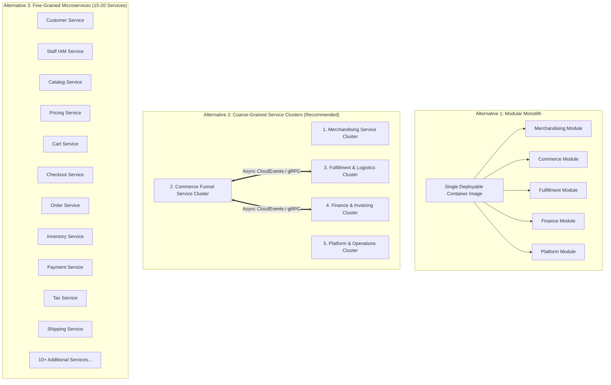
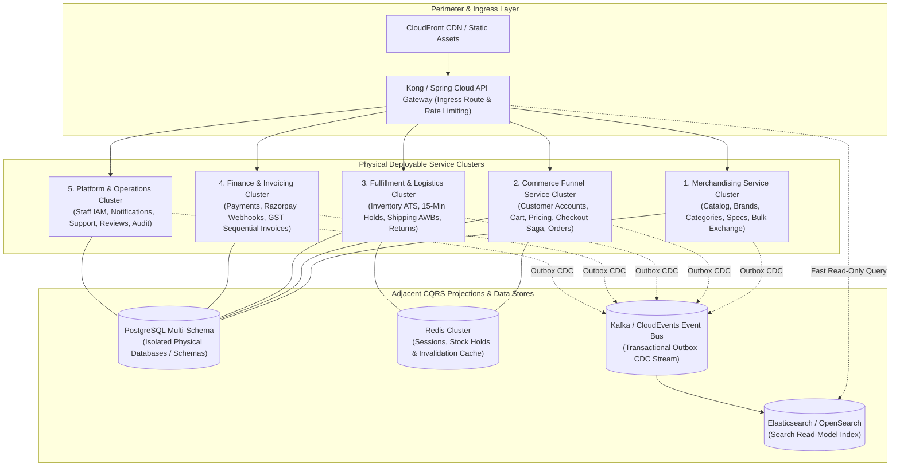
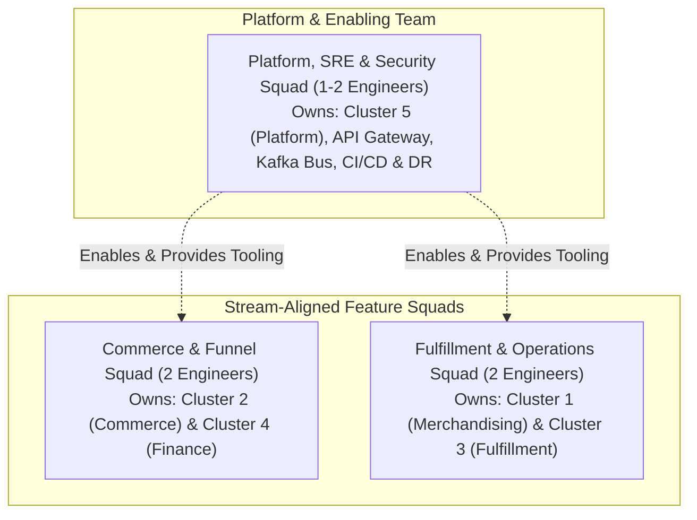

# ARCH-03 — Service Decomposition, Cluster Packaging and Responsibility Matrix

> [!WARNING]
> **NON-BINDING — DRAFT ONLY — NOT APPROVED FOR IMPLEMENTATION**  
> This specification is an exploratory Phase 2 architecture drafting instrument prepared under `docs/00-requirements/review/`. It does **not** constitute an approved architecture design, does not commit the enterprise to physical infrastructure or frameworks, and does not authorize software implementation.  
> Transitioning to approved architecture under `docs/01-architecture/ARCH-03-service-catalog.md` remains strictly blocked until the authorized Enterprise Business Owner signs off on [`docs/00-requirements/11-review-and-approval.md`](../11-review-and-approval.md) and ratifies the strategic decisions in [`docs/00-requirements/review/executive-decision-register.md`](./executive-decision-register.md).

---

## 1. Document Control

| Document Attribute | Specification Details |
| :--- | :--- |
| **Document ID** | `ARCH-03` |
| **Document Title** | Service Decomposition, Cluster Packaging, and Service Responsibility Matrix |
| **Project Name** | Chellaa E-Commerce Platform |
| **Repository & Branch** | [`ezhilselvan1109/chellaa-system`](https://github.com/ezhilselvan1109/chellaa-system) &bull; Branch: `dev` |
| **File Location** | `docs/00-requirements/review/arch-03-service-decomposition-draft.md` |
| **Version** | `1.0.0-DRAFT` |
| **Lifecycle State** | **`DRAFT_COMPLETE_PENDING_REVIEW`** (Non-Binding Preparatory Draft) |
| **Target Promotion Path** | `docs/01-architecture/ARCH-03-service-catalog.md` (Deferred pending formal executive sign-off) |
| **Author Roles** | Principal Distributed Systems Architect, Cloud Infrastructure Engineer & Solution Architect |
| **Target Reviewers** | Chief Technology Officer, Lead Security Architect, DevOps/SRE Lead & Principal Software Architect |
| **Upstream Baseline Documents** | [`00-business-overview.md`](../00-business-overview.md) through [`11-review-and-approval.md`](../11-review-and-approval.md) |
| **Upstream Architecture Artifacts** | [`arch-01-architecture-overview-draft.md`](./arch-01-architecture-overview-draft.md), [`arch-02-domain-decomposition-draft.md`](./arch-02-domain-decomposition-draft.md), [`architecture-decision-analysis.md`](./architecture-decision-analysis.md) (`AD-001`), [`phase-2-document-status-register.md`](./phase-2-document-status-register.md) |

### 1.1 Document Lifecycle & Governance Checkpoint

The Chellaa technical architecture governance framework enforces a strict six-stage lifecycle gate. The current progress status for `ARCH-03` is recorded below:

| Lifecycle Stage | Stage Status | Evaluation Criteria & Operational Verification |
| :--- | :---: | :--- |
| **1. Draft Completion** | **`COMPLETED`** | All deployment topology evaluations, cluster packaging models, container sizing profiles, and responsibility matrices are fully articulated. |
| **2. Requirements Traceability** | **`PENDING_RECONCILIATION`** — Previous completeness claims are withdrawn until source IDs and bidirectional mappings are verified against the current baseline (17 workflows). |
| **3. Technical Architecture Review** | **`PENDING_REVIEW`** | Subject to peer review by CTO, Lead Distributed Systems Architect, and DevOps/SRE Lead. |
| **4. Business Owner Policy Review** | **`PENDING_REVIEW`** | Subject to review of surge capacity targets ([`ADQ-007`](./executive-decision-register.md#adq-007)) and availability SLAs ([`ADQ-008`](./executive-decision-register.md#adq-008)). |
| **5. Formal Baseline Approval** | **`NOT_APPROVED`** | Maintained strictly per Document 11 governance gate ([`11-review-and-approval.md`](../11-review-and-approval.md)). |
| **6. Implementation Authorization** | **`NOT_GRANTED`** | Strictly blocked pending Business Owner signature in Document 11 Section 7. |

### 1.2 Revision History

| Version | Date | Author Roles | Description of Changes & Governance Triggers |
| :---: | :---: | :--- | :--- |
| `0.1.0-PLAN` | 2026-10-18 | Principal Software Architect | Preliminary service decomposition plan in [`phase-2-architecture-planning.md`](./phase-2-architecture-planning.md). |
| `0.2.0-DEC` | 2026-10-18 | Solution Architect | Trade-off analysis of deployment granularity (`AD-001`) in [`architecture-decision-analysis.md`](./architecture-decision-analysis.md). |
| `0.3.0-REG` | 2026-10-24 | Architecture Governance Lead | Detailed specification plan, container sizing criteria, and acceptance gates in [`phase-2-document-status-register.md`](./phase-2-document-status-register.md). |
| `1.0.0-DRAFT` | 2026-10-24 | Principal Distributed Systems Architect | Comprehensive `ARCH-03` draft: Physical service topology trade-offs, 5 Coarse-Grained Clusters, container resource sizing, autoscaling rules, inter-service communications, Team Topologies, and traceability. |

---

## 2. Physical Deployment Topology Evaluation

In [`ARCH-02`](./arch-02-domain-decomposition-draft.md), the 20 candidate business domains were established as logical boundaries of business responsibility and ubiquitous language. This section addresses Architecture Decision [`AD-001`](./architecture-decision-analysis.md#ad-001): **How should these 20 logical domains be packaged into physical, deployable runtime units (OCI containers)?**

### 2.1 The Three Structural Alternatives

### 2.2 Multidimensional Architecture Trade-Off Analysis

| Architectural Dimension | Alternative 1: Modular Monolith | Alternative 2: Coarse-Grained Clusters (Recommended Baseline) | Alternative 3: Fine-Grained Microservices |
| :--- | :--- | :--- | :--- |
| **Transactional Simplicity** | **Highest.** In-process method calls; native single-database ACID transactions across modules. Zero distributed Sagass. | **High.** Local ACID transactions within clusters (e.g., Cart + Pricing + Checkout + Orders). Distributed Sagass limited strictly to cross-cluster boundaries (Commerce $\leftrightarrow$ Fulfillment $\leftrightarrow$ Finance). | **Very Low.** Every business workflow requires multi-service distributed Sagass, two-phase reservation protocols, and complex compensating logic. |
| **Surge Scalability ([`NFR-SCL-001`](../07-non-functional-requirements.md#nfr-scl-001))** | Moderate. Scaling checkout during festive surges (1,000 OPM) requires scaling the entire application container, consuming unnecessary memory for cold administrative modules. | **High.** The *Commerce Funnel Cluster* and *Fulfillment Cluster* auto-scale independently during flash sales without wasting resources on low-traffic back-office services. | **Highest.** Individual endpoints scale independently. However, serialized network hops across 6–8 services consume the 1,000ms $p95$ checkout latency budget ([`NFR-PERF-002`](../07-non-functional-requirements.md#nfr-perf-002)). |
| **Failure Isolation & Blast Radius** | Low. An uncaught memory leak in bulk spreadsheet ingestion or PDF invoice rendering can crash the entire monolith container process. | **High.** Bulkhead isolation: A failure in Reporting, Customer Support, or SMS Notifications cannot degrade or crash the critical checkout path. | **Highest.** Maximum process isolation. However, network timeouts and gateway failures can cascade without strict circuit breakers across all 18 services. |
| **Operational & Cognitive Drag** | **Lowest.** Single CI/CD pipeline, single container repository, simple local developer workstation setup. | **Manageable.** 5 service container repositories/pipelines, clear team boundaries, manageable Kubernetes/ECS operational overhead for a 2–6 engineer team. | **Severe.** Requires managing 15–20 CI/CD pipelines, service mesh (Istio/Linkerd), distributed tracing, and complex local debugging environments, overwhelming a small team. |
| **Evaluation Recommendation** | `Viable for Initial MVP Prototype` | `PROPOSED for Production Architecture Baseline` | `NOT RECOMMENDED for Launch Team` |

---

## 3. The 5 Coarse-Grained Service Clusters

The Chellaa physical architecture establishes **5 Coarse-Grained Service Clusters** plus an adjacent CQRS Search read-model engine:

---

### 3.1 Cluster 1: Merchandising Service Cluster

* **Physical Container Image:** `chellaa-merchandising-service:latest`
* **Logical Domains Enclosed:**
  * *03. Product Catalog, Categories, Brands and Variants*
  * *18. Bulk Data Exchange*
* **Core Business Responsibilities:**
  * Hierarchical category taxonomy management (max 3 levels per [`BR-CAT-002`](../05-business-rules.md#br-cat-002)).
  * Product variant matrix authoring and globally unique SKU allocation ([`BR-CAT-001`](../05-business-rules.md#br-cat-001)).
  * Mandatory category specification sheet validation before publishing ([`BR-CAT-003`](../05-business-rules.md#br-cat-003)).
  * Asynchronous bulk ingestion of supplier spreadsheets (up to 5,000 SKUs in $\le 15\text{ mins}$ per [`NFR-PERF-003`](../07-non-functional-requirements.md#nfr-perf-003)).
* **Database Isolation Boundary:**
  * PostgreSQL dedicated schema: `merchandising_schema`
  * Authoritative tables: `categories`, `brands`, `products`, `product_variants`, `category_attribute_schemas`, `bulk_job_batches`, `bulk_row_error_records`.
* **Container Sizing & Scaling Profile:**
  * Baseline Sizing: 2 vCPU, 4 GB RAM (2 replicas minimum for High Availability).
  * Worker Pool: Dedicated internal background thread pool for bulk spreadsheet chunk parsing to prevent memory spikes from impacting administrative catalog API response times.
* **Interservice Protocols:**
  * Inbound: Synchronous REST HTTP/2 JSON for catalog management.
  * Outbound: Transactional Outbox CDC emitting `product.published`, `sku.archived`, `category.created`.

---

### 3.2 Cluster 2: Commerce Funnel Service Cluster

* **Physical Container Image:** `chellaa-commerce-service:latest`
* **Logical Domains Enclosed:**
  * *01. Customer Accounts*
  * *04. Pricing and Promotions*
  * *06. Cart and Wishlist*
  * *08. Checkout Orchestration*
  * *09. Orders Lifecycle*
* **Core Business Responsibilities:**
  * Retail customer registration, mobile phone OTP authentication, and multi-address management ([`FEAT-CUST-001`](../03-business-feature-inventory.md#feat-cust-001), [`FEAT-CUST-002`](../03-business-feature-inventory.md#feat-cust-002)).
  * Customer persistent cart, guest cart session tracking, and login cart merging ([`BR-CART-001`](../05-business-rules.md#br-cart-001), [`BR-CART-002`](../05-business-rules.md#br-cart-002)).
  * MRP ceiling validation ([`BR-PRC-001`](../05-business-rules.md#br-prc-001)) and non-stacking coupon application ([`BR-PRM-001`](../05-business-rules.md#br-prm-001)).
  * Server-side checkout total recalculation and fraud defense ([`BR-CHK-002`](../05-business-rules.md#br-chk-002)).
  * Checkout Saga orchestration: Acquires 15-minute inventory holds, coordinates payment intents, and rolls back upon failure ([`BR-CHK-001`](../05-business-rules.md#br-chk-001), [`AD-004`](./architecture-decision-analysis.md#ad-004)).
  * Order snapshot immutability ([`BR-ORD-001`](../05-business-rules.md#br-ord-001)) and order status lifecycle state machine (`PENDING` to `DELIVERED`).
* **Database Isolation Boundary:**
  * PostgreSQL dedicated schema: `commerce_schema`
  * Authoritative tables: `customers`, `customer_addresses`, `shopping_carts`, `cart_items`, `sku_prices`, `coupons`, `coupon_redemptions`, `checkout_sessions`, `customer_orders`, `order_line_items`.
* **Container Sizing & Scaling Profile:**
  * Baseline Sizing: 4 vCPU, 8 GB RAM (3 replicas baseline).
  * Surge Sizing ([`NFR-SCL-001`](../07-non-functional-requirements.md#nfr-scl-001)): Horizontal Pod Autoscaler (HPA) auto-scales from 3 to 12 replicas based on CPU ($> 70\%$) or active HTTP connection count to sustain 1,000 orders/minute.
* **Interservice Protocols:**
  * Inbound: Synchronous REST HTTP/2 JSON via API Gateway.
  * Synchronous Outbound: Synchronous gRPC / REST to *Fulfillment Cluster* (15-min stock hold) and *Finance Cluster* (payment intent session).
  * Asynchronous Outbound: Transactional Outbox CDC emitting `checkout.completed`, `order.confirmed`, `order.cancelled`.

---

### 3.3 Cluster 3: Fulfillment & Logistics Service Cluster

* **Physical Container Image:** `chellaa-fulfillment-service:latest`
* **Logical Domains Enclosed:**
  * *07. Inventory and Warehouse Operations*
  * *12. Shipping and Delivery*
  * *13. Returns, Diagnostics and Refunds*
* **Core Business Responsibilities:**
  * **Zero Overselling Mandate:** Available-to-Sell (ATS) stock computation ($\text{ATS} = \text{On-Hand} - \text{Allocated} - \text{Holds} - \text{Safety} \ge 0$ per [`NFR-INT-001`](../07-non-functional-requirements.md#nfr-int-001)).
  * Atomic 15-minute checkout reservation hold acquisition and TTL automated expiration ([`BR-INV-001`](../05-business-rules.md#br-inv-001)).
  * High-value serial/IMEI hardware scanning during pick-and-pack fulfillment ([`BR-INV-002`](../05-business-rules.md#br-inv-002)).
  * Carrier consignment booking, AWB generation, and 3PL tracking status webhook ingestion ([`WF-008`](../06-business-workflows.md#wf-008), [`WF-009`](../06-business-workflows.md#wf-009)).
  * Automatic Return-to-Origin (RTO) execution after 3 failed delivery attempts ([`BR-SHP-002`](../05-business-rules.md#br-shp-002)).
  * 7-day electronics return policy window enforcement ([`BR-RET-001`](../05-business-rules.md#br-ret-001)) and mandatory warehouse technician diagnostic condition grading gate ([`BR-RET-002`](../05-business-rules.md#br-ret-002)).
* **Database Isolation Boundary:**
  * PostgreSQL dedicated schema: `fulfillment_schema`
  * Authoritative tables: `inventory_ledgers`, `stock_holds`, `serial_asset_records`, `warehouse_bins`, `shipments`, `consignment_tracking_logs`, `return_requests`, `diagnostic_reports`.
* **Container Sizing & Scaling Profile:**
  * Baseline Sizing: 4 vCPU, 8 GB RAM (2 replicas baseline).
  * Surge Sizing: HPA auto-scales from 2 to 8 replicas during flash sales to handle concurrent atomic hold reservation requests.
* **Interservice Protocols:**
  * Inbound: Synchronous gRPC / REST from *Commerce Cluster* for stock holds; asynchronous event consumers for `order.confirmed`.
  * External Inbound: HTTPS Webhook endpoints for 3PL courier tracking callbacks.
  * Outbound: Transactional Outbox CDC emitting `inventory.hold_created`, `inventory.stock_deducted`, `shipment.dispatched`, `return.graded`.

---

### 3.4 Cluster 4: Finance & Invoicing Service Cluster

* **Physical Container Image:** `chellaa-finance-service:latest`
* **Logical Domains Enclosed:**
  * *10. Payments and Reconciliation*
  * *11. Tax and Invoicing*
* **Core Business Responsibilities:**
  * Payment intent creation and payment method routing ([`FEAT-PAY-001`](../03-business-feature-inventory.md#feat-pay-001)).
  * Cryptographic webhook signature verification (HMAC-SHA256 per [`BR-PAY-001`](../05-business-rules.md#br-pay-001)).
  * **Late Payment Webhook Dual-Path Recovery:** Automatic source-instrument refund if stock hold has expired ([`BR-PAY-002`](../05-business-rules.md#br-pay-002), [`AD-003`](./architecture-decision-analysis.md#ad-003)).
  * Zero Raw Cardholder PAN / CVV Storage Mandate ([`NFR-SEC-001`](../07-non-functional-requirements.md#nfr-sec-001)).
  * Automated refund dispatches to original payment instruments; zero cash payouts ([`BR-PAY-003`](../05-business-rules.md#br-pay-003), [`BR-RET-003`](../05-business-rules.md#br-ret-003)).
  * Indian GST tax calculation: Intra-state (CGST+SGST) vs inter-state (IGST) split ([`BR-FIN-003`](../05-business-rules.md#br-fin-003)).
  * **Monotonic Gapless Sequential Invoicing:** Atomic sequential number allocation (`INV/YYYY-YY/XXXXX` per [`BR-FIN-001`](../05-business-rules.md#br-fin-001)).
  * Sequential statutory Credit Note generation (`CN/YYYY-YY/XXXXX` per [`BR-FIN-002`](../05-business-rules.md#br-fin-002)).
* **Database Isolation Boundary:**
  * PostgreSQL dedicated schema: `finance_schema`
  * Authoritative tables: `payment_transactions`, `gateway_webhooks`, `settlement_batches`, `tax_invoices`, `invoice_lines`, `credit_notes`, `gst_sequences`.
* **Container Sizing & Scaling Profile:**
  * Baseline Sizing: 2 vCPU, 4 GB RAM (2 replicas baseline).
  * Highly stable, non-bursty processing decoupled from storefront browsing.
* **Interservice Protocols:**
  * Inbound: Synchronous REST from *Commerce Cluster* for payment intent creation; asynchronous HTTPS webhooks from Razorpay.
  * Outbound: Transactional Outbox CDC emitting `payment.captured`, `payment.failed`, `invoice.generated`, `credit_note.issued`.

---

### 3.5 Cluster 5: Platform & Operations Service Cluster

* **Physical Container Image:** `chellaa-platform-service:latest`
* **Logical Domains Enclosed:**
  * *02. Staff IAM and RBAC*
  * *14. Notifications*
  * *15. Customer Support*
  * *16. Reviews and Ratings*
  * *17. Reporting and Analytics*
  * *19. External Integrations*
  * *20. Audit and Platform Operations*
* **Core Business Responsibilities:**
  * Enterprise administrative staff credentials, mandatory TOTP MFA ([`BR-ADM-001`](../05-business-rules.md#br-adm-001)), and 15-minute inactivity session timeouts ([`BR-ADM-002`](../05-business-rules.md#br-adm-002)).
  * Customer vs staff identity boundary isolation ([`NFR-SEC-002`](../07-non-functional-requirements.md#nfr-sec-002), [`AD-008`](./architecture-decision-analysis.md#ad-008)).
  * Asynchronous transactional SMS, WhatsApp, and Email dispatches adhering to TRAI DLT template registration ([`BR-NTF-001`](../05-business-rules.md#br-ntf-001)).
  * Customer support ticket lifecycle with 2-hour SLA response timer ([`BR-SUP-001`](../05-business-rules.md#br-sup-001)).
  * Verified-buyer review gating ([`BR-REV-001`](../05-business-rules.md#br-rev-001)) and star rating aggregation.
  * Executive GMV and net sales reporting isolated on database read replicas ([`BR-RPT-001`](../05-business-rules.md#br-rpt-001)).
  * **Immutable WORM Audit Trail:** Append-only audit logging with SHA-256 cryptographic hash chaining ([`BR-AUD-001`](../05-business-rules.md#br-aud-001)) and 8 Financial Years statutory retention ([`BR-DAT-001`](../05-business-rules.md#br-dat-001), [`OQ-020`](../08-assumptions-dependencies-open-questions.md#oq-020)).
* **Database Isolation Boundary:**
  * PostgreSQL dedicated schema: `platform_schema`
  * Authoritative tables: `staff_users`, `roles`, `permissions`, `notification_messages`, `support_tickets`, `product_reviews`, `audit_event_blocks`, `audit_chain_anchors`.
* **Container Sizing & Scaling Profile:**
  * Baseline Sizing: 2 vCPU, 4 GB RAM (2 replicas baseline).
  * Background worker pools handle asynchronous event queues independently.
* **Interservice Protocols:**
  * Inbound: Staff admin REST endpoints; internal event listeners consuming 100% of platform domain events.

---

### 3.6 Adjacent CQRS Search Read-Model Engine

* **Engine:** Dedicated Elasticsearch / OpenSearch 2.x Managed Cluster
* **Logical Domain Enclosed:** *05. Search and Discovery*
* **Core Business Responsibilities:**
  * High-performance full-text search with typo tolerance and fuzzy matching.
  * Multi-attribute faceted filtering (brand, category, price range min/max, RAM, storage).
  * Out-of-stock badge demotion and ranking penalties ([`BR-SRCH-001`](../05-business-rules.md#br-srch-001)).
  * Eventual consistency index synchronization within $\le 5\text{ seconds}$ SLA ([`NFR-INT-002`](../07-non-functional-requirements.md#nfr-int-002)).
* **Access Boundary:**
  * Read-only public query access routed via API Gateway (`GET /api/v1/search`, `GET /api/v1/catalog/facets`).
  * Zero direct HTTP mutation endpoints; mutations occur exclusively via Kafka CDC consumer pipeline ([`AD-010`](./architecture-decision-analysis.md#ad-010)).

---

## 4. Interservice Communication & Protocol Matrix

The interaction matrix below governs the communication protocols, timeouts, circuit breaking rules, and idempotency mechanisms across cluster boundaries:

| Source Cluster | Target Cluster | Interaction Type | Protocol & Transport | Target SLA / Timeout | Circuit Breaker Policy (Resilience4j) | Idempotency & Retry Mechanism |
| :--- | :--- | :---: | :---: | :---: | :--- | :--- |
| **API Gateway** | **Cluster 1 (Merchandising)** | Public Read / Admin Write | HTTPS / REST HTTP/2 JSON | $p95 \le 200\text{ms}$ / 2s timeout | Threshold: 50% failure over 20 calls; Open duration: 10s | Idempotency token on admin modifications |
| **API Gateway** | **Cluster 2 (Commerce)** | Customer Funnel APIs | HTTPS / REST HTTP/2 JSON | $p95 \le 1,000\text{ms}$ / 3s timeout | Threshold: 50% failure over 30 calls; Open duration: 15s | Mandatory `Idempotency-Key` header on checkout POST |
| **Cluster 2 (Commerce)** | **Cluster 3 (Fulfillment)** | Acquire 15-min Stock Hold | Internal gRPC / Protobuf | $p95 \le 150\text{ms}$ / 1s timeout | Threshold: 40% failure over 20 calls; Open duration: 5s | Token keyed on `checkout_session_id`; Atomic hold script |
| **Cluster 2 (Commerce)** | **Cluster 4 (Finance)** | Create Payment Intent | Internal gRPC / Protobuf | $p95 \le 300\text{ms}$ / 2s timeout | Threshold: 50% failure over 20 calls; Open duration: 10s | Token keyed on `order_id` + `attempt_count` |
| **Razorpay Gateway** | **Cluster 4 (Finance)** | Inbound Payment Webhook | HTTPS Webhook Callback | $p95 \le 500\text{ms}$ / 5s timeout | Rate-limited by IP; Webhook retry handled by Razorpay | HMAC-SHA256 signature verification; Deduplicated on Gateway ID |
| **Cluster 3 (Fulfillment)** | **3PL Courier APIs** | Book Consignment & AWB | Outbound HTTPS REST | $p95 \le 1,500\text{ms}$ / 5s timeout | Threshold: 50% failure over 10 calls; Open duration: 30s | Exponential backoff retry with jitter (max 3 retries) |
| **Cluster 4 (Finance)** | **Razorpay Gateway** | Dispatch Refund API | Outbound HTTPS REST | $p95 \le 1,000\text{ms}$ / 5s timeout | Threshold: 40% failure over 10 calls; Open duration: 30s | Deduplicated on `refund_id`; Dead-letter queue fallback |
| **All Clusters (1–5)** | **Event Broker (Kafka)** | Publish Domain Events | Transactional Outbox CDC | $\le 1\text{s}$ event propagation | Broker cluster multi-AZ redundancy; Producer acks=all | At-least-once delivery; Consumer deduplication filter |
| **Event Broker (Kafka)** | **Search Engine** | Sync Search Read-Model | Consumer Group Stream | $\le 5\text{s}$ SLA ([`NFR-INT-002`](../07-non-functional-requirements.md#nfr-int-002)) | Consumer auto-recovery; Full re-indexing fallback job | Document versioning (`_seq_no` / `primary_term`) |

---

## 5. Team Topologies & Engineering Ownership

To ensure that the physical architecture reflects human organizational capabilities, engineering ownership aligns with the **Team Topologies** organizational framework for an initial engineering team of 2 to 6 developers:

### 5.1 Team Boundary Responsibilities

| Engineering Squad | Team Topologies Classification | Owned Service Clusters | Primary KPIs & Quality Invariants |
| :--- | :--- | :--- | :--- |
| **Commerce & Funnel Squad** (2 Engineers) | Stream-Aligned Team | **Cluster 2 (Commerce)** **Cluster 4 (Finance)** | Checkout conversion latency ($p95 \le 1,000\text{ms}$); Zero unfulfilled captured payments; Monotonic gapless invoicing. |
| **Fulfillment & Operations Squad** (2 Engineers) | Stream-Aligned Team | **Cluster 1 (Merchandising)** **Cluster 3 (Fulfillment)** | Zero Overselling Mandate ($\text{ATS} \ge 0$); Bulk ingestion SLA (5,000 SKUs $\le 15\text{m}$); Barcode pick-and-pack accuracy. |
| **Platform, SRE & Security Squad** (1–2 Engineers) | Platform & Enabling Team | **Cluster 5 (Platform)** **API Gateway & Bus** | Platform availability ($\ge 99.9\%$); WORM audit chain integrity; Disaster recovery PITR drills (RTO $\le 2\text{h}$, RPO $\le 5\text{m}$). |

---

## 6. Container Sizing, Resource Quotas and Scaling Profile

The resource allocation profiles below support the baseline operational traffic and the 1,000 orders/minute festive surge target ([`NFR-SCL-001`](../07-non-functional-requirements.md#nfr-scl-001)):

| Deployable Service Cluster | CPU Request / Limit | Memory Request / Limit | Min Replicas (Multi-AZ) | Max Replicas (Surge) | Horizontal Pod Autoscaler (HPA) Metric | Cold Start SLA |
| :--- | :---: | :---: | :---: | :---: | :--- | :---: |
| **1. Merchandising Cluster** | 1000m / 2000m | 2Gi / 4Gi | 2 | 4 | CPU $> 75\%$ or Memory $> 80\%$ | $\le 15\text{ seconds}$ |
| **2. Commerce Funnel Cluster** | 2000m / 4000m | 4Gi / 8Gi | 3 | 12 | CPU $> 70\%$ or HTTP Requests $> 500\text{ RPS}$ | $\le 10\text{ seconds}$ |
| **3. Fulfillment Cluster** | 2000m / 4000m | 4Gi / 8Gi | 2 | 8 | CPU $> 70\%$ or Hold Requests $> 300\text{ RPS}$ | $\le 10\text{ seconds}$ |
| **4. Finance & Invoicing Cluster** | 1000m / 2000m | 2Gi / 4Gi | 2 | 4 | CPU $> 75\%$ or Webhook Queue Depth $> 100$ | $\le 15\text{ seconds}$ |
| **5. Platform & Operations Cluster** | 1000m / 2000m | 2Gi / 4Gi | 2 | 4 | CPU $> 80\%$ or Outbox Queue Depth $> 500$ | $\le 20\text{ seconds}$ |
| **Search Engine (OpenSearch Cluster)** | 3 Nodes Dedicated | 16Gi RAM per node | 3 Nodes | 6 Nodes | JVM Heap Pressure $> 75\%$ | Managed AWS |

---

## 7. Traceability to Baseline Business Requirements

The physical packaging model adheres strictly to the formal BRD baseline and Architecture Decision Register:

| Service Cluster | Mapped Business Features (`FEAT`) | Mapped Functional Requirements (`FR`) | Mapped Business Rules (`BR`) | Mapped Workflows (`WF`) | Mapped NFRs | Linked Architecture Decisions |
| :--- | :--- | :--- | :--- | :--- | :--- | :--- |
| **Cluster 1: Merchandising** | [`FEAT-CAT-001`](../03-business-feature-inventory.md#feat-cat-001), [`002`](../03-business-feature-inventory.md#feat-cat-002), [`FEAT-CTG-001`](../03-business-feature-inventory.md#feat-ctg-001), [`002`](../03-business-feature-inventory.md#feat-ctg-002), [`FEAT-BRD-001`](../03-business-feature-inventory.md#feat-brd-001), [`FEAT-DAT-001`](../03-business-feature-inventory.md#feat-dat-001) | [`FR-CAT-001`](../04-functional-requirements.md#fr-cat-001)–[`003`](../04-functional-requirements.md#fr-cat-003) | [`BR-CAT-001`](../05-business-rules.md#br-cat-001)–[`003`](../05-business-rules.md#br-cat-003) | [`WF-002`](../06-business-workflows.md#wf-002) | [`NFR-SCL-002`](../07-non-functional-requirements.md#nfr-scl-002), [`NFR-PERF-003`](../07-non-functional-requirements.md#nfr-perf-003) | [`AD-001`](./architecture-decision-analysis.md#ad-001) |
| **Cluster 2: Commerce Funnel** | [`FEAT-CUST-001`](../03-business-feature-inventory.md#feat-cust-001)–[`003`](../03-business-feature-inventory.md#feat-cust-003), [`FEAT-CART-001`](../03-business-feature-inventory.md#feat-cart-001), [`FEAT-WSH-001`](../03-business-feature-inventory.md#feat-wsh-001), [`FEAT-PRC-001`](../03-business-feature-inventory.md#feat-prc-001), [`FEAT-PRM-001`](../03-business-feature-inventory.md#feat-prm-001), [`FEAT-CHK-001`](../03-business-feature-inventory.md#feat-chk-001), [`FEAT-ORD-001`](../03-business-feature-inventory.md#feat-ord-001) | [`FR-CUST-001`](../04-functional-requirements.md#fr-cust-001)–[`004`](../04-functional-requirements.md#fr-cust-004), [`FR-CART-001`](../04-functional-requirements.md#fr-cart-001), [`FR-PRC-001`](../04-functional-requirements.md#fr-prc-001), [`FR-CHK-001`](../04-functional-requirements.md#fr-chk-001), [`002`](../04-functional-requirements.md#fr-chk-002), [`FR-ORD-001`](../04-functional-requirements.md#fr-ord-001)–[`003`](../04-functional-requirements.md#fr-ord-003) | [`BR-CUST-001`](../05-business-rules.md#br-cust-001), [`002`](../05-business-rules.md#br-cust-002), [`BR-CART-001`](../05-business-rules.md#br-cart-001), [`002`](../05-business-rules.md#br-cart-002), [`BR-PRC-001`](../05-business-rules.md#br-prc-001), [`BR-CHK-001`](../05-business-rules.md#br-chk-001), [`002`](../05-business-rules.md#br-chk-002), [`BR-ORD-001`](../05-business-rules.md#br-ord-001)–[`004`](../05-business-rules.md#br-ord-004) | [`WF-001`](../06-business-workflows.md#wf-001), [`WF-005`](../06-business-workflows.md#wf-005), [`WF-006`](../06-business-workflows.md#wf-006), [`WF-008`](../06-business-workflows.md#wf-008), [`WF-011`](../06-business-workflows.md#wf-011) | [`NFR-SCL-001`](../07-non-functional-requirements.md#nfr-scl-001), [`NFR-PERF-002`](../07-non-functional-requirements.md#nfr-perf-002), [`NFR-SEC-003`](../07-non-functional-requirements.md#nfr-sec-003) | [`AD-001`](./architecture-decision-analysis.md#ad-001), [`AD-004`](./architecture-decision-analysis.md#ad-004), [`AD-011`](./architecture-decision-analysis.md#ad-011) |
| **Cluster 3: Fulfillment** | [`FEAT-INV-001`](../03-business-feature-inventory.md#feat-inv-001)–[`003`](../03-business-feature-inventory.md#feat-inv-003), [`FEAT-SHP-001`](../03-business-feature-inventory.md#feat-shp-001), [`FEAT-RET-001`](../03-business-feature-inventory.md#feat-ret-001) | [`FR-INV-001`](../04-functional-requirements.md#fr-inv-001)–[`004`](../04-functional-requirements.md#fr-inv-004), [`FR-SHP-001`](../04-functional-requirements.md#fr-shp-001), [`002`](../04-functional-requirements.md#fr-shp-002), [`FR-RET-001`](../04-functional-requirements.md#fr-ret-001)–[`003`](../04-functional-requirements.md#fr-ret-003) | [`BR-INV-001`](../05-business-rules.md#br-inv-001)–[`004`](../05-business-rules.md#br-inv-004), [`BR-SHP-001`](../05-business-rules.md#br-shp-001), [`002`](../05-business-rules.md#br-shp-002), [`BR-RET-001`](../05-business-rules.md#br-ret-001)–[`003`](../05-business-rules.md#br-ret-003) | [`WF-008`](../06-business-workflows.md#wf-008), [`WF-009`](../06-business-workflows.md#wf-009), [`WF-010`](../06-business-workflows.md#wf-010) | [`NFR-INT-001`](../07-non-functional-requirements.md#nfr-int-001), [`NFR-AVL-002`](../07-non-functional-requirements.md#nfr-avl-002) | [`AD-001`](./architecture-decision-analysis.md#ad-001), [`AD-002`](./architecture-decision-analysis.md#ad-002) |
| **Cluster 4: Finance** | [`FEAT-PAY-001`](../03-business-feature-inventory.md#feat-pay-001), [`002`](../03-business-feature-inventory.md#feat-pay-002), [`FEAT-FIN-001`](../03-business-feature-inventory.md#feat-fin-001), [`002`](../03-business-feature-inventory.md#feat-fin-002) | [`FR-PAY-001`](../04-functional-requirements.md#fr-pay-001)–[`003`](../04-functional-requirements.md#fr-pay-003), [`FR-FIN-001`](../04-functional-requirements.md#fr-fin-001)–[`003`](../04-functional-requirements.md#fr-fin-003) | [`BR-PAY-001`](../05-business-rules.md#br-pay-001)–[`003`](../05-business-rules.md#br-pay-003), [`BR-FIN-001`](../05-business-rules.md#br-fin-001)–[`003`](../05-business-rules.md#br-fin-003) | [`WF-007`](../06-business-workflows.md#wf-007), [`WF-010`](../06-business-workflows.md#wf-010), [`WF-014`](../06-business-workflows.md#wf-014) | [`NFR-SEC-001`](../07-non-functional-requirements.md#nfr-sec-001), [`NFR-INT-001`](../07-non-functional-requirements.md#nfr-int-001) | [`AD-001`](./architecture-decision-analysis.md#ad-001), [`AD-003`](./architecture-decision-analysis.md#ad-003), [`AD-005`](./architecture-decision-analysis.md#ad-005) |
| **Cluster 5: Platform** | [`FEAT-ADM-001`](../03-business-feature-inventory.md#feat-adm-001), [`FEAT-NTF-001`](../03-business-feature-inventory.md#feat-ntf-001), [`FEAT-SUP-001`](../03-business-feature-inventory.md#feat-sup-001), [`FEAT-REV-001`](../03-business-feature-inventory.md#feat-rev-001), [`FEAT-RPT-001`](../03-business-feature-inventory.md#feat-rpt-001), [`FEAT-INT-001`](../03-business-feature-inventory.md#feat-int-001), [`FEAT-AUD-001`](../03-business-feature-inventory.md#feat-aud-001), [`FEAT-OPS-001`](../03-business-feature-inventory.md#feat-ops-001) | [`FR-SEC-001`](../04-functional-requirements.md#fr-sec-001), [`002`](../04-functional-requirements.md#fr-sec-002), [`FR-NTF-001`](../04-functional-requirements.md#fr-ntf-001), [`FR-SUP-001`](../04-functional-requirements.md#fr-sup-001), [`FR-REV-001`](../04-functional-requirements.md#fr-rev-001), [`FR-RPT-001`](../04-functional-requirements.md#fr-rpt-001), [`FR-INT-001`](../04-functional-requirements.md#fr-int-001), [`FR-AUD-001`](../04-functional-requirements.md#fr-aud-001), [`002`](../04-functional-requirements.md#fr-aud-002) | [`BR-ADM-001`](../05-business-rules.md#br-adm-001), [`002`](../05-business-rules.md#br-adm-002), [`BR-NTF-001`](../05-business-rules.md#br-ntf-001), [`BR-SUP-001`](../05-business-rules.md#br-sup-001), [`BR-REV-001`](../05-business-rules.md#br-rev-001), [`BR-RPT-001`](../05-business-rules.md#br-rpt-001), [`BR-INT-001`](../05-business-rules.md#br-int-001), [`BR-AUD-001`](../05-business-rules.md#br-aud-001), [`BR-DAT-001`](../05-business-rules.md#br-dat-001) | [`WF-012`](../06-business-workflows.md#wf-012)–[`017`](../06-business-workflows.md#wf-017) | [`NFR-SEC-002`](../07-non-functional-requirements.md#nfr-sec-002), [`NFR-OBS-001`](../07-non-functional-requirements.md#nfr-obs-001), [`002`](../07-non-functional-requirements.md#nfr-obs-002), [`NFR-AVL-001`](../07-non-functional-requirements.md#nfr-avl-001) | [`AD-001`](./architecture-decision-analysis.md#ad-001), [`AD-006`](./architecture-decision-analysis.md#ad-006), [`AD-008`](./architecture-decision-analysis.md#ad-008) |

---

## 8. Review and Acceptance Checklist

The checklist below governs the quality gate audit for `ARCH-03`:

- [x] 1. **Complete Topology Evaluation:** Modular Monolith, Coarse-Grained Clusters, and Fine Microservices comparatively analyzed against transactional complexity, surge scalability, failure isolation, and team operational drag.
- [x] 2. **5 Coarse-Grained Clusters Bounded:** Every one of the 20 candidate domains allocated to a concrete deployable cluster with designated database schemas and authoritative tables.
- [x] 3. **Container Resource Sizing & Autoscaling:** CPU, memory, replica minimums, and HPA trigger metrics defined to sustain 1,000 orders/minute surge ([`NFR-SCL-001`](../07-non-functional-requirements.md#nfr-scl-001)).
- [x] 4. **Interservice Communication Contracts:** Synchronous gRPC vs asynchronous Kafka Outbox CDC protocols and circuit breaker rules defined for all cluster interfaces.
- [x] 5. **Team Topologies Alignment:** Clear ownership assigned across Stream-Aligned Squads and Platform/Enabling Team for a 2–6 engineer organizational baseline.
- [x] 6. **Single-Retailer Anti-Scope Preserved:** Zero third-party marketplace, vendor onboarding, commission ledgers, or split payout concepts present.
- [ ] 7. **Requirements Traceability — verification pending:** All cluster allocations trace directly to authentic BRD identifiers.
- [x] 8. **Non-Binding Labeling:** Prominently marked as a non-binding draft pending formal Phase 1 sign-off.

---

## Cross-document reconciliation note (2026-10-24)

- Canonical workflow identifiers and titles are defined by `docs/00-requirements/06-business-workflows.md` (WF-001–WF-017). Do not infer workflow meaning from an old identifier or copy stale mapping labels.
- Recorded business decisions are inputs, not implementation approval. Online payment gateway: Razorpay only. Notification channels: SMS, Email and WhatsApp Business API; channel/fallback policy remains open. Reviews: verified buyers with admin moderation; detailed policy remains open. Advanced reporting is selected while specifications remain open. Legacy customer/order history migration is out of scope; catalog and opening-stock import remain in scope. Statutory financial records are retained for eight financial years, subject to Legal/Security review of anonymization details.
- **Shipping decision alignment (ADQ-014 supersedes ADQ-011 provider-exclusion clauses):** Chellaa owns its Shipping Management System and canonical internal Shipment ID. The recorded provider model permits Chellaa's own delivery team, directly integrated courier partners, and a shipping aggregator. This does not select a named provider, establish a contract, validate a PIN code, or authorize an untested lane. `DEP-002` remains `OPEN`; each lane requires documented operational readiness and end-to-end evidence before activation.
- This draft remains non-binding. Phase 1 review is `PENDING_APPROVAL`, the requirements baseline is `NOT_APPROVED`, and architecture implementation authorization is `NOT_GRANTED`. This note does not authorize promotion to `docs/01-architecture/`.
