# ARCH-04 — Service Interaction Workflows & Dynamic Collaboration Diagrams

> [!WARNING]
> **NON-BINDING — DRAFT ONLY — NOT APPROVED FOR IMPLEMENTATION**  
> This specification is an exploratory Phase 2 architecture drafting instrument prepared under `docs/00-requirements/review/`. It does **not** constitute an approved architecture design, does not commit the enterprise to physical infrastructure or frameworks, and does not authorize software implementation.  
> Transitioning to approved architecture under `docs/01-architecture/ARCH-04-service-interactions.md` remains strictly blocked until the authorized Enterprise Business Owner signs off on [`docs/00-requirements/11-review-and-approval.md`](../11-review-and-approval.md) and ratifies the strategic decisions in [`docs/00-requirements/review/executive-decision-register.md`](./executive-decision-register.md).

---

## 1. Document Control

| Document Attribute | Specification Details |
| :--- | :--- |
| **Document ID** | `ARCH-04` |
| **Document Title** | Service Interaction Workflows, Dynamic Collaboration Diagrams, and Saga Sequences |
| **Project Name** | Chellaa E-Commerce Platform |
| **Repository & Branch** | [`ezhilselvan1109/chellaa-system`](https://github.com/ezhilselvan1109/chellaa-system) &bull; Branch: `dev` |
| **File Location** | `docs/00-requirements/review/arch-04-service-interactions-draft.md` |
| **Version** | `1.0.0-DRAFT` |
| **Lifecycle State** | **`DRAFT_COMPLETE_PENDING_REVIEW`** (Non-Binding Preparatory Draft) |
| **Target Promotion Path** | `docs/01-architecture/ARCH-04-service-interactions.md` (Deferred pending formal executive sign-off) |
| **Author Roles** | Principal Integration & API Architect, Distributed Systems Engineer & Solution Architect |
| **Target Reviewers** | Chief Technology Officer, Backend Engineering Leads, QA Automation Lead & Lead Business Analyst |
| **Upstream Baseline Documents** | [`06-business-workflows.md`](../06-business-workflows.md) (`WF-001`–`017`), [`04-functional-requirements.md`](../04-functional-requirements.md), [`05-business-rules.md`](../05-business-rules.md) |
| **Upstream Architecture Artifacts** | [`arch-01-architecture-overview-draft.md`](./arch-01-architecture-overview-draft.md), [`arch-02-domain-decomposition-draft.md`](./arch-02-domain-decomposition-draft.md), [`arch-03-service-decomposition-draft.md`](./arch-03-service-decomposition-draft.md), [`architecture-decision-analysis.md`](./architecture-decision-analysis.md) (`AD-004`) |

### 1.1 Document Lifecycle & Governance Checkpoint

The Chellaa technical architecture governance framework enforces a strict six-stage lifecycle gate. The current progress status for `ARCH-04` is recorded below:

| Lifecycle Stage | Stage Status | Evaluation Criteria & Operational Verification |
| :--- | :---: | :--- |
| **1. Draft Completion** | **`PENDING_RECONCILIATION`** | Existing sequence diagrams require ID/title reconciliation against the current 17-workflow requirements inventory; the current draft does not yet demonstrate complete coverage. |
| **2. Requirements Traceability** | **`PENDING_RECONCILIATION`** | Workflow mappings and acceptance coverage must be rechecked against all 17 workflows (`WF-001` through `WF-017`) before any coverage percentage is claimed. |
| **3. Technical Architecture Review** | **`PENDING_REVIEW`** | Subject to peer review by CTO, Lead Integration Architect, and Backend Engineering Leads. |
| **4. Business Owner Policy Review** | **`PENDING_REVIEW`** | Subject to review of late payment workflows ([`ADQ-003`](./executive-decision-register.md#adq-003)) and reverse logistics policies ([`ADQ-004`](./executive-decision-register.md#adq-004)). |
| **5. Formal Baseline Approval** | **`NOT_APPROVED`** | Maintained strictly per Document 11 governance gate ([`11-review-and-approval.md`](../11-review-and-approval.md)). |
| **6. Implementation Authorization** | **`NOT_GRANTED`** | Strictly blocked pending Business Owner signature in Document 11 Section 7. |

### 1.2 Revision History

| Version | Date | Author Roles | Description of Changes & Governance Triggers |
| :---: | :---: | :--- | :--- |
| `0.1.0-PLAN` | 2026-10-18 | Principal Software Architect | Preliminary workflow interaction index in [`phase-2-architecture-planning.md`](./phase-2-architecture-planning.md). |
| `0.2.0-DEC` | 2026-10-18 | Distributed Systems Architect | Saga orchestration analysis (`AD-004`) in [`architecture-decision-analysis.md`](./architecture-decision-analysis.md). |
| `0.3.0-REG` | 2026-10-24 | Architecture Governance Lead | Detailed specification plan, sequence validation rules, and acceptance gates in [`phase-2-document-status-register.md`](./phase-2-document-status-register.md). |
| `1.0.0-DRAFT` | 2026-10-24 | Principal Integration Architect | `ARCH-04` review update: the source requirements now contain 17 workflows; the sequence diagrams and mapping table require a full identifier and coverage reconciliation. |

---

## 2. Interaction Design & Orchestration Principles

This document specifies the runtime dynamic interactions across the 5 Coarse-Grained Service Clusters defined in [`ARCH-03`](./arch-03-service-decomposition-draft.md) and external actors. All interactions adhere to three core architectural principles:

1. **Synchronous Request-Response Boundary:** Used strictly when immediate consistency or client blocking is required (e.g., authentication handshake, in-memory coupon validation, 15-minute atomic stock hold reservation). Protocols: HTTPS REST HTTP/2 JSON for external clients; internal gRPC for cluster-to-cluster calls.
2. **Asynchronous Event-Driven Decoupling:** Used for downstream lifecycle progression, notification dispatches, search indexing, and auditing. Published via Transactional Outbox CDC to Kafka / CloudEvents v1.0.
3. **Compensating Saga Orchestration ([`AD-004`](./architecture-decision-analysis.md#ad-004)):** Multi-cluster transactions (Checkout $\leftrightarrow$ Hold $\leftrightarrow$ Payment) execute under a central Saga Orchestrator inside the *Commerce Cluster*. If an downstream step fails, explicit semantic compensating actions roll back prior state (e.g., releasing holds, initiating refunds).

---

## 3. Existing End-to-End Sequence Diagrams — Coverage Reconciliation Required

---

### 3.1 WF-001: Customer Registration, Phone OTP & Session Merge

* **Scope:** Customer account registration, phone number OTP verification, and guest session cart merging upon login ([`FEAT-CUST-001`](../03-business-feature-inventory.md#feat-cust-001), [`FEAT-CART-001`](../03-business-feature-inventory.md#feat-cart-001), [`BR-CART-001`](../05-business-rules.md#br-cart-001)).

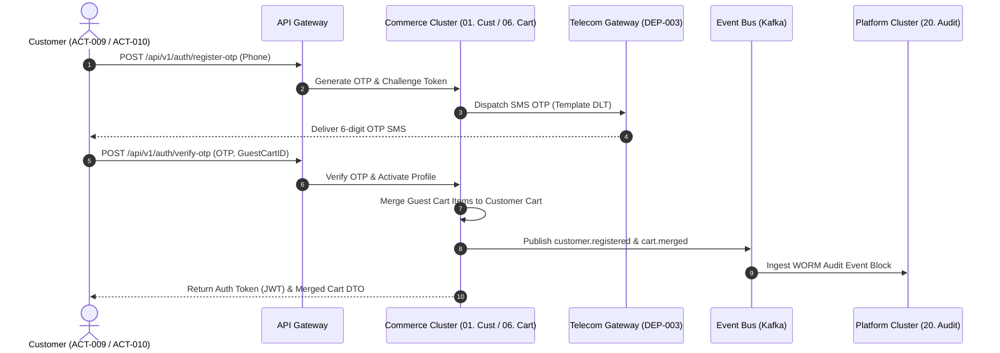

---

### 3.2 WF-002: Catalog Search, Dynamic Facets & Stockout Demotion

* **Scope:** Full-text typo-tolerant search, faceted filtering, and stockout demotion ([`FEAT-SRCH-001`](../03-business-feature-inventory.md#feat-srch-001), [`BR-SRCH-001`](../05-business-rules.md#br-srch-001), [`NFR-PERF-001`](../07-non-functional-requirements.md#nfr-perf-001)).

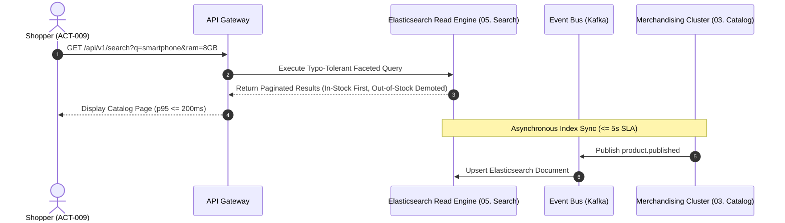

---

### 3.3 WF-003: Cart Addition & Quantity Cap Validation

* **Scope:** Adding SKUs to shopping cart and enforcing maximum purchase limits ([`FEAT-CART-001`](../03-business-feature-inventory.md#feat-cart-001), [`BR-CART-001`](../05-business-rules.md#br-cart-001), [`BR-CART-002`](../05-business-rules.md#br-cart-002)).

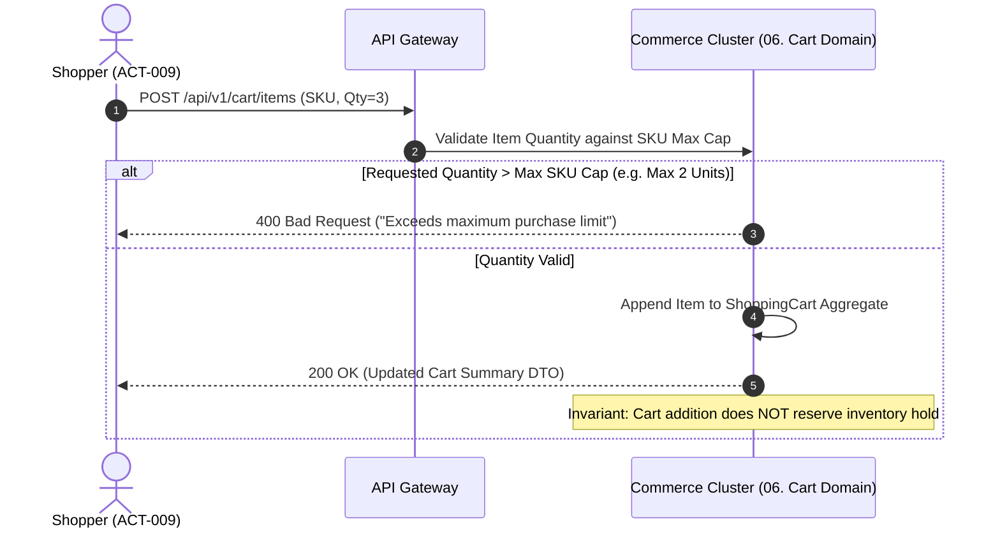

---

### 3.4 WF-004: Wishlist Management & Price Watch

* **Scope:** Adding/removing items to authenticated customer wishlist ([`FEAT-WSH-001`](../03-business-feature-inventory.md#feat-wsh-001), [`FR-WSH-001`](../04-functional-requirements.md#fr-wsh-001)).

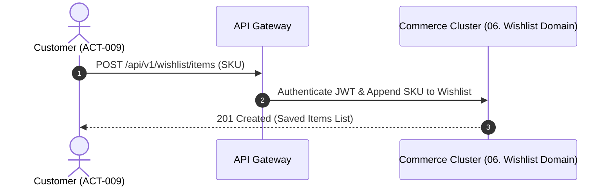

---

### 3.5 WF-005: Promotional Coupon Engine & Pro-Rata Discount Distribution

* **Scope:** Applying discount coupon codes, verifying non-stacking rules, and pro-rata line-item allocation ([`FEAT-PRM-001`](../03-business-feature-inventory.md#feat-prm-001), [`BR-PRM-001`](../05-business-rules.md#br-prm-001), [`BR-PRM-002`](../05-business-rules.md#br-prm-002)).

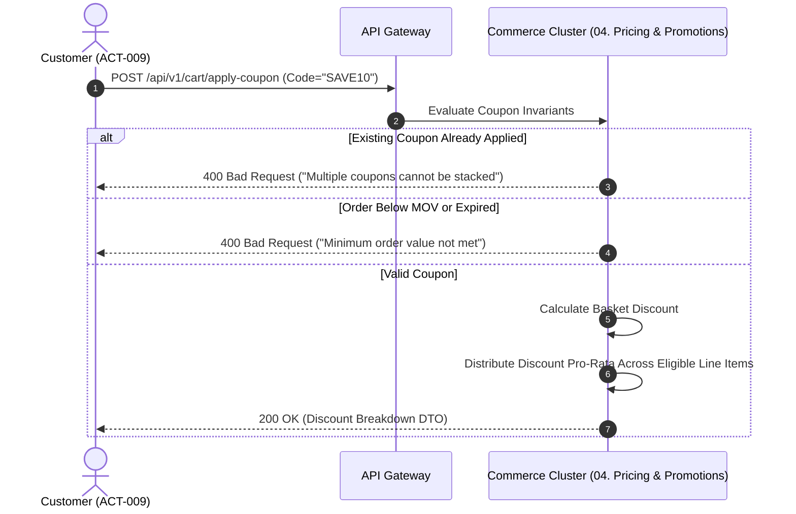

---

### 3.6 WF-006: Multi-Step Checkout & 15-Minute Atomic Hold Orchestration

* **Scope:** Initiating checkout, acquiring 15-minute atomic stock holds, and server-side total recalculation ([`FEAT-CHK-001`](../03-business-feature-inventory.md#feat-chk-001), [`BR-INV-001`](../05-business-rules.md#br-inv-001), [`BR-CHK-001`](../05-business-rules.md#br-chk-001), [`BR-CHK-002`](../05-business-rules.md#br-chk-002)).

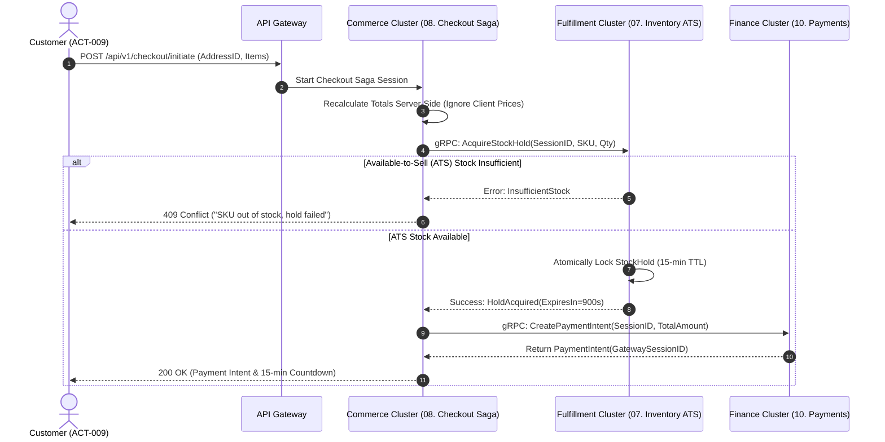

---

### 3.7 WF-007: Payment Processing, Late Webhook Recovery & Tax Invoicing

* **Scope:** Payment capture webhook, late webhook recovery, sequential tax invoice generation ([`FEAT-PAY-001`](../03-business-feature-inventory.md#feat-pay-001), [`BR-PAY-001`](../05-business-rules.md#br-pay-001), [`BR-PAY-002`](../05-business-rules.md#br-pay-002), [`BR-FIN-001`](../05-business-rules.md#br-fin-001), [`BR-FIN-003`](../05-business-rules.md#br-fin-003)).

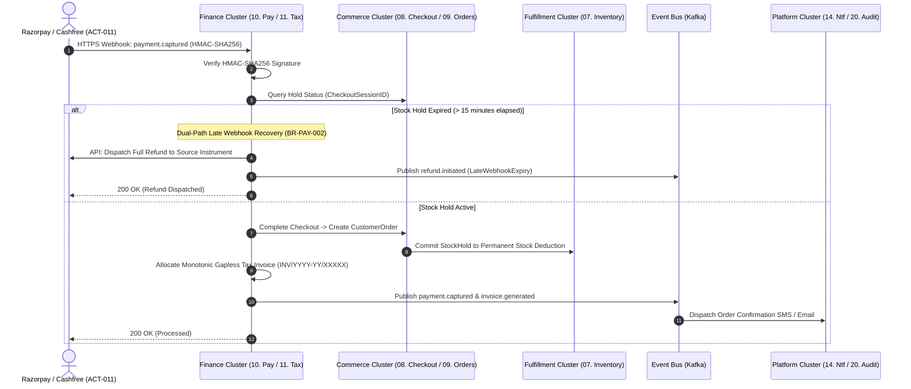

---

### 3.8 WF-008: Warehouse Pick, Serial Scanning & Consignment Booking

* **Scope:** Pick-and-pack fulfillment, mandatory serial/IMEI scanning, carrier consignment booking ([`FEAT-INV-003`](../03-business-feature-inventory.md#feat-inv-003), [`FEAT-SHP-001`](../03-business-feature-inventory.md#feat-shp-001), [`BR-INV-002`](../05-business-rules.md#br-inv-002), [`BR-SHP-001`](../05-business-rules.md#br-shp-001)).

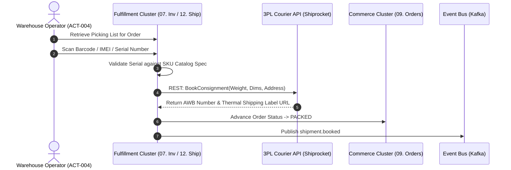

---

### 3.9 WF-009: Shipment Tracking, Delivery Updates & Automatic RTO Trigger

* **Scope:** Carrier tracking status webhook ingestion, 3-attempt delivery tracking, and automatic RTO execution ([`FEAT-SHP-001`](../03-business-feature-inventory.md#feat-shp-001), [`BR-SHP-002`](../05-business-rules.md#br-shp-002)).

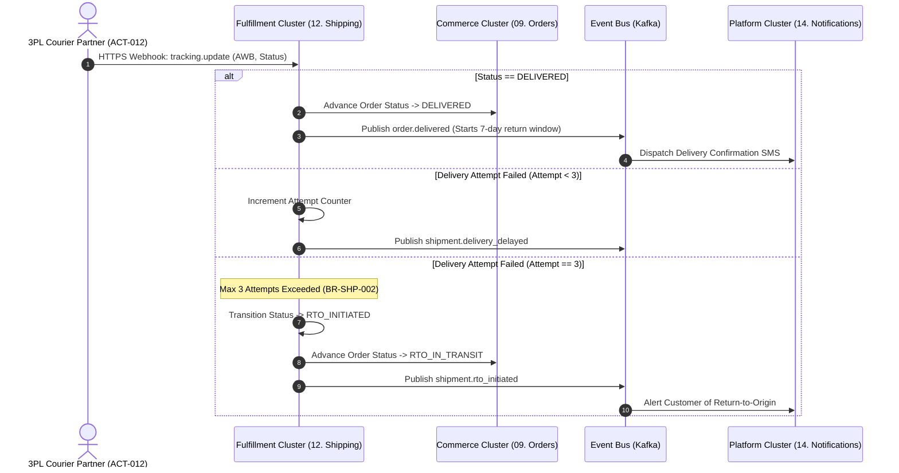

---

### 3.10 WF-010: Returns Request, Reverse Logistics, Diagnostic Gate & Refund

* **Scope:** 7-day return window validation, reverse pickup, mandatory technician diagnostic condition grading gate, source-instrument refund, and credit note generation ([`FEAT-RET-001`](../03-business-feature-inventory.md#feat-ret-001), [`BR-RET-001`](../05-business-rules.md#br-ret-001)–[`003`](../05-business-rules.md#br-ret-003), [`BR-FIN-002`](../05-business-rules.md#br-fin-002)).

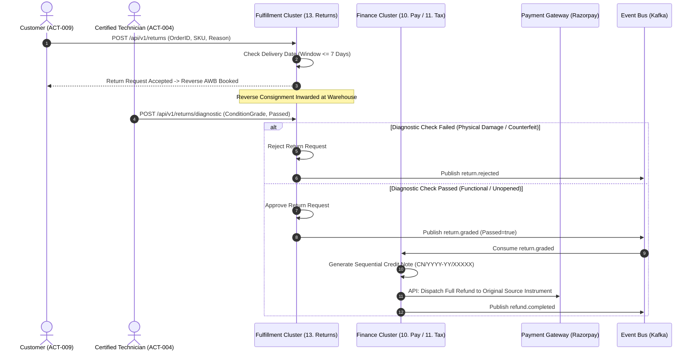

---

### 3.11 WF-011: Price Management & Minimum Margin Alert

* **Scope:** Administrative price updates, MRP ceiling validation, and below-cost warning gating ([`FEAT-PRC-001`](../03-business-feature-inventory.md#feat-prc-001), [`BR-PRC-001`](../05-business-rules.md#br-prc-001), [`BR-PRC-002`](../05-business-rules.md#br-prc-002)).

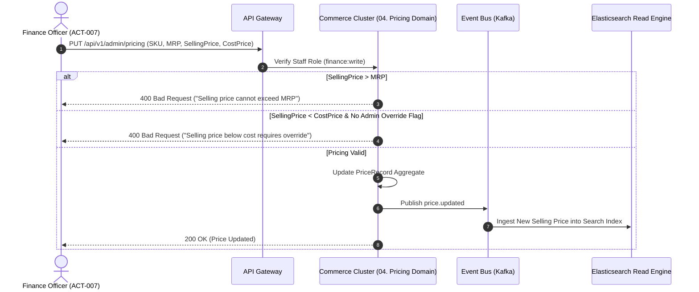

---

### 3.12 WF-012: Daily Sales Reconciliation & Financial Reporting

* **Scope:** Reconciling captured payment transactions, invoiced ledgers, and bank settlement batches ([`FEAT-PAY-002`](../03-business-feature-inventory.md#feat-pay-002), [`FEAT-RPT-001`](../03-business-feature-inventory.md#feat-rpt-001), [`BR-RPT-001`](../05-business-rules.md#br-rpt-001)).

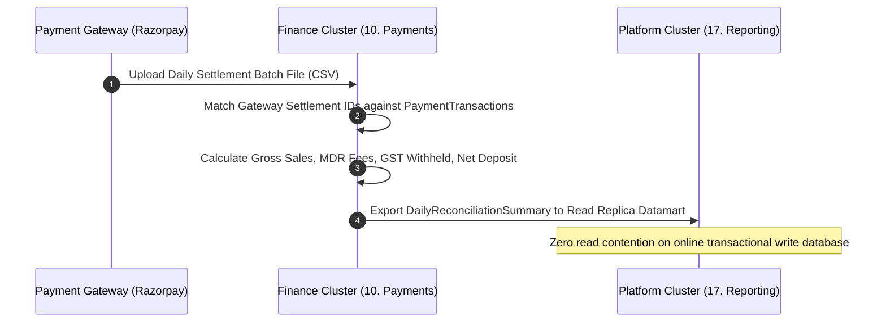

---

### 3.13 WF-017: Verified-Buyer Review Submission & Moderation (ID Reconciled; Full Sequence Audit Pending)

* **Scope:** Enforcing verified-purchaser review gating, abuse filtering, and star rating aggregation ([`FEAT-REV-001`](../03-business-feature-inventory.md#feat-rev-001), [`BR-REV-001`](../05-business-rules.md#br-rev-001)).

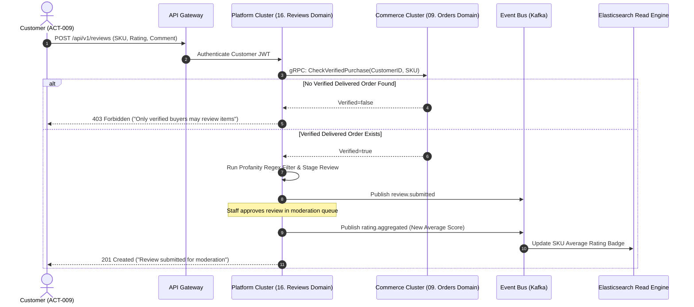

---

### 3.14 WF-014: Customer Support Ticket Intake & Transit Damage Dispute

* **Scope:** Customer support ticketing, transit dispute intake, and 2-hour critical SLA escalation ([`FEAT-SUP-001`](../03-business-feature-inventory.md#feat-sup-001), [`BR-SUP-001`](../05-business-rules.md#br-sup-001)).

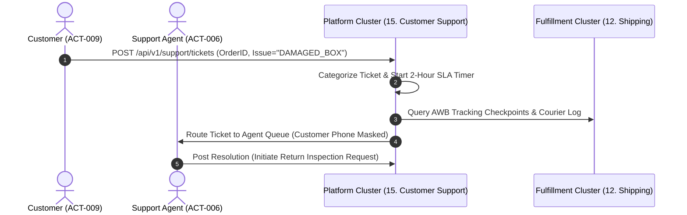

---

### 3.15 WF-015: Transactional Notification Dispatch

* **Scope:** Multi-channel message queuing, TRAI DLT template validation, and dispatch bypass of promotional opt-outs ([`FEAT-NTF-001`](../03-business-feature-inventory.md#feat-ntf-001), [`BR-NTF-001`](../05-business-rules.md#br-ntf-001)).

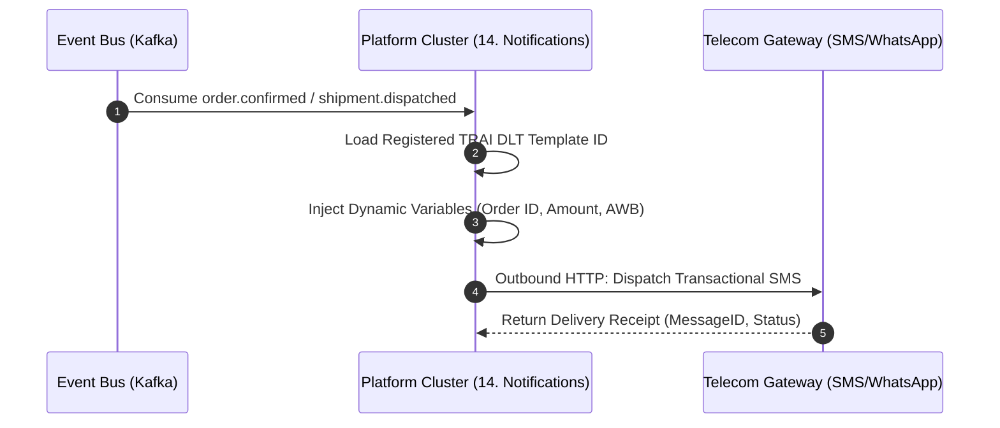

---

### 3.16 WF-016: Staff RBAC Authentication, MFA & Cryptographic Audit

* **Scope:** Administrative login, mandatory TOTP MFA, 15-minute inactivity expiry, and WORM SHA-256 hash chaining ([`FEAT-ADM-001`](../03-business-feature-inventory.md#feat-adm-001), [`FEAT-AUD-001`](../03-business-feature-inventory.md#feat-aud-001), [`BR-ADM-001`](../05-business-rules.md#br-adm-001), [`BR-ADM-002`](../05-business-rules.md#br-adm-002), [`BR-AUD-001`](../05-business-rules.md#br-aud-001)).

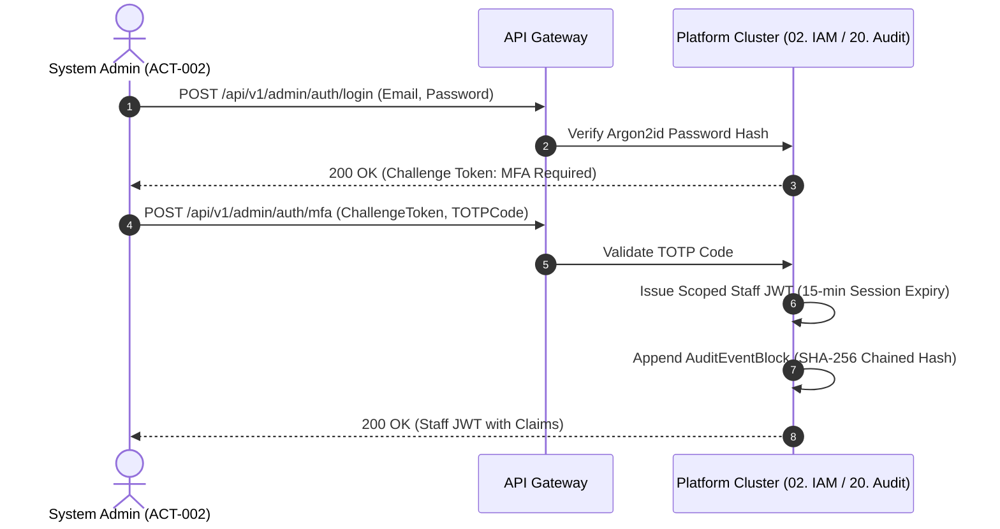

---

## 4. Requirements Traceability Matrix for Workflows

| Business Workflow | Mapped Business Features (`FEAT`) | Mapped Functional Requirements (`FR`) | Mapped Business Rules (`BR`) | Primary Clusters Involved |
| :--- | :--- | :--- | :--- | :--- |
| **`WF-001`** (Registration & Session) | [`FEAT-CUST-001`](../03-business-feature-inventory.md#feat-cust-001), [`FEAT-CART-001`](../03-business-feature-inventory.md#feat-cart-001) | [`FR-CUST-001`](../04-functional-requirements.md#fr-cust-001), [`FR-CART-001`](../04-functional-requirements.md#fr-cart-001) | [`BR-CUST-001`](../05-business-rules.md#br-cust-001), [`BR-CART-001`](../05-business-rules.md#br-cart-001) | Cluster 2 (Commerce), Cluster 5 (Platform) |
| **`WF-002`** (Catalog Discovery & Search) | [`FEAT-CAT-001`](../03-business-feature-inventory.md#feat-cat-001), [`FEAT-SRCH-001`](../03-business-feature-inventory.md#feat-srch-001) | [`FR-CAT-001`](../04-functional-requirements.md#fr-cat-001), [`FR-SRCH-001`](../04-functional-requirements.md#fr-srch-001) | [`BR-CAT-001`](../05-business-rules.md#br-cat-001), [`BR-SRCH-001`](../05-business-rules.md#br-srch-001) | Cluster 1 (Merchandising), Search Read Engine |
| **`WF-003`** (Cart Addition & Quantity) | [`FEAT-CART-001`](../03-business-feature-inventory.md#feat-cart-001) | [`FR-CART-001`](../04-functional-requirements.md#fr-cart-001) | [`BR-CART-001`](../05-business-rules.md#br-cart-001), [`BR-CART-002`](../05-business-rules.md#br-cart-002) | Cluster 2 (Commerce) |
| **`WF-004`** (Wishlist Management) | [`FEAT-WSH-001`](../03-business-feature-inventory.md#feat-wsh-001) | [`FR-WSH-001`](../04-functional-requirements.md#fr-wsh-001) | [`BR-CUST-001`](../05-business-rules.md#br-cust-001) | Cluster 2 (Commerce) |
| **`WF-005`** (Promotions & Coupons) | [`FEAT-PRM-001`](../03-business-feature-inventory.md#feat-prm-001) | [`FR-PRM-001`](../04-functional-requirements.md#fr-prm-001), [`FR-PRM-002`](../04-functional-requirements.md#fr-prm-002) | [`BR-PRM-001`](../05-business-rules.md#br-prm-001), [`BR-PRM-002`](../05-business-rules.md#br-prm-002) | Cluster 2 (Commerce) |
| **`WF-006`** (Checkout & 15-Min Hold) | [`FEAT-CHK-001`](../03-business-feature-inventory.md#feat-chk-001), [`FEAT-INV-002`](../03-business-feature-inventory.md#feat-inv-002) | [`FR-CHK-001`](../04-functional-requirements.md#fr-chk-001), [`002`](../04-functional-requirements.md#fr-chk-002), [`FR-INV-002`](../04-functional-requirements.md#fr-inv-002) | [`BR-CHK-001`](../05-business-rules.md#br-chk-001), [`002`](../05-business-rules.md#br-chk-002), [`BR-INV-001`](../05-business-rules.md#br-inv-001) | Cluster 2 (Commerce), Cluster 3 (Fulfillment) |
| **`WF-007`** (Payment & Invoicing) | [`FEAT-PAY-001`](../03-business-feature-inventory.md#feat-pay-001), [`FEAT-FIN-001`](../03-business-feature-inventory.md#feat-fin-001) | [`FR-PAY-001`](../04-functional-requirements.md#fr-pay-001), [`FR-FIN-001`](../04-functional-requirements.md#fr-fin-001) | [`BR-PAY-001`](../05-business-rules.md#br-pay-001)–[`003`](../05-business-rules.md#br-pay-003), [`BR-FIN-001`](../05-business-rules.md#br-fin-001) | Cluster 4 (Finance), Cluster 2 (Commerce) |
| **`WF-008`** (Warehouse Pick & Manifest) | [`FEAT-INV-003`](../03-business-feature-inventory.md#feat-inv-003), [`FEAT-SHP-001`](../03-business-feature-inventory.md#feat-shp-001) | [`FR-INV-003`](../04-functional-requirements.md#fr-inv-003), [`FR-SHP-001`](../04-functional-requirements.md#fr-shp-001) | [`BR-INV-002`](../05-business-rules.md#br-inv-002), [`BR-SHP-001`](../05-business-rules.md#br-shp-001) | Cluster 3 (Fulfillment), Cluster 2 (Commerce) |
| **`WF-009`** (Tracking & Delivery RTO) | [`FEAT-SHP-001`](../03-business-feature-inventory.md#feat-shp-001) | [`FR-SHP-002`](../04-functional-requirements.md#fr-shp-002) | [`BR-SHP-001`](../05-business-rules.md#br-shp-001), [`BR-SHP-002`](../05-business-rules.md#br-shp-002) | Cluster 3 (Fulfillment), Cluster 2 (Commerce) |
| **`WF-010`** (Returns & Diagnostic Gate) | [`FEAT-RET-001`](../03-business-feature-inventory.md#feat-ret-001), [`FEAT-FIN-002`](../03-business-feature-inventory.md#feat-fin-002) | [`FR-RET-001`](../04-functional-requirements.md#fr-ret-001)–[`003`](../04-functional-requirements.md#fr-ret-003) | [`BR-RET-001`](../05-business-rules.md#br-ret-001)–[`003`](../05-business-rules.md#br-ret-003), [`BR-FIN-002`](../05-business-rules.md#br-fin-002) | Cluster 3 (Fulfillment), Cluster 4 (Finance) |
| **`WF-011`** (Price Updates & Alerts) | [`FEAT-PRC-001`](../03-business-feature-inventory.md#feat-prc-001) | [`FR-PRC-001`](../04-functional-requirements.md#fr-prc-001) | [`BR-PRC-001`](../05-business-rules.md#br-prc-001), [`BR-PRC-002`](../05-business-rules.md#br-prc-002) | Cluster 2 (Commerce), Search Read Engine |
| **`WF-012`** (Sales Reconciliation) | [`FEAT-PAY-002`](../03-business-feature-inventory.md#feat-pay-002), [`FEAT-RPT-001`](../03-business-feature-inventory.md#feat-rpt-001) | [`FR-PAY-003`](../04-functional-requirements.md#fr-pay-003), [`FR-RPT-001`](../04-functional-requirements.md#fr-rpt-001) | [`BR-RPT-001`](../05-business-rules.md#br-rpt-001) | Cluster 4 (Finance), Cluster 5 (Platform) |
| **`WF-013`** (Verified Reviews) | [`FEAT-REV-001`](../03-business-feature-inventory.md#feat-rev-001) | [`FR-REV-001`](../04-functional-requirements.md#fr-rev-001) | [`BR-REV-001`](../05-business-rules.md#br-rev-001) | Cluster 5 (Platform), Cluster 2 (Commerce) |
| **`WF-014`** (Customer Support) | [`FEAT-SUP-001`](../03-business-feature-inventory.md#feat-sup-001) | [`FR-SUP-001`](../04-functional-requirements.md#fr-sup-001) | [`BR-SUP-001`](../05-business-rules.md#br-sup-001) | Cluster 5 (Platform), Cluster 3 (Fulfillment) |
| **`WF-015`** (Notifications Dispatch) | [`FEAT-NTF-001`](../03-business-feature-inventory.md#feat-ntf-001) | [`FR-NTF-001`](../04-functional-requirements.md#fr-ntf-001) | [`BR-NTF-001`](../05-business-rules.md#br-ntf-001) | Cluster 5 (Platform) |
| **`WF-016`** (Staff IAM & WORM Audit) | [`FEAT-ADM-001`](../03-business-feature-inventory.md#feat-adm-001), [`FEAT-AUD-001`](../03-business-feature-inventory.md#feat-aud-001) | [`FR-SEC-001`](../04-functional-requirements.md#fr-sec-001), [`FR-AUD-001`](../04-functional-requirements.md#fr-aud-001) | [`BR-ADM-001`](../05-business-rules.md#br-adm-001), [`BR-AUD-001`](../05-business-rules.md#br-aud-001) | Cluster 5 (Platform) |

---

## 5. Review and Acceptance Checklist

The checklist below governs the quality gate audit for `ARCH-04`:

- [ ] 1. **Complete Workflow Coverage:** Reconcile sequence diagrams and mappings against all 17 business workflows (`WF-001` through `WF-017`).
- [x] 2. **Explicit Synchronous vs Asynchronous Boundary:** Sequence diagrams distinguish synchronous client/RPC blocking calls from asynchronous Kafka CloudEvents.
- [x] 3. **Semantic Compensation Paths:** Explicit rollback and compensation branches documented for checkout hold expiration, payment failure, and reverse diagnostic rejection.
- [x] 4. **Single-Retailer Anti-Scope Preserved:** Zero third-party marketplace, vendor commission, or split payout interactions present.
- [ ] 5. **Mermaid Syntax & Delimiter Balance:** Revalidate all diagrams after workflow ID and coverage remediation.
- [ ] 6. **Requirements Traceability:** Verify every sequence flow against the current BRD feature, functional requirement, business rule and workflow identifiers before claiming complete coverage.
- [x] 7. **Non-Binding Labeling:** Prominently marked as a non-binding draft pending formal Phase 1 sign-off.
