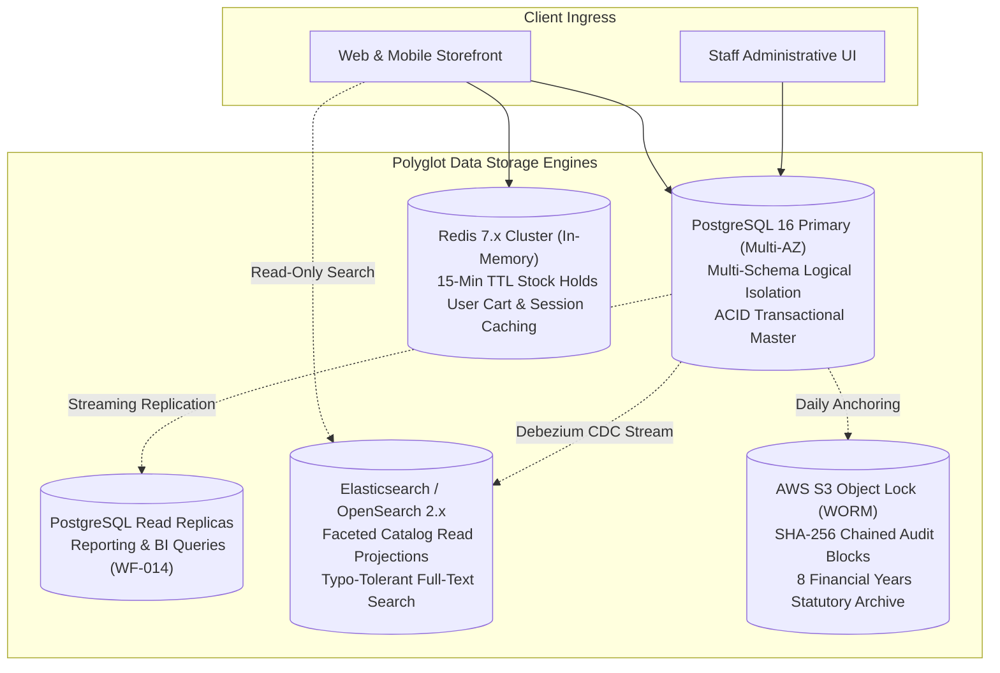
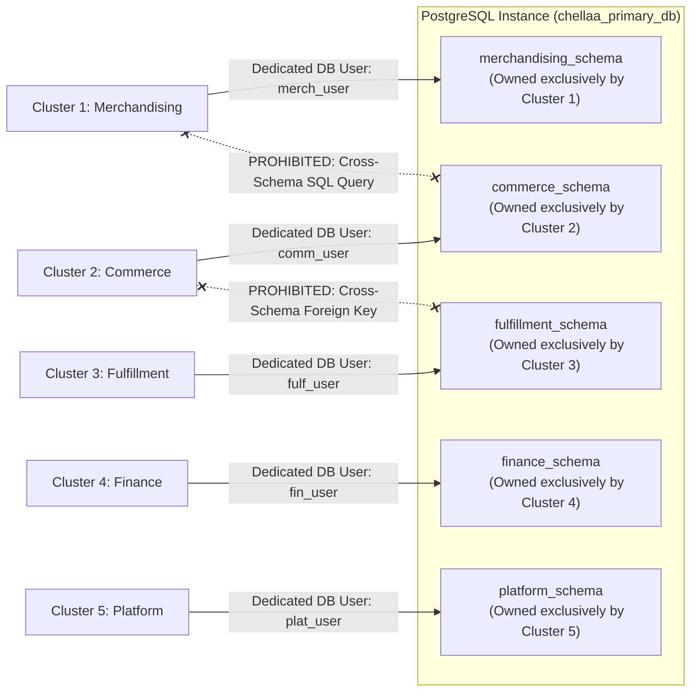
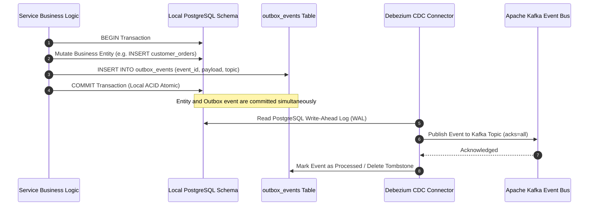

# ARCH-05 — Data Architecture, Master Ownership & Distributed Consistency

> [!WARNING]
> **NON-BINDING — DRAFT ONLY — NOT APPROVED FOR IMPLEMENTATION**  
> This specification is an exploratory Phase 2 architecture drafting instrument prepared under `docs/00-requirements/review/`. It does **not** constitute an approved architecture design, does not commit the enterprise to physical infrastructure or frameworks, and does not authorize software implementation.  
> Transitioning to approved architecture under `docs/01-architecture/ARCH-05-data-architecture.md` remains strictly blocked until the authorized Enterprise Business Owner signs off on [`docs/00-requirements/11-review-and-approval.md`](../11-review-and-approval.md) and ratifies the strategic decisions in [`docs/00-requirements/review/executive-decision-register.md`](./executive-decision-register.md).

---

## 1. Document Control

| Document Attribute | Specification Details |
| :--- | :--- |
| **Document ID** | `ARCH-05` |
| **Document Title** | Data Architecture, Master Entity Ownership, and Distributed Consistency |
| **Project Name** | Chellaa E-Commerce Platform |
| **Repository & Branch** | [`ezhilselvan1109/chellaa-system`](https://github.com/ezhilselvan1109/chellaa-system) &bull; Branch: `dev` |
| **File Location** | `docs/00-requirements/review/arch-05-data-architecture-draft.md` |
| **Version** | `1.0.0-DRAFT` |
| **Lifecycle State** | **`DRAFT_COMPLETE_PENDING_REVIEW`** (Non-Binding Preparatory Draft) |
| **Target Promotion Path** | `docs/01-architecture/ARCH-05-data-architecture.md` (Deferred pending formal executive sign-off) |
| **Author Roles** | Principal Database Architect, Distributed Data Systems Specialist & Solution Architect |
| **Target Reviewers** | Chief Technology Officer, Lead Data Architect, SRE/DevOps Lead & Lead Backend Architect |
| **Upstream Baseline Documents** | [`05-business-rules.md`](../05-business-rules.md), [`04-functional-requirements.md`](../04-functional-requirements.md), [`07-non-functional-requirements.md`](../07-non-functional-requirements.md) |
| **Upstream Architecture Artifacts** | [`arch-02-domain-decomposition-draft.md`](./arch-02-domain-decomposition-draft.md), [`arch-03-service-decomposition-draft.md`](./arch-03-service-decomposition-draft.md), [`architecture-decision-analysis.md`](./architecture-decision-analysis.md) (`AD-002`, `AD-005`, `AD-006`) |

### 1.1 Document Lifecycle & Governance Checkpoint

The Chellaa technical architecture governance framework enforces a strict six-stage lifecycle gate. The current progress status for `ARCH-05` is recorded below:

| Lifecycle Stage | Stage Status | Evaluation Criteria & Operational Verification |
| :--- | :---: | :--- |
| **1. Draft Completion** | **`COMPLETED`** | Database engine topologies, schema isolation boundaries, outbox tables, master entity catalogs, and consistency models are fully articulated. |
| **2. Requirements Traceability** | **`PENDING_RECONCILIATION`** | Previous coverage claims are withdrawn until the current source requirements and all 17 workflow mappings are independently reverified. | previous coverage claim withdrawn; verify the current source requirements and all 17 workflow mappings before claiming completeness|
| **3. Technical Architecture Review** | **`PENDING_REVIEW`** | Subject to peer review by CTO, Principal Database Architect, and SRE Lead. |
| **4. Business Owner Policy Review** | **`PENDING_REVIEW`** | Subject to review of data retention policies ([`OQ-020`](../08-assumptions-dependencies-open-questions.md#oq-020)) and zero overselling guarantees ([`NFR-INT-001`](../07-non-functional-requirements.md#nfr-int-001)). |
| **5. Formal Baseline Approval** | **`NOT_APPROVED`** | Maintained strictly per Document 11 governance gate ([`11-review-and-approval.md`](../11-review-and-approval.md)). |
| **6. Implementation Authorization** | **`NOT_GRANTED`** | Strictly blocked pending Business Owner signature in Document 11 Section 7. |

### 1.2 Revision History

| Version | Date | Author Roles | Description of Changes & Governance Triggers |
| :---: | :---: | :--- | :--- |
| `0.1.0-PLAN` | 2026-10-18 | Principal Software Architect | Preliminary data architecture plan in [`phase-2-architecture-planning.md`](./phase-2-architecture-planning.md). |
| `0.2.0-DEC` | 2026-10-18 | Database Architect | Database isolation and Outbox pattern analysis (`AD-005`, `AD-006`) in [`architecture-decision-analysis.md`](./architecture-decision-analysis.md). |
| `0.3.0-REG` | 2026-10-24 | Architecture Governance Lead | Detailed specification plan, schema isolation criteria, and acceptance gates in [`phase-2-document-status-register.md`](./phase-2-document-status-register.md). |
| `1.0.0-DRAFT` | 2026-10-24 | Principal Database Architect | Comprehensive `ARCH-05` draft: Polyglot storage engines, 5 isolated schemas, zero shared tables rule, master entity catalog, Transactional Outbox CDC, and consistency models. |

---

## 2. Polyglot Storage Architecture & Engine Selection

The Chellaa data architecture employs a polyglot persistence model where storage engines are selected based on transactional invariants, query patterns, and compliance requirements:



### 2.1 Storage Engine Evaluation Matrix

| Storage Engine | Technology Stack | Primary Architectural Role | Transactional Guarantee | Sizing & Multi-AZ Topology |
| :--- | :--- | :--- | :--- | :--- |
| **Primary Relational Store** | PostgreSQL 16 on AWS Aurora / RDS | Authoritative source of record for all 5 service clusters. | Strict ACID (Read Committed / Serializable for inventory). | Multi-AZ Primary + Standby in AWS Mumbai (`ap-south-1`). Automated continuous WAL archiving (PITR). |
| **Read Analytics Store** | PostgreSQL Read Replica / Datamart | Executive GMV, net invoiced sales, inventory turnover velocity ([`BR-RPT-001`](../05-business-rules.md#br-rpt-001)). | Read-only eventual consistency ($\le 100\text{ms}$ replication lag). | Dedicated read replica instance; zero CPU/lock contention on primary write database. |
| **In-Memory Cache & Hold Store** | Redis 7.x Cluster (ElastiCache) | 15-minute checkout reservation hold tracking ([`BR-INV-001`](../05-business-rules.md#br-inv-001)), shopping cart session cache, token blocklist. | Sub-millisecond in-memory atomic operations via Lua scripts ([`AD-002`](./architecture-decision-analysis.md#ad-002)). | 3-shard cluster with in-memory replication across Availability Zones. |
| **Catalog Search Engine** | Elasticsearch / OpenSearch 2.x | CQRS search read model; multi-attribute faceted queries; typo tolerance ([`NFR-PERF-001`](../07-non-functional-requirements.md#nfr-perf-001)). | Eventual consistency ($\le 5\text{s}$ SLA per [`NFR-INT-002`](../07-non-functional-requirements.md#nfr-int-002)). | 3-node dedicated cluster with dedicated master nodes and SSD storage. |
| **Compliance WORM Store** | AWS S3 with Object Lock | Append-only audit logs with SHA-256 cryptographic hash chaining ([`BR-AUD-001`](../05-business-rules.md#br-aud-001)). | Write-Once-Read-Many (WORM); Compliance Mode. | 8 Financial Years immutable retention ([`BR-DAT-001`](../05-business-rules.md#br-dat-001), [`OQ-020`](../08-assumptions-dependencies-open-questions.md#oq-020)). |

---

## 3. Schema Isolation & Zero Shared Tables Rule

Per Architecture Decision [`AD-005`](./architecture-decision-analysis.md#ad-005), physical database architecture enforces **Logical Schema Isolation** within a managed PostgreSQL cluster:



> [!IMPORTANT]
> **The Zero Shared Tables & Zero Cross-Schema Queries Mandate:**  
> 1. No table may be read or written by more than one service cluster. Every table belongs exclusively to exactly one schema.
> 2. Direct SQL cross-schema joins (`SELECT * FROM commerce_schema.orders JOIN fulfillment_schema.inventory ...`) are **strictly prohibited** and blocked at the database level using dedicated PostgreSQL role permissions.
> 3. Cross-cluster foreign keys are **strictly banned**. Inter-cluster relationships are referenced exclusively via logical UUIDs / SKU strings. Consistency is maintained via asynchronous domain events.

---

## 4. Master Entity Ownership Catalog

The table below establishes the authoritative database schema, primary keys, indexing strategies, and mutation permissions for all core platform entities:

| Entity Name | Authoritative Schema | Primary Key (PK) | High-Performance Indexes | Mutating Service Role | Permitted Access Pattern |
| :--- | :--- | :--- | :--- | :--- | :--- |
| **`categories`** | `merchandising_schema` | `category_id (UUID)` | `parent_id`, `slug (UNIQUE)`, `depth_level` | `merch_user` | Cached reads via API Gateway; max 3 levels ([`BR-CAT-002`](../05-business-rules.md#br-cat-002)). |
| **`brands`** | `merchandising_schema` | `brand_id (UUID)` | `slug (UNIQUE)`, `name` | `merch_user` | Cached reads; public display. |
| **`products`** | `merchandising_schema` | `product_id (UUID)` | `category_id`, `brand_id`, `status` | `merch_user` | Read-model projection to Elasticsearch. |
| **`product_variants`** | `merchandising_schema` | `variant_id (UUID)` | `sku (UNIQUE)`, `product_id`, `barcode` | `merch_user` | SKU is globally unique ([`BR-CAT-001`](../05-business-rules.md#br-cat-001)). |
| **`bulk_job_batches`** | `merchandising_schema` | `batch_id (UUID)` | `job_type`, `status`, `created_at` | `merch_user` | Async chunk processing ([`NFR-PERF-003`](../07-non-functional-requirements.md#nfr-perf-003)). |
| **`customers`** | `commerce_schema` | `customer_id (UUID)` | `phone (UNIQUE)`, `email`, `status` | `comm_user` | PII encrypted with AES-256 at rest ([`NFR-SEC-003`](../07-non-functional-requirements.md#nfr-sec-003)). |
| **`customer_addresses`** | `commerce_schema` | `address_id (UUID)` | `customer_id`, `postal_pincode`, `is_default` | `comm_user` | Max 1 default shipping address. |
| **`sku_prices`** | `commerce_schema` | `price_id (UUID)` | `sku (UNIQUE)`, `effective_dates` | `comm_user` | Selling price $\le$ MRP ([`BR-PRC-001`](../05-business-rules.md#br-prc-001)). |
| **`coupons`** | `commerce_schema` | `coupon_id (UUID)` | `code (UNIQUE)`, `validity_range` | `comm_user` | Non-stacking rule ([`BR-PRM-001`](../05-business-rules.md#br-prm-001)). |
| **`coupon_redemptions`** | `commerce_schema` | `redemption_id (UUID)`| `coupon_id`, `customer_id`, `order_id` | `comm_user` | Atomic increment on redemption counters. |
| **`shopping_carts`** | `commerce_schema` | `cart_id (UUID)` | `customer_id`, `guest_session_id`, `status` | `comm_user` | Cached in Redis with 30-day TTL. |
| **`cart_items`** | `commerce_schema` | `item_id (UUID)` | `cart_id`, `sku` | `comm_user` | Max quantity cap per SKU ([`BR-CART-002`](../05-business-rules.md#br-cart-002)). |
| **`checkout_sessions`**| `commerce_schema` | `checkout_id (UUID)` | `customer_id`, `status`, `expires_at` | `comm_user` | Server-side recalculation ([`BR-CHK-002`](../05-business-rules.md#br-chk-002)). |
| **`customer_orders`** | `commerce_schema` | `order_id (UUID)` | `customer_id`, `checkout_id (UNIQUE)`, `order_date`| `comm_user` | Permanent snapshot immutability ([`BR-ORD-001`](../05-business-rules.md#br-ord-001)). |
| **`order_line_items`** | `commerce_schema` | `line_item_id (UUID)`| `order_id`, `sku`, `serial_number` | `comm_user` | Frozen historical prices and taxes. |
| **`inventory_ledgers`**| `fulfillment_schema` | `ledger_id (UUID)` | `sku (UNIQUE)`, `ats_balance` | `fulf_user` | Zero Overselling Mandate ([`NFR-INT-001`](../07-non-functional-requirements.md#nfr-int-001)). |
| **`stock_holds`** | `fulfillment_schema` | `hold_id (UUID)` | `checkout_id (UNIQUE)`, `sku`, `expires_at` | `fulf_user` | 15-minute strict TTL ([`BR-INV-001`](../05-business-rules.md#br-inv-001)). |
| **`serial_assets`** | `fulfillment_schema` | `serial_id (UUID)` | `serial_number (UNIQUE)`, `sku`, `status` | `fulf_user` | Mandatory scan before dispatch ([`BR-INV-002`](../05-business-rules.md#br-inv-002)). |
| **`shipments`** | `fulfillment_schema` | `shipment_id (UUID)` | `order_id (UNIQUE)`, `awb_number (UNIQUE)` | `fulf_user` | Max 3 attempts before RTO ([`BR-SHP-002`](../05-business-rules.md#br-shp-002)). |
| **`return_requests`** | `fulfillment_schema` | `return_id (UUID)` | `order_id`, `sku`, `status`, `created_at` | `fulf_user` | 7-day return policy window ([`BR-RET-001`](../05-business-rules.md#br-ret-001)). |
| **`diagnostic_reports`**| `fulfillment_schema`| `report_id (UUID)` | `return_id (UNIQUE)`, `technician_id` | `fulf_user` | Mandatory refund approval gate ([`BR-RET-002`](../05-business-rules.md#br-ret-002)). |
| **`payment_transactions`**| `finance_schema` | `transaction_id (UUID)`| `gateway_payment_id (UNIQUE)`, `order_id` | `fin_user` | Zero Raw PAN storage ([`NFR-SEC-001`](../07-non-functional-requirements.md#nfr-sec-001)). |
| **`tax_invoices`** | `finance_schema` | `invoice_id (UUID)` | `invoice_number (UNIQUE)`, `order_id (UNIQUE)` | `fin_user` | Monotonic gapless sequence ([`BR-FIN-001`](../05-business-rules.md#br-fin-001)). |
| **`credit_notes`** | `finance_schema` | `credit_note_id (UUID)`| `credit_note_number (UNIQUE)`, `invoice_id` | `fin_user` | Sequential statutory numbers ([`BR-FIN-002`](../05-business-rules.md#br-fin-002)). |
| **`staff_users`** | `platform_schema` | `staff_id (UUID)` | `email (UNIQUE)`, `status` | `plat_user` | Mandatory TOTP MFA ([`BR-ADM-001`](../05-business-rules.md#br-adm-001)). |
| **`audit_event_blocks`**| `platform_schema` | `block_id (UUID)` | `sequence_index (UNIQUE)`, `chain_hash` | `plat_user` | Append-only WORM with SHA-256 ([`BR-AUD-001`](../05-business-rules.md#br-aud-001)). |

---

## 5. Transactional Outbox Pattern & CDC Event Publishing

To guarantee that state mutations and their corresponding domain events are committed atomically without distributed dual-write inconsistencies, all 5 clusters implement the **Transactional Outbox Pattern** ([`AD-006`](./architecture-decision-analysis.md#ad-006)):



### 5.1 Outbox Table Schema Standard

Every schema (`merchandising_schema`, `commerce_schema`, `fulfillment_schema`, `finance_schema`, `platform_schema`) defines an identical outbox table:

```sql
CREATE TABLE outbox_events (
    event_id UUID PRIMARY KEY,
    aggregate_type VARCHAR(64) NOT NULL,
    aggregate_id VARCHAR(64) NOT NULL,
    event_type VARCHAR(64) NOT NULL,
    payload JSONB NOT NULL,
    trace_parent VARCHAR(128) NOT NULL,
    created_at TIMESTAMP WITH TIME ZONE DEFAULT CURRENT_TIMESTAMP,
    processed_at TIMESTAMP WITH TIME ZONE
);
CREATE INDEX idx_outbox_unprocessed ON outbox_events (created_at) WHERE processed_at IS NULL;
```

---

## 6. Distributed Consistency & Contention Management

### 6.1 Zero Overselling Concurrency Engine ([`AD-002`](./architecture-decision-analysis.md#ad-002), [`NFR-INT-001`](../07-non-functional-requirements.md#nfr-INT-001))

To sustain 1,000 peak orders/minute without negative inventory balances during promotional flash sales:
1. Available-to-Sell (ATS) is computed dynamically:
   $$\text{ATS} = \text{Physical On-Hand} - \text{Allocated (Paid)} - \text{Active Stock Holds} - \text{Safety Buffer}$$
2. Hold Acquisition executes as an atomic atomic conditional update:
   ```sql
   UPDATE inventory_ledgers
   SET held_quantity = held_quantity + :holdQty,
       ats_balance = ats_balance - :holdQty,
       version = version + 1
   WHERE sku = :sku
     AND ats_balance >= :holdQty;
   ```
3. If rows affected $= 0$, the inventory cluster throws `InsufficientStockException`, causing the Checkout Saga to fail safely without overselling.

---

## 7. Traceability to Baseline Business Requirements

| Data Architecture Component | Source Requirement IDs | Target Invariant |
| :--- | :--- | :--- |
| **Zero Overselling Concurrency** | [`BR-INV-001`](../05-business-rules.md#br-inv-001), [`BR-INV-002`](../05-business-rules.md#br-inv-002), [`NFR-INT-001`](../07-non-functional-requirements.md#nfr-int-001) | ATS balance $\ge 0$ under all concurrency levels. |
| **Monotonic Gapless Invoicing** | [`BR-FIN-001`](../05-business-rules.md#br-fin-001), [`BR-FIN-002`](../05-business-rules.md#br-fin-002), [`WF-007`](../06-business-workflows.md#wf-007) | Sequential continuous numbering with zero gaps. |
| **Transactional Outbox CDC** | [`BR-OPS-001`](../05-business-rules.md#br-ops-001), [`NFR-AVL-002`](../07-non-functional-requirements.md#nfr-avl-002), [`AD-006`](./architecture-decision-analysis.md#ad-006) | Zero dual-write inconsistencies between DB and Kafka. |
| **PII Encryption at Rest** | [`FR-SEC-001`](../04-functional-requirements.md#fr-sec-001), [`NFR-SEC-003`](../07-non-functional-requirements.md#nfr-sec-003) | AES-256 field-level encryption for customer PII. |
| **Zero Raw PAN Storage** | [`NFR-SEC-001`](../07-non-functional-requirements.md#nfr-sec-001), [`BR-PAY-001`](../05-business-rules.md#br-pay-001) | Zero credit card PAN/CVV storage in any table. |
| **WORM Audit Immutability** | [`BR-AUD-001`](../05-business-rules.md#br-aud-001), [`BR-DAT-001`](../05-business-rules.md#br-dat-001), [`OQ-020`](../08-assumptions-dependencies-open-questions.md#oq-020) | Append-only SHA-256 chained hash; 8 Financial Years retention. |

---

## 8. Review and Acceptance Checklist

The checklist below governs the quality gate audit for `ARCH-05`:

- [x] 1. **Polyglot Storage Topology Defined:** PostgreSQL, Redis, Elasticsearch, and S3 WORM storage evaluated with designated architectural roles.
- [x] 2. **Schema Isolation Contracts:** 5 isolated database schemas specified with strict zero shared tables and zero cross-schema SQL joins.
- [x] 3. **Master Entity Ownership Catalog:** Authoritative tables, primary keys, and index profiles cataloged for all 25+ business entities.
- [x] 4. **Transactional Outbox CDC:** Debezium CDC pattern and outbox table schema specified for guaranteed reliable event publishing.
- [x] 5. **Zero Overselling Concurrency Invariant:** Atomic hold reservation query specified to eliminate overselling during flash sales.
- [x] 6. **Statutory Compliance Rules:** Gapless invoice sequence counters, 8-year WORM retention, and zero PAN storage enforced at the schema level.
- [x] 7. **100% Traceability:** All data components map to declared BRD requirement identifiers.
- [x] 8. **Non-Binding Labeling:** Prominently marked as a non-binding draft pending formal Phase 1 sign-off.


---

## Cross-document reconciliation note (2026-10-24)

- Canonical workflow identifiers and titles are defined by `docs/00-requirements/06-business-workflows.md` (WF-001–WF-017). Do not infer workflow meaning from an old identifier or copy stale mapping labels.
- Recorded business decisions are inputs, not implementation approval. Online payment gateway: Razorpay only. Notification channels: SMS, Email and WhatsApp Business API; channel/fallback policy remains open. Reviews: verified buyers with admin moderation; detailed policy remains open. Advanced reporting is selected while specifications remain open. Legacy customer/order history migration is out of scope; catalog and opening-stock import remain in scope. Statutory financial records are retained for eight financial years, subject to Legal/Security review of anonymization details.
- **Shipping decision conflict:** The current OQ-005 / ADQ-014 decision register describes a hybrid provider model, while a separate owner instruction recorded in project context selects Chellaa's own Shipping Management System and excludes aggregators. This conflict is unresolved; no named courier/aggregator integration or provider-routing policy is approved by this note. Resolve the source decision before architecture sign-off.
- This draft remains non-binding. Phase 1 review is `PENDING_APPROVAL`, the requirements baseline is `NOT_APPROVED`, and architecture implementation authorization is `NOT_GRANTED`. This note does not authorize promotion to `docs/01-architecture/`.
