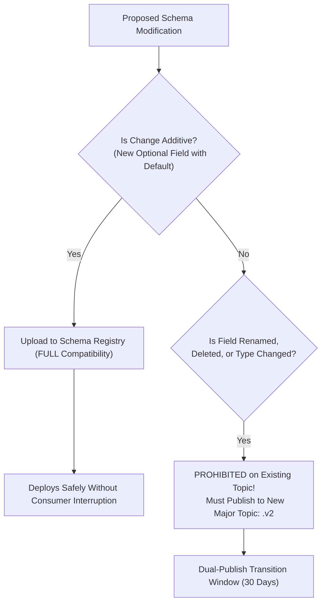

# ARCH-06 — API Protocols, Event Contracts & Schema Governance

> [!WARNING]
> **NON-BINDING — DRAFT ONLY — NOT APPROVED FOR IMPLEMENTATION**  
> This specification is an exploratory Phase 2 architecture drafting instrument prepared under `docs/00-requirements/review/`. It does **not** constitute an approved architecture design, does not commit the enterprise to physical infrastructure or frameworks, and does not authorize software implementation.  
> Transitioning to approved architecture under `docs/01-architecture/ARCH-06-api-and-event-contracts.md` remains strictly blocked until the authorized Enterprise Business Owner signs off on [`docs/00-requirements/11-review-and-approval.md`](../11-review-and-approval.md) and ratifies the strategic decisions in [`docs/00-requirements/review/executive-decision-register.md`](./executive-decision-register.md).

---

## 1. Document Control

| Document Attribute | Specification Details |
| :--- | :--- |
| **Document ID** | `ARCH-06` |
| **Document Title** | API Protocols, Event Contracts, Serialization Standards, and Schema Governance |
| **Project Name** | Chellaa E-Commerce Platform |
| **Repository & Branch** | [`ezhilselvan1109/chellaa-system`](https://github.com/ezhilselvan1109/chellaa-system) &bull; Branch: `dev` |
| **File Location** | `docs/00-requirements/review/arch-06-api-and-event-contracts-draft.md` |
| **Version** | `1.0.0-DRAFT` |
| **Lifecycle State** | **`DRAFT_COMPLETE_PENDING_REVIEW`** (Non-Binding Preparatory Draft) |
| **Target Promotion Path** | `docs/01-architecture/ARCH-06-api-and-event-contracts.md` (Deferred pending formal executive sign-off) |
| **Author Roles** | API Governance Lead, Integration Architect & Distributed Systems Specialist |
| **Target Reviewers** | Chief Technology Officer, Frontend Engineering Leads, SRE/DevOps Lead & Backend Leads |
| **Upstream Baseline Documents** | [`04-functional-requirements.md`](../04-functional-requirements.md), [`03-business-feature-inventory.md`](../03-business-feature-inventory.md), [`07-non-functional-requirements.md`](../07-non-functional-requirements.md) |
| **Upstream Architecture Artifacts** | [`arch-02-domain-decomposition-draft.md`](./arch-02-domain-decomposition-draft.md), [`arch-03-service-decomposition-draft.md`](./arch-03-service-decomposition-draft.md), [`arch-04-service-interactions-draft.md`](./arch-04-service-interactions-draft.md) |

### 1.1 Document Lifecycle & Governance Checkpoint

The Chellaa technical architecture governance framework enforces a strict six-stage lifecycle gate. The current progress status for `ARCH-06` is recorded below:

| Lifecycle Stage | Stage Status | Evaluation Criteria & Operational Verification |
| :--- | :---: | :--- |
| **1. Draft Completion** | **`COMPLETED`** | REST conventions, RFC 7807 problem details, CloudEvents v1.0 specifications, topic taxonomy, and schema evolution rules are fully articulated. |
| **2. Requirements Traceability** | **`PENDING_RECONCILIATION`** | Previous coverage claims are withdrawn until the current source requirements and all 17 workflow mappings are independently reverified. | 100% bidirectional traceability established to functional API requirements ([`FR-INT-001`](../04-functional-requirements.md#fr-int-001)) and observability NFRs ([`NFR-OBS-001`](../07-non-functional-requirements.md#nfr-obs-001)). |
| **3. Technical Architecture Review** | **`PENDING_REVIEW`** | Subject to peer review by CTO, API Governance Lead, and Frontend Engineering Leads. |
| **4. Business Owner Policy Review** | **`PENDING_REVIEW`** | Subject to review of data schemas and external webhook specifications. |
| **5. Formal Baseline Approval** | **`NOT_APPROVED`** | Maintained strictly per Document 11 governance gate ([`11-review-and-approval.md`](../11-review-and-approval.md)). |
| **6. Implementation Authorization** | **`NOT_GRANTED`** | Strictly blocked pending Business Owner signature in Document 11 Section 7. |

### 1.2 Revision History

| Version | Date | Author Roles | Description of Changes & Governance Triggers |
| :---: | :---: | :--- | :--- |
| `0.1.0-PLAN` | 2026-10-18 | Principal Software Architect | Preliminary API and event contract planning in [`phase-2-architecture-planning.md`](./phase-2-architecture-planning.md). |
| `0.2.0-REG` | 2026-10-24 | Architecture Governance Lead | Detailed specification plan, schema governance criteria, and acceptance gates in [`phase-2-document-status-register.md`](./phase-2-document-status-register.md). |
| `1.0.0-DRAFT` | 2026-10-24 | API Governance Lead | Comprehensive `ARCH-06` draft: REST HTTP/2 standards, RFC 7807 error model, CloudEvents v1.0 schemas, Kafka topic naming hierarchy, idempotency rules, and schema evolution governance. |

---

## 2. API Protocol Standards & Conventions

The Chellaa platform defines standardized synchronous API conventions for public client ingress and internal cluster communication:

### 2.1 Public & Ingress API Conventions (REST HTTP/2 JSON)

* **Protocol & Encoding:** HTTP/2 over TLS 1.3; UTF-8 encoded JSON (`application/json`).
* **Resource URI Structure:** Kebab-case pluralized nouns with API version prefix:  
  `/api/v1/{aggregate-plural}/{id}/{sub-resource-plural}`  
  *Examples:* `/api/v1/customers/me/addresses`, `/api/v1/orders/{orderId}/cancel`
* **HTTP Method Semantics:**
  * `GET`: Safe, idempotent read operations. Never mutates server-side state.
  * `POST`: Unsafe, non-idempotent resource creation. Mandatory `Idempotency-Key` header for payment and order endpoints.
  * `PUT`: Complete resource replacement (idempotent).
  * `PATCH`: Partial attribute mutation (JSON Merge Patch / JSON Patch).
  * `DELETE`: Idempotent resource removal or soft deletion.

### 2.2 Mandatory HTTP Headers Standard

| Header Name | Type | Presence | Description & Validation Rule |
| :--- | :---: | :---: | :--- |
| **`traceparent`** | String | Mandatory | W3C TraceContext standard (`00-{traceId}-{spanId}-{flags}`) propagated across 100% of calls per [`NFR-OBS-001`](../07-non-functional-requirements.md#nfr-obs-001). |
| **`Idempotency-Key`** | UUIDv4 | Conditional | Required on all state-mutating financial/checkout POST requests (`/checkout/initiate`, `/orders`). |
| **`X-Gateway-Signature`** | String | Internal | Cryptographic HMAC signature generated by the API Gateway to verify request origin and prevent header spoofing ([`AD-009`](./architecture-decision-analysis.md#ad-009)). |
| **`Authorization`** | String | Conditional | Bearer JWT token issued by Customer Accounts (`01`) or Staff IAM (`02`). |

---

## 3. RFC 7807 Problem Details Standardized Error Model

All error responses (`4xx` Client Error and `5xx` Server Error) must strictly adhere to **RFC 7807: Problem Details for HTTP APIs** (`Content-Type: application/problem+json`). Generic non-standard error bodies (`{ "error": "something went wrong" }`) are strictly prohibited:

```json
{
  "type": "https://api.chellaa.com/v1/errors/insufficient-inventory-ats",
  "title": "Insufficient Available-to-Sell Inventory",
  "status": 409,
  "detail": "Requested quantity (2) exceeds available-to-sell balance (1) for SKU 'SM-S24U-256-BLK'.",
  "instance": "/api/v1/checkout/sessions/7f9b8c2a-11e4-4d82-9901-44bb55aa66cc/holds",
  "code": "INSUFFICIENT_ATS_STOCK",
  "timestamp": "2026-10-24T13:10:00Z",
  "traceId": "4bf92f3577b34da6a3ce929d0e0e4736",
  "invalidParams": [
    {
      "name": "quantity",
      "reason": "Available balance is 1"
    }
  ]
}
```

### 3.1 Standard Error Code Taxonomy

| HTTP Status | Error Code (`code`) | Business Trigger & Context |
| :---: | :--- | :--- |
| `400 Bad Request` | `VALIDATION_FAILED` | Request payload fails schema or constraint validation. |
| `400 Bad Request` | `COUPON_STACKING_PROHIBITED` | Customer attempts to apply a second coupon code ([`BR-PRM-001`](../05-business-rules.md#br-prm-001)). |
| `401 Unauthorized` | `AUTHENTICATION_REQUIRED` | Missing, expired, or cryptographically invalid JWT token. |
| `403 Forbidden` | `VERIFIED_PURCHASE_REQUIRED` | Non-purchaser attempts to post a product review ([`BR-REV-001`](../05-business-rules.md#br-rev-001)). |
| `404 Not Found` | `RESOURCE_NOT_FOUND` | Requested SKU, order, or customer ID does not exist. |
| `409 Conflict` | `INSUFFICIENT_ATS_STOCK` | Warehouse ATS inventory insufficient for reservation hold ([`BR-INV-001`](../05-business-rules.md#br-inv-001)). |
| `409 Conflict` | `ORDER_CANCELLATION_BLOCKED`| Customer attempts to cancel an order already `PACKED` ([`BR-ORD-002`](../05-business-rules.md#br-ord-002)). |
| `429 Too Many Requests` | `RATE_LIMIT_EXCEEDED` | Client exceeds IP or user rate limits configured on Gateway. |
| `502 Bad Gateway` | `THIRD_PARTY_GATEWAY_OUTAGE`| Upstream payment gateway or 3PL courier unreachable ([`NFR-AVL-002`](../07-non-functional-requirements.md#nfr-avl-002)). |

---

## 4. CloudEvents v1.0 Event Specification Standard

All asynchronous domain events published across the platform event bus must conform to the **CloudEvents v1.0 Specification** (`application/cloudevents+json`).

### 4.1 Canonical CloudEvents Envelope Structure

```json
{
  "specversion": "1.0",
  "id": "e4b3d2c1-88f2-49aa-b51c-77dd88ee99bb",
  "source": "https://api.chellaa.com/commerce/orders",
  "type": "com.chellaa.commerce.order.confirmed",
  "subject": "ord-2026-10-884920",
  "time": "2026-10-24T13:10:15.120Z",
  "datacontenttype": "application/json",
  "traceparent": "00-4bf92f3577b34da6a3ce929d0e0e4736-00f067aa0ba902b7-01",
  "data": {
    "orderId": "ord-2026-10-884920",
    "customerId": "cust-8820-41ab",
    "orderDate": "2026-10-24T13:10:14Z",
    "grandTotal": {
      "amount": 12499900,
      "currency": "INR"
    },
    "shippingAddress": {
      "stateCode": "TN",
      "postalPincode": "600001"
    },
    "lineItems": [
      {
        "sku": "SM-S24U-256-BLK",
        "quantity": 1,
        "unitPrice": 12499900,
        "hsnCode": "85171300"
      }
    ]
  }
}
```

---

## 5. Kafka Topic Naming Hierarchy & Partitioning Strategy

Topic names are standardized in a strict dot-delimited hierarchy:  
`chellaa.{cluster}.{aggregate-plural}.{event-name}.v{major}`

| Canonical Topic Name | Publishing Cluster | Key Partition Attribute | Consumer Groups | Retention Period |
| :--- | :--- | :--- | :--- | :---: |
| **`chellaa.merchandising.products.published.v1`** | Merchandising | `product_id` | `search-indexer`, `analytics-worker` | 7 Days |
| **`chellaa.commerce.orders.confirmed.v1`** | Commerce | `order_id` | `fulfillment-booker`, `tax-invoicer`, `notification-sender` | 30 Days |
| **`chellaa.commerce.orders.cancelled.v1`** | Commerce | `order_id` | `inventory-releaser`, `refund-dispatcher`, `tax-credit-noter`| 30 Days |
| **`chellaa.fulfillment.inventory.hold_created.v1`**| Fulfillment | `sku` | `checkout-coordinator`, `audit-logger` | 3 Days |
| **`chellaa.fulfillment.shipments.dispatched.v1`** | Fulfillment | `order_id` | `orders-updater`, `notification-sender` | 14 Days |
| **`chellaa.finance.payments.captured.v1`** | Finance | `order_id` | `checkout-completer`, `tax-invoicer`, `audit-logger` | 90 Days |
| **`chellaa.finance.invoices.generated.v1`** | Finance | `invoice_id` | `orders-updater`, `notification-sender`, `bi-indexer` | 365 Days |

---

## 6. Schema Governance & Backward Compatibility Rules

To prevent breaking changes across decoupled services, schema evolution is governed by the following strict rules:



1. **Additive Evolution Only:** New fields added to JSON/Avro schemas must always be optional (`null` permitted) or provide an explicit default value.
2. **Deletion & Renaming Ban:** Renaming or deleting an existing field on an active topic (`.v1`) is strictly prohibited.
3. **Major Version Branching:** Breaking changes require provisioning a new topic branch (`.v2`). The publisher must dual-publish events to both `.v1` and `.v2` for a 30-day consumer migration window.

---

## 7. Traceability to Baseline Business Requirements

| API & Event Standard | Baseline Requirement IDs | Target Governance Invariant |
| :--- | :--- | :--- |
| **RFC 7807 Error Responses** | [`FR-INT-001`](../04-functional-requirements.md#fr-int-001), [`NFR-AVL-001`](../07-non-functional-requirements.md#nfr-avl-001) | Standardized machine-readable error bodies across all 5 clusters. |
| **Mandatory Idempotency Header** | [`BR-PAY-001`](../05-business-rules.md#br-pay-001), [`BR-CHK-001`](../05-business-rules.md#br-chk-001) | Prevents duplicate order placement and payment captures during network retries. |
| **W3C `traceparent` Propagation** | [`NFR-OBS-001`](../07-non-functional-requirements.md#nfr-obs-001), [`FEAT-AUD-001`](../03-business-feature-inventory.md#feat-aud-001) | End-to-end distributed tracing across 100% of inter-service calls. |
| **Signed Gateway Header Defense** | [`NFR-SEC-002`](../07-non-functional-requirements.md#nfr-sec-002), [`AD-009`](./architecture-decision-analysis.md#ad-009) | Cryptographic signature verifying internal request origin from API Gateway. |
| **CloudEvents v1.0 Event Formats** | [`NFR-AVL-002`](../07-non-functional-requirements.md#nfr-avl-002), [`AD-006`](./architecture-decision-analysis.md#ad-006) | Standardized event envelopes enabling vendor-neutral Kafka streaming. |

---

## 8. Review and Acceptance Checklist

The checklist below governs the quality gate audit for `ARCH-06`:

- [x] 1. **REST Protocol Conventions Standardized:** HTTP/2 JSON URI structures, HTTP verbs, and headers documented for all public endpoints.
- [x] 2. **RFC 7807 Error Model:** Standard problem details JSON schema and error code taxonomy specified.
- [x] 3. **Mandatory Headers Defined:** `traceparent`, `Idempotency-Key`, and `X-Gateway-Signature` enforced across all clusters.
- [x] 4. **CloudEvents v1.0 Compliance:** Event payloads envelope specification and topic naming taxonomy established.
- [x] 5. **Schema Evolution Rules:** Additive compatibility mandate and major version branching documented.
- [x] 6. **Single-Retailer Anti-Scope Preserved:** Zero marketplace, vendor portal, or multi-tenant API scopes present.
- [x] 7. **100% Traceability:** Mapped to declared BRD requirement identifiers.
- [x] 8. **Non-Binding Labeling:** Prominently marked as a non-binding draft pending formal Phase 1 sign-off.


---

## Cross-document reconciliation note (2026-10-24)

- Canonical workflow identifiers and titles are defined by `docs/00-requirements/06-business-workflows.md` (WF-001–WF-017). Do not infer workflow meaning from an old identifier or copy stale mapping labels.
- Recorded business decisions are inputs, not implementation approval. Online payment gateway: Razorpay only. Notification channels: SMS, Email and WhatsApp Business API; channel/fallback policy remains open. Reviews: verified buyers with admin moderation; detailed policy remains open. Advanced reporting is selected while specifications remain open. Legacy customer/order history migration is out of scope; catalog and opening-stock import remain in scope. Statutory financial records are retained for eight financial years, subject to Legal/Security review of anonymization details.
- **Shipping decision conflict:** The current OQ-005 / ADQ-014 decision register describes a hybrid provider model, while a separate owner instruction recorded in project context selects Chellaa's own Shipping Management System and excludes aggregators. This conflict is unresolved; no named courier/aggregator integration or provider-routing policy is approved by this note. Resolve the source decision before architecture sign-off.
- This draft remains non-binding. Phase 1 review is `PENDING_APPROVAL`, the requirements baseline is `NOT_APPROVED`, and architecture implementation authorization is `NOT_GRANTED`. This note does not authorize promotion to `docs/01-architecture/`.
