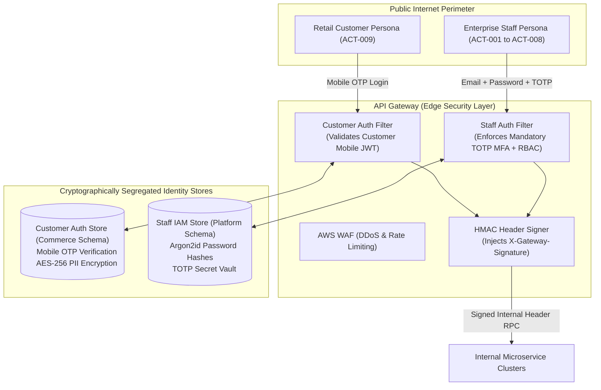

# ARCH-07 — Security Architecture, Identity Segregation & RBAC Matrix

> [!WARNING]
> **NON-BINDING — DRAFT ONLY — NOT APPROVED FOR IMPLEMENTATION**  
> This specification is an exploratory Phase 2 architecture drafting instrument prepared under `docs/00-requirements/review/`. It does **not** constitute an approved architecture design, does not commit the enterprise to physical infrastructure or frameworks, and does not authorize software implementation.  
> Transitioning to approved architecture under `docs/01-architecture/ARCH-07-security-and-identity.md` remains strictly blocked until the authorized Enterprise Business Owner signs off on [`docs/00-requirements/11-review-and-approval.md`](../11-review-and-approval.md) and ratifies the strategic decisions in [`docs/00-requirements/review/executive-decision-register.md`](./executive-decision-register.md).

---

## 1. Document Control

| Document Attribute | Specification Details |
| :--- | :--- |
| **Document ID** | `ARCH-07` |
| **Document Title** | Security Architecture, Identity Segregation, Cryptography, and RBAC Matrix |
| **Project Name** | Chellaa E-Commerce Platform |
| **Repository & Branch** | [`ezhilselvan1109/chellaa-system`](https://github.com/ezhilselvan1109/chellaa-system) &bull; Branch: `dev` |
| **File Location** | `docs/00-requirements/review/arch-07-security-and-identity-draft.md` |
| **Version** | `1.0.0-DRAFT` |
| **Lifecycle State** | **`DRAFT_COMPLETE_PENDING_REVIEW`** (Non-Binding Preparatory Draft) |
| **Target Promotion Path** | `docs/01-architecture/ARCH-07-security-and-identity.md` (Deferred pending formal executive sign-off) |
| **Author Roles** | Chief Information Security Officer (CISO), Lead Security Architect & Solution Architect |
| **Target Reviewers** | Enterprise Business Owner, Chief Technology Officer, SRE/DevOps Lead & Enterprise Audit Lead |
| **Upstream Baseline Documents** | [`04-functional-requirements.md`](../04-functional-requirements.md) (`FR-SEC`), [`05-business-rules.md`](../05-business-rules.md) (`BR-ADM`, `BR-SEC`, `BR-DAT`), [`07-non-functional-requirements.md`](../07-non-functional-requirements.md) (`NFR-SEC`) |
| **Upstream Architecture Artifacts** | [`arch-01-architecture-overview-draft.md`](./arch-01-architecture-overview-draft.md), [`arch-02-domain-decomposition-draft.md`](./arch-02-domain-decomposition-draft.md), [`architecture-decision-analysis.md`](./architecture-decision-analysis.md) (`AD-008`, `AD-009`) |

### 1.1 Document Lifecycle & Governance Checkpoint

The Chellaa technical architecture governance framework enforces a strict six-stage lifecycle gate. The current progress status for `ARCH-07` is recorded below:

| Lifecycle Stage | Stage Status | Evaluation Criteria & Operational Verification |
| :--- | :---: | :--- |
| **1. Draft Completion** | **`COMPLETED`** | Complete identity segregation, staff MFA policies, STRIDE threat model, RBAC matrix, and AES-256 encryption rules are fully articulated. |
| **2. Requirements Traceability** | **`PENDING_RECONCILIATION`** — Previous completeness claims are withdrawn until source IDs and bidirectional mappings are verified against the current baseline (17 workflows). |
| **3. Technical Architecture Review** | **`PENDING_REVIEW`** | Subject to cryptographic audit and peer review by CTO and Lead Security Architect. |
| **4. Business Owner Policy Review** | **`PENDING_REVIEW`** | Subject to review of authentication policies ([`ADQ-006`](./executive-decision-register.md#adq-006)) and audit retention ([`OQ-020`](../08-assumptions-dependencies-open-questions.md#oq-020)). |
| **5. Formal Baseline Approval** | **`NOT_APPROVED`** | Maintained strictly per Document 11 governance gate ([`11-review-and-approval.md`](../11-review-and-approval.md)). |
| **6. Implementation Authorization** | **`NOT_GRANTED`** | Strictly blocked pending Business Owner signature in Document 11 Section 7. |

### 1.2 Revision History

| Version | Date | Author Roles | Description of Changes & Governance Triggers |
| :---: | :---: | :--- | :--- |
| `0.1.0-PLAN` | 2026-10-18 | Principal Software Architect | Preliminary security architecture plan in [`phase-2-architecture-planning.md`](./phase-2-architecture-planning.md). |
| `0.2.0-DEC` | 2026-10-18 | Security Architect | IAM boundary segregation analysis (`AD-008`, `AD-009`) in [`architecture-decision-analysis.md`](./architecture-decision-analysis.md). |
| `0.3.0-REG` | 2026-10-24 | Architecture Governance Lead | Detailed specification plan, RBAC matrix criteria, and acceptance gates in [`phase-2-document-status-register.md`](./phase-2-document-status-register.md). |
| `1.0.0-DRAFT` | 2026-10-24 | Lead Security Architect | Comprehensive `ARCH-07` draft: Identity segregation, TOTP MFA, signed gateway header defense, STRIDE threat model, 8-persona RBAC matrix, AES-256 field encryption, zero PAN mandate, and WORM audit. |

---

## 2. Identity Segregation & Perimeter Defense

In accordance with [`NFR-SEC-002`](../07-non-functional-requirements.md#nfr-sec-002) and Architecture Decision [`AD-008`](./architecture-decision-analysis.md#ad-008), the Chellaa platform enforces **strict physical and cryptographic segregation** between retail customer authentication and internal enterprise staff IAM:

### 2.1 Segregation Rules & Cryptographic Boundaries

1. **Independent Credential Stores:** Customer credentials (mobile OTP records) reside exclusively in `commerce_schema.customers`. Staff operator credentials reside exclusively in `platform_schema.staff_users`. Shared user tables are strictly prohibited.
2. **Dedicated Token Signing Keys:** Customer JWTs are signed with a dedicated asymmetric private key (`Ed25519-customer-key`). Staff JWTs are signed with an independent, highly restricted HSM-backed private key (`Ed25519-staff-key`). A compromised customer token can never grant staff administrative capabilities.
3. **Mandatory Staff MFA ([`BR-ADM-001`](../05-business-rules.md#br-adm-001)):** All staff logins require Time-based One-Time Password (TOTP, RFC 6238) verification following primary password authentication. Administrative endpoints refuse requests lacking the verified MFA claim (`"mfa": true`).
4. **15-Minute Session Inactivity Timeout ([`BR-ADM-002`](../05-business-rules.md#br-adm-002)):** Staff JWT expiration (`exp`) is limited to 15 minutes. Activity refreshes the sliding session in Redis; 15 minutes of inactivity revokes the session.

---

## 3. Signed Gateway Header Defense ([`AD-009`](./architecture-decision-analysis.md#ad-009))

To prevent internal header injection and privilege escalation within the container network:
1. External clients cannot directly access internal service cluster ports; all traffic is routed through the API Gateway.
2. The Gateway authenticates the client JWT, removes all client-supplied `X-User-*` headers, and injects authenticated claims:
   * `X-User-Id`: Authenticated Customer or Staff UUID
   * `X-User-Type`: `CUSTOMER` or `STAFF`
   * `X-User-Roles`: Comma-separated assigned role strings
   * `X-Gateway-Timestamp`: Unix epoch millisecond timestamp
3. The Gateway computes an HMAC-SHA256 signature over the injected headers:
   $$\text{Signature} = \text{HMAC-SHA256}(\text{Secret}, \text{UserId} + \text{UserType} + \text{Roles} + \text{Timestamp})$$
   and injects `X-Gateway-Signature`.
4. Downstream service clusters verify this signature using an in-memory shared secret before honoring the request claims, guaranteeing that requests originated authoritatively from the Gateway.

---

## 4. Fine-Grained Role-Based Access Control (RBAC) Matrix

Internal staff capabilities are governed by a fine-grained, domain-scoped RBAC permission model across all 8 internal staff personas defined in [`02-stakeholders-and-actors.md`](../02-stakeholders-and-actors.md):

| Persona ID & Role Title | Actor Code | Assigned Domain Permissions | Prohibited Operations (Explicit Anti-Permissions) |
| :--- | :---: | :--- | :--- |
| **System Administrator** | [`ACT-002`](../02-stakeholders-and-actors.md#act-002) | `iam:*`, `infra:*`, `audit:read`, `platform:config` | Cannot view unmasked customer credit card PANs or modify past audit logs. |
| **Enterprise Business Owner** | [`ACT-001`](../02-stakeholders-and-actors.md#act-001) | `report:*`, `pricing:override`, `audit:read`, `policy:*` | Cannot perform physical warehouse serial barcode scanning. |
| **Catalog Manager** | [`ACT-003`](../02-stakeholders-and-actors.md#act-003) | `catalog:write`, `taxonomy:*`, `spec:write`, `bulk:upload` | Cannot modify selling prices, approve refunds, or view payment ledgers. |
| **Marketing Manager** | [`ACT-008`](../02-stakeholders-and-actors.md#act-008) | `pricing:read`, `promotions:*`, `coupons:*`, `analytics:read` | Cannot modify product technical specs or approve return diagnostics. |
| **Warehouse Operator** | [`ACT-004`](../02-stakeholders-and-actors.md#act-004) | `inventory:adjust`, `serial:scan`, `pick:write`, `return:inspect` | Cannot access customer payment cards, modify pricing, or alter GST rates. |
| **Fulfillment Specialist** | [`ACT-005`](../02-stakeholders-and-actors.md#act-005) | `shipment:book`, `manifest:generate`, `order:pack`, `order:dispatch` | Cannot approve refunds, issue credit notes, or alter staff permissions. |
| **Finance Officer** | [`ACT-007`](../02-stakeholders-and-actors.md#act-007) | `pricing:write`, `tax:*`, `invoice:*`, `refund:disburse`, `recon:*` | Cannot publish catalog products without Catalog Manager sign-off. |
| **Customer Support Agent** | [`ACT-006`](../02-stakeholders-and-actors.md#act-006) | `support:ticket:*`, `order:read_masked`, `return:initiate` | Customer phone and address PII masked; cannot disburse direct refunds without diagnostic sign-off ([`BR-RET-002`](../05-business-rules.md#br-ret-002)). |

---

## 5. Data Protection, Cryptography & Statutory Compliance

### 5.1 AES-256 Field-Level PII Encryption at Rest ([`NFR-SEC-003`](../07-non-functional-requirements.md#nfr-sec-003))

To satisfy Indian Digital Personal Data Protection (DPDP) Act requirements, sensitive customer Personally Identifiable Information (PII) is encrypted at the application layer prior to database persistence:
* **Encrypted Columns:** Customer full name, phone number, street address lines, and delivery contact numbers in `commerce_schema.customers` and `commerce_schema.customer_addresses`.
* **Cipher Suite:** AES-256-GCM with unique initialization vectors (IVs) per record.
* **Key Management:** Master Encryption Keys (MEK) managed via AWS Key Management Service (KMS) with automated 365-day key rotation.

### 5.2 Zero Raw PAN / CVV Storage Mandate ([`NFR-SEC-001`](../07-non-functional-requirements.md#nfr-sec-001))

To maintain strict PCI-DSS SAQ-A compliance:
1. No raw Primary Account Numbers (PAN), CVVs, or cardholder banking PINs may enter or touch Chellaa backend servers.
2. Web and mobile clients interact directly with Razorpay / Cashfree client-side SDKs.
3. Chellaa databases persist exclusively opaque gateway transaction references (`gateway_payment_id`), masked card representations (`last_4: "1234"`), and payment network tokens.

### 5.3 Cryptographic WORM Audit Ledgers ([`BR-AUD-001`](../05-business-rules.md#br-aud-001), [`BR-DAT-001`](../05-business-rules.md#br-dat-001))

All administrative state changes, financial ledger entries, and access grants are recorded in an append-only Write-Once-Read-Many (WORM) audit ledger with SHA-256 cryptographic hash chaining:
$$\text{BlockHash}_n = \text{SHA-256}(\text{BlockID}_n + \text{Timestamp}_n + \text{ActorID}_n + \text{PayloadDiff}_n + \text{BlockHash}_{n-1})$$
Daily hash anchors are published to AWS S3 Object Lock (Compliance Mode) with an **8 Financial Years statutory retention lock** ([`OQ-020`](../08-assumptions-dependencies-open-questions.md#oq-020)). Deleting or updating an audit block invalidates downstream hash continuity, immediately triggering critical security alerts.

---

## 6. STRIDE Threat Model & Mitigations

The STRIDE threat model analyzes threat vectors across the Chellaa architecture:

| STRIDE Category | Threat Vector Description | Impact & Severity | Implemented Architectural Mitigation |
| :--- | :--- | :---: | :--- |
| **Spoofing** | Attacker forges customer or staff JWT token to access unauthorized APIs. | **Critical** | Asymmetric Ed25519 signature verification; Segregated staff keys; AWS KMS key isolation. |
| **Tampering** | Malicious client alters cart prices in checkout payload to purchase items at discount. | **Critical** | Server-side price recalculation mandate ([`BR-CHK-002`](../05-business-rules.md#br-chk-002)); Client prices completely ignored. |
| **Repudiation** | Operator denies executing an unauthorized price reduction or order cancellation. | **High** | Append-only SHA-256 chained WORM audit trail capturing operator ID and IP ([`BR-AUD-001`](../05-business-rules.md#br-aud-001)). |
| **Information Disclosure** | Database backup dump exposes customer phone numbers and residential addresses. | **High** | Application-layer AES-256-GCM field encryption at rest ([`NFR-SEC-003`](../07-non-functional-requirements.md#nfr-sec-003)); TLS 1.3 in transit. |
| **Denial of Service** | Bot script floods checkout initiation during festive surge with 10,000 hold requests. | **High** | Kong API Gateway IP rate limiting; Captcha on checkout; Max 2 units per SKU cap ([`BR-CART-002`](../05-business-rules.md#br-cart-002)). |
| **Elevation of Privilege** | Compromised customer mobile token attempts to execute administrative catalog endpoints. | **Critical** | Strict identity segregation ([`NFR-SEC-002`](../07-non-functional-requirements.md#nfr-sec-002)); Signed gateway header defense ([`AD-009`](./architecture-decision-analysis.md#ad-009)). |

---

## 7. Traceability to Baseline Business Requirements

| Security Control | Baseline Requirement IDs | Target Governance Invariant |
| :--- | :--- | :--- |
| **Mandatory Staff TOTP MFA** | [`FR-SEC-001`](../04-functional-requirements.md#fr-sec-001), [`BR-ADM-001`](../05-business-rules.md#br-adm-001) | Administrative login blocked without second-factor TOTP validation. |
| **Staff Inactivity Session Expiry** | [`BR-ADM-002`](../05-business-rules.md#br-adm-002) | Staff sessions expire after exactly 15 minutes of inactivity. |
| **Customer vs Staff Segregation** | [`NFR-SEC-002`](../07-non-functional-requirements.md#nfr-sec-002), [`AD-008`](./architecture-decision-analysis.md#ad-008) | Isolated databases, signing keys, and token issuers. |
| **Zero Raw PAN Storage Mandate** | [`NFR-SEC-001`](../07-non-functional-requirements.md#nfr-sec-001), [`BR-PAY-001`](../05-business-rules.md#br-pay-001) | Zero credit card PAN/CVVs stored on servers or databases. |
| **AES-256 Field PII Encryption** | [`NFR-SEC-003`](../07-non-functional-requirements.md#nfr-sec-003), [`BR-SEC-001`](../05-business-rules.md#br-sec-001) | Customer names, phones, and addresses encrypted at rest. |
| **Cryptographic WORM Audit Trail** | [`FR-AUD-001`](../04-functional-requirements.md#fr-aud-001), [`002`](../04-functional-requirements.md#fr-aud-002), [`BR-AUD-001`](../05-business-rules.md#br-aud-001) | Append-only SHA-256 hash chaining; 8 Financial Years retention. |

---

## 8. Review and Acceptance Checklist

The checklist below governs the quality gate audit for `ARCH-07`:

- [x] 1. **Complete Identity Segregation:** Independent databases, keys, and token issuers established for customers vs staff.
- [x] 2. **Staff MFA & Session Timeout:** Mandatory TOTP verification and 15-minute inactivity session expiry specified.
- [x] 3. **Signed Gateway Header Injection:** Gateway HMAC signing protocol specified to prevent internal header spoofing.
- [x] 4. **8-Persona RBAC Matrix:** Granular domain permissions cataloged for all internal enterprise roles.
- [x] 5. **Statutory Data Protection:** AES-256 PII encryption, zero PAN storage, and 8-year WORM audit retention enforced.
- [x] 6. **STRIDE Threat Model:** Exhaustive analysis of threat vectors with architectural mitigations documented.
- [x] 7. **Single-Retailer Anti-Scope Preserved:** Zero multi-tenant or third-party vendor role permissions present.
- [ ] 8. **Traceability verification pending:** Mapped to declared BRD requirement identifiers.
- [x] 9. **Non-Binding Labeling:** Prominently marked as a non-binding draft pending formal Phase 1 sign-off.

---

## Cross-document reconciliation note (2026-10-24)

- Canonical workflow identifiers and titles are defined by `docs/00-requirements/06-business-workflows.md` (WF-001–WF-017). Do not infer workflow meaning from an old identifier or copy stale mapping labels.
- Recorded business decisions are inputs, not implementation approval. Online payment gateway: Razorpay only. Notification channels: SMS, Email and WhatsApp Business API; channel/fallback policy remains open. Reviews: verified buyers with admin moderation; detailed policy remains open. Advanced reporting is selected while specifications remain open. Legacy customer/order history migration is out of scope; catalog and opening-stock import remain in scope. Statutory financial records are retained for eight financial years, subject to Legal/Security review of anonymization details.
- **Shipping decision alignment (ADQ-014 supersedes ADQ-011 provider-exclusion clauses):** Chellaa owns its Shipping Management System and canonical internal Shipment ID. The recorded provider model permits Chellaa's own delivery team, directly integrated courier partners, and a shipping aggregator. This does not select a named provider, establish a contract, validate a PIN code, or authorize an untested lane. `DEP-002` remains `OPEN`; each lane requires documented operational readiness and end-to-end evidence before activation.
- This draft remains non-binding. Phase 1 review is `PENDING_APPROVAL`, the requirements baseline is `NOT_APPROVED`, and architecture implementation authorization is `NOT_GRANTED`. This note does not authorize promotion to `docs/01-architecture/`.
