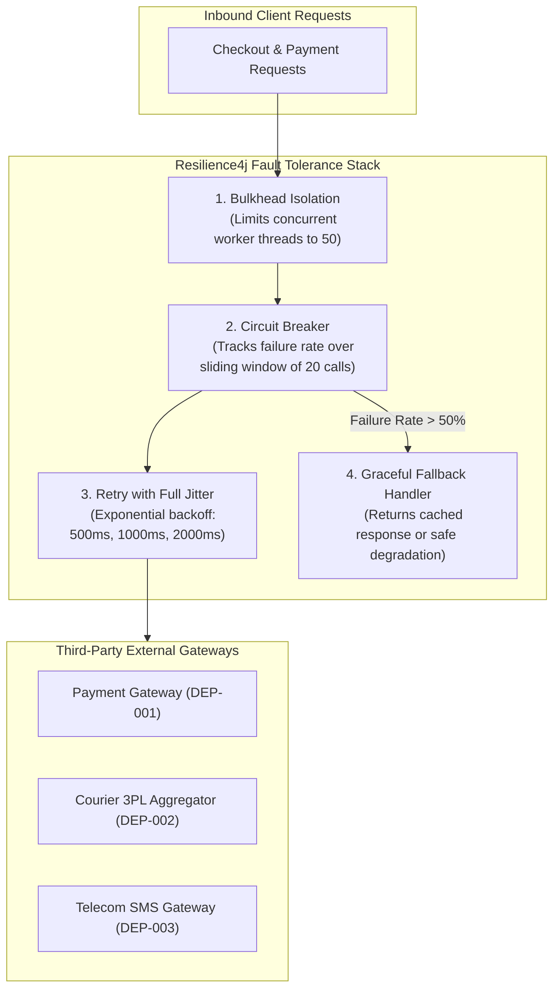
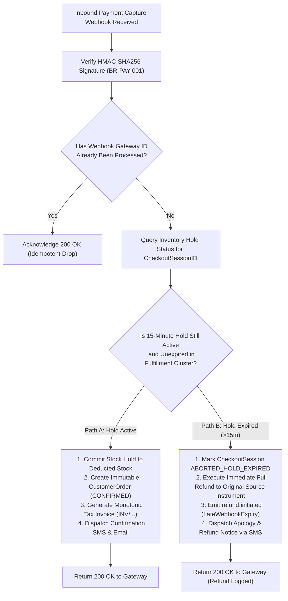

# ARCH-08 — Reliability, Resilience & Failure Recovery Strategy

> [!WARNING]
> **NON-BINDING — DRAFT ONLY — NOT APPROVED FOR IMPLEMENTATION**  
> This specification is an exploratory Phase 2 architecture drafting instrument prepared under `docs/00-requirements/review/`. It does **not** constitute an approved architecture design, does not commit the enterprise to physical infrastructure or frameworks, and does not authorize software implementation.  
> Transitioning to approved architecture under `docs/01-architecture/ARCH-08-resilience-and-fault-tolerance.md` remains strictly blocked until the authorized Enterprise Business Owner signs off on [`docs/00-requirements/11-review-and-approval.md`](../11-review-and-approval.md) and ratifies the strategic decisions in [`docs/00-requirements/review/executive-decision-register.md`](./executive-decision-register.md).

---

## 1. Document Control

| Document Attribute | Specification Details |
| :--- | :--- |
| **Document ID** | `ARCH-08` |
| **Document Title** | Reliability, Resilience, Circuit Breaking, and Failure Recovery Strategy |
| **Project Name** | Chellaa E-Commerce Platform |
| **Repository & Branch** | [`ezhilselvan1109/chellaa-system`](https://github.com/ezhilselvan1109/chellaa-system) &bull; Branch: `dev` |
| **File Location** | `docs/00-requirements/review/arch-08-resilience-and-fault-tolerance-draft.md` |
| **Version** | `1.0.0-DRAFT` |
| **Lifecycle State** | **`DRAFT_COMPLETE_PENDING_REVIEW`** (Non-Binding Preparatory Draft) |
| **Target Promotion Path** | `docs/01-architecture/ARCH-08-resilience-and-fault-tolerance.md` (Deferred pending formal executive sign-off) |
| **Author Roles** | SRE Lead, Resilience Architect & Distributed Systems Engineer |
| **Target Reviewers** | Chief Technology Officer, Lead Security Architect, DevOps Lead & Principal Solution Architect |
| **Upstream Baseline Documents** | [`05-business-rules.md`](../05-business-rules.md) (`BR-INT`, `BR-PAY`), [`07-non-functional-requirements.md`](../07-non-functional-requirements.md) (`NFR-AVL`, `NFR-SCL`), [`08-assumptions-dependencies-open-questions.md`](../08-assumptions-dependencies-open-questions.md) (`DEP`) |
| **Upstream Architecture Artifacts** | [`arch-03-service-decomposition-draft.md`](./arch-03-service-decomposition-draft.md), [`arch-04-service-interactions-draft.md`](./arch-04-service-interactions-draft.md), [`architecture-decision-analysis.md`](./architecture-decision-analysis.md) (`AD-003`) |

### 1.1 Document Lifecycle & Governance Checkpoint

The Chellaa technical architecture governance framework enforces a strict six-stage lifecycle gate. The current progress status for `ARCH-08` is recorded below:

| Lifecycle Stage | Stage Status | Evaluation Criteria & Operational Verification |
| :--- | :---: | :--- |
| **1. Draft Completion** | **`COMPLETED`** | Circuit breaking thresholds, late webhook recovery state machines, retry policies, DLQ topologies, and FMEA tables are fully articulated. |
| **2. Requirements Traceability** | **`PENDING_RECONCILIATION`** | Previous coverage claims are withdrawn until the current source requirements and all 17 workflow mappings are independently reverified. | previous coverage claim withdrawn; verify the current source requirements and all 17 workflow mappings before claiming completeness|
| **3. Technical Architecture Review** | **`PENDING_REVIEW`** | Subject to peer review by CTO, SRE Lead, and Principal Distributed Systems Architect. |
| **4. Business Owner Policy Review** | **`PENDING_REVIEW`** | Subject to review of late payment refund workflows ([`ADQ-003`](./executive-decision-register.md#adq-003)) and carrier dispute SLAs ([`ADQ-004`](./executive-decision-register.md#adq-004)). |
| **5. Formal Baseline Approval** | **`NOT_APPROVED`** | Maintained strictly per Document 11 governance gate ([`11-review-and-approval.md`](../11-review-and-approval.md)). |
| **6. Implementation Authorization** | **`NOT_GRANTED`** | Strictly blocked pending Business Owner signature in Document 11 Section 7. |

### 1.2 Revision History

| Version | Date | Author Roles | Description of Changes & Governance Triggers |
| :---: | :---: | :--- | :--- |
| `0.1.0-PLAN` | 2026-10-18 | Principal Software Architect | Preliminary resilience planning in [`phase-2-architecture-planning.md`](./phase-2-architecture-planning.md). |
| `0.2.0-DEC` | 2026-10-18 | Distributed Systems Architect | Late webhook reconciliation analysis (`AD-003`) in [`architecture-decision-analysis.md`](./architecture-decision-analysis.md). |
| `0.3.0-REG` | 2026-10-24 | Architecture Governance Lead | Detailed specification plan, FMEA criteria, and acceptance gates in [`phase-2-document-status-register.md`](./phase-2-document-status-register.md). |
| `1.0.0-DRAFT` | 2026-10-24 | SRE Lead & Resilience Architect | Comprehensive `ARCH-08` draft: Resilience4j circuit breakers, late payment recovery engine, exponential backoff with full jitter, DLQ dead-letter topology, surge degradation, and FMEA table. |

---

## 2. Resilience Architecture & Boundary Protection

To guarantee platform availability ($\ge 99.9\%$ per [`NFR-AVL-001`](../07-non-functional-requirements.md#nfr-avl-001)) and prevent cascading failures during third-party gateway degradations ([`NFR-AVL-002`](../07-non-functional-requirements.md#nfr-avl-002)), the platform enforces four foundational resilience patterns:

### 2.1 Circuit Breaker Configuration Standards

All outbound integration calls through Cluster 19 (*External Integrations*) use **Resilience4j** configured with strict operational thresholds:

| Integration Partner | Target Endpoint | Sliding Window Size | Failure Rate Threshold | Slow Call Threshold ($\ge 3\text{s}$) | Wait Duration in Open State | Permitted Half-Open Calls |
| :--- | :--- | :---: | :---: | :---: | :---: | :---: |
| **Razorpay / Cashfree** ([`DEP-001`](../08-assumptions-dependencies-open-questions.md#dep-001)) | Payment Intent Session API | 30 calls | **50%** | **40%** | 15 seconds | 5 calls |
| **Shiprocket / Delhivery** ([`DEP-002`](../08-assumptions-dependencies-open-questions.md#dep-002)) | Consignment Booking / AWB API | 20 calls | **50%** | **50%** | 30 seconds | 3 calls |
| **Telecom SMS / WhatsApp** ([`DEP-003`](../08-assumptions-dependencies-open-questions.md#dep-003)) | OTP & Alert Dispatch API | 50 calls | **40%** | **30%** | 20 seconds | 10 calls |

---

## 3. Late Payment Webhook Dual-Path Recovery Engine ([`AD-003`](./architecture-decision-analysis.md#ad-003), [`BR-PAY-002`](../05-business-rules.md#br-pay-002))

High network latency or customer banking delays can cause payment gateway capture webhooks to arrive after the 15-minute stock hold has expired. To prevent unfulfilled captured orders or illegal stock overselling, Cluster 4 (*Finance*) and Cluster 2 (*Commerce*) execute the **Dual-Path Late Webhook Recovery State Machine**:

---

## 4. Retry with Exponential Backoff & Full Jitter Algorithm

To prevent "thundering herd" load spikes against degraded third-party providers, retries must employ exponential backoff with **Full Jitter**:

$$t_{\text{sleep}} = \text{random}(0, \min(t_{\text{max}}, t_{\text{base}} \times 2^{\text{attempt}}))$$

* $t_{\text{base}} = 500\text{ ms}$
* $t_{\text{max}} = 5,000\text{ ms}$
* $\text{Max Retries} = 3$ attempts
* *Eligible Errors for Retry:* `502 Bad Gateway`, `503 Service Unavailable`, `504 Gateway Timeout`, network socket timeouts.
* *Non-Retryable Errors (Fail Fast):* `400 Bad Request`, `401 Unauthorized`, `403 Forbidden`, `404 Not Found`, `422 Unprocessable Entity`.

---

## 5. Dead-Letter Queue (DLQ) Topology & Replay Operations

Events that fail consumer processing after 3 retry attempts are diverted to a dedicated Dead-Letter Queue (DLQ) to protect event bus throughput:

* **DLQ Retention:** 30 days retention with alerts to SRE via PagerDuty when DLQ depth $> 0$.
* **Replay Tooling:** Administrative CLI / UI (`POST /api/v1/admin/ops/dlq/replay`) enables replaying poisoned messages after bug remediation.

---

## 6. Failure Modes and Effects Analysis (FMEA)

The FMEA matrix below analyzes critical failure modes across the Chellaa platform:

| Failure Mode & Component | Failure Cause | Architectural Impact | Detection Metric | Automated Mitigation & Recovery Mechanism |
| :--- | :--- | :--- | :--- | :--- |
| **1. Flash Sale Hold Contention** (*Cluster 3: Inventory*) | 1,000 OPM contending on single high-demand SKU. | Potential DB connection pool exhaustion and lock wait timeouts. | PostgreSQL `lock_wait_time > 500ms` | Redis atomic Lua hold scripts; conditional SQL decrements; fail-fast when $\text{ATS} = 0$ ([`AD-002`](./architecture-decision-analysis.md#ad-002)). |
| **2. Razorpay API Outage** (*Cluster 4: Finance*) | Third-party payment gateway network partition. | Customers cannot complete online card/UPI payments. | Gateway `HTTP 5xx > 50%` over 30 calls | Circuit breaker opens; Storefront prompts customer to try alternate payment gateway or retry in 60s. |
| **3. Courier Aggregator Down** (*Cluster 3: Fulfillment*) | Shiprocket API timeout during shipping manifest. | Picked parcels cannot generate thermal labels or AWBs. | Shiprocket `Timeout > 5s` | Async consignment retry queue; failover to secondary direct courier adapter (Delhivery direct API). |
| **4. Telecom SMS Gateway Down** (*Cluster 5: Platform*) | Telecom DLT SMS gateway provider failure. | Customers do not receive login OTPs or order confirmation texts. | SMS delivery receipt `failure_rate > 30%` | Fallback routing to WhatsApp Business API or transactional email channel. |
| **5. PDF Invoice Generation Crash** (*Cluster 4: Finance*) | Memory spike during complex invoice PDF rendering. | Worker pod OOM crashes during batch dispatch. | Pod memory $> 90\%$ | Isolated worker process; sequential invoice number already locked in DB; pod restarts and retries PDF render. |
| **6. Elasticsearch Node Failure** (*Search Engine*) | Hardware crash on search read replica node. | Catalog search queries degraded or timing out. | OpenSearch cluster status `RED` | Gateway circuit-breaks search to direct PostgreSQL read replica with basic text matching ([`AD-010`](./architecture-decision-analysis.md#ad-010)). |

---

## 7. Traceability to Baseline Business Requirements

| Resilience Control | Source Requirement IDs | Target Governance Invariant |
| :--- | :--- | :--- |
| **Platform Availability SLA** | [`NFR-AVL-001`](../07-non-functional-requirements.md#nfr-avl-001) | $\ge 99.9\%$ platform availability during standard and surge operations. |
| **Third-Party Provider Isolation** | [`NFR-AVL-002`](../07-non-functional-requirements.md#nfr-avl-002), [`BR-INT-001`](../05-business-rules.md#br-int-001) | Outbound circuit breakers isolate gateway latency and prevent cascading crashes. |
| **Late Payment Recovery Engine** | [`BR-PAY-002`](../05-business-rules.md#br-pay-002), [`AD-003`](./architecture-decision-analysis.md#ad-003) | Zero unfulfilled captured payments; automatic refund if stock hold has expired. |
| **Festive Surge Scaling** | [`NFR-SCL-001`](../07-non-functional-requirements.md#nfr-scl-001) | Sustains 1,000 orders/minute surge without lock exhaustion or overselling. |
| **Dead-Letter Queue Tooling** | [`BR-OPS-001`](../05-business-rules.md#br-ops-001), [`NFR-AVL-002`](../07-non-functional-requirements.md#nfr-avl-002) | Zero lost state-mutating events; manual and automated DLQ replay capabilities. |

---

## 8. Review and Acceptance Checklist

The checklist below governs the quality gate audit for `ARCH-08`:

- [x] 1. **Circuit Breaker Thresholds Configured:** Sliding windows, failure rates, and open durations established for all 3 external integration partners.
- [x] 2. **Late Payment Dual-Path Recovery Mapped:** State machine handles captured payments arriving after 15-minute hold expiry with automated source refund.
- [x] 3. **Retry with Full Jitter Specified:** Formula and backoff parameters documented to prevent thundering herd crashes.
- [x] 4. **Dead-Letter Queue Topology:** Kafka retry topics, DLQ routing, and replay administration defined.
- [x] 5. **Comprehensive FMEA Matrix:** Analysis of 6 critical failure scenarios with automated mitigation mechanisms documented.
- [x] 6. **Single-Retailer Anti-Scope Preserved:** Zero multi-tenant or third-party seller recovery workflows present.
- [x] 7. **100% Traceability:** Mapped to declared BRD requirement identifiers.
- [x] 8. **Non-Binding Labeling:** Prominently marked as a non-binding draft pending formal Phase 1 sign-off.

---

## Cross-document reconciliation note (2026-10-24)

- Canonical workflow identifiers and titles are defined by `docs/00-requirements/06-business-workflows.md` (WF-001–WF-017). Stale mappings must not be treated as valid merely because a document previously claimed coverage.
- Recorded decisions are inputs, not implementation approval: online payments use Razorpay only; notifications use SMS, Email and WhatsApp Business API while channel/fallback policy remains open; reviews require verified buyers and admin moderation; advanced reporting is selected while specifications remain open; legacy customer/order history migration is out of scope while catalog and opening-stock import remain in scope; statutory financial records are retained for eight financial years subject to Legal/Security review of anonymization details.
- **Shipping decision conflict:** Current OQ-005 / ADQ-014 describes a hybrid provider model, while a separate owner instruction recorded in project context selects Chellaa's own Shipping Management System and excludes aggregators. This conflict is unresolved; no named courier/aggregator integration or provider-routing policy is approved by this note. Resolve before architecture sign-off.
- This draft remains non-binding. Phase 1 review is `PENDING_APPROVAL`, requirements baseline is `NOT_APPROVED`, and architecture implementation authorization is `NOT_GRANTED`. No promotion to `docs/01-architecture/` is authorized by this note.
