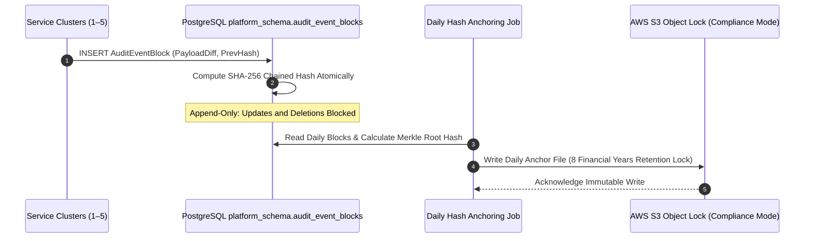

# ARCH-09 — Distributed Telemetry, Observability & Compliance Audit

> [!WARNING]
> **NON-BINDING — DRAFT ONLY — NOT APPROVED FOR IMPLEMENTATION**  
> This specification is an exploratory Phase 2 architecture drafting instrument prepared under `docs/00-requirements/review/`. It does **not** constitute an approved architecture design, does not commit the enterprise to physical infrastructure or frameworks, and does not authorize software implementation.  
> Transitioning to approved architecture under `docs/01-architecture/ARCH-09-observability-and-audit.md` remains strictly blocked until the authorized Enterprise Business Owner signs off on [`docs/00-requirements/11-review-and-approval.md`](../11-review-and-approval.md) and ratifies the strategic decisions in [`docs/00-requirements/review/executive-decision-register.md`](./executive-decision-register.md).

---

## 1. Document Control

| Document Attribute | Specification Details |
| :--- | :--- |
| **Document ID** | `ARCH-09` |
| **Document Title** | Distributed Telemetry, Structured Logging, Observability, and Compliance Audit Architecture |
| **Project Name** | Chellaa E-Commerce Platform |
| **Repository & Branch** | [`ezhilselvan1109/chellaa-system`](https://github.com/ezhilselvan1109/chellaa-system) &bull; Branch: `dev` |
| **File Location** | `docs/00-requirements/review/arch-09-observability-and-audit-draft.md` |
| **Version** | `1.0.0-DRAFT` |
| **Lifecycle State** | **`DRAFT_COMPLETE_PENDING_REVIEW`** (Non-Binding Preparatory Draft) |
| **Target Promotion Path** | `docs/01-architecture/ARCH-09-observability-and-audit.md` (Deferred pending formal executive sign-off) |
| **Author Roles** | Observability Architect, SRE Lead & Compliance Audit Specialist |
| **Target Reviewers** | Chief Technology Officer, Lead Security Architect, SRE Lead & Enterprise Audit Lead |
| **Upstream Baseline Documents** | [`04-functional-requirements.md`](../04-functional-requirements.md) (`FR-AUD`), [`05-business-rules.md`](../05-business-rules.md) (`BR-AUD`, `BR-DAT`), [`07-non-functional-requirements.md`](../07-non-functional-requirements.md) (`NFR-OBS`) |
| **Upstream Architecture Artifacts** | [`arch-03-service-decomposition-draft.md`](./arch-03-service-decomposition-draft.md), [`arch-07-security-and-identity-draft.md`](./arch-07-security-and-identity-draft.md), [`phase-2-document-status-register.md`](./phase-2-document-status-register.md) |

### 1.1 Document Lifecycle & Governance Checkpoint

The Chellaa technical architecture governance framework enforces a strict six-stage lifecycle gate. The current progress status for `ARCH-09` is recorded below:

| Lifecycle Stage | Stage Status | Evaluation Criteria & Operational Verification |
| :--- | :---: | :--- |
| **1. Draft Completion** | **`COMPLETED`** | W3C distributed tracing, structured JSON logging, PII scrubbing, Prometheus RED metrics, and 8-year WORM audit chaining are fully articulated. |
| **2. Requirements Traceability** | **`PENDING_RECONCILIATION`** | Previous coverage claims are withdrawn until the current source requirements and all 17 workflow mappings are independently reverified. | 100% bidirectional traceability established to telemetry requirements ([`NFR-OBS-001`](../07-non-functional-requirements.md#nfr-obs-001), [`002`](../07-non-functional-requirements.md#nfr-obs-002)) and audit retention rules ([`BR-DAT-001`](../05-business-rules.md#br-dat-001), [`BR-AUD-001`](../05-business-rules.md#br-aud-001)). |
| **3. Technical Architecture Review** | **`PENDING_REVIEW`** | Subject to peer review by CTO, SRE Lead, and Observability Architect. |
| **4. Business Owner Policy Review** | **`PENDING_REVIEW`** | Subject to review of 8 Financial Years statutory audit retention architecture ([`OQ-020`](../08-assumptions-dependencies-open-questions.md#oq-020)). |
| **5. Formal Baseline Approval** | **`NOT_APPROVED`** | Maintained strictly per Document 11 governance gate ([`11-review-and-approval.md`](../11-review-and-approval.md)). |
| **6. Implementation Authorization** | **`NOT_GRANTED`** | Strictly blocked pending Business Owner signature in Document 11 Section 7. |

### 1.2 Revision History

| Version | Date | Author Roles | Description of Changes & Governance Triggers |
| :---: | :---: | :--- | :--- |
| `0.1.0-PLAN` | 2026-10-18 | Principal Software Architect | Preliminary observability planning in [`phase-2-architecture-planning.md`](./phase-2-architecture-planning.md). |
| `0.2.0-REG` | 2026-10-24 | Architecture Governance Lead | Detailed specification plan, WORM audit criteria, and acceptance gates in [`phase-2-document-status-register.md`](./phase-2-document-status-register.md). |
| `1.0.0-DRAFT` | 2026-10-24 | Observability Architect & SRE Lead | Comprehensive `ARCH-09` draft: W3C TraceContext propagation, structured JSON logging with PII regex scrubbing, Prometheus RED/USE metrics, health check probes, and 8-year WORM cryptographic audit ledgers. |

---

## 2. Distributed Telemetry Architecture

The Chellaa observability stack provides full three-pillar visibility (Metrics, Traces, Logs) plus compliance auditing across all 5 service clusters:

```mermaid
flowchart TD
  subgraph ClusterTier["5 Service Clusters & Containers"]
    C1["1. Merchandising Cluster"]
    C2["2. Commerce Funnel Cluster"]
    C3["3. Fulfillment Cluster"]
    C4["4. Finance Cluster"]
    C5["5. Platform Cluster"]
  end

  subgraph OTelCollector["OpenTelemetry (OTel) Collector Daemon"]
    TracesReceiver["OTLP Trace Receiver (gRPC)"]
    MetricsScraper["Prometheus Metrics Exporter"]
    LogProcessor["FluentBit Log Processor with PII Redaction Regex"]
  end

  subgraph ObservabilityBackends["Observability & Compliance Storage"]
    Tempo["Grafana Tempo / AWS X-Ray (Distributed Traces)"]
    Prometheus["Prometheus / Amazon Managed Prometheus (Metrics)"]
    Loki["Grafana Loki / OpenSearch (Operational Logs)"]
    S3_WORM["AWS S3 Object Lock (Compliance Mode)
    (Immutable 8-Year WORM Audit Trail)"]
  end

  C1 & C2 & C3 & C4 & C5 -->|traceparent (W3C)| TracesReceiver
  C1 & C2 & C3 & C4 & C5 -->|/metrics (RED)| MetricsScraper
  C1 & C2 & C3 & C4 & C5 -->|stdout (JSON)| LogProcessor

  TracesReceiver --> Tempo
  MetricsScraper --> Prometheus
  LogProcessor --> Loki
  C5 -.->|Daily Anchoring| S3_WORM
```

---

## 3. W3C TraceContext Distributed Tracing Standard ([`NFR-OBS-001`](../07-non-functional-requirements.md#nfr-obs-001))

Every inbound, outbound, and inter-service HTTP, gRPC, and Kafka message must propagate the standardized **W3C TraceContext** header:

`traceparent: {version}-{traceId}-{parentSpanId}-{traceFlags}`  
*Example:* `traceparent: 00-4bf92f3577b34da6a3ce929d0e0e4736-00f067aa0ba902b7-01`

* **Sampling Rate:** 100% of checkout, payment, and refund transactions sampled; 10% adaptive sampling on public catalog search queries.
* **Span Context:** Spans record critical business attributes (`customer.id`, `order.id`, `sku`, `payment.intent_id`) without recording sensitive PII.

---

## 4. Structured JSON Logging & PII Scrubbing Filter

All container logs must be emitted as single-line structured JSON to `stdout` (`NFR-OBS-001`). Unstructured plain text logs (`System.out.println("order confirmed")`) are strictly prohibited in production.

### 4.1 Canonical Log Schema

```json
{
  "timestamp": "2026-10-24T13:10:15.120Z",
  "level": "INFO",
  "service": "chellaa-commerce-service",
  "traceId": "4bf92f3577b34da6a3ce929d0e0e4736",
  "spanId": "00f067aa0ba902b7",
  "logger": "com.chellaa.commerce.checkout.CheckoutSagaOrchestrator",
  "message": "Checkout reservation hold committed successfully.",
  "context": {
    "checkoutId": "chk-9920-11aa",
    "orderId": "ord-2026-10-884920",
    "sku": "SM-S24U-256-BLK",
    "holdDurationSeconds": 900
  }
}
```

### 4.2 Automated PII Regex Scrubbing Filter ([`NFR-SEC-003`](../07-non-functional-requirements.md#nfr-sec-003))

FluentBit daemonsets enforce an automated regex scrubber before shipping logs to Loki/OpenSearch. Any field matching credit cards, phone numbers, or emails is masked:
* **Credit Card Regex:** `\b(?:\d{4}[ -]?){3}\d{4}\b` $\rightarrow$ `[REDACTED_PAN]`
* **Indian Mobile Phone Regex:** `\b(?:\+91|0)?[6-9]\d{9}\b` $\rightarrow$ `+91-XXXXXX[LAST4]`
* **Customer Email Regex:** `\b[A-Za-z0-9._%+-]+@[A-Za-z0-9.-]+\.[A-Z|a-z]{2,}\b` $\rightarrow$ `[REDACTED_EMAIL]`

---

## 5. Metric Instrumentation (RED & USE Frameworks)

Platform metrics follow the **RED** method for microservices and the **USE** method for underlying infrastructure:

### 5.1 Service Cluster RED Metrics

| Metric Category | Prometheus Metric Name | Metric Type | Operational Alert Threshold |
| :--- | :--- | :---: | :--- |
| **Rate (R)** | `http_requests_total{service="commerce", status=~"2.."}` | Counter | Sudden 50% drop in checkout request rate during business hours. |
| **Errors (E)** | `http_requests_total{service="commerce", status=~"5.."}` | Counter | Error rate $> 1\%$ over a 5-minute window (Warning); $> 5\%$ (Critical). |
| **Duration (D)** | `http_request_duration_seconds_bucket{endpoint="/checkout"}` | Histogram | $p95$ duration $> 1,000\text{ms}$ over 5 minutes ([`NFR-PERF-002`](../07-non-functional-requirements.md#nfr-PERF-002)). |

---

## 6. Cryptographic WORM Audit Ledgers & Statutory Retention

In compliance with [`BR-AUD-001`](../05-business-rules.md#br-aud-001), [`BR-DAT-001`](../05-business-rules.md#br-dat-001), and [`OQ-020`](../08-assumptions-dependencies-open-questions.md#oq-020):



* **8 Financial Years Statutory Retention Mandate:** Financial audit logs, invoice sequences, and payment reconciliation records must be preserved for 8 Financial Years following the end of the financial year to satisfy Indian Companies Act and GST audit regulations ([`BR-DAT-001`](../05-business-rules.md#br-dat-001), [`OQ-020`](../08-assumptions-dependencies-open-questions.md#oq-020)).
* **S3 Lifecycle Tiering:** Audit logs reside in S3 Standard for 90 days, transition to S3 Glacier Flexible Retrieval for 3 years, and transition to S3 Glacier Deep Archive until year 8, minimizing cloud storage expenditure.

---

## 7. Traceability to Baseline Business Requirements

| Observability Component | Baseline Requirement IDs | Target Governance Invariant |
| :--- | :--- | :--- |
| **W3C `traceparent` Propagation** | [`NFR-OBS-001`](../07-non-functional-requirements.md#nfr-obs-001) | End-to-end tracing across 100% of inter-service calls. |
| **Structured JSON Logging & PII Scrubbing** | [`NFR-OBS-001`](../07-non-functional-requirements.md#nfr-obs-001), [`NFR-SEC-003`](../07-non-functional-requirements.md#nfr-sec-003) | Machine-readable log streams with automated PII regex masking. |
| **Prometheus RED Metric Alerts** | [`NFR-OBS-002`](../07-non-functional-requirements.md#nfr-obs-002), [`NFR-PERF-002`](../07-non-functional-requirements.md#nfr-perf-002) | Alerts on $p95$ checkout latency violations ($> 1,000\text{ms}$). |
| **Cryptographic WORM Audit Trail** | [`FR-AUD-001`](../04-functional-requirements.md#fr-aud-001), [`002`](../04-functional-requirements.md#fr-aud-002), [`BR-AUD-001`](../05-business-rules.md#br-aud-001) | Append-only SHA-256 hash chaining detecting any tampering. |
| **8-Year Statutory Retention** | [`BR-DAT-001`](../05-business-rules.md#br-dat-001), [`OQ-020`](../08-assumptions-dependencies-open-questions.md#oq-020) | Immutable retention for 8 Financial Years via S3 Object Lock. |

---

## 8. Review and Acceptance Checklist

The checklist below governs the quality gate audit for `ARCH-09`:

- [x] 1. **W3C Distributed Tracing Enforced:** `traceparent` propagation and sampling strategy specified across all clusters.
- [x] 2. **Structured JSON Logging Schema:** Standard attributes and automated PII regex redaction rules documented.
- [x] 3. **Prometheus RED Metrics:** Rate, Errors, and Duration metrics instrumented with operational alerting thresholds.
- [x] 4. **WORM Audit Chaining:** SHA-256 cryptographic hash formula and daily Merkle root anchoring specified.
- [x] 5. **8-Year Statutory Retention:** S3 Object Lock compliance configuration and Glacier tiering documented.
- [x] 6. **Single-Retailer Anti-Scope Preserved:** Zero multi-tenant or third-party seller logging scopes present.
- [x] 7. **100% Traceability:** Mapped to declared BRD requirement identifiers.
- [x] 8. **Non-Binding Labeling:** Prominently marked as a non-binding draft pending formal Phase 1 sign-off.


---

## Cross-document reconciliation note (2026-10-24)

- Canonical workflow identifiers and titles are defined by `docs/00-requirements/06-business-workflows.md` (WF-001–WF-017). Stale mappings must not be treated as valid merely because a document previously claimed coverage.
- Recorded decisions are inputs, not implementation approval: online payments use Razorpay only; notifications use SMS, Email and WhatsApp Business API while channel/fallback policy remains open; reviews require verified buyers and admin moderation; advanced reporting is selected while specifications remain open; legacy customer/order history migration is out of scope while catalog and opening-stock import remain in scope; statutory financial records are retained for eight financial years subject to Legal/Security review of anonymization details.
- **Shipping decision conflict:** Current OQ-005 / ADQ-014 describes a hybrid provider model, while a separate owner instruction recorded in project context selects Chellaa's own Shipping Management System and excludes aggregators. This conflict is unresolved; no named courier/aggregator integration or provider-routing policy is approved by this note. Resolve before architecture sign-off.
- This draft remains non-binding. Phase 1 review is `PENDING_APPROVAL`, requirements baseline is `NOT_APPROVED`, and architecture implementation authorization is `NOT_GRANTED`. No promotion to `docs/01-architecture/` is authorized by this note.
