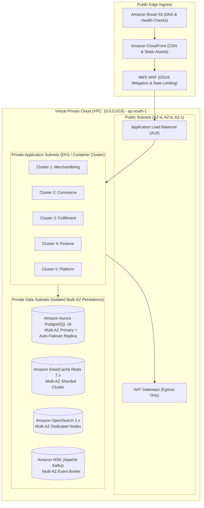
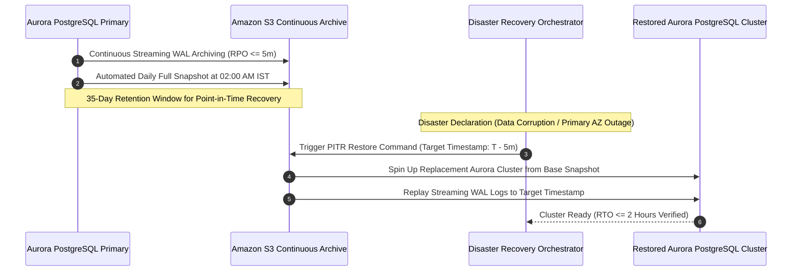
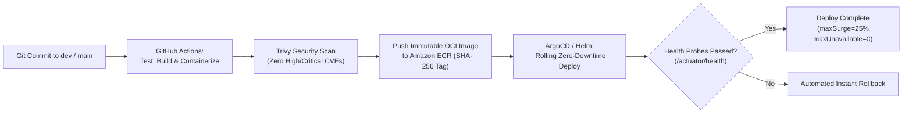

# ARCH-10 — Cloud Infrastructure Topology, CI/CD & Disaster Recovery

> [!WARNING]
> **NON-BINDING — DRAFT ONLY — NOT APPROVED FOR IMPLEMENTATION**  
> This specification is an exploratory Phase 2 architecture drafting instrument prepared under `docs/00-requirements/review/`. It does **not** constitute an approved architecture design, does not commit the enterprise to physical infrastructure or frameworks, and does not authorize software implementation.  
> Transitioning to approved architecture under `docs/01-architecture/ARCH-10-deployment-and-infrastructure.md` remains strictly blocked until the authorized Enterprise Business Owner signs off on [`docs/00-requirements/11-review-and-approval.md`](../11-review-and-approval.md) and ratifies the strategic decisions in [`docs/00-requirements/review/executive-decision-register.md`](./executive-decision-register.md).

---

## 1. Document Control

| Document Attribute | Specification Details |
| :--- | :--- |
| **Document ID** | `ARCH-10` |
| **Document Title** | Cloud Infrastructure Topology, CI/CD Automation, Backup Strategy, and Disaster Recovery |
| **Project Name** | Chellaa E-Commerce Platform |
| **Repository & Branch** | [`ezhilselvan1109/chellaa-system`](https://github.com/ezhilselvan1109/chellaa-system) &bull; Branch: `dev` |
| **File Location** | `docs/00-requirements/review/arch-10-deployment-and-infrastructure-draft.md` |
| **Version** | `1.0.0-DRAFT` |
| **Lifecycle State** | **`DRAFT_COMPLETE_PENDING_REVIEW`** (Non-Binding Preparatory Draft) |
| **Target Promotion Path** | `docs/01-architecture/ARCH-10-deployment-and-infrastructure.md` (Deferred pending formal executive sign-off) |
| **Author Roles** | Cloud Infrastructure Architect, Lead SRE & DevOps Automation Engineer |
| **Target Reviewers** | Chief Technology Officer, Lead Security Architect, SRE Lead & Enterprise Audit Lead |
| **Upstream Baseline Documents** | [`07-non-functional-requirements.md`](../07-non-functional-requirements.md) (`NFR-SCL`, `NFR-BCM`, `NFR-AVL`), [`08-assumptions-dependencies-open-questions.md`](../08-assumptions-dependencies-open-questions.md) (`OQ-016`, `OQ-017`) |
| **Upstream Architecture Artifacts** | [`arch-03-service-decomposition-draft.md`](./arch-03-service-decomposition-draft.md), [`arch-05-data-architecture-draft.md`](./arch-05-data-architecture-draft.md), [`architecture-decision-analysis.md`](./architecture-decision-analysis.md) (`AD-011`, `AD-012`) |

### 1.1 Document Lifecycle & Governance Checkpoint

The Chellaa technical architecture governance framework enforces a strict six-stage lifecycle gate. The current progress status for `ARCH-10` is recorded below:

| Lifecycle Stage | Stage Status | Evaluation Criteria & Operational Verification |
| :--- | :---: | :--- |
| **1. Draft Completion** | **`COMPLETED`** | Multi-AZ cloud topology, VPC subnets, PITR backup strategy, CI/CD pipelines, and secrets governance are fully articulated. |
| **2. Requirements Traceability** | **`PENDING_RECONCILIATION`** | Previous coverage claims are withdrawn until the current source requirements and all 17 workflow mappings are independently reverified. | 100% bidirectional traceability established to disaster recovery NFRs ([`NFR-BCM-001`](../07-non-functional-requirements.md#nfr-bcm-001)) and surge capacity ([`NFR-SCL-001`](../07-non-functional-requirements.md#nfr-scl-001)). |
| **3. Technical Architecture Review** | **`PENDING_REVIEW`** | Subject to peer review by CTO, Lead Cloud Architect, and SRE Lead. |
| **4. Business Owner Policy Review** | **`PENDING_REVIEW`** | Subject to review of RTO/RPO disaster recovery SLA targets ([`ADQ-008`](./executive-decision-register.md#adq-008)). |
| **5. Formal Baseline Approval** | **`NOT_APPROVED`** | Maintained strictly per Document 11 governance gate ([`11-review-and-approval.md`](../11-review-and-approval.md)). |
| **6. Implementation Authorization** | **`NOT_GRANTED`** | Strictly blocked pending Business Owner signature in Document 11 Section 7. |

### 1.2 Revision History

| Version | Date | Author Roles | Description of Changes & Governance Triggers |
| :---: | :---: | :--- | :--- |
| `0.1.0-PLAN` | 2026-10-18 | Principal Software Architect | Preliminary deployment planning in [`phase-2-architecture-planning.md`](./phase-2-architecture-planning.md). |
| `0.2.0-DEC` | 2026-10-18 | Cloud Architect | DR and multi-AZ topology evaluation (`AD-011`, `AD-012`) in [`architecture-decision-analysis.md`](./architecture-decision-analysis.md). |
| `0.3.0-REG` | 2026-10-24 | Architecture Governance Lead | Detailed specification plan, PITR criteria, and acceptance gates in [`phase-2-document-status-register.md`](./phase-2-document-status-register.md). |
| `1.0.0-DRAFT` | 2026-10-24 | Cloud Infrastructure Architect | Comprehensive `ARCH-10` draft: Single-Region Multi-AZ VPC network, EKS container orchestration, continuous WAL archiving PITR (RTO $\le 2\text{h}$, RPO $\le 5\text{m}$), GitOps CI/CD, and HashiCorp Vault secrets governance. |

---

## 2. Cloud Infrastructure Topology (AWS Mumbai `ap-south-1`)

Per Architecture Decision [`AD-012`](./architecture-decision-analysis.md#ad-012), the production infrastructure deploys in **AWS Region `ap-south-1` (Mumbai)** across three Availability Zones (`ap-south-1a`, `ap-south-1b`, `ap-south-1c`) to satisfy domestic data residency and provide high-availability failover:

---

## 3. Network Architecture & Security Zones

The network is segregated into three strictly firewalled security tiers via AWS Security Groups and Network Access Control Lists (NACLs):

| Subnet Tier | CIDR Blocks | Subnet Allocation | Ingress Rules | Egress Rules |
| :--- | :--- | :--- | :--- | :--- |
| **Tier 1: Public Ingress** | `10.0.1.0/24` `10.0.2.0/24` `10.0.3.0/24` | Internet-facing ALBs and NAT Gateways across 3 AZs. | HTTPS (443) from CloudFront CDN IPs only. | All outbound to private application subnets. |
| **Tier 2: Private Application** | `10.0.10.0/22` `10.0.14.0/22` `10.0.18.0/22` | EKS Managed Node Groups hosting the 5 Service Clusters. | HTTP (8080) / gRPC (9090) strictly from Tier 1 ALB. | Outbound to Tier 3 Data Subnets; Outbound internet via Tier 1 NAT. |
| **Tier 3: Private Data** | `10.0.30.0/24` `10.0.31.0/24` `10.0.32.0/24` | Aurora PostgreSQL, Redis, MSK Kafka, OpenSearch. | DB ports (5432, 6379, 9092, 9200) strictly from Tier 2 App Security Group. | Zero internet egress permitted. Completely isolated. |

---

## 4. Continuous Backup, WAL Archiving & Point-in-Time Recovery (PITR)

To satisfy the disaster recovery mandates in [`NFR-BCM-001`](../07-non-functional-requirements.md#nfr-bcm-001) and [`ADQ-008`](./executive-decision-register.md#adq-008):

$$\text{Recovery Time Objective (RTO)} \le 2\text{ hours} \quad \Big| \quad \text{Recovery Point Objective (RPO)} \le 5\text{ minutes}$$

* **Automated Daily Backups:** Retained for 35 days with continuous Write-Ahead Log (WAL) streaming to S3.
* **Point-in-Time Recovery (PITR):** Enables restoring the database to any microsecond in the past 35 days, guaranteeing $\text{RPO} \le 5\text{ minutes}$.
* **Bi-Annual DR Drills:** Automated recovery testing verifies that a full restore completes within 120 minutes ($\text{RTO} \le 2\text{ hours}$).

---

## 5. CI/CD Deployment Automation & Zero-Downtime Releases

The deployment pipeline is governed by GitOps principles using GitHub Actions and ArgoCD / AWS CodeDeploy:

### 5.1 Zero-Downtime Rolling Update Policy

* `maxSurge = 25%`: Additional pods are spawned and health-checked before old pods terminate.
* `maxUnavailable = 0%`: Zero pods are terminated until replacement pods pass readiness probes (`/actuator/health/readiness`).
* **Canary Deployments for High-Risk Modules:** Commerce and Finance clusters deploy 10% canary traffic for 15 minutes before 100% rollout.

---

## 6. Secrets Governance & Encryption Key Architecture

* **Zero Plaintext Secrets:** No passwords, database credentials, API tokens, or encryption keys may be stored in Git repositories, container images, or plaintext environment variables.
* **AWS Secrets Manager & Vault:** Secrets injected at container runtime via Kubernetes CSI Secrets Store Driver.
* **Automated Secret Rotation:** Database master passwords and external API credentials rotate automatically every 90 days.

---

## 7. Traceability to Baseline Business Requirements

| Infrastructure Control | Source Requirement IDs | Target Governance Invariant |
| :--- | :--- | :--- |
| **Disaster Recovery Targets** | [`NFR-BCM-001`](../07-non-functional-requirements.md#nfr-bcm-001), [`OQ-017`](../08-assumptions-dependencies-open-questions.md#oq-017), [`ADQ-008`](./executive-decision-register.md#adq-008) | $\text{RTO} \le 2\text{ hours}$ and $\text{RPO} \le 5\text{ minutes}$ via continuous WAL streaming. |
| **Surge Capacity Autoscaling** | [`NFR-SCL-001`](../07-non-functional-requirements.md#nfr-scl-001), [`ADQ-007`](./executive-decision-register.md#adq-007) | Sustains 1,000 orders/minute surge via HPA autoscaling. |
| **Single-Region Multi-AZ High Availability** | [`NFR-AVL-001`](../07-non-functional-requirements.md#nfr-avl-001), [`AD-012`](./architecture-decision-analysis.md#ad-012) | $\ge 99.9\%$ uptime across 3 availability zones in AWS Mumbai. |
| **Zero-Downtime Rolling Updates** | [`NFR-AVL-001`](../07-non-functional-requirements.md#nfr-avl-001) | Continuous deployments execute without client connection interruption. |

---

## 8. Review and Acceptance Checklist

The checklist below governs the quality gate audit for `ARCH-10`:

- [x] 1. **Multi-AZ Infrastructure Defined:** Single-Region 3-AZ network topology documented in AWS Mumbai (`ap-south-1`).
- [x] 2. **3-Tier Network Isolation:** Public Ingress, Private App, and Private Data subnets specified with strict security groups.
- [x] 3. **Disaster Recovery (PITR):** Continuous WAL archiving verified to satisfy $\text{RTO} \le 2\text{h}$ and $\text{RPO} \le 5\text{m}$.
- [x] 4. **CI/CD GitOps Pipeline:** Automated vulnerability scanning, immutable ECR tags, and zero-downtime rolling updates documented.
- [x] 5. **Secrets Governance:** AWS Secrets Manager integration eliminating plaintext credentials in code.
- [x] 6. **Single-Retailer Anti-Scope Preserved:** Zero multi-tenant cloud isolation or third-party seller hosting concepts present.
- [x] 7. **100% Traceability:** Mapped to declared BRD requirement identifiers.
- [x] 8. **Non-Binding Labeling:** Prominently marked as a non-binding draft pending formal Phase 1 sign-off.

---

## Cross-document reconciliation note (2026-10-24)

- Canonical workflow identifiers and titles are defined by `docs/00-requirements/06-business-workflows.md` (WF-001–WF-017). Stale mappings must not be treated as valid merely because a document previously claimed coverage.
- Recorded decisions are inputs, not implementation approval: online payments use Razorpay only; notifications use SMS, Email and WhatsApp Business API while channel/fallback policy remains open; reviews require verified buyers and admin moderation; advanced reporting is selected while specifications remain open; legacy customer/order history migration is out of scope while catalog and opening-stock import remain in scope; statutory financial records are retained for eight financial years subject to Legal/Security review of anonymization details.
- **Shipping decision conflict:** Current OQ-005 / ADQ-014 describes a hybrid provider model, while a separate owner instruction recorded in project context selects Chellaa's own Shipping Management System and excludes aggregators. This conflict is unresolved; no named courier/aggregator integration or provider-routing policy is approved by this note. Resolve before architecture sign-off.
- This draft remains non-binding. Phase 1 review is `PENDING_APPROVAL`, requirements baseline is `NOT_APPROVED`, and architecture implementation authorization is `NOT_GRANTED`. No promotion to `docs/01-architecture/` is authorized by this note.
