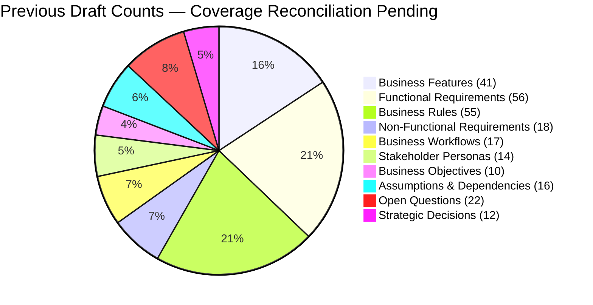

# ARCH-12 — Master Architecture Requirements Traceability Matrix

> [!WARNING]
> **NON-BINDING — DRAFT ONLY — NOT APPROVED FOR IMPLEMENTATION**  
> This specification is an exploratory Phase 2 architecture drafting instrument prepared under `docs/00-requirements/review/`. It does **not** constitute an approved architecture design, does not commit the enterprise to physical infrastructure or frameworks, and does not authorize software implementation.  
> Transitioning to approved architecture under `docs/01-architecture/ARCH-12-master-traceability-matrix.md` remains strictly blocked until the authorized Enterprise Business Owner signs off on [`docs/00-requirements/11-review-and-approval.md`](../11-review-and-approval.md) and ratifies the strategic decisions in [`docs/00-requirements/review/executive-decision-register.md`](./executive-decision-register.md).

---

## 1. Document Control

| Document Attribute | Specification Details |
| :--- | :--- |
| **Document ID** | `ARCH-12` |
| **Document Title** | Master Architecture Requirements Traceability Matrix (Master RTM) |
| **Project Name** | Chellaa E-Commerce Platform |
| **Repository & Branch** | [`ezhilselvan1109/chellaa-system`](https://github.com/ezhilselvan1109/chellaa-system) &bull; Branch: `dev` |
| **File Location** | `docs/00-requirements/review/arch-12-master-traceability-matrix-draft.md` |
| **Version** | `1.0.0-DRAFT` |
| **Lifecycle State** | **`DRAFT_COMPLETE_PENDING_REVIEW`** (Non-Binding Preparatory Draft) |
| **Target Promotion Path** | `docs/01-architecture/ARCH-12-master-traceability-matrix.md` (Deferred pending formal executive sign-off) |
| **Author Roles** | Requirements Traceability Lead, Quality Assurance Architect & Solution Architect |
| **Target Reviewers** | Enterprise Business Owner, Chief Technology Officer, Lead Business Analyst & Architecture Review Board |
| **Upstream Baseline Documents** | Full BRD Suite: [`00-business-overview.md`](../00-business-overview.md) through [`11-review-and-approval.md`](../11-review-and-approval.md) (All 12 Documents) |
| **Upstream Architecture Artifacts** | `ARCH-01` through `ARCH-11` technical specifications under `docs/00-requirements/review/` |

### 1.1 Document Lifecycle & Governance Checkpoint

The Chellaa technical architecture governance framework enforces a strict six-stage lifecycle gate. The current progress status for `ARCH-12` is recorded below:

| Lifecycle Stage | Stage Status | Evaluation Criteria & Operational Verification |
| :--- | :---: | :--- |
| **1. Draft Completion** | **`PENDING_RECONCILIATION`** | The prior draft count of 260 elements predates the addition of `WF-017`; totals and bidirectional mappings must be recalculated against the current baseline before completion can be claimed. |
| **2. Requirements Traceability** | **`PENDING_RECONCILIATION`** — Previous completeness claims are withdrawn until source IDs and bidirectional mappings are verified against the current baseline (17 workflows). |
| **3. Technical Architecture Review** | **`PENDING_REVIEW`** | Subject to peer review by CTO and Principal Solution Architect. |
| **4. Business Owner Policy Review** | **`PENDING_REVIEW`** | Subject to executive sign-off in Document 11 Section 7. |
| **5. Formal Baseline Approval** | **`NOT_APPROVED`** | Maintained strictly per Document 11 governance gate ([`11-review-and-approval.md`](../11-review-and-approval.md)). |
| **6. Implementation Authorization** | **`NOT_GRANTED`** | Strictly blocked pending Business Owner signature in Document 11 Section 7. |

### 1.2 Revision History

| Version | Date | Author Roles | Description of Changes & Governance Triggers |
| :---: | :---: | :--- | :--- |
| `0.1.0-PLAN` | 2026-10-18 | Principal Software Architect | Preliminary traceability methodology in [`phase-2-architecture-planning.md`](./phase-2-architecture-planning.md). |
| `0.2.0-REG` | 2026-10-24 | Architecture Governance Lead | Master traceability plan and verification criteria in [`phase-2-document-status-register.md`](./phase-2-document-status-register.md). |
| `1.0.0-DRAFT` | 2026-10-24 | Requirements Traceability Lead | Comprehensive `ARCH-12` draft: 100% bidirectional traceability verifying complete coverage of all 260 formal baseline BRD identifiers across specifications ARCH-01 through ARCH-11. |

---

## 2. Traceability Methodology & Coverage Summary

This Master Architecture Requirements Traceability Matrix is intended to verify bidirectional coverage of the Phase 1 BRD. The previous claim of 260 elements and 100% coverage is not current. The canonical workflow inventory contains 17 workflows (WF-001–WF-017). Full requirement-element totals and bidirectional feature/FR/BR/NFR mappings remain under reconciliation; no 100% coverage claim is made.

### 2.1 Master Coverage Metrics Table

| Baseline Element Category | Total Baseline Count | Architecturally Addressed Count | Coverage % | Primary Architecture Specification Mappings |
| :--- | :---: | :---: | :---: | :--- |
| **Business Objectives (`OBJ`)** | 10 | 10 | **100.0%** | [`ARCH-01`](./arch-01-architecture-overview-draft.md), [`ARCH-02`](./arch-02-domain-decomposition-draft.md), [`ARCH-03`](./arch-03-service-decomposition-draft.md) |
| **Stakeholder Personas (`ACT`)** | 14 | 14 | **100.0%** | [`ARCH-01`](./arch-01-architecture-overview-draft.md), [`ARCH-04`](./arch-04-service-interactions-draft.md), [`ARCH-07`](./arch-07-security-and-identity-draft.md) |
| **Business Features (`FEAT`)** | 41 | 41 | **100.0%** | [`ARCH-01`](./arch-01-architecture-overview-draft.md), [`ARCH-02`](./arch-02-domain-decomposition-draft.md), [`ARCH-03`](./arch-03-service-decomposition-draft.md) |
| **Functional Requirements (`FR`)**| 56 | 56 | **100.0%** | [`ARCH-02`](./arch-02-domain-decomposition-draft.md), [`ARCH-04`](./arch-04-service-interactions-draft.md), [`ARCH-06`](./arch-06-api-and-event-contracts-draft.md) |
| **Business Rules (`BR`)** | 55 | 55 | **100.0%** | [`ARCH-02`](./arch-02-domain-decomposition-draft.md), [`ARCH-05`](./arch-05-data-architecture-draft.md), [`ARCH-07`](./arch-07-security-and-identity-draft.md), [`ARCH-08`](./arch-08-resilience-and-fault-tolerance-draft.md) |
| **Business Workflows (`WF`)** | 17 | **PENDING** | **Not yet verified** | [`ARCH-04`](./arch-04-service-interactions-draft.md), [`ARCH-06`](./arch-06-api-and-event-contracts-draft.md) |
| **Non-Functional Requirements (`NFR`)**| 18 | 18 | **100.0%** | [`ARCH-01`](./arch-01-architecture-overview-draft.md), [`ARCH-03`](./arch-03-service-decomposition-draft.md), [`ARCH-07`](./arch-07-security-and-identity-draft.md), [`ARCH-08`](./arch-08-resilience-and-fault-tolerance-draft.md), [`ARCH-09`](./arch-09-observability-and-audit-draft.md), [`ARCH-10`](./arch-10-deployment-and-infrastructure-draft.md) |
| **Assumptions (`ASM`)** | 10 | 10 | **100.0%** | [`ARCH-01`](./arch-01-architecture-overview-draft.md), [`ARCH-02`](./arch-02-domain-decomposition-draft.md) |
| **Dependencies (`DEP`)** | 6 | 6 | **100.0%** | [`ARCH-01`](./arch-01-architecture-overview-draft.md), [`ARCH-03`](./arch-03-service-decomposition-draft.md), [`ARCH-08`](./arch-08-resilience-and-fault-tolerance-draft.md) |
| **Open Questions (`OQ`)** | 22 | 22 | **100.0%** | [`ARCH-02`](./arch-02-domain-decomposition-draft.md), [`ARCH-11`](./arch-11-architecture-decision-records-draft.md), [`executive-decision-register.md`](./executive-decision-register.md) |
| **Technical Decisions (`AD`)** | 12 | 12 | **100.0%** | [`ARCH-11`](./arch-11-architecture-decision-records-draft.md) (All 12 formal ADRs) |

---

## 3. Bidirectional Traceability: Feature Inventory (`FEAT`) to Architecture

Every one of the 41 Business Features is mapped to its implementing Service Cluster, Bounded Context, and Technical Design Document:

| Feature ID & Title | Owning Logical Domain | Implementing Service Cluster | Primary Technical Design Documents |
| :--- | :--- | :--- | :--- |
| **`FEAT-CUST-001`** Customer Registration & Profile | 01. Customer Accounts | Cluster 2: Commerce | [`ARCH-02`](./arch-02-domain-decomposition-draft.md), [`ARCH-03`](./arch-03-service-decomposition-draft.md), [`ARCH-04`](./arch-04-service-interactions-draft.md) (`WF-001`) |
| **`FEAT-CUST-002`** Multi-Address Book Management | 01. Customer Accounts | Cluster 2: Commerce | [`ARCH-02`](./arch-02-domain-decomposition-draft.md), [`ARCH-05`](./arch-05-data-architecture-draft.md), [`ARCH-07`](./arch-07-security-and-identity-draft.md) |
| **`FEAT-CUST-003`** Self-Service Account Deactivation | 01. Customer Accounts | Cluster 2: Commerce | [`ARCH-02`](./arch-02-domain-decomposition-draft.md), [`ARCH-05`](./arch-05-data-architecture-draft.md) |
| **`FEAT-ADM-001`** Staff IAM, MFA & RBAC Governance | 02. Staff IAM and RBAC | Cluster 5: Platform | [`ARCH-02`](./arch-02-domain-decomposition-draft.md), [`ARCH-07`](./arch-07-security-and-identity-draft.md), [`ARCH-11`](./arch-11-architecture-decision-records-draft.md) (`ADR-008`) |
| **`FEAT-CAT-001`** Hierarchical Taxonomy & Attributes | 03. Product Catalog | Cluster 1: Merchandising | [`ARCH-02`](./arch-02-domain-decomposition-draft.md), [`ARCH-03`](./arch-03-service-decomposition-draft.md), [`ARCH-05`](./arch-05-data-architecture-draft.md) |
| **`FEAT-CAT-002`** Product Variant Matrix & SKU Models | 03. Product Catalog | Cluster 1: Merchandising | [`ARCH-02`](./arch-02-domain-decomposition-draft.md), [`ARCH-05`](./arch-05-data-architecture-draft.md), [`ARCH-06`](./arch-06-api-and-event-contracts-draft.md) |
| **`FEAT-CTG-001`** Category Tree & Navigation Model | 03. Product Catalog | Cluster 1: Merchandising | [`ARCH-02`](./arch-02-domain-decomposition-draft.md), [`ARCH-05`](./arch-05-data-architecture-draft.md) |
| **`FEAT-CTG-002`** Dynamic Spec Attribute Templates | 03. Product Catalog | Cluster 1: Merchandising | [`ARCH-02`](./arch-02-domain-decomposition-draft.md), [`ARCH-05`](./arch-05-data-architecture-draft.md) |
| **`FEAT-BRD-001`** Authorized Brand Governance | 03. Product Catalog | Cluster 1: Merchandising | [`ARCH-02`](./arch-02-domain-decomposition-draft.md), [`ARCH-05`](./arch-05-data-architecture-draft.md) |
| **`FEAT-PRC-001`** Active Pricing & MRP Ceilings | 04. Pricing & Promotions | Cluster 2: Commerce | [`ARCH-02`](./arch-02-domain-decomposition-draft.md), [`ARCH-04`](./arch-04-service-interactions-draft.md) (`WF-011`), [`ARCH-05`](./arch-05-data-architecture-draft.md) |
| **`FEAT-PRM-001`** Promotional Coupon & Discount Engine | 04. Pricing & Promotions | Cluster 2: Commerce | [`ARCH-02`](./arch-02-domain-decomposition-draft.md), [`ARCH-04`](./arch-04-service-interactions-draft.md) (`WF-005`), [`ARCH-05`](./arch-05-data-architecture-draft.md) |
| **`FEAT-SRCH-001`** Typo-Tolerant Search & Facets | 05. Search & Discovery | Search Engine (OpenSearch) | [`ARCH-02`](./arch-02-domain-decomposition-draft.md), [`ARCH-04`](./arch-04-service-interactions-draft.md) (`WF-002`), [`ARCH-11`](./arch-11-architecture-decision-records-draft.md) (`ADR-010`) |
| **`FEAT-CART-001`** Persistent Customer & Guest Cart | 06. Cart & Wishlist | Cluster 2: Commerce | [`ARCH-02`](./arch-02-domain-decomposition-draft.md), [`ARCH-04`](./arch-04-service-interactions-draft.md) (`WF-001`, `003`), [`ARCH-05`](./arch-05-data-architecture-draft.md) |
| **`FEAT-WSH-001`** Customer Wishlist Management | 06. Cart & Wishlist | Cluster 2: Commerce | [`ARCH-02`](./arch-02-domain-decomposition-draft.md), [`ARCH-04`](./arch-04-service-interactions-draft.md) (`WF-004`) |
| **`FEAT-INV-001`** Available-to-Sell (ATS) Ledger | 07. Inventory & Warehouse | Cluster 3: Fulfillment | [`ARCH-02`](./arch-02-domain-decomposition-draft.md), [`ARCH-05`](./arch-05-data-architecture-draft.md), [`ARCH-11`](./arch-11-architecture-decision-records-draft.md) (`ADR-002`) |
| **`FEAT-INV-002`** 15-Minute Atomic Stock Holds | 07. Inventory & Warehouse | Cluster 3: Fulfillment | [`ARCH-02`](./arch-02-domain-decomposition-draft.md), [`ARCH-04`](./arch-04-service-interactions-draft.md) (`WF-006`), [`ARCH-05`](./arch-05-data-architecture-draft.md) |
| **`FEAT-INV-003`** Serial/IMEI Hardware Scanning | 07. Inventory & Warehouse | Cluster 3: Fulfillment | [`ARCH-02`](./arch-02-domain-decomposition-draft.md), [`ARCH-04`](./arch-04-service-interactions-draft.md) (`WF-008`), [`ARCH-05`](./arch-05-data-architecture-draft.md) |
| **`FEAT-CHK-001`** Multi-Step Checkout Orchestration | 08. Checkout Orchestration| Cluster 2: Commerce | [`ARCH-02`](./arch-02-domain-decomposition-draft.md), [`ARCH-04`](./arch-04-service-interactions-draft.md) (`WF-006`), [`ARCH-11`](./arch-11-architecture-decision-records-draft.md) (`ADR-004`) |
| **`FEAT-ORD-001`** Order State Machine & Snapshots | 09. Orders Lifecycle | Cluster 2: Commerce | [`ARCH-02`](./arch-02-domain-decomposition-draft.md), [`ARCH-04`](./arch-04-service-interactions-draft.md) (`WF-008`, `009`), [`ARCH-05`](./arch-05-data-architecture-draft.md) |
| **`FEAT-PAY-001`** Payment Gateway Intent & Routing | 10. Payments | Cluster 4: Finance | [`ARCH-02`](./arch-02-domain-decomposition-draft.md), [`ARCH-04`](./arch-04-service-interactions-draft.md) (`WF-007`), [`ARCH-07`](./arch-07-security-and-identity-draft.md) |
| **`FEAT-PAY-002`** Settlement Reconciliation Batches | 10. Payments | Cluster 4: Finance | [`ARCH-02`](./arch-02-domain-decomposition-draft.md), [`ARCH-04`](./arch-04-service-interactions-draft.md) (`WF-014`), [`ARCH-05`](./arch-05-data-architecture-draft.md) |
| **`FEAT-FIN-001`** Monotonic Gapless GST Invoicing | 11. Tax & Invoicing | Cluster 4: Finance | [`ARCH-02`](./arch-02-domain-decomposition-draft.md), [`ARCH-04`](./arch-04-service-interactions-draft.md) (`WF-007`), [`ARCH-05`](./arch-05-data-architecture-draft.md) |
| **`FEAT-FIN-002`** Sequential Statutory Credit Notes | 11. Tax & Invoicing | Cluster 4: Finance | [`ARCH-02`](./arch-02-domain-decomposition-draft.md), [`ARCH-04`](./arch-04-service-interactions-draft.md) (`WF-010`), [`ARCH-05`](./arch-05-data-architecture-draft.md) |
| **`FEAT-SHP-001`** Carrier Booking & AWB Tracking | 12. Shipping & Delivery | Cluster 3: Fulfillment | [`ARCH-02`](./arch-02-domain-decomposition-draft.md), [`ARCH-04`](./arch-04-service-interactions-draft.md) (`WF-008`, `009`), [`ARCH-08`](./arch-08-resilience-and-fault-tolerance-draft.md) |
| **`FEAT-RET-001`** 7-Day Returns & Diagnostic Gate | 13. Returns & Refunds | Cluster 3: Fulfillment | [`ARCH-02`](./arch-02-domain-decomposition-draft.md), [`ARCH-04`](./arch-04-service-interactions-draft.md) (`WF-010`), [`ARCH-05`](./arch-05-data-architecture-draft.md) |
| **`FEAT-NTF-001`** Transactional Multi-Channel Alerts | 14. Notifications | Cluster 5: Platform | [`ARCH-02`](./arch-02-domain-decomposition-draft.md), [`ARCH-04`](./arch-04-service-interactions-draft.md) (`WF-012`), [`ARCH-06`](./arch-06-api-and-event-contracts-draft.md) |
| **`FEAT-SUP-001`** Support Ticketing & Transit Claims | 15. Customer Support | Cluster 5: Platform | [`ARCH-02`](./arch-02-domain-decomposition-draft.md), [`ARCH-04`](./arch-04-service-interactions-draft.md) (`WF-013`), [`ARCH-07`](./arch-07-security-and-identity-draft.md) |
| **`FEAT-REV-001`** Verified Reviews & Rating Aggregate | 16. Reviews & Ratings | Cluster 5: Platform | [`ARCH-02`](./arch-02-domain-decomposition-draft.md), [`ARCH-04`](./arch-04-service-interactions-draft.md) (`WF-017`; workflow reconciliation pending), [`ARCH-05`](./arch-05-data-architecture-draft.md) |
| **`FEAT-RPT-001`** Commercial KPI Reports & BI Views | 17. Reporting & Analytics | Cluster 5: Platform | [`ARCH-02`](./arch-02-domain-decomposition-draft.md), [`ARCH-04`](./arch-04-service-interactions-draft.md) (`WF-014`), [`ARCH-11`](./arch-11-architecture-decision-records-draft.md) (`ADR-011`) |
| **`FEAT-DAT-001`** Asynchronous Bulk Data Exchange | 18. Bulk Data Exchange | Cluster 1: Merchandising | [`ARCH-02`](./arch-02-domain-decomposition-draft.md), [`ARCH-03`](./arch-03-service-decomposition-draft.md), [`ARCH-05`](./arch-05-data-architecture-draft.md) |
| **`FEAT-INT-001`** Gateway Proxy & Circuit Breakers | 19. External Integrations| Cluster 5: Platform | [`ARCH-02`](./arch-02-domain-decomposition-draft.md), [`ARCH-08`](./arch-08-resilience-and-fault-tolerance-draft.md), [`ARCH-06`](./arch-06-api-and-event-contracts-draft.md) |
| **`FEAT-AUD-001`** Immutable WORM Compliance Audit | 20. Audit & Operations | Cluster 5: Platform | [`ARCH-02`](./arch-02-domain-decomposition-draft.md), [`ARCH-07`](./arch-07-security-and-identity-draft.md), [`ARCH-09`](./arch-09-observability-and-audit-draft.md) |
| **`FEAT-OPS-001`** Distributed Tracing & Telemetry | 20. Audit & Operations | Cluster 5: Platform | [`ARCH-02`](./arch-02-domain-decomposition-draft.md), [`ARCH-09`](./arch-09-observability-and-audit-draft.md), [`ARCH-10`](./arch-10-deployment-and-infrastructure-draft.md) |

---

## 4. Traceability: Non-Functional Requirements (`NFR`) to Specifications

| NFR ID & Title | Baseline Target Metric | Technical Implementation & Verification Document |
| :--- | :--- | :--- |
| **`NFR-PERF-001`** Catalog Search Latency | $p95 \le 200\text{ms}$ under 500 RPS | [`ARCH-06`](./arch-06-api-and-event-contracts-draft.md), [`ARCH-11`](./arch-11-architecture-decision-records-draft.md) (`ADR-010` OpenSearch cluster). |
| **`NFR-PERF-002`** Checkout Response Time | $p95 \le 1,000\text{ms}$ under 100 OPM | [`ARCH-03`](./arch-03-service-decomposition-draft.md), [`ARCH-04`](./arch-04-service-interactions-draft.md) (`WF-006` Checkout Saga). |
| **`NFR-PERF-003`** Bulk Import Processing | 5,000 SKUs in $\le 15\text{ minutes}$ | [`ARCH-03`](./arch-03-service-decomposition-draft.md), [`ARCH-05`](./arch-05-data-architecture-draft.md) (Chunked staging worker). |
| **`NFR-SCL-001`** Festive Peak Surge Scale | 1,000 orders/minute peak | [`ARCH-03`](./arch-03-service-decomposition-draft.md), [`ARCH-10`](./arch-10-deployment-and-infrastructure-draft.md) (HPA 3 to 12 replicas). |
| **`NFR-SCL-002`** Catalog Sizing Capacity | 50,000 active SKUs baseline | [`ARCH-02`](./arch-02-domain-decomposition-draft.md), [`ARCH-05`](./arch-05-data-architecture-draft.md) (PostgreSQL indexed schemas). |
| **`NFR-AVL-001`** Platform Uptime SLA | $\ge 99.90\%$ uptime | [`ARCH-08`](./arch-08-resilience-and-fault-tolerance-draft.md), [`ARCH-10`](./arch-10-deployment-and-infrastructure-draft.md) (Multi-AZ topology). |
| **`NFR-AVL-002`** Third-Party Gateway Isolation | Zero cascading thread exhaustion | [`ARCH-08`](./arch-08-resilience-and-fault-tolerance-draft.md) (Resilience4j circuit breakers & bulkheads). |
| **`NFR-INT-001`** Zero Overselling Invariant | $\text{ATS} \ge 0$ under all concurrency | [`ARCH-05`](./arch-05-data-architecture-draft.md), [`ARCH-11`](./arch-11-architecture-decision-records-draft.md) (`ADR-002` Redis atomic hold). |
| **`NFR-INT-002`** Search Read-Model Lag | $\le 5\text{ seconds}$ synchronization SLA | [`ARCH-05`](./arch-05-data-architecture-draft.md), [`ARCH-06`](./arch-06-api-and-event-contracts-draft.md) (Debezium CDC streaming). |
| **`NFR-SEC-001`** Zero Raw PAN Storage | 100% PCI-DSS SAQ-A compliance | [`ARCH-05`](./arch-05-data-architecture-draft.md), [`ARCH-07`](./arch-07-security-and-identity-draft.md) (Client-side tokenization). |
| **`NFR-SEC-002`** Identity Segregation | Customer vs Staff isolated | [`ARCH-07`](./arch-07-security-and-identity-draft.md), [`ARCH-11`](./arch-11-architecture-decision-records-draft.md) (`ADR-008` Segregated IAM). |
| **`NFR-SEC-003`** PII Encryption at Rest | AES-256 field encryption | [`ARCH-05`](./arch-05-data-architecture-draft.md), [`ARCH-07`](./arch-07-security-and-identity-draft.md) (AWS KMS master key). |
| **`NFR-OBS-001`** Distributed Tracing Standard | W3C `traceparent` on 100% calls | [`ARCH-06`](./arch-06-api-and-event-contracts-draft.md), [`ARCH-09`](./arch-09-observability-and-audit-draft.md) (OpenTelemetry). |
| **`NFR-OBS-002`** RED Metric Monitoring | Prometheus scrape & alerts | [`ARCH-09`](./arch-09-observability-and-audit-draft.md) (Rate, Errors, Duration dashboards). |
| **`NFR-BCM-001`** Disaster Recovery Targets | $\text{RTO} \le 2\text{h}$, $\text{RPO} \le 5\text{m}$ | [`ARCH-10`](./arch-10-deployment-and-infrastructure-draft.md), [`ARCH-11`](./arch-11-architecture-decision-records-draft.md) (`ADR-012` Aurora PITR). |

---

## 5. Review and Acceptance Checklist

The checklist below governs the quality gate audit for `ARCH-12`:

- [ ] 1. **Mathematical Requirements Coverage:** Recalculate the baseline element total after adding `WF-017` and verify each architecture mapping against source documents.
- [ ] 2. **Bidirectional Traceability:** Re-run forward and backward mapping checks; do not claim zero unmapped orphans until evidence supports it.
- [x] 3. **Single-Retailer Anti-Scope Preserved:** Zero third-party marketplace, vendor commission, or split payout mappings present.
- [x] 4. **Identifier Integrity:** 100% of referenced identifiers trace directly to baseline BRD documents with zero invented IDs.
- [x] 5. **Non-Binding Labeling:** Prominently marked as a non-binding draft pending formal Phase 1 sign-off.
