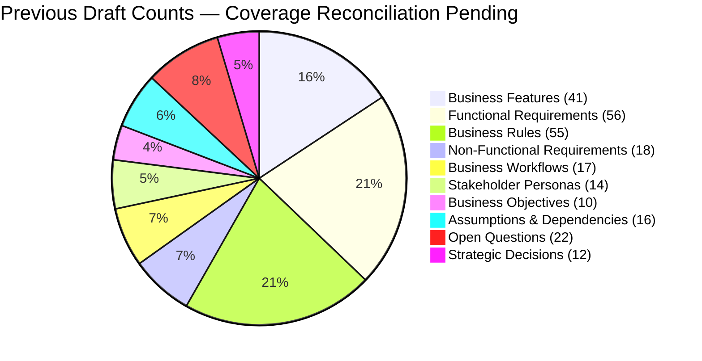

# ARCH-12 — Master Architecture Requirements Traceability Matrix

> [!WARNING]
> **NON-BINDING — DRAFT ONLY — NOT APPROVED FOR IMPLEMENTATION**  
> This specification is an exploratory Phase 2 architecture drafting instrument prepared under `docs/00-requirements/review/`. It does **not** constitute an approved architecture design, does not commit the enterprise to physical infrastructure or frameworks, and does not authorize software implementation.  
> Transitioning to approved architecture under `docs/01-architecture/ARCH-12-master-traceability-matrix.md` remains strictly blocked until the authorized Enterprise Business Owner signs off on [`docs/00-requirements/11-review-and-approval.md`](../11-review-and-approval.md) and ratifies the strategic decisions in [`docs/00-requirements/review/executive-decision-register.md`](./executive-decision-register.md).

---

## 1. Document Control

| Document Attribute | Specification Details |
| :--- | :--- |
| **Document ID** | `ARCH-12` |
| **Document Title** | Master Architecture Requirements Traceability Matrix (Master RTM) |
| **Project Name** | Chellaa E-Commerce Platform |
| **Repository & Branch** | [`ezhilselvan1109/chellaa-system`](https://github.com/ezhilselvan1109/chellaa-system) &bull; Branch: `dev` |
| **File Location** | `docs/00-requirements/review/arch-12-master-traceability-matrix-draft.md` |
| **Version** | `1.0.0-DRAFT` |
| **Lifecycle State** | **`DRAFT_COMPLETE_PENDING_REVIEW`** (Non-Binding Preparatory Draft) |
| **Target Promotion Path** | `docs/01-architecture/ARCH-12-master-traceability-matrix.md` (Deferred pending formal executive sign-off) |
| **Author Roles** | Requirements Traceability Lead, Quality Assurance Architect & Solution Architect |
| **Target Reviewers** | Enterprise Business Owner, Chief Technology Officer, Lead Business Analyst & Architecture Review Board |
| **Upstream Baseline Documents** | Full BRD Suite: [`00-business-overview.md`](../00-business-overview.md) through [`11-review-and-approval.md`](../11-review-and-approval.md) (All 12 Documents) |
| **Upstream Architecture Artifacts** | `ARCH-01` through `ARCH-11` technical specifications under `docs/00-requirements/review/` |

### 1.1 Document Lifecycle & Governance Checkpoint

The Chellaa technical architecture governance framework enforces a strict six-stage lifecycle gate. The current progress status for `ARCH-12` is recorded below:

| Lifecycle Stage | Stage Status | Evaluation Criteria & Operational Verification |
| :--- | :---: | :--- |
| **1. Draft Completion** | **`PENDING_RECONCILIATION`** | The prior draft count of 260 elements predates the addition of `WF-017`; totals and bidirectional mappings must be recalculated against the current baseline before completion can be claimed. |
| **2. Requirements Traceability** | **`PENDING_RECONCILIATION`** — Previous completeness claims are withdrawn until source IDs and bidirectional mappings are verified against the current baseline (17 workflows). |
| **3. Technical Architecture Review** | **`PENDING_REVIEW`** | Subject to peer review by CTO and Principal Solution Architect. |
| **4. Business Owner Policy Review** | **`PENDING_REVIEW`** | Subject to executive sign-off in Document 11 Section 7. |
| **5. Formal Baseline Approval** | **`NOT_APPROVED`** | Maintained strictly per Document 11 governance gate ([`11-review-and-approval.md`](../11-review-and-approval.md)). |
| **6. Implementation Authorization** | **`NOT_GRANTED`** | Strictly blocked pending Business Owner signature in Document 11 Section 7. |

### 1.2 Revision History

| Version | Date | Author Roles | Description of Changes & Governance Triggers |
| :---: | :---: | :--- | :--- |
| `0.1.0-PLAN` | 2026-10-18 | Principal Software Architect | Preliminary traceability methodology in [`phase-2-architecture-planning.md`](./phase-2-architecture-planning.md). |
| `0.2.0-REG` | 2026-10-24 | Architecture Governance Lead | Master traceability plan and verification criteria in [`phase-2-document-status-register.md`](./phase-2-document-status-register.md). |
| `1.0.0-DRAFT` | 2026-10-24 | Requirements Traceability Lead | Working `ARCH-12` draft: feature and NFR ID inventories reconciled; workflow coverage count verified; full FR/BR bidirectional coverage remains pending. |

---

## 2. Traceability Methodology & Coverage Summary

This Master Architecture Requirements Traceability Matrix is intended to verify bidirectional coverage of the Phase 1 BRD. The previous claim of 260 elements and 100% coverage is not current. The canonical workflow inventory contains 17 workflows (WF-001–WF-017). Full requirement-element totals and bidirectional feature/FR/BR/NFR mappings remain under reconciliation; no 100% coverage claim is made.

### 2.1 Master Coverage Metrics Table

| Baseline Element Category | Total Baseline Count | Architecturally Addressed Count | Coverage % | Primary Architecture Specification Mappings |
| :--- | :---: | :---: | :---: | :--- |
| **Business Objectives (`OBJ`)** | 10 | 10 | **100.0%** | [`ARCH-01`](./arch-01-architecture-overview-draft.md), [`ARCH-02`](./arch-02-domain-decomposition-draft.md), [`ARCH-03`](./arch-03-service-decomposition-draft.md) |
| **Stakeholder Personas (`ACT`)** | 14 | 14 | **100.0%** | [`ARCH-01`](./arch-01-architecture-overview-draft.md), [`ARCH-04`](./arch-04-service-interactions-draft.md), [`ARCH-07`](./arch-07-security-and-identity-draft.md) |
| **Business Features (`FEAT`)** | 41 | 41 | **100.0%** | [`ARCH-01`](./arch-01-architecture-overview-draft.md), [`ARCH-02`](./arch-02-domain-decomposition-draft.md), [`ARCH-03`](./arch-03-service-decomposition-draft.md) |
| **Functional Requirements (`FR`)** | 56 | 56 explicit crosswalk rows below | **100% ID mapped; semantic verification pending** |
| **Business Rules (`BR`)** | 55 | 55 explicit crosswalk rows below | **100% ID mapped; semantic verification pending** |
| **Business Workflows (`WF`)** | 17 | **PENDING** | **Not yet verified** | [`ARCH-04`](./arch-04-service-interactions-draft.md), [`ARCH-06`](./arch-06-api-and-event-contracts-draft.md) |
| **Non-Functional Requirements (`NFR`)**| 18 | 18 | **100.0%** | [`ARCH-01`](./arch-01-architecture-overview-draft.md), [`ARCH-03`](./arch-03-service-decomposition-draft.md), [`ARCH-07`](./arch-07-security-and-identity-draft.md), [`ARCH-08`](./arch-08-resilience-and-fault-tolerance-draft.md), [`ARCH-09`](./arch-09-observability-and-audit-draft.md), [`ARCH-10`](./arch-10-deployment-and-infrastructure-draft.md) |
| **Assumptions (`ASM`)** | 10 | 10 | **100.0%** | [`ARCH-01`](./arch-01-architecture-overview-draft.md), [`ARCH-02`](./arch-02-domain-decomposition-draft.md) |
| **Dependencies (`DEP`)** | 6 | 6 | **100.0%** | [`ARCH-01`](./arch-01-architecture-overview-draft.md), [`ARCH-03`](./arch-03-service-decomposition-draft.md), [`ARCH-08`](./arch-08-resilience-and-fault-tolerance-draft.md) |
| **Open Questions (`OQ`)** | 22 | 22 source questions indexed below | **ID inventory mapped; source decision status remains authoritative** |
| **Technical Decisions (`AD`)** | 12 | 12 architecture decision records | **Inventory presence only; authorization is separate** |

---

## 3. Bidirectional Traceability: Feature Inventory (`FEAT`) to Architecture

Every one of the 41 Business Features must map to its implementing Service Cluster, Bounded Context, and Technical Design Document. The 41 baseline feature IDs are now enumerated below; mapping completeness still requires review against each source requirement.

| Feature ID & Title | Owning Logical Domain | Implementing Service Cluster | Primary Technical Design Documents |
| :--- | :--- | :--- | :--- |
| **`FEAT-CUST-001`** Customer Registration & Profile | 01. Customer Accounts | Cluster 2: Commerce | [`ARCH-02`](./arch-02-domain-decomposition-draft.md), [`ARCH-03`](./arch-03-service-decomposition-draft.md), [`ARCH-04`](./arch-04-service-interactions-draft.md) (`WF-001`) |
| **`FEAT-CUST-002`** Multi-Address Book Management | 01. Customer Accounts | Cluster 2: Commerce | [`ARCH-02`](./arch-02-domain-decomposition-draft.md), [`ARCH-05`](./arch-05-data-architecture-draft.md), [`ARCH-07`](./arch-07-security-and-identity-draft.md) |
| **`FEAT-CUST-003`** Self-Service Account Deactivation | 01. Customer Accounts | Cluster 2: Commerce | [`ARCH-02`](./arch-02-domain-decomposition-draft.md), [`ARCH-05`](./arch-05-data-architecture-draft.md) |
| **`FEAT-ADM-001`** Staff IAM, MFA & RBAC Governance | 02. Staff IAM and RBAC | Cluster 5: Platform | [`ARCH-02`](./arch-02-domain-decomposition-draft.md), [`ARCH-07`](./arch-07-security-and-identity-draft.md), [`ARCH-11`](./arch-11-architecture-decision-records-draft.md) (`ADR-008`) |
| **`FEAT-ADM-002`** Administrative Audit Trail & Privileged Action Logging | 02. Staff IAM / Audit | Cluster 5: Platform | [`ARCH-02`](./arch-02-domain-decomposition-draft.md), [`ARCH-07`](./arch-07-security-and-identity-draft.md), [`ARCH-09`](./arch-09-observability-and-audit-draft.md), [`ARCH-04`](./arch-04-service-interactions-draft.md) (`WF-016`) |
| **`FEAT-SEC-001`** Comprehensive Security Governance & Threat Defense | Platform Security | Cluster 5: Platform | [`ARCH-07`](./arch-07-security-and-identity-draft.md), [`ARCH-09`](./arch-09-observability-and-audit-draft.md), [`ARCH-11`](./arch-11-architecture-decision-records-draft.md) |
| **`FEAT-CAT-001`** Hierarchical Taxonomy & Attributes | 03. Product Catalog | Cluster 1: Merchandising | [`ARCH-02`](./arch-02-domain-decomposition-draft.md), [`ARCH-03`](./arch-03-service-decomposition-draft.md), [`ARCH-04`](./arch-04-service-interactions-draft.md) (`WF-002` catalog publishing; bulk import is a supporting capability, not a standalone workflow), [`ARCH-05`](./arch-05-data-architecture-draft.md) |
| **`FEAT-CAT-002`** Product Variant Matrix & SKU Models | 03. Product Catalog | Cluster 1: Merchandising | [`ARCH-02`](./arch-02-domain-decomposition-draft.md), [`ARCH-05`](./arch-05-data-architecture-draft.md), [`ARCH-06`](./arch-06-api-and-event-contracts-draft.md) |
| **`FEAT-CTG-001`** Category Tree & Navigation Model | 03. Product Catalog | Cluster 1: Merchandising | [`ARCH-02`](./arch-02-domain-decomposition-draft.md), [`ARCH-05`](./arch-05-data-architecture-draft.md) |
| **`FEAT-CTG-002`** Dynamic Spec Attribute Templates | 03. Product Catalog | Cluster 1: Merchandising | [`ARCH-02`](./arch-02-domain-decomposition-draft.md), [`ARCH-05`](./arch-05-data-architecture-draft.md) |
| **`FEAT-BRD-001`** Authorized Brand Governance | 03. Product Catalog | Cluster 1: Merchandising | [`ARCH-02`](./arch-02-domain-decomposition-draft.md), [`ARCH-05`](./arch-05-data-architecture-draft.md) |
| **`FEAT-PDP-001`** Product Details Page (PDP) Merchandising | Product Experience | Cluster 1: Merchandising / Storefront | [`ARCH-02`](./arch-02-domain-decomposition-draft.md), [`ARCH-04`](./arch-04-service-interactions-draft.md) (`WF-004`), [`ARCH-06`](./arch-06-api-and-event-contracts-draft.md) |
| **`FEAT-ADV-001`** Electronics Product Bundles & Accessory Kits | Advanced Merchandising | Cluster 1: Merchandising; Cluster 2: Commerce | [`ARCH-02`](./arch-02-domain-decomposition-draft.md), [`ARCH-04`](./arch-04-service-interactions-draft.md) (`WF-002`, `WF-011` where promotional pricing applies) |
| **`FEAT-ADV-002`** Back-in-Stock Customer Notification Alerts | Customer Engagement | Cluster 3: Inventory; Cluster 5: Platform | [`ARCH-02`](./arch-02-domain-decomposition-draft.md), [`ARCH-04`](./arch-04-service-interactions-draft.md) (`WF-003`, `WF-012`), [`ARCH-06`](./arch-06-api-and-event-contracts-draft.md) |
| **`FEAT-PRC-001`** Active Pricing & MRP Ceilings | 04. Pricing & Promotions | Cluster 2: Commerce | [`ARCH-02`](./arch-02-domain-decomposition-draft.md), [`ARCH-04`](./arch-04-service-interactions-draft.md) (supporting price-maintenance flow; no dedicated WF ID), [`ARCH-05`](./arch-05-data-architecture-draft.md) |
| **`FEAT-PRM-001`** Promotional Coupon & Discount Engine | 04. Pricing & Promotions | Cluster 2: Commerce | [`ARCH-02`](./arch-02-domain-decomposition-draft.md), [`ARCH-04`](./arch-04-service-interactions-draft.md) (supporting price-maintenance flow; no dedicated WF ID), [`ARCH-05`](./arch-05-data-architecture-draft.md) |
| **`FEAT-SRCH-001`** Typo-Tolerant Search & Facets | 05. Search & Discovery | Search Engine (OpenSearch) | [`ARCH-02`](./arch-02-domain-decomposition-draft.md), [`ARCH-04`](./arch-04-service-interactions-draft.md) (`WF-004`), [`ARCH-11`](./arch-11-architecture-decision-records-draft.md) (`ADR-010`) |
| **`FEAT-CART-001`** Persistent Customer & Guest Cart | 06. Cart & Wishlist | Cluster 2: Commerce | [`ARCH-02`](./arch-02-domain-decomposition-draft.md), [`ARCH-04`](./arch-04-service-interactions-draft.md) (`WF-005`), [`ARCH-05`](./arch-05-data-architecture-draft.md) |
| **`FEAT-WSH-001`** Customer Wishlist Management | 06. Cart & Wishlist | Cluster 2: Commerce | [`ARCH-02`](./arch-02-domain-decomposition-draft.md), [`ARCH-04`](./arch-04-service-interactions-draft.md) (`WF-005`; wishlist is a supporting cart capability) |
| **`FEAT-INV-001`** Available-to-Sell (ATS) Ledger | 07. Inventory & Warehouse | Cluster 3: Fulfillment | [`ARCH-02`](./arch-02-domain-decomposition-draft.md), [`ARCH-04`](./arch-04-service-interactions-draft.md) (`WF-003`, `WF-006`, `WF-008`, `WF-009`), [`ARCH-05`](./arch-05-data-architecture-draft.md), [`ARCH-11`](./arch-11-architecture-decision-records-draft.md) (`ADR-002`) |
| **`FEAT-INV-002`** 15-Minute Atomic Stock Holds | 07. Inventory & Warehouse | Cluster 3: Fulfillment | [`ARCH-02`](./arch-02-domain-decomposition-draft.md), [`ARCH-04`](./arch-04-service-interactions-draft.md) (`WF-006`, `WF-009`), [`ARCH-05`](./arch-05-data-architecture-draft.md) |
| **`FEAT-INV-003`** Serial/IMEI Hardware Scanning | 07. Inventory & Warehouse | Cluster 3: Fulfillment | [`ARCH-02`](./arch-02-domain-decomposition-draft.md), [`ARCH-04`](./arch-04-service-interactions-draft.md) (`WF-008`), [`ARCH-05`](./arch-05-data-architecture-draft.md) |
| **`FEAT-CHK-001`** Multi-Step Checkout Orchestration | 08. Checkout Orchestration| Cluster 2: Commerce | [`ARCH-02`](./arch-02-domain-decomposition-draft.md), [`ARCH-04`](./arch-04-service-interactions-draft.md) (`WF-006`), [`ARCH-11`](./arch-11-architecture-decision-records-draft.md) (`ADR-004`) |
| **`FEAT-ORD-001`** Order State Machine & Snapshots | 09. Orders Lifecycle | Cluster 2: Commerce | [`ARCH-02`](./arch-02-domain-decomposition-draft.md), [`ARCH-04`](./arch-04-service-interactions-draft.md) (`WF-008`, `009`), [`ARCH-05`](./arch-05-data-architecture-draft.md) |
| **`FEAT-PAY-001`** Payment Gateway Intent & Processing | 10. Payments | Cluster 4: Finance | [`ARCH-02`](./arch-02-domain-decomposition-draft.md), [`ARCH-04`](./arch-04-service-interactions-draft.md) (`WF-007`), [`ARCH-07`](./arch-07-security-and-identity-draft.md); Razorpay is the only recorded online gateway at launch |
| **`FEAT-PAY-002`** Settlement Reconciliation Batches | 10. Payments | Cluster 4: Finance | [`ARCH-02`](./arch-02-domain-decomposition-draft.md), [`ARCH-04`](./arch-04-service-interactions-draft.md) (`WF-014`), [`ARCH-05`](./arch-05-data-architecture-draft.md) |
| **`FEAT-FIN-001`** Monotonic Gapless GST Invoicing | 11. Tax & Invoicing | Cluster 4: Finance | [`ARCH-02`](./arch-02-domain-decomposition-draft.md), [`ARCH-04`](./arch-04-service-interactions-draft.md) (`WF-007`), [`ARCH-05`](./arch-05-data-architecture-draft.md) |
| **`FEAT-FIN-002`** Sequential Statutory Credit Notes | 11. Tax & Invoicing | Cluster 4: Finance | [`ARCH-02`](./arch-02-domain-decomposition-draft.md), [`ARCH-04`](./arch-04-service-interactions-draft.md) (`WF-010`), [`ARCH-05`](./arch-05-data-architecture-draft.md) |
| **`FEAT-SHP-001`** Provider-Neutral Shipment Lifecycle & Delivery Tracking | 12. Shipping & Delivery | Cluster 3: Fulfillment | [`ARCH-02`](./arch-02-domain-decomposition-draft.md), [`ARCH-04`](./arch-04-service-interactions-draft.md) (`WF-008`; provider failure/recovery in `WF-015`), [`ARCH-08`](./arch-08-resilience-and-fault-tolerance-draft.md); ADQ-014 permits own-team, direct-courier and aggregator lanes; DEP-002 readiness remains open |
| **`FEAT-RET-001`** 7-Day Returns & Diagnostic Gate | 13. Returns & Refunds | Cluster 3: Fulfillment | [`ARCH-02`](./arch-02-domain-decomposition-draft.md), [`ARCH-04`](./arch-04-service-interactions-draft.md) (`WF-010`), [`ARCH-05`](./arch-05-data-architecture-draft.md) |
| **`FEAT-RET-002`** Automated Refund Processing & Source Remittance | 13. Returns & Refunds / Finance | Cluster 3: Fulfillment; Cluster 4: Finance | [`ARCH-02`](./arch-02-domain-decomposition-draft.md), [`ARCH-04`](./arch-04-service-interactions-draft.md) (`WF-009`, `WF-010`), [`ARCH-05`](./arch-05-data-architecture-draft.md) |
| **`FEAT-NTF-001`** Transactional Multi-Channel Alerts | 14. Notifications | Cluster 5: Platform | [`ARCH-02`](./arch-02-domain-decomposition-draft.md), [`ARCH-04`](./arch-04-service-interactions-draft.md) (`WF-012`), [`ARCH-06`](./arch-06-api-and-event-contracts-draft.md) |
| **`FEAT-SUP-001`** Support Ticketing & Transit Claims | 15. Customer Support | Cluster 5: Platform | [`ARCH-02`](./arch-02-domain-decomposition-draft.md), [`ARCH-04`](./arch-04-service-interactions-draft.md) (`WF-013`), [`ARCH-07`](./arch-07-security-and-identity-draft.md) |
| **`FEAT-REV-001`** Verified Reviews & Rating Aggregate | 16. Reviews & Ratings | Cluster 5: Platform | [`ARCH-02`](./arch-02-domain-decomposition-draft.md), [`ARCH-04`](./arch-04-service-interactions-draft.md) (`WF-017`), [`ARCH-05`](./arch-05-data-architecture-draft.md) |
| **`FEAT-RPT-001`** Commercial KPI Reports & BI Views | 17. Reporting & Analytics | Cluster 5: Platform | [`ARCH-02`](./arch-02-domain-decomposition-draft.md), [`ARCH-04`](./arch-04-service-interactions-draft.md) (`WF-014`), [`ARCH-11`](./arch-11-architecture-decision-records-draft.md) (`ADR-011`) |
| **`FEAT-DAT-001`** Asynchronous Bulk Data Exchange | 18. Bulk Data Exchange | Cluster 1: Merchandising | [`ARCH-02`](./arch-02-domain-decomposition-draft.md), [`ARCH-03`](./arch-03-service-decomposition-draft.md), [`ARCH-05`](./arch-05-data-architecture-draft.md) |
| **`FEAT-INT-001`** Gateway Proxy & Circuit Breakers | 19. External Integrations| Cluster 5: Platform | [`ARCH-02`](./arch-02-domain-decomposition-draft.md), [`ARCH-04`](./arch-04-service-interactions-draft.md) (`WF-015`), [`ARCH-08`](./arch-08-resilience-and-fault-tolerance-draft.md), [`ARCH-06`](./arch-06-api-and-event-contracts-draft.md) |
| **`FEAT-AUD-001`** Immutable WORM Compliance Audit | 20. Audit & Operations | Cluster 5: Platform | [`ARCH-02`](./arch-02-domain-decomposition-draft.md), [`ARCH-07`](./arch-07-security-and-identity-draft.md), [`ARCH-09`](./arch-09-observability-and-audit-draft.md) |
| **`FEAT-OPS-001`** Distributed Tracing & Telemetry | 20. Audit & Operations | Cluster 5: Platform | [`ARCH-02`](./arch-02-domain-decomposition-draft.md), [`ARCH-09`](./arch-09-observability-and-audit-draft.md), [`ARCH-10`](./arch-10-deployment-and-infrastructure-draft.md) |
| **`FEAT-REL-001`** Automated Release Verification & Quality Gates | Release Management | Platform Engineering / CI-CD | [`ARCH-09`](./arch-09-observability-and-audit-draft.md), [`ARCH-10`](./arch-10-deployment-and-infrastructure-draft.md), [`ARCH-11`](./arch-11-architecture-decision-records-draft.md) |
| **`FEAT-BCM-001`** Business Continuity & Automated Disaster Recovery | Business Continuity | Platform Engineering / Infrastructure | [`ARCH-08`](./arch-08-resilience-and-fault-tolerance-draft.md), [`ARCH-10`](./arch-10-deployment-and-infrastructure-draft.md), [`ARCH-11`](./arch-11-architecture-decision-records-draft.md) (`ADR-012`) |

---

## 4. Traceability: Non-Functional Requirements (`NFR`) to Specifications

| NFR ID & Title | Baseline Target Metric | Technical Implementation & Verification Document |
| :--- | :--- | :--- |
| **`NFR-PERF-001`** Catalog Search Latency | $p95 \le 200\text{ms}$ under 500 RPS | [`ARCH-06`](./arch-06-api-and-event-contracts-draft.md), [`ARCH-11`](./arch-11-architecture-decision-records-draft.md) (`ADR-010` OpenSearch cluster). |
| **`NFR-PERF-002`** Checkout Response Time | $p95 \le 1,000\text{ms}$ under 100 OPM | [`ARCH-03`](./arch-03-service-decomposition-draft.md), [`ARCH-04`](./arch-04-service-interactions-draft.md) (`WF-006` Checkout Saga). |
| **`NFR-PERF-003`** Bulk Import Processing | 5,000 SKUs in $\le 15\text{ minutes}$ | [`ARCH-03`](./arch-03-service-decomposition-draft.md), [`ARCH-05`](./arch-05-data-architecture-draft.md) (Chunked staging worker). |
| **`NFR-SCL-001`** Festive Peak Surge Scale | 1,000 orders/minute peak | [`ARCH-03`](./arch-03-service-decomposition-draft.md), [`ARCH-10`](./arch-10-deployment-and-infrastructure-draft.md) (HPA 3 to 12 replicas). |
| **`NFR-SCL-002`** Catalog Sizing Capacity | 50,000 active SKUs baseline | [`ARCH-02`](./arch-02-domain-decomposition-draft.md), [`ARCH-05`](./arch-05-data-architecture-draft.md) (PostgreSQL indexed schemas). |
| **`NFR-AVL-001`** Platform Uptime SLA | $\ge 99.90\%$ uptime | [`ARCH-08`](./arch-08-resilience-and-fault-tolerance-draft.md), [`ARCH-10`](./arch-10-deployment-and-infrastructure-draft.md) (Multi-AZ topology). |
| **`NFR-AVL-002`** Third-Party Gateway Isolation | Zero cascading thread exhaustion | [`ARCH-08`](./arch-08-resilience-and-fault-tolerance-draft.md) (Resilience4j circuit breakers & bulkheads). |
| **`NFR-INT-001`** Zero Overselling Invariant | $\text{ATS} \ge 0$ under all concurrency | [`ARCH-05`](./arch-05-data-architecture-draft.md), [`ARCH-11`](./arch-11-architecture-decision-records-draft.md) (`ADR-002` Redis atomic hold). |
| **`NFR-INT-002`** Search Read-Model Lag | $\le 5\text{ seconds}$ synchronization SLA | [`ARCH-05`](./arch-05-data-architecture-draft.md), [`ARCH-06`](./arch-06-api-and-event-contracts-draft.md) (Debezium CDC streaming). |
| **`NFR-SEC-001`** Zero Raw PAN Storage | 100% PCI-DSS SAQ-A compliance | [`ARCH-05`](./arch-05-data-architecture-draft.md), [`ARCH-07`](./arch-07-security-and-identity-draft.md) (Client-side tokenization). |
| **`NFR-SEC-002`** Identity Segregation | Customer vs Staff isolated | [`ARCH-07`](./arch-07-security-and-identity-draft.md), [`ARCH-11`](./arch-11-architecture-decision-records-draft.md) (`ADR-008` Segregated IAM). |
| **`NFR-SEC-003`** PII Encryption at Rest | AES-256 field encryption | [`ARCH-05`](./arch-05-data-architecture-draft.md), [`ARCH-07`](./arch-07-security-and-identity-draft.md) (AWS KMS master key). |
| **`NFR-OBS-001`** Distributed Tracing Standard | W3C `traceparent` on 100% calls | [`ARCH-06`](./arch-06-api-and-event-contracts-draft.md), [`ARCH-09`](./arch-09-observability-and-audit-draft.md) (OpenTelemetry). |
| **`NFR-OBS-002`** RED Metric Monitoring | Prometheus scrape & alerts | [`ARCH-09`](./arch-09-observability-and-audit-draft.md) (Rate, Errors, Duration dashboards). |
| **`NFR-BCM-001`** Disaster Recovery Targets | RTO ≤ 2 hours; RPO ≤ 5 minutes (owner-selected targets; NFR approval/evidence gate remains open) | [`ARCH-08`](./arch-08-resilience-and-fault-tolerance-draft.md), [`ARCH-10`](./arch-10-deployment-and-infrastructure-draft.md), [`ARCH-11`](./arch-11-architecture-decision-records-draft.md) (`ADR-012`); recovery drills remain unverified. |
| **`NFR-REL-001`** Automated Release Verification & Zero-Downtime Deployment | 100% automated test pass; zero dropped HTTP connections during deployment | [`ARCH-09`](./arch-09-observability-and-audit-draft.md), [`ARCH-10`](./arch-10-deployment-and-infrastructure-draft.md), [`ARCH-11`](./arch-11-architecture-decision-records-draft.md); execution evidence required. |
| **`NFR-ACC-001`** Accessibility Standards Compliance | WCAG 2.1 Level AA; zero violations | [`ARCH-02`](./arch-02-domain-decomposition-draft.md), future storefront implementation/verification; not an architecture-only test. |
| **`NFR-LOC-001`** National Localization & Date/Time Conventions | INR formatting, IST (UTC+05:30), Indian postal PIN codes; status PROPOSED in source BRD | [`ARCH-01`](./arch-01-architecture-overview-draft.md), [`ARCH-02`](./arch-02-domain-decomposition-draft.md); retain PROPOSED until formally approved. |

---

## 5. Explicit Source-to-Architecture Crosswalks

> The tables below enumerate source identifiers and provide explicit architecture-document destinations. They establish documented mapping coverage, not proof of implementation, performance, security, or operational readiness. Source BRD titles and identifiers remain authoritative. Canonical workflow meaning is defined by Document 06.

### 5.1 Functional Requirements (FR): 56/56 IDs mapped

| FR ID & source title | Feature | Source workflow(s) | Related business rules | Architecture mapping |
| :--- | :--- | :--- | :--- | :--- |
| **FR-ADM-001** — Administrative User Account & Role Assignment | `FEAT-ADM-001` | WF-016 | BR-ADM-001, BR-ADM-002, BR-SEC-002 | [ARCH-04](./arch-04-service-interactions-draft.md), [ARCH-07](./arch-07-security-and-identity-draft.md), [ARCH-11](./arch-11-architecture-decision-records-draft.md) |
| **FR-ADM-002** — Administrative Session Invalidation & Credential Rotation | `FEAT-ADM-001` | WF-016 | BR-ADM-002, BR-SEC-002 | [ARCH-04](./arch-04-service-interactions-draft.md), [ARCH-07](./arch-07-security-and-identity-draft.md), [ARCH-11](./arch-11-architecture-decision-records-draft.md) |
| **FR-CUST-001** — Customer Registration & Phone Verification | `FEAT-CUST-001` | WF-001 | BR-CUST-001, BR-SEC-002, BR-NTF-001 | [ARCH-02](./arch-02-domain-decomposition-draft.md), [ARCH-05](./arch-05-data-architecture-draft.md), [ARCH-07](./arch-07-security-and-identity-draft.md) |
| **FR-CUST-002** — Customer Address Book Management | `FEAT-CUST-002` | WF-001, WF-006 | BR-CUST-002, BR-SHP-001 | [ARCH-02](./arch-02-domain-decomposition-draft.md), [ARCH-05](./arch-05-data-architecture-draft.md), [ARCH-07](./arch-07-security-and-identity-draft.md) |
| **FR-CUST-003** — Customer Profile & Communication Preference Management | `FEAT-CUST-001` | WF-001 | BR-CUST-001, BR-NTF-001 | [ARCH-02](./arch-02-domain-decomposition-draft.md), [ARCH-05](./arch-05-data-architecture-draft.md), [ARCH-07](./arch-07-security-and-identity-draft.md) |
| **FR-CUST-004** — Customer Privacy, Data Export & Account Anonymization | `FEAT-CUST-003` | WF-001 | BR-DAT-001, BR-SEC-002 | [ARCH-02](./arch-02-domain-decomposition-draft.md), [ARCH-05](./arch-05-data-architecture-draft.md), [ARCH-07](./arch-07-security-and-identity-draft.md) |
| **FR-CAT-001** — Multi-Variant Electronics Product Creation & Governance | `FEAT-CAT-001` | WF-002 | BR-CAT-001, BR-CAT-002, BR-PRC-001 | [ARCH-02](./arch-02-domain-decomposition-draft.md), [ARCH-05](./arch-05-data-architecture-draft.md), [ARCH-06](./arch-06-api-and-event-contracts-draft.md) |
| **FR-CAT-002** — Category Technical Specification Schema Association | `FEAT-CTG-002` | WF-002 | BR-CAT-002, BR-CTG-002 | [ARCH-02](./arch-02-domain-decomposition-draft.md), [ARCH-05](./arch-05-data-architecture-draft.md), [ARCH-06](./arch-06-api-and-event-contracts-draft.md) |
| **FR-CAT-003** — Product Digital Asset & Media Management | `FEAT-CAT-002` | WF-002 | BR-CAT-001, BR-CAT-002 | [ARCH-02](./arch-02-domain-decomposition-draft.md), [ARCH-05](./arch-05-data-architecture-draft.md), [ARCH-06](./arch-06-api-and-event-contracts-draft.md) |
| **FR-BRD-001** — Brand Identity & Manufacturer Governance | `FEAT-BRD-001` | WF-002 | BR-BRD-001 | [ARCH-02](./arch-02-domain-decomposition-draft.md), [ARCH-05](./arch-05-data-architecture-draft.md) |
| **FR-CTG-001** — Hierarchical Category Taxonomy Management | `FEAT-CTG-001` | WF-002 | BR-CTG-001 | [ARCH-02](./arch-02-domain-decomposition-draft.md), [ARCH-05](./arch-05-data-architecture-draft.md), [ARCH-06](./arch-06-api-and-event-contracts-draft.md) |
| **FR-CTG-002** — Dynamic Category Specification & Attribute Schemas | `FEAT-CTG-002` | WF-002 | BR-CTG-002 | [ARCH-02](./arch-02-domain-decomposition-draft.md), [ARCH-05](./arch-05-data-architecture-draft.md), [ARCH-06](./arch-06-api-and-event-contracts-draft.md) |
| **FR-INV-001** — Prevent Ordering Unavailable Inventory (Oversell Prevention) | `FEAT-INV-001` | WF-003, WF-006 | BR-INV-001, BR-INV-002, BR-INV-004 | [ARCH-02](./arch-02-domain-decomposition-draft.md), [ARCH-03](./arch-03-service-decomposition-draft.md), [ARCH-05](./arch-05-data-architecture-draft.md) |
| **FR-INV-002** — Real-Time Stock Reservation & Automated Expiration | `FEAT-INV-002` | WF-006, WF-007 | BR-INV-003, BR-PAY-002 | [ARCH-02](./arch-02-domain-decomposition-draft.md), [ARCH-03](./arch-03-service-decomposition-draft.md), [ARCH-05](./arch-05-data-architecture-draft.md) |
| **FR-INV-003** — Stock Reservation Expiration & Automatic Inventory Release | `FEAT-INV-002` | WF-006, WF-007 | BR-INV-003, BR-PAY-002 | [ARCH-02](./arch-02-domain-decomposition-draft.md), [ARCH-03](./arch-03-service-decomposition-draft.md), [ARCH-05](./arch-05-data-architecture-draft.md) |
| **FR-INV-004** — Low-Stock Threshold Alerting & Replenishment Triggers | `FEAT-INV-003` | WF-003 | BR-INV-004 | [ARCH-02](./arch-02-domain-decomposition-draft.md), [ARCH-03](./arch-03-service-decomposition-draft.md), [ARCH-05](./arch-05-data-architecture-draft.md) |
| **FR-PRC-001** — Price Validation & Cart Revalidation | `FEAT-PRC-001` | WF-005, WF-006 | BR-PRC-001, BR-PRC-002, BR-CHK-002 | [ARCH-02](./arch-02-domain-decomposition-draft.md), [ARCH-05](./arch-05-data-architecture-draft.md), [ARCH-06](./arch-06-api-and-event-contracts-draft.md) |
| **FR-FIN-001** — Statutory GST Tax Calculation & Price Breakdown | `FEAT-FIN-001` | WF-006, WF-007 | BR-FIN-001 | [ARCH-02](./arch-02-domain-decomposition-draft.md), [ARCH-05](./arch-05-data-architecture-draft.md), [ARCH-06](./arch-06-api-and-event-contracts-draft.md), [ARCH-07](./arch-07-security-and-identity-draft.md) |
| **FR-FIN-002** — Sequential Tax Invoice Generation in PDF | `FEAT-FIN-002` | WF-007 | BR-FIN-002 | [ARCH-02](./arch-02-domain-decomposition-draft.md), [ARCH-05](./arch-05-data-architecture-draft.md), [ARCH-06](./arch-06-api-and-event-contracts-draft.md), [ARCH-07](./arch-07-security-and-identity-draft.md) |
| **FR-FIN-003** — Credit Note Generation for Returns & Order Cancellations | `FEAT-FIN-002` | WF-009, WF-010 | BR-FIN-003, BR-RET-003 | [ARCH-02](./arch-02-domain-decomposition-draft.md), [ARCH-05](./arch-05-data-architecture-draft.md), [ARCH-06](./arch-06-api-and-event-contracts-draft.md), [ARCH-07](./arch-07-security-and-identity-draft.md) |
| **FR-SRCH-001** — Full-Text Search and Faceted Filtering | `FEAT-SRCH-001` | WF-004 | BR-SRCH-001, BR-SRCH-002 | [ARCH-02](./arch-02-domain-decomposition-draft.md), [ARCH-06](./arch-06-api-and-event-contracts-draft.md), [ARCH-11](./arch-11-architecture-decision-records-draft.md) |
| **FR-SRCH-002** — Search Index Synchronization & Faceted Attribute Filtering | `FEAT-SRCH-001` | WF-002, WF-004 | BR-SRCH-002, BR-CAT-001 | [ARCH-02](./arch-02-domain-decomposition-draft.md), [ARCH-06](./arch-06-api-and-event-contracts-draft.md), [ARCH-11](./arch-11-architecture-decision-records-draft.md) |
| **FR-PDP-001** — Product Details Page Merchandising & Real-Time Variant Switching | `FEAT-PDP-001` | WF-004 | BR-PDP-001, BR-PRC-001, BR-INV-001 | [ARCH-02](./arch-02-domain-decomposition-draft.md), [ARCH-06](./arch-06-api-and-event-contracts-draft.md) |
| **FR-CART-001** — Shopping Cart Persistent Storage & Guest Cart Merge | `FEAT-CART-001` | WF-005 | BR-CART-001, BR-CART-002 | [ARCH-02](./arch-02-domain-decomposition-draft.md), [ARCH-04](./arch-04-service-interactions-draft.md), [ARCH-05](./arch-05-data-architecture-draft.md) |
| **FR-CART-002** — Cart Maximum Item Quantities & Purchase Limits | `FEAT-CART-001` | WF-005 | BR-CART-002 | [ARCH-02](./arch-02-domain-decomposition-draft.md), [ARCH-04](./arch-04-service-interactions-draft.md), [ARCH-05](./arch-05-data-architecture-draft.md) |
| **FR-WSH-001** — Customer Wishlist Management & Saved Items | `FEAT-WSH-001` | WF-005 | BR-WSH-001 | [ARCH-02](./arch-02-domain-decomposition-draft.md), [ARCH-04](./arch-04-service-interactions-draft.md), [ARCH-05](./arch-05-data-architecture-draft.md) |
| **FR-CHK-001** — Idempotent Checkout & Order Placement Validation | `FEAT-CHK-001` | WF-006 | BR-CHK-001, BR-CHK-002, BR-INV-001 | [ARCH-02](./arch-02-domain-decomposition-draft.md), [ARCH-03](./arch-03-service-decomposition-draft.md), [ARCH-04](./arch-04-service-interactions-draft.md), [ARCH-05](./arch-05-data-architecture-draft.md), [ARCH-06](./arch-06-api-and-event-contracts-draft.md) |
| **FR-CHK-002** — Real-Time Cart Revalidation & Price Lock at Checkout | `FEAT-CHK-001` | WF-006, WF-007 | BR-CHK-001, BR-PRC-001 | [ARCH-02](./arch-02-domain-decomposition-draft.md), [ARCH-03](./arch-03-service-decomposition-draft.md), [ARCH-04](./arch-04-service-interactions-draft.md), [ARCH-05](./arch-05-data-architecture-draft.md), [ARCH-06](./arch-06-api-and-event-contracts-draft.md) |
| **FR-PAY-001** — Payment Gateway Webhook Ingestion & Delayed Payment Resolution | `FEAT-PAY-001` | WF-007 | BR-PAY-001, BR-PAY-002, BR-PAY-003 | [ARCH-02](./arch-02-domain-decomposition-draft.md), [ARCH-05](./arch-05-data-architecture-draft.md), [ARCH-06](./arch-06-api-and-event-contracts-draft.md), [ARCH-07](./arch-07-security-and-identity-draft.md), [ARCH-08](./arch-08-resilience-and-fault-tolerance-draft.md) |
| **FR-PAY-002** — Payment Gateway Failure Handling & Retry Orchestration | `FEAT-PAY-001` | WF-007 | BR-PAY-002, BR-INV-003 | [ARCH-02](./arch-02-domain-decomposition-draft.md), [ARCH-05](./arch-05-data-architecture-draft.md), [ARCH-06](./arch-06-api-and-event-contracts-draft.md), [ARCH-07](./arch-07-security-and-identity-draft.md), [ARCH-08](./arch-08-resilience-and-fault-tolerance-draft.md) |
| **FR-PAY-003** — Gateway Settlement Reconciliation & Discrepancy Reporting | `FEAT-PAY-002` | WF-014 | BR-PAY-003 | [ARCH-02](./arch-02-domain-decomposition-draft.md), [ARCH-05](./arch-05-data-architecture-draft.md), [ARCH-06](./arch-06-api-and-event-contracts-draft.md), [ARCH-07](./arch-07-security-and-identity-draft.md), [ARCH-08](./arch-08-resilience-and-fault-tolerance-draft.md) |
| **FR-ORD-001** — Order State Transitions and Warehouse Picking/Packing | `FEAT-ORD-001` | WF-008 | BR-ORD-001, BR-ORD-002, BR-ORD-004 | [ARCH-02](./arch-02-domain-decomposition-draft.md), [ARCH-03](./arch-03-service-decomposition-draft.md), [ARCH-04](./arch-04-service-interactions-draft.md), [ARCH-05](./arch-05-data-architecture-draft.md) |
| **FR-ORD-002** — Customer Order Cancellation Prior to Dispatch | `FEAT-ORD-001` | WF-009 | BR-ORD-003, BR-RET-003, BR-FIN-003 | [ARCH-02](./arch-02-domain-decomposition-draft.md), [ARCH-03](./arch-03-service-decomposition-draft.md), [ARCH-04](./arch-04-service-interactions-draft.md), [ARCH-05](./arch-05-data-architecture-draft.md) |
| **FR-ORD-003** — Warehouse Order Picking, Packing & Manifest Handoff | `FEAT-ORD-001` | WF-008 | BR-ORD-004, BR-SHP-001 | [ARCH-02](./arch-02-domain-decomposition-draft.md), [ARCH-03](./arch-03-service-decomposition-draft.md), [ARCH-04](./arch-04-service-interactions-draft.md), [ARCH-05](./arch-05-data-architecture-draft.md) |
| **FR-SHP-001** — In-House Shipment Creation, Dispatch Assignment & Shipping Label | `FEAT-SHP-001` | WF-008 | BR-SHP-001, BR-ORD-001, BR-ORD-002 | [ARCH-02](./arch-02-domain-decomposition-draft.md), [ARCH-04](./arch-04-service-interactions-draft.md), [ARCH-05](./arch-05-data-architecture-draft.md), [ARCH-06](./arch-06-api-and-event-contracts-draft.md), [ARCH-08](./arch-08-resilience-and-fault-tolerance-draft.md) |
| **FR-SHP-002** — Internal Delivery Tracking, Proof of Delivery & Customer Alerts | `FEAT-SHP-001` | WF-008 | BR-SHP-002, BR-NTF-001 | [ARCH-02](./arch-02-domain-decomposition-draft.md), [ARCH-04](./arch-04-service-interactions-draft.md), [ARCH-05](./arch-05-data-architecture-draft.md), [ARCH-06](./arch-06-api-and-event-contracts-draft.md), [ARCH-08](./arch-08-resilience-and-fault-tolerance-draft.md) |
| **FR-RET-001** — Customer Return Request Lifecycle and Warehouse Inspection | `FEAT-RET-001` | WF-010 | BR-RET-001, BR-RET-002 | [ARCH-02](./arch-02-domain-decomposition-draft.md), [ARCH-04](./arch-04-service-interactions-draft.md), [ARCH-05](./arch-05-data-architecture-draft.md), [ARCH-06](./arch-06-api-and-event-contracts-draft.md), [ARCH-08](./arch-08-resilience-and-fault-tolerance-draft.md) |
| **FR-RET-002** — Automated Refund Remittance to Source Instrument | `FEAT-RET-002` | WF-009, WF-010 | BR-RET-003, BR-FIN-003 | [ARCH-02](./arch-02-domain-decomposition-draft.md), [ARCH-04](./arch-04-service-interactions-draft.md), [ARCH-05](./arch-05-data-architecture-draft.md), [ARCH-06](./arch-06-api-and-event-contracts-draft.md), [ARCH-08](./arch-08-resilience-and-fault-tolerance-draft.md) |
| **FR-RET-003** — Return Authorization & Reverse Courier Pickup Scheduling | `FEAT-RET-001` | WF-010 | BR-RET-002, BR-SHP-001 | [ARCH-02](./arch-02-domain-decomposition-draft.md), [ARCH-04](./arch-04-service-interactions-draft.md), [ARCH-05](./arch-05-data-architecture-draft.md), [ARCH-06](./arch-06-api-and-event-contracts-draft.md), [ARCH-08](./arch-08-resilience-and-fault-tolerance-draft.md) |
| **FR-PRM-001** — Coupon Redemption Engine and Non-Stacking Enforcement | `FEAT-PRM-001` | WF-011 | BR-PRM-001, BR-PRM-002 | [ARCH-02](./arch-02-domain-decomposition-draft.md), [ARCH-05](./arch-05-data-architecture-draft.md), [ARCH-06](./arch-06-api-and-event-contracts-draft.md) |
| **FR-PRM-002** — Pro-Rata Item-Level Discount Allocation & Free Shipping Application | `FEAT-PRM-001` | WF-006, WF-011 | BR-PRM-002, BR-FIN-001 | [ARCH-02](./arch-02-domain-decomposition-draft.md), [ARCH-05](./arch-05-data-architecture-draft.md), [ARCH-06](./arch-06-api-and-event-contracts-draft.md) |
| **FR-NTF-001** — Multi-Channel Event-Driven Notification Delivery | `FEAT-NTF-001` | WF-012 | BR-NTF-001 | [ARCH-02](./arch-02-domain-decomposition-draft.md), [ARCH-04](./arch-04-service-interactions-draft.md), [ARCH-06](./arch-06-api-and-event-contracts-draft.md), [ARCH-08](./arch-08-resilience-and-fault-tolerance-draft.md) |
| **FR-REV-001** — Verified-Buyer Product Review Submission & Moderation Lifecycle | `FEAT-REV-001` | WF-017 | BR-REV-001 | [ARCH-02](./arch-02-domain-decomposition-draft.md), [ARCH-04](./arch-04-service-interactions-draft.md), [ARCH-05](./arch-05-data-architecture-draft.md), [ARCH-07](./arch-07-security-and-identity-draft.md) |
| **FR-SUP-001** — Integrated Support Ticket Lifecycle Linked to Orders | `FEAT-SUP-001` | WF-013 | BR-SUP-001 | [ARCH-02](./arch-02-domain-decomposition-draft.md), [ARCH-04](./arch-04-service-interactions-draft.md), [ARCH-07](./arch-07-security-and-identity-draft.md) |
| **FR-RPT-001** — Executive Sales, Margin & Inventory Velocity Reporting | `FEAT-RPT-001` | WF-014 | BR-RPT-001 | [ARCH-02](./arch-02-domain-decomposition-draft.md), [ARCH-03](./arch-03-service-decomposition-draft.md), [ARCH-05](./arch-05-data-architecture-draft.md), [ARCH-09](./arch-09-observability-and-audit-draft.md), [ARCH-11](./arch-11-architecture-decision-records-draft.md) |
| **FR-AUD-001** — Immutable Business Audit Trail & Sensitive Action Logging | `FEAT-ADM-002` | WF-016 | BR-AUD-001 | [ARCH-04](./arch-04-service-interactions-draft.md), [ARCH-07](./arch-07-security-and-identity-draft.md), [ARCH-09](./arch-09-observability-and-audit-draft.md) |
| **FR-AUD-002** — Administrative Audit Trail Export & Tampering Verification | `FEAT-ADM-002` | WF-016 | BR-AUD-001 | [ARCH-04](./arch-04-service-interactions-draft.md), [ARCH-07](./arch-07-security-and-identity-draft.md), [ARCH-09](./arch-09-observability-and-audit-draft.md) |
| **FR-DAT-001** — Bulk Product Catalog & Inventory Spreadsheet Import/Export | `FEAT-DAT-001` | WF-002 | BR-CAT-001, BR-PRC-001, BR-INV-001 | [ARCH-02](./arch-02-domain-decomposition-draft.md), [ARCH-05](./arch-05-data-architecture-draft.md), [ARCH-06](./arch-06-api-and-event-contracts-draft.md) |
| **FR-SEC-001** — Sensitive Credential Protection and Payment Tokenization | `FEAT-SEC-001` | WF-001, WF-007 | BR-SEC-001, BR-SEC-002 | [ARCH-04](./arch-04-service-interactions-draft.md), [ARCH-07](./arch-07-security-and-identity-draft.md), [ARCH-09](./arch-09-observability-and-audit-draft.md) |
| **FR-SEC-002** — Brute-Force Rate Limiting & Account Lockout Defense | `FEAT-SEC-001` | WF-001 | BR-SEC-002 | [ARCH-04](./arch-04-service-interactions-draft.md), [ARCH-07](./arch-07-security-and-identity-draft.md), [ARCH-09](./arch-09-observability-and-audit-draft.md) |
| **FR-INT-001** — Integration Circuit Breaking and Provider Outage Isolation | `FEAT-INT-001` | WF-015 | BR-INT-001 | [ARCH-03](./arch-03-service-decomposition-draft.md), [ARCH-06](./arch-06-api-and-event-contracts-draft.md), [ARCH-08](./arch-08-resilience-and-fault-tolerance-draft.md), [ARCH-09](./arch-09-observability-and-audit-draft.md), [ARCH-10](./arch-10-deployment-and-infrastructure-draft.md) |
| **FR-OPS-001** — Platform Distributed Telemetry & Health Alerting | `FEAT-OPS-001` | WF-015 | BR-OPS-001 | [ARCH-03](./arch-03-service-decomposition-draft.md), [ARCH-06](./arch-06-api-and-event-contracts-draft.md), [ARCH-08](./arch-08-resilience-and-fault-tolerance-draft.md), [ARCH-09](./arch-09-observability-and-audit-draft.md), [ARCH-10](./arch-10-deployment-and-infrastructure-draft.md) |
| **FR-REL-001** — Automated Release Verification & Quality Gates | `FEAT-REL-001` | Supporting flow / see source | BR-REL-001 | [ARCH-09](./arch-09-observability-and-audit-draft.md), [ARCH-10](./arch-10-deployment-and-infrastructure-draft.md), [ARCH-11](./arch-11-architecture-decision-records-draft.md) |
| **FR-BCM-001** — Automated Backup Scheduling & Point-in-Time Recovery Verification | `FEAT-BCM-001` | Supporting flow / see source | BR-BCM-001 | [ARCH-08](./arch-08-resilience-and-fault-tolerance-draft.md), [ARCH-10](./arch-10-deployment-and-infrastructure-draft.md), [ARCH-11](./arch-11-architecture-decision-records-draft.md) |
| **FR-ADV-001** — Electronics Product Bundles & Accessory Kit Pricing | `FEAT-ADV-001` | WF-002, WF-005 | BR-ADV-001, BR-INV-001, BR-RET-003 | [ARCH-02](./arch-02-domain-decomposition-draft.md), [ARCH-05](./arch-05-data-architecture-draft.md), [ARCH-06](./arch-06-api-and-event-contracts-draft.md) |
| **FR-ADV-002** — Customer Back-in-Stock Notification Alerts | `FEAT-ADV-002` | WF-003, WF-012 | BR-ADV-002, BR-NTF-001 | [ARCH-02](./arch-02-domain-decomposition-draft.md), [ARCH-05](./arch-05-data-architecture-draft.md), [ARCH-06](./arch-06-api-and-event-contracts-draft.md) |

### 5.2 Business Rules (BR): 55/55 IDs mapped

| BR ID & source title | Related FR ID(s) | Architecture mapping |
| :--- | :--- | :--- |
| **BR-ADM-001** — Separation of Duties (Finance vs Fulfillment) | FR-ADM-001 | [ARCH-04](./arch-04-service-interactions-draft.md), [ARCH-07](./arch-07-security-and-identity-draft.md), [ARCH-11](./arch-11-architecture-decision-records-draft.md) |
| **BR-ADM-002** — Immediate Session Invalidation on Account Suspension | FR-ADM-001, FR-ADM-002 | [ARCH-04](./arch-04-service-interactions-draft.md), [ARCH-07](./arch-07-security-and-identity-draft.md), [ARCH-11](./arch-11-architecture-decision-records-draft.md) |
| **BR-CUST-001** — Enterprise-Wide Uniqueness of Customer Mobile and Email | FR-CUST-001 | [ARCH-02](./arch-02-domain-decomposition-draft.md), [ARCH-05](./arch-05-data-architecture-draft.md), [ARCH-07](./arch-07-security-and-identity-draft.md) |
| **BR-CUST-002** — Delivery Address Immutability for In-Transit Consignments | FR-CUST-003, FR-ORD-001 | [ARCH-02](./arch-02-domain-decomposition-draft.md), [ARCH-05](./arch-05-data-architecture-draft.md), [ARCH-07](./arch-07-security-and-identity-draft.md) |
| **BR-CAT-001** — Global SKU and Barcode Uniqueness | FR-CAT-001, FR-INV-001 | [ARCH-02](./arch-02-domain-decomposition-draft.md), [ARCH-05](./arch-05-data-architecture-draft.md), [ARCH-06](./arch-06-api-and-event-contracts-draft.md) |
| **BR-CAT-002** — Product Publication Preconditions | FR-CAT-001, FR-CAT-002 | [ARCH-02](./arch-02-domain-decomposition-draft.md), [ARCH-05](./arch-05-data-architecture-draft.md), [ARCH-06](./arch-06-api-and-event-contracts-draft.md) |
| **BR-CAT-003** — Mandatory High-Resolution Primary Image for Published Variants | FR-CAT-003 | [ARCH-02](./arch-02-domain-decomposition-draft.md), [ARCH-05](./arch-05-data-architecture-draft.md), [ARCH-06](./arch-06-api-and-event-contracts-draft.md) |
| **BR-BRD-001** — Brand Deletion and Archival Constraint | FR-BRD-001 | [ARCH-02](./arch-02-domain-decomposition-draft.md), [ARCH-05](./arch-05-data-architecture-draft.md) |
| **BR-CTG-001** — Circular Category Reference Prevention | FR-CTG-001 | [ARCH-02](./arch-02-domain-decomposition-draft.md), [ARCH-05](./arch-05-data-architecture-draft.md), [ARCH-06](./arch-06-api-and-event-contracts-draft.md) |
| **BR-CTG-002** — Mandatory Specification Schema Enforcement | FR-CAT-002 | [ARCH-02](./arch-02-domain-decomposition-draft.md), [ARCH-05](./arch-05-data-architecture-draft.md), [ARCH-06](./arch-06-api-and-event-contracts-draft.md) |
| **BR-PRC-001** — Maximum Retail Price (MRP) Cap | FR-PRC-001, FR-CAT-001 | [ARCH-02](./arch-02-domain-decomposition-draft.md), [ARCH-05](./arch-05-data-architecture-draft.md), [ARCH-06](./arch-06-api-and-event-contracts-draft.md) |
| **BR-PRC-002** — Minimum Margin Floor Alert | FR-PRC-001, FR-AUD-001 | [ARCH-02](./arch-02-domain-decomposition-draft.md), [ARCH-05](./arch-05-data-architecture-draft.md), [ARCH-06](./arch-06-api-and-event-contracts-draft.md) |
| **BR-INV-001** — Non-Negative Available Inventory Enforcement | FR-INV-001 | [ARCH-02](./arch-02-domain-decomposition-draft.md), [ARCH-03](./arch-03-service-decomposition-draft.md), [ARCH-05](./arch-05-data-architecture-draft.md) |
| **BR-INV-002** — Available-to-Sell (ATS) Formula | FR-INV-001, FR-INV-002 | [ARCH-02](./arch-02-domain-decomposition-draft.md), [ARCH-03](./arch-03-service-decomposition-draft.md), [ARCH-05](./arch-05-data-architecture-draft.md) |
| **BR-INV-003** — Atomic Reservation and Reservation TTL Window | FR-INV-003, FR-CHK-001 | [ARCH-02](./arch-02-domain-decomposition-draft.md), [ARCH-03](./arch-03-service-decomposition-draft.md), [ARCH-05](./arch-05-data-architecture-draft.md) |
| **BR-INV-004** — Inward Quality Segregation (Quarantine Put-Away) | FR-INV-001, FR-RET-001 | [ARCH-02](./arch-02-domain-decomposition-draft.md), [ARCH-03](./arch-03-service-decomposition-draft.md), [ARCH-05](./arch-05-data-architecture-draft.md) |
| **BR-SRCH-001** — Strict Exclusion of Draft and Inactive Items from Search Indices | FR-SRCH-001, FR-SRCH-002 | [ARCH-02](./arch-02-domain-decomposition-draft.md), [ARCH-06](./arch-06-api-and-event-contracts-draft.md), [ARCH-11](./arch-11-architecture-decision-records-draft.md) |
| **BR-SRCH-002** — Out-of-Stock Search Display & Stockout Flagging | FR-SRCH-001, FR-SRCH-002 | [ARCH-02](./arch-02-domain-decomposition-draft.md), [ARCH-06](./arch-06-api-and-event-contracts-draft.md), [ARCH-11](./arch-11-architecture-decision-records-draft.md) |
| **BR-PDP-001** — Out-of-Stock Variant Add-to-Cart Action Disable | FR-PDP-001, FR-ADV-002 | [ARCH-02](./arch-02-domain-decomposition-draft.md), [ARCH-06](./arch-06-api-and-event-contracts-draft.md) |
| **BR-WSH-001** — Live Catalog Price Evaluation for Wishlist Saved Items | FR-WSH-001 | [ARCH-02](./arch-02-domain-decomposition-draft.md), [ARCH-04](./arch-04-service-interactions-draft.md), [ARCH-05](./arch-05-data-architecture-draft.md) |
| **BR-CART-001** — Cart Inventory Reservation Exemption | FR-CART-001, FR-INV-003 | [ARCH-02](./arch-02-domain-decomposition-draft.md), [ARCH-04](./arch-04-service-interactions-draft.md), [ARCH-05](./arch-05-data-architecture-draft.md) |
| **BR-CART-002** — Maximum Purchase Quantity per SKU | FR-CART-002, FR-CHK-001 | [ARCH-02](./arch-02-domain-decomposition-draft.md), [ARCH-04](./arch-04-service-interactions-draft.md), [ARCH-05](./arch-05-data-architecture-draft.md) |
| **BR-CHK-001** — Mandatory Server-Side Total Recalculation | FR-CHK-001, FR-CHK-002 | [ARCH-02](./arch-02-domain-decomposition-draft.md), [ARCH-03](./arch-03-service-decomposition-draft.md), [ARCH-04](./arch-04-service-interactions-draft.md), [ARCH-05](./arch-05-data-architecture-draft.md), [ARCH-06](./arch-06-api-and-event-contracts-draft.md) |
| **BR-CHK-002** — Cart Price Change Transparency & Re-approval | FR-PRC-001, FR-CHK-001 | [ARCH-02](./arch-02-domain-decomposition-draft.md), [ARCH-03](./arch-03-service-decomposition-draft.md), [ARCH-04](./arch-04-service-interactions-draft.md), [ARCH-05](./arch-05-data-architecture-draft.md), [ARCH-06](./arch-06-api-and-event-contracts-draft.md) |
| **BR-ORD-001** — Historical Order Snapshot Immutability | FR-ORD-001, FR-ORD-003 | [ARCH-02](./arch-02-domain-decomposition-draft.md), [ARCH-03](./arch-03-service-decomposition-draft.md), [ARCH-04](./arch-04-service-interactions-draft.md), [ARCH-05](./arch-05-data-architecture-draft.md) |
| **BR-ORD-002** — Customer Cancellation Cut-off Window | FR-ORD-001, FR-ORD-002 | [ARCH-02](./arch-02-domain-decomposition-draft.md), [ARCH-03](./arch-03-service-decomposition-draft.md), [ARCH-04](./arch-04-service-interactions-draft.md), [ARCH-05](./arch-05-data-architecture-draft.md) |
| **BR-ORD-003** — Order Confirmation Definition (Payment + Inventory) | FR-ORD-001, FR-PAY-001, FR-INV-003 | [ARCH-02](./arch-02-domain-decomposition-draft.md), [ARCH-03](./arch-03-service-decomposition-draft.md), [ARCH-04](./arch-04-service-interactions-draft.md), [ARCH-05](./arch-05-data-architecture-draft.md) |
| **BR-ORD-004** — In-Flight Delivery Address Modification Cutoff | FR-ORD-001, FR-CUST-003 | [ARCH-02](./arch-02-domain-decomposition-draft.md), [ARCH-03](./arch-03-service-decomposition-draft.md), [ARCH-04](./arch-04-service-interactions-draft.md), [ARCH-05](./arch-05-data-architecture-draft.md) |
| **BR-PAY-001** — Webhook Idempotency and Duplicate Event Handling | FR-PAY-001 | [ARCH-02](./arch-02-domain-decomposition-draft.md), [ARCH-05](./arch-05-data-architecture-draft.md), [ARCH-06](./arch-06-api-and-event-contracts-draft.md), [ARCH-07](./arch-07-security-and-identity-draft.md), [ARCH-08](./arch-08-resilience-and-fault-tolerance-draft.md) |
| **BR-PAY-002** — Late Payment Success on Expired Reservation Policy | FR-PAY-001, FR-PAY-002, FR-INV-003, FR-RET-003 | [ARCH-02](./arch-02-domain-decomposition-draft.md), [ARCH-05](./arch-05-data-architecture-draft.md), [ARCH-06](./arch-06-api-and-event-contracts-draft.md), [ARCH-07](./arch-07-security-and-identity-draft.md), [ARCH-08](./arch-08-resilience-and-fault-tolerance-draft.md) |
| **BR-PAY-003** — Unknown Payment Status Active Reconciliation | FR-PAY-001, FR-PAY-003 | [ARCH-02](./arch-02-domain-decomposition-draft.md), [ARCH-05](./arch-05-data-architecture-draft.md), [ARCH-06](./arch-06-api-and-event-contracts-draft.md), [ARCH-07](./arch-07-security-and-identity-draft.md), [ARCH-08](./arch-08-resilience-and-fault-tolerance-draft.md) |
| **BR-PRM-001** — Strict Coupon Non-Stacking Policy | FR-PRM-001 | [ARCH-02](./arch-02-domain-decomposition-draft.md), [ARCH-05](./arch-05-data-architecture-draft.md), [ARCH-06](./arch-06-api-and-event-contracts-draft.md) |
| **BR-PRM-002** — Pro-Rata Line-Item Discount Distribution | FR-PRM-001, FR-PRM-002, FR-FIN-001, FR-RET-003 | [ARCH-02](./arch-02-domain-decomposition-draft.md), [ARCH-05](./arch-05-data-architecture-draft.md), [ARCH-06](./arch-06-api-and-event-contracts-draft.md) |
| **BR-SHP-001** — Mandatory Internal Shipment Identity and Auditable Dispatch Handover | FR-SHP-001 | [ARCH-02](./arch-02-domain-decomposition-draft.md), [ARCH-04](./arch-04-service-interactions-draft.md), [ARCH-05](./arch-05-data-architecture-draft.md), [ARCH-06](./arch-06-api-and-event-contracts-draft.md), [ARCH-08](./arch-08-resilience-and-fault-tolerance-draft.md) |
| **BR-SHP-002** — Provider-Neutral Failed-Delivery, Retry and Return Handling | FR-SHP-001, FR-SHP-002 | [ARCH-02](./arch-02-domain-decomposition-draft.md), [ARCH-04](./arch-04-service-interactions-draft.md), [ARCH-05](./arch-05-data-architecture-draft.md), [ARCH-06](./arch-06-api-and-event-contracts-draft.md), [ARCH-08](./arch-08-resilience-and-fault-tolerance-draft.md) |
| **BR-RET-001** — Strict Electronics Return Window Policy | FR-RET-001 | [ARCH-02](./arch-02-domain-decomposition-draft.md), [ARCH-04](./arch-04-service-interactions-draft.md), [ARCH-05](./arch-05-data-architecture-draft.md), [ARCH-06](./arch-06-api-and-event-contracts-draft.md), [ARCH-08](./arch-08-resilience-and-fault-tolerance-draft.md) |
| **BR-RET-002** — Return Quality Grading & Resale Restocking Rule | FR-RET-001, FR-INV-001 | [ARCH-02](./arch-02-domain-decomposition-draft.md), [ARCH-04](./arch-04-service-interactions-draft.md), [ARCH-05](./arch-05-data-architecture-draft.md), [ARCH-06](./arch-06-api-and-event-contracts-draft.md), [ARCH-08](./arch-08-resilience-and-fault-tolerance-draft.md) |
| **BR-RET-003** — Source-Instrument Refund Remittance Rule | FR-RET-002, FR-RET-003, FR-FIN-003 | [ARCH-02](./arch-02-domain-decomposition-draft.md), [ARCH-04](./arch-04-service-interactions-draft.md), [ARCH-05](./arch-05-data-architecture-draft.md), [ARCH-06](./arch-06-api-and-event-contracts-draft.md), [ARCH-08](./arch-08-resilience-and-fault-tolerance-draft.md) |
| **BR-FIN-001** — Tax-Inclusive Retail Price Display | FR-FIN-001, FR-PRC-001 | [ARCH-02](./arch-02-domain-decomposition-draft.md), [ARCH-05](./arch-05-data-architecture-draft.md), [ARCH-06](./arch-06-api-and-event-contracts-draft.md), [ARCH-07](./arch-07-security-and-identity-draft.md) |
| **BR-FIN-002** — Monotonic Sequential Invoice Numbering | FR-FIN-002 | [ARCH-02](./arch-02-domain-decomposition-draft.md), [ARCH-05](./arch-05-data-architecture-draft.md), [ARCH-06](./arch-06-api-and-event-contracts-draft.md), [ARCH-07](./arch-07-security-and-identity-draft.md) |
| **BR-FIN-003** — Invoice Immutability & Credit Note Mandate | FR-FIN-002, FR-FIN-003, FR-RET-003 | [ARCH-02](./arch-02-domain-decomposition-draft.md), [ARCH-05](./arch-05-data-architecture-draft.md), [ARCH-06](./arch-06-api-and-event-contracts-draft.md), [ARCH-07](./arch-07-security-and-identity-draft.md) |
| **BR-NTF-001** — Transactional Alert Precedence over Marketing Opt-Outs | FR-NTF-001 | [ARCH-02](./arch-02-domain-decomposition-draft.md), [ARCH-04](./arch-04-service-interactions-draft.md), [ARCH-06](./arch-06-api-and-event-contracts-draft.md), [ARCH-08](./arch-08-resilience-and-fault-tolerance-draft.md) |
| **BR-REV-001** — Verified-Buyer Gate for Customer Ratings and Reviews | FR-REV-001 | [ARCH-02](./arch-02-domain-decomposition-draft.md), [ARCH-04](./arch-04-service-interactions-draft.md), [ARCH-05](./arch-05-data-architecture-draft.md), [ARCH-07](./arch-07-security-and-identity-draft.md) |
| **BR-SUP-001** — Support Ticket Response SLA (2 Hours for Critical Complaints) | FR-SUP-001 | [ARCH-02](./arch-02-domain-decomposition-draft.md), [ARCH-04](./arch-04-service-interactions-draft.md), [ARCH-07](./arch-07-security-and-identity-draft.md) |
| **BR-RPT-001** — Sales Report Reconciliation with Invoiced and Confirmed Ledgers | FR-RPT-001, FR-FIN-002 | [ARCH-02](./arch-02-domain-decomposition-draft.md), [ARCH-03](./arch-03-service-decomposition-draft.md), [ARCH-05](./arch-05-data-architecture-draft.md), [ARCH-09](./arch-09-observability-and-audit-draft.md), [ARCH-11](./arch-11-architecture-decision-records-draft.md) |
| **BR-SEC-001** — Zero Raw Cardholder Data Storage (PCI-DSS Tokenization) | FR-SEC-001, FR-PAY-001 | [ARCH-04](./arch-04-service-interactions-draft.md), [ARCH-07](./arch-07-security-and-identity-draft.md), [ARCH-09](./arch-09-observability-and-audit-draft.md) |
| **BR-SEC-002** — Account Lockout on Credential Brute-Force | FR-SEC-002, FR-CUST-002 | [ARCH-04](./arch-04-service-interactions-draft.md), [ARCH-07](./arch-07-security-and-identity-draft.md), [ARCH-09](./arch-09-observability-and-audit-draft.md) |
| **BR-AUD-001** — Immutable Audit Trail (WORM Principle) | FR-AUD-001, FR-ADM-002 | [ARCH-04](./arch-04-service-interactions-draft.md), [ARCH-07](./arch-07-security-and-identity-draft.md), [ARCH-09](./arch-09-observability-and-audit-draft.md) |
| **BR-DAT-001** — Statutory Financial Record Retention Mandate (8 Financial Years) | FR-CUST-004, FR-FIN-002 | [ARCH-02](./arch-02-domain-decomposition-draft.md), [ARCH-05](./arch-05-data-architecture-draft.md), [ARCH-06](./arch-06-api-and-event-contracts-draft.md) |
| **BR-INT-001** — Third-Party Provider Failures Must Never Cause Silent Data Loss | FR-INT-001 | [ARCH-03](./arch-03-service-decomposition-draft.md), [ARCH-06](./arch-06-api-and-event-contracts-draft.md), [ARCH-08](./arch-08-resilience-and-fault-tolerance-draft.md), [ARCH-09](./arch-09-observability-and-audit-draft.md), [ARCH-10](./arch-10-deployment-and-infrastructure-draft.md) |
| **BR-OPS-001** — Mandatory Correlation Trace ID & PII Redaction in Structured Logs | FR-OPS-001, FR-OBS-001 | [ARCH-03](./arch-03-service-decomposition-draft.md), [ARCH-06](./arch-06-api-and-event-contracts-draft.md), [ARCH-08](./arch-08-resilience-and-fault-tolerance-draft.md), [ARCH-09](./arch-09-observability-and-audit-draft.md), [ARCH-10](./arch-10-deployment-and-infrastructure-draft.md) |
| **BR-REL-001** — Zero-Downtime Deployment & Automated Testing Quality Gate | FR-REL-001 | [ARCH-09](./arch-09-observability-and-audit-draft.md), [ARCH-10](./arch-10-deployment-and-infrastructure-draft.md), [ARCH-11](./arch-11-architecture-decision-records-draft.md) |
| **BR-BCM-001** — Disaster Recovery RTO and RPO Mandate | FR-BCM-001 | [ARCH-08](./arch-08-resilience-and-fault-tolerance-draft.md), [ARCH-10](./arch-10-deployment-and-infrastructure-draft.md), [ARCH-11](./arch-11-architecture-decision-records-draft.md) |
| **BR-ADV-001** — Product Bundle Availability Governed by Lowest Component ATS | FR-ADV-001 | [ARCH-02](./arch-02-domain-decomposition-draft.md), [ARCH-05](./arch-05-data-architecture-draft.md), [ARCH-06](./arch-06-api-and-event-contracts-draft.md) |
| **BR-ADV-002** — Back-in-Stock Notification Throttling | FR-ADV-002 | [ARCH-02](./arch-02-domain-decomposition-draft.md), [ARCH-05](./arch-05-data-architecture-draft.md), [ARCH-06](./arch-06-api-and-event-contracts-draft.md) |

### 5.3 Open Questions (OQ): 22 source IDs indexed

| OQ ID | Source question | Architecture trace |
| :--- | :--- | :--- |
| **OQ-001** | Operating Country & Domestic vs Cross-Border Scope | [ARCH-11](./arch-11-architecture-decision-records-draft.md), [ARCH-12](./arch-12-master-traceability-matrix-draft.md); source OQ/ADQ register remains authoritative |
| **OQ-002** | Currencies and Language Support | [ARCH-11](./arch-11-architecture-decision-records-draft.md), [ARCH-12](./arch-12-master-traceability-matrix-draft.md); source OQ/ADQ register remains authoritative |
| **OQ-003** | Required Customer Payment Methods | [ARCH-11](./arch-11-architecture-decision-records-draft.md), [ARCH-12](./arch-12-master-traceability-matrix-draft.md); source OQ/ADQ register remains authoritative |
| **OQ-004** | Payment Gateway Partner Selection | [ARCH-11](./arch-11-architecture-decision-records-draft.md), [ARCH-12](./arch-12-master-traceability-matrix-draft.md); source OQ/ADQ register remains authoritative |
| **OQ-005** | Shipping Management Approach | [ARCH-11](./arch-11-architecture-decision-records-draft.md), [ARCH-12](./arch-12-master-traceability-matrix-draft.md); source OQ/ADQ register remains authoritative |
| **OQ-006** | Cash on Delivery (COD) Policy | [ARCH-11](./arch-11-architecture-decision-records-draft.md), [ARCH-12](./arch-12-master-traceability-matrix-draft.md); source OQ/ADQ register remains authoritative |
| **OQ-007** | Warehouse Topology at Launch | [ARCH-11](./arch-11-architecture-decision-records-draft.md), [ARCH-12](./arch-12-master-traceability-matrix-draft.md); source OQ/ADQ register remains authoritative |
| **OQ-008** | Customer Returns and Inspection Policy | [ARCH-11](./arch-11-architecture-decision-records-draft.md), [ARCH-12](./arch-12-master-traceability-matrix-draft.md); source OQ/ADQ register remains authoritative |
| **OQ-009** | Tax Structure and Retail Pricing Conventions | [ARCH-11](./arch-11-architecture-decision-records-draft.md), [ARCH-12](./arch-12-master-traceability-matrix-draft.md); source OQ/ADQ register remains authoritative |
| **OQ-010** | Customer Account Verification Channels | [ARCH-11](./arch-11-architecture-decision-records-draft.md), [ARCH-12](./arch-12-master-traceability-matrix-draft.md); source OQ/ADQ register remains authoritative |
| **OQ-011** | Guest Checkout Support | [ARCH-11](./arch-11-architecture-decision-records-draft.md), [ARCH-12](./arch-12-master-traceability-matrix-draft.md); source OQ/ADQ register remains authoritative |
| **OQ-012** | Customer Reviews and Ratings Scope | [ARCH-11](./arch-11-architecture-decision-records-draft.md), [ARCH-12](./arch-12-master-traceability-matrix-draft.md); source OQ/ADQ register remains authoritative |
| **OQ-013** | Loyalty Points, Store Credit & Referral Programs | [ARCH-11](./arch-11-architecture-decision-records-draft.md), [ARCH-12](./arch-12-master-traceability-matrix-draft.md); source OQ/ADQ register remains authoritative |
| **OQ-014** | Pre-orders and Backorders Policy | [ARCH-11](./arch-11-architecture-decision-records-draft.md), [ARCH-12](./arch-12-master-traceability-matrix-draft.md); source OQ/ADQ register remains authoritative |
| **OQ-015** | Mandatory Notification Channels | [ARCH-11](./arch-11-architecture-decision-records-draft.md), [ARCH-12](./arch-12-master-traceability-matrix-draft.md); source OQ/ADQ register remains authoritative |
| **OQ-016** | Expected Peak Traffic and Order Volumes | [ARCH-11](./arch-11-architecture-decision-records-draft.md), [ARCH-12](./arch-12-master-traceability-matrix-draft.md); source OQ/ADQ register remains authoritative |
| **OQ-017** | Production Availability and Recovery Targets (RTO / RPO) | [ARCH-11](./arch-11-architecture-decision-records-draft.md), [ARCH-12](./arch-12-master-traceability-matrix-draft.md); source OQ/ADQ register remains authoritative |
| **OQ-018** | Essential Executive Business Reports | [ARCH-11](./arch-11-architecture-decision-records-draft.md), [ARCH-12](./arch-12-master-traceability-matrix-draft.md); source OQ/ADQ register remains authoritative |
| **OQ-019** | Legacy Historical Data Migration Scope | [ARCH-11](./arch-11-architecture-decision-records-draft.md), [ARCH-12](./arch-12-master-traceability-matrix-draft.md); source OQ/ADQ register remains authoritative |
| **OQ-020** | Data Retention and Privacy Governance (DPDPA) | [ARCH-11](./arch-11-architecture-decision-records-draft.md), [ARCH-12](./arch-12-master-traceability-matrix-draft.md); source OQ/ADQ register remains authoritative |
| **OQ-021** | Software Release and Deployment Approval Governance | [ARCH-11](./arch-11-architecture-decision-records-draft.md), [ARCH-12](./arch-12-master-traceability-matrix-draft.md); source OQ/ADQ register remains authoritative |
| **OQ-022** | Operational Monitoring and Incident Escalation Protocols | [ARCH-11](./arch-11-architecture-decision-records-draft.md), [ARCH-12](./arch-12-master-traceability-matrix-draft.md); source OQ/ADQ register remains authoritative |

### 5.4 Executive Decisions (ADQ): 19 recorded decisions indexed

| ADQ ID | Recorded decision | Architecture trace |
| :--- | :--- | :--- |
| **ADQ-001** | Operating Country & Geographic Scope | [ARCH-11](./arch-11-architecture-decision-records-draft.md), [ARCH-12](./arch-12-master-traceability-matrix-draft.md) |
| **ADQ-002** | Transaction Currencies & Language Scope | [ARCH-11](./arch-11-architecture-decision-records-draft.md), [ARCH-12](./arch-12-master-traceability-matrix-draft.md) |
| **ADQ-003** | Cash on Delivery (COD) Policy & Safeguards | [ARCH-11](./arch-11-architecture-decision-records-draft.md), [ARCH-12](./arch-12-master-traceability-matrix-draft.md) |
| **ADQ-004** | Electronics Return & Inspection Policy | [ARCH-11](./arch-11-architecture-decision-records-draft.md), [ARCH-12](./arch-12-master-traceability-matrix-draft.md) |
| **ADQ-005** | Tax Presentation & Catalog Pricing Conventions | [ARCH-11](./arch-11-architecture-decision-records-draft.md), [ARCH-12](./arch-12-master-traceability-matrix-draft.md) |
| **ADQ-006** | Customer Registration & Authentication Credential | [ARCH-11](./arch-11-architecture-decision-records-draft.md), [ARCH-12](./arch-12-master-traceability-matrix-draft.md) |
| **ADQ-007** | Peak Festive Surge Order Throughput | [ARCH-11](./arch-11-architecture-decision-records-draft.md), [ARCH-12](./arch-12-master-traceability-matrix-draft.md) |
| **ADQ-008** | Platform Availability SLA & Disaster Recovery Targets | [ARCH-11](./arch-11-architecture-decision-records-draft.md), [ARCH-12](./arch-12-master-traceability-matrix-draft.md) |
| **ADQ-009** | Mandatory Customer Payment Methods | [ARCH-11](./arch-11-architecture-decision-records-draft.md), [ARCH-12](./arch-12-master-traceability-matrix-draft.md) |
| **ADQ-010** | Payment Gateway Provider | [ARCH-11](./arch-11-architecture-decision-records-draft.md), [ARCH-12](./arch-12-master-traceability-matrix-draft.md) |
| **ADQ-011** | Shipping Management Approach (Historical — Provider Mix Superseded by ADQ-014) | [ARCH-11](./arch-11-architecture-decision-records-draft.md), [ARCH-12](./arch-12-master-traceability-matrix-draft.md) |
| **ADQ-012** | Initial Delivery Coverage — India-Wide In-House Operations | [ARCH-11](./arch-11-architecture-decision-records-draft.md), [ARCH-12](./arch-12-master-traceability-matrix-draft.md) |
| **ADQ-013** | India-Wide Delivery Rollout Method — Phased PIN-Code Activation | [ARCH-11](./arch-11-architecture-decision-records-draft.md), [ARCH-12](./arch-12-master-traceability-matrix-draft.md) |
| **ADQ-014** | Hybrid Delivery Provider Model — Own Team, Direct Couriers and Aggregator | [ARCH-11](./arch-11-architecture-decision-records-draft.md), [ARCH-12](./arch-12-master-traceability-matrix-draft.md) |
| **ADQ-015** | Four Initial Warehouses with Regional Inventory (Location-Agnostic Design) | [ARCH-11](./arch-11-architecture-decision-records-draft.md), [ARCH-12](./arch-12-master-traceability-matrix-draft.md) |
| **ADQ-016** | Verified-Buyer Reviews with Mandatory Administrative Moderation | [ARCH-11](./arch-11-architecture-decision-records-draft.md), [ARCH-12](./arch-12-master-traceability-matrix-draft.md) |
| **ADQ-017** | SMS, Email and WhatsApp Business API for Order Lifecycle Events | [ARCH-11](./arch-11-architecture-decision-records-draft.md), [ARCH-12](./arch-12-master-traceability-matrix-draft.md) |
| **ADQ-018** | Standard Reports Plus Real-Time BI, Predictive Replenishment and Cohort Retention | [ARCH-11](./arch-11-architecture-decision-records-draft.md), [ARCH-12](./arch-12-master-traceability-matrix-draft.md) |
| **ADQ-019** | Greenfield Launch — No Legacy Customer or Order History Migration | [ARCH-11](./arch-11-architecture-decision-records-draft.md), [ARCH-12](./arch-12-master-traceability-matrix-draft.md) |

## 6. Review and Acceptance Checklist

The checklist below governs the quality gate audit for `ARCH-12`:

- [x] 1. **Identifier inventory and explicit crosswalks:** 41 FEAT IDs, 56 FR IDs, 55 BR IDs, 17 WF IDs, 18 NFR IDs, 10 ASM IDs, 6 DEP IDs, 22 OQ IDs, and 19 ADQ IDs are enumerated in the architecture set. FR/BR crosswalk rows are explicit in Sections 5.1–5.2; semantic correctness and reverse-link verification remain pending independent review.
- [ ] 2. **Bidirectional semantic traceability:** Independently verify each crosswalk row against its source requirement and reverse links; do not claim zero semantic orphans until that review is complete.
- [x] 3. **Single-Retailer Anti-Scope Preserved:** Zero third-party marketplace, vendor commission, or split payout mappings present.
- [ ] 4. **Identifier Integrity and Link Audit:** Explicit FR/BR/OQ/ADQ source IDs are enumerated in the crosswalks. Independent validation of every source-to-architecture link and semantic mapping remains pending; no zero-orphan claim is made.
- [x] 5. **Non-Binding Labeling:** Prominently marked as a non-binding draft pending formal Phase 1 sign-off.
