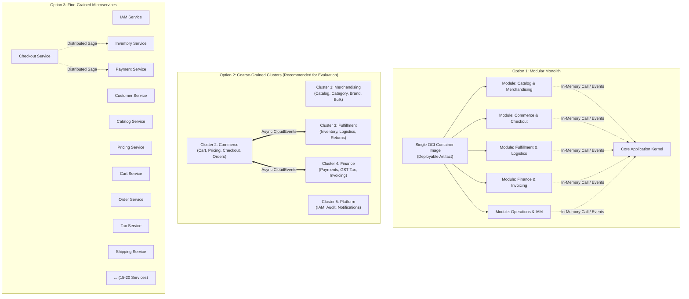
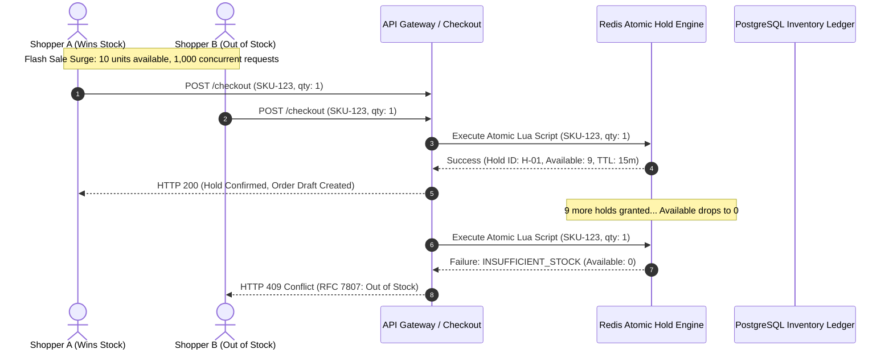
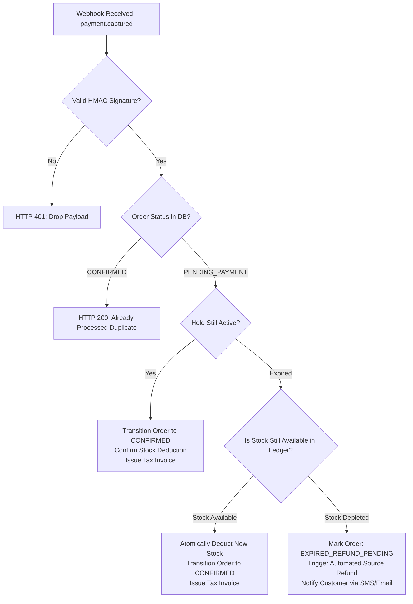
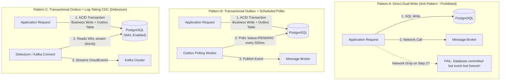

# Phase 2 — Architecture Decision Analysis

| Document Attribute | Details |
| :--- | :--- |
| **Document ID** | `ARCH-DEC-01` |
| **Document Title** | Step 02B: Architecture Decision Analysis & Technical Trade-Off Evaluation |
| **Project Name** | Chellaa E-Commerce Platform |
| **Target Repository** | [`ezhilselvan1109/chellaa-system`](https://github.com/ezhilselvan1109/chellaa-system) (Branch: `dev`) |
| **File Location** | `docs/00-requirements/review/architecture-decision-analysis.md` |
| **Creation Date** | 2026-10-18 |
| **Author Role** | Principal Software Architect, Domain-Driven Design Specialist, Security & Database Architect |
| **Governance Status** | **`NON_BINDING_ANALYSIS`** (Architecture Research & Decision Preparation Only) |
| **Phase 1 Baseline Status** | **`PENDING_APPROVAL`** (Maintained strictly per governance constraints) |

---

## 1. Executive Summary & Governance Restrictions

### 1.1 Objective & Scope
This analysis executes **Step 02B (Architecture Decision Analysis)** for the planned Chellaa single-retailer e-commerce platform. It provides a rigorous, objective, and deeply technical evaluation of the architectural trade-offs, critical business invariants, failure scenarios, and research questions identified during Step 02A discovery ([`docs/00-requirements/review/architecture-discovery-and-domain-boundaries.md`](./architecture-discovery-and-domain-boundaries.md)).

### 1.2 Mandatory Governance Constraints
* **Non-Binding Research Only:** This document is an exploratory architectural research instrument. It does **not** authorize final architectural decisions, approve production technology selections, define immutable microservice boundaries, or initiate software implementation.
* **Preservation of Official Statuses:** The platform governance state recorded in [`docs/00-requirements/11-review-and-approval.md`](../11-review-and-approval.md) remains strictly unmodified:
  * Lifecycle Status: `PENDING_APPROVAL`
  * Requirements Baseline: `NOT_APPROVED`
  * Architecture Design Approval: `NOT_GRANTED`
  * Software Implementation: `NOT_STARTED`
* **Zero Premature Specifications:** No formal specifications, diagrams, or ADRs are placed in `docs/01-architecture/`.
* **Zero Code Implementation:** No backend application code, database migrations, Dockerfiles, or deployment configurations have been created.
* **Single-Retailer Invariant:** The architecture is strictly bounded to the proprietary inventory retail model. Zero marketplace or multi-seller concepts are evaluated or permitted.

---

## 2. Area A: Deployment & Service Boundaries

### 2.1 The Architectural Spectrum
A critical architectural pitfall in e-commerce systems is **premature microservice decomposition**—equating logical business domains directly with independent deployable containers. For an initial engineering team (2–6 engineers) launching a backend-first single-retailer platform, three distinct deployment boundary options are comparatively evaluated:

### 2.2 Deep Multidimensional Trade-Off Matrix

| Evaluation Dimension | Option 1: Modular Monolith | Option 2: Coarse-Grained Service Clusters | Option 3: Fine-Grained Microservices |
| :--- | :--- | :--- | :--- |
| **Business Cohesion** | High within code namespaces; relies on automated static analysis (ArchUnit) to prevent cross-module spaghetti dependencies. | **Very High:** Service boundaries map directly to major business capabilities (Merchandising, Commerce, Fulfillment, Finance). | High within individual micro-domains, but end-to-end commerce workflows become fragmented across 10+ services. |
| **Transaction Boundaries** | **Very High:** Native local ACID transactions across modules. Zero distributed Sagass required for checkout and order placement. | **High:** Local ACID transactions within clusters (e.g., Cart + Pricing + Checkout + Orders); Sagass limited to cross-cluster milestones. | **Very Low:** Every multi-step workflow requires distributed Sagass, two-phase reservation protocols, and complex compensating transactions. |
| **Scalability Under Load** | Moderate: The entire application must scale horizontally when checkout surges to 1,000 OPM during promotional events. | **High:** The *Commerce & Checkout* cluster scales independently without scaling low-load back-office administration modules. | **Highest:** Individual endpoints scale independently; but network serialization overhead can degrade $p95$ response times. |
| **Failure Isolation** | Low: An uncaught memory leak or thread exhaustion in PDF rendering or reporting can crash the entire application process. | **High:** A failure in Reporting, Logistics, or Notifications cannot crash or slow down the customer-facing checkout funnel. | **Highest:** Maximum process isolation; but vulnerable to cascading network failures without strict circuit breakers. |
| **Team Size & Operational Complexity** | **Lowest:** Ideal for 2–5 engineers. Single CI/CD pipeline, single Docker image, single monitoring target, trivial local dev setup. | **Moderate:** Ideal for 5–10 engineers. 4–6 CI/CD pipelines, manageable container orchestration, clear service ownership. | **Highest:** Requires 15+ engineers and a dedicated SRE/DevOps team to manage service mesh, distributed tracing, and 15+ pipelines. |
| **Infrastructure Cost** | **Lowest:** Runs efficiently on modest cloud compute (e.g., 2–4 container instances); single managed database instance. | **Moderate:** 4–6 lightweight container services; low resource wastage; clear cost allocation per capability. | **Highest:** High cloud bill (minimum 2 replicas $\times$ 15 services = 30+ containers, multiple DB instances or connection pools). |
| **Testing Simplicity** | **Highest:** Fast, deterministic in-memory integration testing; zero network mock overhead; reliable test suites. | **High:** Comprehensive integration testing within clusters; contract testing (Pact/OpenAPI) for inter-cluster contracts. | **Lowest:** Slow, brittle distributed integration tests; heavy reliance on complex mock environments or staging clusters. |
| **Future Extraction Path** | Serves as the starting baseline; clean module interfaces allow progressive extraction of high-load clusters. | Provides a sustainable, long-term operational sweet spot; clusters can be further decomposed if team expands. | Irreversible distributed complexity; decomposing too early creates "distributed monolith" antipatterns. |
| **Evaluation Recommendation** | `PROPOSED for Prototype / MVP Evaluation` | `PROPOSED as Primary Exploration Baseline` | `NOT RECOMMENDED for Initial Launch Team` |

---

## 3. Area B: Inventory & Checkout Correctness

### 3.1 Non-Negotiable Invariants
In a single-retailer e-commerce platform selling high-value proprietary electronics, the following correctness invariants must **always hold**:

1. **Stock Non-Negativity Invariant:** For any SKU $s$ at any time $t$, $\text{AvailableStock}(s, t) \ge 0$. Under no circumstance may available stock drop below zero ([`BR-INV-001`](../05-business-rules.md#br-inv-001), [`BR-INV-002`](../05-business-rules.md#br-inv-002)).
2. **Stock Conservation Invariant:** For any SKU $s$, $\text{TotalPhysicalStock}(s) = \text{AvailableStock}(s) + \text{ReservedStock}(s) + \text{DamagedStock}(s) + \text{FulfilledStock}(s)$.
3. **Temporal Hold Expiry Invariant:** An unconfirmed reservation hold MUST automatically expire and return to $\text{AvailableStock}$ exactly when $\text{currentTime} > \text{HoldExpiresAt}$ (15-minute TTL per [`WF-006`](../06-business-workflows.md#wf-006)).
4. **Order-Stock Parity Invariant:** Exactly one confirmed order line item corresponds to one decremented physical unit; phantom orders or unallocated confirmed orders are strictly illegal ([`BR-INV-003`](../05-business-rules.md#br-inv-003)).

### 3.2 Failure Scenarios & Correctness Mechanisms

#### Detailed Mechanism Analysis:
1. **Pessimistic SQL Row Locking (`SELECT FOR UPDATE`):**
   * *Mechanism:* Transaction locks the inventory row: `SELECT stock_available FROM stock_ledger WHERE sku_id = ? FOR UPDATE`.
   * *Correctness:* 100% ACID compliant; zero synchronization drift.
   * *Failure Mode under Load:* Under 1,000 OPM flash sales on a single flagship SKU, 1,000 concurrent transactions queue for the same row lock. This causes lock wait timeouts (504 Gateway Timeout), connection pool starvation, and database CPU spikes.
2. **In-Memory Distributed Atomic Hold (Redis + Lua Script):**
   * *Mechanism:* Available stock cached in Redis. An atomic Lua script executes in the single-threaded Redis engine: checks $\text{available} \ge \text{requested}$; decrements available; increments reserved; writes hold key with 15-minute TTL.
   * *Correctness:* Guaranteed atomic; sub-2ms latency; offloads all read/hold contention from PostgreSQL.
   * *Failure Mode & Mitigation:* If Redis crashes, stock state could desynchronize. *Mitigation:* Redis deployed in Multi-AZ cluster with synchronous replication; PostgreSQL remains the authoritative ledger; background reconciliation worker syncs Redis against PostgreSQL.
3. **Optimistic Locking with Retry:**
   * *Mechanism:* `UPDATE stock_ledger SET stock_available = stock_available - ? WHERE sku_id = ? AND version = ?`.
   * *Failure Mode:* Under high concurrency, 95%+ of transactions fail their version check, causing massive retry storms. **Unsuitable for flash sales.**

### 3.3 Executable Verification Plan for Overselling Prevention
To mathematically prove zero overselling before implementation:
* **Test Architecture:** Synthetic load test script (k6) deploying 1,000 concurrent virtual users contending for 10 physical stock units of SKU-TEST-001.
* **Pass Criteria:**
  1. Exactly 10 requests receive HTTP 200 with valid hold tokens.
  2. Exactly 990 requests receive HTTP 409 (Conflict / Insufficient Stock).
  3. Database and cache assert: $\text{AvailableStock} = 0$, $\text{ReservedStock} = 10$, $\text{TotalStock} = 10$.
  4. After 15 minutes of inactivity, an automated test worker asserts all 10 holds expire and $\text{AvailableStock}$ returns to 10.

---

## 4. Area C: Payment Lifecycle & Late Webhook Reconciliation

### 4.1 Payment Idempotency & Ingress Security
* **Client Idempotency Keys:** Storefront clients submit an `Idempotency-Key: <UUIDv4>` header for checkout submissions and payment authorizations ([`FR-CHK-001`](../04-functional-requirements.md#fr-chk-001)).
* **Gateway Idempotency:** Outbound calls to payment gateways pass the unique `order_id` as the gateway's idempotency parameter, guaranteeing that network dropouts on intent creation cannot create duplicate merchant payment sessions.
* **Webhook Cryptographic Validation:** Webhook payloads from payment gateways (Razorpay, PayU, Cashfree per [`DEP-001`](../08-assumptions-dependencies-open-questions.md#dep-001)) must be verified using HMAC-SHA256 signature headers against the merchant secret ([`BR-PAY-002`](../05-business-rules.md#br-pay-002)). Invalid signatures are rejected with HTTP 401.

### 4.2 Late Payment Success & Inventory Expiry Policy
A critical real-world failure mode occurs when a customer completes payment at the bank gateway, but network latency or gateway delays cause the webhook to arrive **after the 15-minute inventory hold has expired**:

#### Mandatory Business Policy for Late Payments:
* **The Assumption to Avoid:** Architecture must **never assume** that late payment success can be followed by another inventory reservation. If the item was purchased by another customer during the delay, forcing an order creates illegal negative stock (overselling).
* **The Recovery Policy ([`BR-PAY-003`](../05-business-rules.md#br-pay-003)):**
  1. *Check Current Stock:* Atomically query if $\text{AvailableStock} \ge \text{order\_qty}$.
  2. *Path A (Stock Available):* Re-reserve stock, transition order to `CONFIRMED`, issue sequential invoice, emit `order.confirmed.late_capture`.
  3. *Path B (Stock Sold Out):* Transition order to `EXPIRED_OUT_OF_STOCK`, immediately trigger an **automated source refund** via the payment gateway API ([`FR-PAY-003`](../04-functional-requirements.md#fr-pay-003)), and dispatch an urgent notification explaining the sold-out condition.

### 4.3 Refund Retries & Gateway Discrepancy Reconciliation
* **Uncertain Refund Outcomes:** If a refund API call to the gateway times out (HTTP 504), the local ledger must not blindly retry (risking double-refunds). The refund transaction is marked `REFUND_PENDING_VERIFICATION`.
* **Reconciliation Worker:** A scheduled reconciliation job queries the gateway refund status endpoint (`/v1/refunds/{refund_id}`) before attempting a retry.
* **Daily Settlement Reconciliation ([`WF-014`](../06-business-workflows.md#wf-014)):** Compares the payment gateway settlement file against the local `payment_transactions` database to catch unmatched captures, chargebacks, or disputed transactions.

---

## 5. Area D: Database & Asynchronous Messaging

### 5.1 Database Architecture Trade-Offs

| Evaluation Dimension | Option 1: Physical Database-Per-Service | Option 2: Shared PostgreSQL with Logical Schema Isolation |
| :--- | :--- | :--- |
| **Blast Radius Containment** | **Highest:** A database crash or runaway query in reporting affects only that service. | **Moderate:** Shared CPU/memory; a resource-heavy analytical query could degrade checkout DB performance. |
| **Data Boundary Enforcement** | Physical network boundary; direct cross-service queries are physically impossible. | **Strong Logical Enforcement:** Separate schemas (`catalog`, `orders`, `inventory`, `finance`) with dedicated database user roles; cross-schema `REFERENCES` banned via CI linting. |
| **Backup & Point-in-Time Recovery (PITR)** | Fragmented: Restoring 6 distinct databases to an identical transactional timestamp is extremely difficult. | **Unified:** Single continuous Write-Ahead Log (WAL) archive enables seamless Point-in-Time Recovery across the entire platform. |
| **Operational & Cloud Cost** | High: 6 managed RDS instances (minimum 12 instances with Multi-AZ standby); complex connection pool tuning. | **Lowest:** Single managed RDS PostgreSQL instance (Multi-AZ); optimal resource utilization for launch. |
| **Local Developer Setup** | Complex: Requires running 6 distinct database engines or multiple Docker containers locally. | **Simplest:** Single `docker-compose` PostgreSQL container initialized with schema creation scripts. |
| **Evaluation Recommendation** | `PROPOSED for Evaluation (Scale Phase)` | `PROPOSED for Evaluation (Launch Phase Baseline)` |

---

### 5.2 Transactional Event Publishing Patterns

Publishing domain events to a message broker during database writes is vulnerable to **dual-write failure** (database transaction commits, but network fails before broker publish; or broker accepts message, but database transaction aborts).

#### Pattern Comparison:
* **Direct Dual-Write:** Strictly prohibited. Violates data consistency.
* **Transactional Outbox with Polling:** Application writes events to an `outbox` table within the same local ACID transaction as the business entity. A background worker polls the outbox table every 500ms and publishes to the broker.  
  * *Trade-off:* Zero message loss; simple to implement without extra infrastructure; but adds polling query load on the database and 500ms latency.
* **Transactional Outbox with Change-Data Capture (CDC - Debezium):** Debezium tails the PostgreSQL Write-Ahead Log (WAL) directly, streaming outbox inserts to Kafka with sub-second latency and zero database query overhead.  
  * *Trade-off:* Industry standard for high-throughput distributed systems; but introduces operational overhead (Kafka Connect cluster management).

---

### 5.3 Messaging Broker Comparison

| Feature / Metric | Apache Kafka | RabbitMQ | Managed Cloud Queues (AWS SQS/SNS) |
| :--- | :--- | :--- | :--- |
| **Delivery Model** | Distributed commit log (pull-based). | Message broker with smart routing (push-based). | Fully managed distributed queue/topic (pull/push). |
| **Delivery Semantics** | At-least-once (with idempotent consumers). | At-least-once. | At-least-once (FIFO queues available). |
| **Throughput Capacity** | Extreme ($>100,000\text{ msgs/sec}$). | Moderate to High ($20,000\text{ msgs/sec}$). | Moderate (FIFO capped at 3,000 msgs/sec with batching). |
| **Message Replay** | **Native:** Replays events by resetting consumer group offsets. | Difficult: Requires custom dead-letter queues. | Not supported: Messages deleted upon consumer acknowledgment. |
| **Ordering Guarantees** | Strict in-order processing per partition key (e.g., `order_id`). | In-order per queue. | Strict in-order only on FIFO queues. |
| **Operational Overhead** | High: Requires KRaft/Zookeeper, cluster balancing, partition sizing. | Moderate: Lightweight Erlang broker; simple clustering. | **Zero:** Fully managed cloud infrastructure; zero patching. |
| **Vendor Portability** | 100% portable across cloud and on-premise. | 100% portable. | Locked to cloud provider proprietary APIs. |
| **Evaluation Recommendation** | `PROPOSED for Evaluation` | `PROPOSED for Evaluation` | `PROPOSED for Evaluation` |

---

## 6. Area E: Security & Identity Architecture

### 6.1 Customer vs Administrative Staff Identity Separation
A core architectural principle for Chellaa is the **strict physical and logical segregation** between customer-facing retail authentication and internal staff access:

| Security Attribute | Retail Customer Identity | Administrative Staff IAM |
| :--- | :--- | :--- |
| **Primary Credential** | Mobile phone number verified via SMS OTP ([`OQ-010`](../08-assumptions-dependencies-open-questions.md#oq-010)). | Enterprise email + strong password + mandatory MFA ([`FEAT-ADM-001`](../03-business-feature-inventory.md#feat-adm-001)). |
| **Credential Storage** | Phone numbers encrypted at rest; OTP hashed with 5-minute TTL. | Passwords hashed using bcrypt (factor $ge 12$) or Argon2id ([`NFR-SEC-002`](../07-non-functional-requirements.md#nfr-sec-002)). |
| **Token Claims & Expiry** | Short-lived JWT (RS256, 15-minute expiry) + refresh token rotation. | Short-lived JWT with embedded RBAC roles and permissions ([`BR-ADM-001`](../05-business-rules.md#br-adm-001)). |
| **Access Perimeter** | Public API Gateway; throttled via IP and account rate limiters. | Restricted internal gateway; IP whitelisting / VPN access recommended. |
| **Blast Radius Isolation** | Customer database breach cannot compromise staff administrative accounts. | Staff credential compromise cannot be used to spoof customer storefront sessions. |

### 6.2 Internal Service Identity Propagation
* **Perimeter Gateway Verification:** The API Gateway validates incoming JWT tokens against the identity provider's public JWKS keys.
* **Header Injection with Cryptographic Signature:** Upon successful token verification, the Gateway injects sanitized headers (`X-User-Id`, `X-User-Roles`, `X-Permissions`) and signs them with a private Gateway key in an `X-Gateway-Signature` header.
* **Internal Defense in Depth:** Internal services verify the `X-Gateway-Signature` header to prevent attackers from bypassing the gateway and directly forging internal user identity headers.

### 6.3 Sensitive Data Protection & PCI DSS Scope
* **Zero Cardholder Storage:** Chellaa application servers never receive, transmit, or store credit/debit card PAN, CVV, or expiry dates ([`BR-SEC-001`](../05-business-rules.md#br-sec-001), [`NFR-SEC-001`](../07-non-functional-requirements.md#nfr-sec-001)). All payment data entry occurs in PCI DSS Level 1 certified hosted fields provided by the payment gateway client SDK.
* **PII Encryption at Rest:** Customer names, phone numbers, and delivery addresses are encrypted using AES-256 in the database ([`NFR-SEC-003`](../07-non-functional-requirements.md#nfr-sec-003)).
* **Automated Log Redaction:** Interceptors in shared logging libraries use regular expressions to scrub phone numbers, emails, passwords, and tokens before log lines are emitted.
* **WORM Audit Trail:** Privileged administrative mutations (role assignments, refunds, price overrides) are written to an append-only ledger with cryptographic hash chaining ([`FR-AUD-001`](../04-functional-requirements.md#fr-aud-001), [`FR-AUD-002`](../04-functional-requirements.md#fr-aud-002)).

---

## 7. Area F: Search, Reporting & Performance Validation

### 7.1 Search Architecture Evaluation
Storefront search requires typo-tolerant keyword queries, faceted filtering, and sorting across an active catalog of up to 100,000 SKUs ([`NFR-SCL-002`](../07-non-functional-requirements.md#nfr-scl-002)) with latency $le 200\text{ms}$ ($p95$) under 5,000 concurrent browsing sessions ([`NFR-PERF-001`](../07-non-functional-requirements.md#nfr-perf-001)):

| Evaluation Metric | Option A: PostgreSQL Read Replica FTS | Option B: Dedicated OpenSearch / Elasticsearch Cluster |
| :--- | :--- | :--- |
| **Technology Stack** | Native PostgreSQL `tsvector`, GIN indexes, `pg_trgm`. | Distributed OpenSearch / Elasticsearch cluster. |
| **Latency at 100k SKUs** | $80\text{ms}$ to $250\text{ms}$ on simple queries; $>500\text{ms}$ on complex multi-facet aggregations. | **Sub-50ms** across all faceted filters and aggregations. |
| **Typo-Tolerance** | Basic trigram similarity; requires custom tuning. | **Native Lucene fuzzy matching** and automated phonetic stemming. |
| **Infrastructure Overhead** | **Zero additional infrastructure:** Leverages existing database read replica. | High: Stateful 3-node cluster requiring dedicated memory and monitoring. |
| **Data Synchronization** | Immediate via PostgreSQL physical replication. | Asynchronous: Ingests domain events via Outbox pattern ($le 1\text{s}$ lag). |
| **Recommendation** | `PROPOSED for Evaluation (MVP / Launch Phase)` | `PROPOSED for Evaluation (Scale Phase)` |

### 7.2 Reporting Data Isolation Architecture
* **The Anti-Pattern:** Executing heavy executive sales aggregations (GMV, AOV, monthly GST tax liability per [`FEAT-RPT-001`](../03-business-feature-inventory.md#feat-rpt-001)) directly on the primary OLTP database risks table locks and catastrophic checkout latency degradation.
* **The Evaluated Solution:**
  1. *Phase 2 Baseline:* Direct reporting queries exclusively to a dedicated **PostgreSQL Read Replica** configured with separate connection pools and statement timeouts.
  2. *Phase 3+ Scale Architecture:* If reporting data volume exceeds millions of transaction rows, evaluate streaming events to a dedicated columnar analytical database (e.g., ClickHouse).

---

## 8. Area G: Architecture Decision Register (ADR Preparation)

The following register formalizes the 12 core technical architecture decisions evaluated during Step 02B. All decisions are currently marked **`STATUS: OPEN`** pending formal authorization and experimental benchmarking:

---

### Decision AD-001: System Decomposition & Service Boundary Style
* **Decision Statement:** Determine the primary architectural deployment style for the initial launch of the single-retailer backend platform.
* **Related BRD IDs:** [`NFR-SCL-001`](../07-non-functional-requirements.md#nfr-scl-001), [`NFR-REL-001`](../07-non-functional-requirements.md#nfr-rel-001), [`03-business-feature-inventory.md`](../03-business-feature-inventory.md).
* **Decision Owner:** Principal Software Architect (Technical Decision).
* **Business-Owner Approval Required:** No (Internal Technical Architecture Decision).
* **Options Considered:**
  * *Option A:* Modular Monolith with strictly enforced code module boundaries.
  * *Option B:* Coarse-Grained Service Clusters (4 to 6 deployables: Catalog, Commerce, Fulfillment, Finance, Operations).
  * *Option C:* Fine-Grained Microservices (15 to 20 deployable containers).
* **Advantages & Disadvantages:** Documented in Section 2.2.
* **Dependencies & Risks:** Sizing against 1,000 OPM peak surge ([`OQ-016`](../08-assumptions-dependencies-open-questions.md#oq-016)). Risk of operational drag under Option C vs scaling friction under Option A.
* **Evidence Required:** Comparative latency and resource benchmarking on containerized prototypes.
* **Recommended Evaluation Method:** Prototype spike comparing local vs inter-cluster latency.
* **Status:** `OPEN` (Option B recommended as primary exploration candidate).

---

### Decision AD-002: Flash-Sale Inventory Concurrency Control
* **Decision Statement:** Select the concurrency safety mechanism for atomic stock reservation holds during promotional bursts.
* **Related BRD IDs:** [`BR-INV-001`](../05-business-rules.md#br-inv-001), [`BR-INV-002`](../05-business-rules.md#br-inv-002), [`FR-INV-001`](../04-functional-requirements.md#fr-inv-001), [`WF-006`](../06-business-workflows.md#wf-006).
* **Decision Owner:** Distributed Systems Engineer / Database Architect (Technical Decision).
* **Business-Owner Approval Required:** No.
* **Options Considered:**
  * *Option A:* PostgreSQL Pessimistic Row Locking (`SELECT FOR UPDATE`).
  * *Option B:* In-Memory Distributed Atomic Hold in Redis with Lua scripts.
  * *Option C:* Optimistic Locking with retry loops.
* **Advantages & Disadvantages:** Documented in Section 3.2.
* **Dependencies & Risks:** Risk of DB lock contention under Option A vs Redis cache synchronization drift under Option B.
* **Evidence Required:** Synthetic 1,000 concurrent user load test on a single SKU with 10 units in stock.
* **Recommended Evaluation Method:** Benchmark load test measuring maximum throughput before lock timeout.
* **Status:** `OPEN` (Option B recommended for high-concurrency evaluation).

---

### Decision AD-003: Late Payment Arrival & Depleted Inventory Policy
* **Decision Statement:** Define the system behavior when a payment success webhook arrives after the 15-minute reservation hold has expired and the item has been sold to another customer.
* **Related BRD IDs:** [`BR-PAY-003`](../05-business-rules.md#br-pay-003), [`FR-PAY-003`](../04-functional-requirements.md#fr-pay-003), [`WF-007`](../06-business-workflows.md#wf-007).
* **Decision Owner:** Enterprise Business Owner (Commercial Policy Decision).
* **Business-Owner Approval Required:** **YES (Commercial Policy Sign-Off Mandated).**
* **Options Considered:**
  * *Option A:* Reallocate if stock exists; if depleted, automatically trigger a source refund via payment gateway and alert the customer.
  * *Option B:* Place order on backorder and notify customer of delayed fulfillment.
* **Advantages & Disadvantages:** Option A strictly preserves single-retailer inventory integrity (zero overselling); Option B risks extended fulfillment delays on discontinued electronics.
* **Dependencies & Risks:** Direct impact on customer satisfaction and payment gateway refund transaction fees.
* **Evidence Required:** Commercial sign-off from Business Owner.
* **Recommended Evaluation Method:** Policy confirmation in review gate.
* **Status:** `OPEN` (Option A recommended to guarantee stock integrity).

---

### Decision AD-004: Checkout Saga Coordination Architecture
* **Decision Statement:** Determine the distributed transaction coordination pattern across Inventory, Coupons, and Orders during checkout.
* **Related BRD IDs:** [`BR-CHK-001`](../05-business-rules.md#br-chk-001), [`FR-CHK-001`](../04-functional-requirements.md#fr-chk-001), [`WF-006`](../06-business-workflows.md#wf-006).
* **Decision Owner:** Distributed Systems Engineer (Technical Decision).
* **Business-Owner Approval Required:** No.
* **Options Considered:**
  * *Option A:* Orchestrated Saga with a dedicated Checkout State Machine coordinator.
  * *Option B:* Choreographed Saga using event listeners across services.
* **Advantages & Disadvantages:** Orchestrated Saga centralizes compensation logic and failure tracking; Choreography provides loose coupling but makes multi-step failure tracing difficult.
* **Dependencies & Risks:** Compensating transactions (`release_hold`, `unlock_coupon`) must be guaranteed idempotent.
* **Evidence Required:** Failure injection tests verifying automated rollback of reserved stock on payment timeout.
* **Recommended Evaluation Method:** Architectural prototype testing.
* **Status:** `OPEN` (Option A recommended for transactional visibility).

---

### Decision AD-005: Database Architecture & Data Isolation Model
* **Decision Statement:** Determine the database hosting topology and isolation model across business domains.
* **Related BRD IDs:** [`FEAT-FIN-001`](../03-business-feature-inventory.md#feat-fin-001), [`NFR-BCM-001`](../07-non-functional-requirements.md#nfr-bcm-001).
* **Decision Owner:** Database Architect (Technical Decision).
* **Business-Owner Approval Required:** No.
* **Options Considered:**
  * *Option A:* Physical Database-per-Service (independent RDS instances).
  * *Option B:* Single Managed PostgreSQL Cluster with Logical Schema Isolation and distinct user roles.
* **Advantages & Disadvantages:** Documented in Section 5.1.
* **Dependencies & Risks:** Cost vs blast radius containment. Backup/PITR complexity.
* **Evidence Required:** Connection pool benchmarking under simulated 1,000 OPM load.
* **Recommended Evaluation Method:** Performance and cost modeling.
* **Status:** `OPEN` (Option B recommended as baseline for initial launch).

---

### Decision AD-006: Transactional Event Publishing Pattern
* **Decision Statement:** Select the pattern for reliably publishing domain events from the database to the message broker without dual-write inconsistency.
* **Related BRD IDs:** [`BR-OPS-001`](../05-business-rules.md#br-ops-001), [`FEAT-OPS-001`](../03-business-feature-inventory.md#feat-ops-001).
* **Decision Owner:** Distributed Systems Engineer (Technical Decision).
* **Business-Owner Approval Required:** No.
* **Options Considered:**
  * *Option A:* Transactional Outbox + Scheduled Polling Worker.
  * *Option B:* Transactional Outbox + Log-Tailing Change Data Capture (Debezium).
* **Advantages & Disadvantages:** Polling is simpler to operate; Debezium eliminates DB polling queries and delivers sub-second latency.
* **Dependencies & Risks:** Direct dual-write is prohibited.
* **Evidence Required:** Kill-9 crash testing of container to verify zero event loss upon restart.
* **Recommended Evaluation Method:** Chaos failure testing in staging.
* **Status:** `OPEN` (Option A for initial simplicity; Option B for scale).

---

### Decision AD-007: Asynchronous Messaging Technology
* **Decision Statement:** Select the messaging broker technology for inter-service domain event streaming.
* **Related BRD IDs:** [`NFR-AVL-002`](../07-non-functional-requirements.md#nfr-avl-002), [`FEAT-INT-001`](../03-business-feature-inventory.md#feat-int-001).
* **Decision Owner:** Distributed Systems Engineer (Technical Decision).
* **Business-Owner Approval Required:** No.
* **Options Considered:**
  * *Option A:* Apache Kafka.
  * *Option B:* RabbitMQ.
  * *Option C:* AWS Managed SQS/SNS.
* **Advantages & Disadvantages:** Documented in Section 5.3.
* **Dependencies & Risks:** Partition key ordering requirements; event replay needs.
* **Evidence Required:** Operational complexity assessment vs throughput needs.
* **Recommended Evaluation Method:** Performance benchmark and operational evaluation.
* **Status:** `OPEN`.

---

### Decision AD-008: Staff vs Customer Identity Segregation
* **Decision Statement:** Define the boundary and identity provider architecture separating retail customers from administrative staff.
* **Related BRD IDs:** [`FEAT-ADM-001`](../03-business-feature-inventory.md#feat-adm-001), [`FEAT-CUST-001`](../03-business-feature-inventory.md#feat-cust-001), [`BR-ADM-001`](../05-business-rules.md#br-adm-001).
* **Decision Owner:** Security Architect (Technical Decision).
* **Business-Owner Approval Required:** No.
* **Options Considered:**
  * *Option A:* Completely separate authentication services, credential tables, and JWT signing keys.
  * *Option B:* Unified identity service with role claims.
* **Advantages & Disadvantages:** Option A ensures zero blast-radius bleed between customer storefront and administrative back-office.
* **Dependencies & Risks:** Prevents staff privilege escalation via customer token tampering.
* **Evidence Required:** Security architecture review.
* **Recommended Evaluation Method:** Threat modeling session.
* **Status:** `OPEN` (Option A strongly recommended).

---

### Decision AD-009: Internal Service Authentication & Identity Propagation
* **Decision Statement:** Select the pattern for propagating validated user identity across backend services behind the API Gateway.
* **Related BRD IDs:** [`NFR-SEC-002`](../07-non-functional-requirements.md#nfr-sec-002), [`BR-ADM-002`](../05-business-rules.md#br-adm-002).
* **Decision Owner:** Security Architect (Technical Decision).
* **Business-Owner Approval Required:** No.
* **Options Considered:**
  * *Option A:* Perimeter Gateway JWT verification + signed internal header injection (`X-Gateway-Signature`).
  * *Option B:* Decentralized JWT verification in every internal service via JWKS.
* **Advantages & Disadvantages:** Option A offloads CPU-heavy signature verification from backend services; Option B provides end-to-end zero-trust verification.
* **Dependencies & Risks:** Risk of header spoofing under Option A if internal network is accessible.
* **Evidence Required:** Penetration testing verifying direct port bypass rejection.
* **Recommended Evaluation Method:** Security review and prototype test.
* **Status:** `OPEN`.

---

### Decision AD-010: Catalog Search Read-Model Architecture
* **Decision Statement:** Determine whether catalog search is served via PostgreSQL Read-Replica Full-Text Search or a dedicated OpenSearch cluster.
* **Related BRD IDs:** [`NFR-PERF-001`](../07-non-functional-requirements.md#nfr-perf-001), [`NFR-SCL-002`](../07-non-functional-requirements.md#nfr-scl-002), [`FEAT-SRCH-001`](../03-business-feature-inventory.md#feat-srch-001).
* **Decision Owner:** Principal Software Architect (Technical Decision).
* **Business-Owner Approval Required:** No.
* **Options Considered:**
  * *Option A:* Dedicated PostgreSQL Read Replica with `tsvector` and `pg_trgm`.
  * *Option B:* Dedicated OpenSearch / Elasticsearch cluster.
* **Advantages & Disadvantages:** Documented in Section 7.1.
* **Dependencies & Risks:** Sizing against 100,000 SKUs and sub-200ms $p95$ latency target.
* **Evidence Required:** Latency benchmarking with 100,000 SKUs under 5,000 concurrent query load.
* **Recommended Evaluation Method:** Synthetic search query benchmark.
* **Status:** `OPEN` (Option A for initial MVP; Option B for scale).

---

### Decision AD-011: Executive Reporting Data Isolation Architecture
* **Decision Statement:** Select the infrastructure isolation strategy for executing heavy daily financial and inventory reports without locking OLTP tables.
* **Related BRD IDs:** [`FEAT-RPT-001`](../03-business-feature-inventory.md#feat-rpt-001), [`NFR-PERF-003`](../07-non-functional-requirements.md#nfr-perf-003), [`WF-014`](../06-business-workflows.md#wf-014).
* **Decision Owner:** Database Architect (Technical Decision).
* **Business-Owner Approval Required:** No.
* **Options Considered:**
  * *Option A:* Dedicated PostgreSQL Read Replica with independent connection pool.
  * *Option B:* Dedicated Columnar Analytical Datamart (ClickHouse).
* **Advantages & Disadvantages:** Option A requires zero extra infrastructure; Option B provides extreme aggregation speeds at higher complexity.
* **Dependencies & Risks:** Direct queries against the primary OLTP database are prohibited.
* **Evidence Required:** Query performance test simulating month-end sales aggregation on 500,000 order records.
* **Recommended Evaluation Method:** Query execution plan analysis.
* **Status:** `OPEN` (Option A recommended for launch).

---

### Decision AD-012: High Availability & Disaster Recovery Topology
* **Decision Statement:** Establish the cloud deployment topology required to satisfy 99.9% uptime and RPO $le 5	ext{m}$ / RTO $le 2	ext{h}$ recovery targets.
* **Related BRD IDs:** [`NFR-AVL-001`](../07-non-functional-requirements.md#nfr-avl-001), [`NFR-BCM-001`](../07-non-functional-requirements.md#nfr-bcm-001), [`OQ-017`](../08-assumptions-dependencies-open-questions.md#oq-017).
* **Decision Owner:** Cloud Architect / SRE Lead (Technical Decision).
* **Business-Owner Approval Required:** **YES (SLA & Infrastructure Cost Sign-Off).**
* **Options Considered:**
  * *Option A:* Single-Region Multi-Availability-Zone (Multi-AZ) Active-Active Container Cluster + Synchronous Standby PostgreSQL.
  * *Option B:* Multi-Region Active-Passive Standby.
* **Advantages & Disadvantages:** Option A easily achieves 99.9% uptime and RTO $le 15	ext{m}$ at reasonable cost; Option B is exorbitantly expensive and adds cross-region latency.
* **Dependencies & Risks:** Continuous Write-Ahead Log (WAL) archiving to S3 is mandatory for Point-in-Time Recovery.
* **Evidence Required:** Automated failover drill in staging measuring cutover time.
* **Recommended Evaluation Method:** Staging disaster simulation drill.
* **Status:** `OPEN` (Option A recommended).

---

## 9. Next Steps & Governance Review Gate

This analysis completes **Phase 2 — Step 02B (Architecture Decision Analysis)**.

### Mandatory Entry Gate for Formal Architecture Specifications:
Before any document can be created under `docs/01-architecture/` or any Architecture Decision Record (ADR) ratified:
1. **Business Owner Approval:** Section 7 of [`docs/00-requirements/11-review-and-approval.md`](../11-review-and-approval.md) must be executed.
2. **Lifecycle Transition:** Lifecycle status must transition from `PENDING_APPROVAL` to `APPROVED`.
3. **Commercial Sign-Off:** Business Owner must resolve `AD-003` (Late payment refund policy) and `AD-012` (HA/DR SLA targets).
4. **Sponsor Authorization:** Formal authorization must be granted to establish `docs/01-architecture/`.
