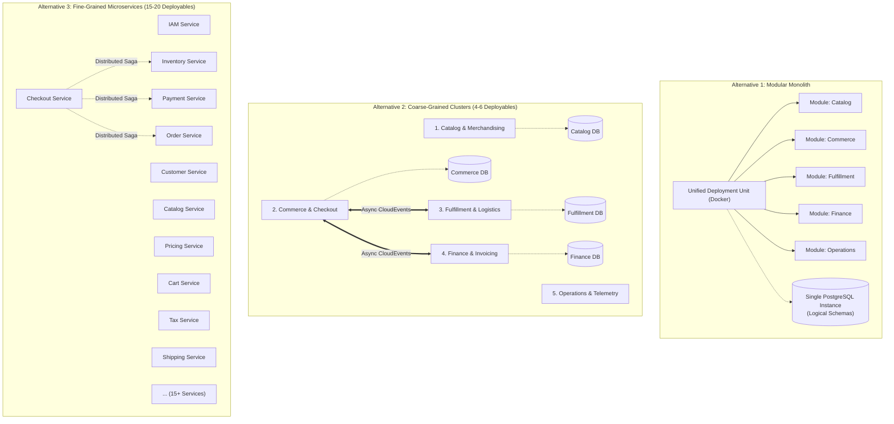

# Phase 2 — Architecture Discovery & Domain Boundary Analysis

| Document Attribute | Details |
| :--- | :--- |
| **Document ID** | `ARCH-DISC-01` |
| **Document Title** | Step 02A: Architecture Discovery, Domain Boundary & Data Ownership Analysis |
| **Project Name** | Chellaa E-Commerce Platform |
| **Target Repository** | [`ezhilselvan1109/chellaa-system`](https://github.com/ezhilselvan1109/chellaa-system) (Branch: `dev`) |
| **File Location** | `docs/00-requirements/review/architecture-discovery-and-domain-boundaries.md` |
| **Creation Date** | 2026-10-18 |
| **Author Role** | Principal Software Architect, Domain-Driven Design Specialist & Distributed Systems Engineer |
| **Governance Status** | **`NON_BINDING_DISCOVERY`** (Exploratory Discovery Artifact — Phase 1 Approval Pending) |
| **Phase 1 Baseline Status** | **`PENDING_APPROVAL`** (Maintained strictly per governance constraints) |

---

## 1. Executive Summary & Discovery Objectives

### 1.1 Discovery Purpose
This discovery artifact executes **Step 02A (Architecture Discovery and Domain Boundary Analysis)** for the planned Chellaa single-retailer e-commerce platform. It provides an exhaustive, capability-by-capability exploration of the 20 candidate business domains, investigates three structural boundary alternatives (Modular Monolith, Coarse-Grained Clusters, Fine-Grained Microservices), analyzes 6 critical end-to-end commerce transaction flows, maps authoritative data ownership across core entities, and establishes the formal **Architecture Discovery Register**.

### 1.2 Non-Binding Status & Scope Constraints
* **Exploratory & Preparatory Only:** This artifact is an investigative engineering instrument. It does **not** finalize architectural decisions, select production technology stacks, define physical database schemas, or prescribe immutable microservice boundaries.
* **Strict Single-Retailer Invariant:** The architecture discovery is strictly bounded to the proprietary inventory retail model (one enterprise owns and sells its own warehouse stock). Zero third-party marketplace capabilities (such as seller onboarding, vendor portals, split payouts, multi-merchant buy-boxes, or vendor commission ledgers) are evaluated or permitted.
* **Backend-First Prioritization:** Analysis focuses entirely on backend capabilities, transactional data consistency, Saga compensation, and integration resilience. Customer-facing web applications, mobile apps, and administrative user interfaces remain deferred.
* **Governance Invariant:** Moving to formal architecture design under `docs/01-architecture/` remains strictly blocked until the Enterprise Business Owner formally signs off on [`docs/00-requirements/11-review-and-approval.md`](../11-review-and-approval.md) Section 7.

---

## 2. Deep Candidate Business Domain Analysis

The 41 business features in [`03-business-feature-inventory.md`](../03-business-feature-inventory.md) and 56 functional specifications in [`04-functional-requirements.md`](../04-functional-requirements.md) are analyzed across **20 candidate business domains**.

> [!IMPORTANT]
> **Candidate Domains are Logical Bounded Contexts, NOT a Mandated Microservice List.**  
> A candidate domain identifies a boundary of business responsibility and ubiquitous language. Multiple candidate domains may be co-located within a single deployable service (in a modular monolith or coarse-grained service cluster) to minimize distributed transaction overhead.

---

### 2.1 Customer Accounts Domain
* **Business Responsibility:** Manages retail customer identities, credential verification, profile lifecycles, multiple shipping addresses, privacy preferences, and self-service account deactivation.
* **Main Entities & Data Ownership:** `CustomerProfile`, `CustomerAddress`, `CustomerPreferences`, `AccountStatusRecord`.
* **Relevant BRD Requirement IDs:** [`FEAT-CUST-001`](../03-business-feature-inventory.md#feat-cust-001), [`FEAT-CUST-002`](../03-business-feature-inventory.md#feat-cust-002), [`FEAT-CUST-003`](../03-business-feature-inventory.md#feat-cust-003), [`FR-CUST-001`](../04-functional-requirements.md#fr-cust-001), [`FR-CUST-002`](../04-functional-requirements.md#fr-cust-002), [`FR-CUST-003`](../04-functional-requirements.md#fr-cust-003), [`FR-CUST-004`](../04-functional-requirements.md#fr-cust-004), [`BR-CUST-001`](../05-business-rules.md#br-cust-001), [`BR-CUST-002`](../05-business-rules.md#br-cust-002), [`WF-001`](../06-business-workflows.md#wf-001).
* **Incoming Interactions:** Customer registration request, address creation/update, PIN code serviceability validation, account deactivation request.
* **Outgoing Interactions:** Emits `customer.registered`, `customer.address.updated`, `customer.deactivated`; calls Messaging Gateway (`DEP-003`) for phone OTP.
* **Transactional Consistency Requirements:** Immediate consistency (ACID) within customer profile and addresses; eventual consistency for downstream analytics and notification relays.
* **Security Boundaries:** High PII sensitivity (names, phone numbers, addresses encrypted with AES-256 at rest per [`NFR-SEC-003`](../07-non-functional-requirements.md#nfr-sec-003)); customer tokens isolated from internal staff scopes.
* **Dependencies:** [`DEP-003`](../08-assumptions-dependencies-open-questions.md#dep-003) (SMS Gateway), [`DEP-002`](../08-assumptions-dependencies-open-questions.md#dep-002) (PIN code serviceability registry), [`OQ-010`](../08-assumptions-dependencies-open-questions.md#oq-010) (Mobile OTP policy).
* **Candidate Reasons to Merge or Separate:**
  * *Merge:* Can be co-located with Customer Identity & Cart in a *Customer & Engagement* cluster.
  * *Separate:* Separation isolates PII storage, simplifying GDPR/DPDP compliance audits.

---

### 2.2 Staff Identity & Access Management (IAM) Domain
* **Business Responsibility:** Governs internal administrative operator accounts, multi-factor authentication (MFA), role assignments, and granular Role-Based Access Control (RBAC) permissions.
* **Main Entities & Data Ownership:** `StaffUser`, `Role`, `Permission`, `StaffSession`, `MFACredential`.
* **Relevant BRD Requirement IDs:** [`FEAT-ADM-001`](../03-business-feature-inventory.md#feat-adm-001), [`FR-SEC-001`](../04-functional-requirements.md#fr-sec-001), [`FR-SEC-002`](../04-functional-requirements.md#fr-sec-002), [`BR-ADM-001`](../05-business-rules.md#br-adm-001), [`BR-ADM-002`](../05-business-rules.md#br-adm-002), [`WF-016`](../06-business-workflows.md#wf-016).
* **Incoming Interactions:** Staff login, MFA token validation, permission check queries from API Gateway.
* **Outgoing Interactions:** Issues signed JWT tokens with claims; emits `staff.authenticated`, `staff.suspended`.
* **Transactional Consistency Requirements:** Immediate ACID consistency for role and permission assignments to ensure immediate revocation.
* **Security Boundaries:** Maximum internal privilege boundary; passwords hashed with bcrypt (factor $ge 12$) or Argon2id per [`NFR-SEC-002`](../07-non-functional-requirements.md#nfr-sec-002); strict least-privilege enforcement.
* **Dependencies:** [`DEP-006`](../08-assumptions-dependencies-open-questions.md#dep-006) (Key Vault / JWKS).
* **Candidate Reasons to Merge or Separate:**
  * *Merge:* Can share infrastructure with Platform Operations.
  * *Separate:* **Strongly recommended to keep separate** from retail customer accounts to contain the blast radius of administrative credential compromise.

---

### 2.3 Product Catalog, Categories, Brands & Variants Domain
* **Business Responsibility:** Maintains the central merchandising catalog: hierarchical category taxonomies, dynamic specifications, authorized brand profiles, multi-variant products (color, RAM, storage), and SKU definitions.
* **Main Entities & Data Ownership:** `Product`, `ProductVariant`, `SKU`, `Category`, `SpecificationSchema`, `Brand`, `ProductMedia`.
* **Relevant BRD Requirement IDs:** [`FEAT-CAT-001`](../03-business-feature-inventory.md#feat-cat-001), [`FEAT-CAT-002`](../03-business-feature-inventory.md#feat-cat-002), [`FEAT-CTG-001`](../03-business-feature-inventory.md#feat-ctg-001), [`FEAT-CTG-002`](../03-business-feature-inventory.md#feat-ctg-002), [`FEAT-BRD-001`](../03-business-feature-inventory.md#feat-brd-001), [`FR-CAT-001`](../04-functional-requirements.md#fr-cat-001) through [`FR-CAT-003`](../04-functional-requirements.md#fr-cat-003), [`FR-CTG-001`](../04-functional-requirements.md#fr-ctg-001), [`FR-CTG-002`](../04-functional-requirements.md#fr-ctg-002), [`FR-BRD-001`](../04-functional-requirements.md#fr-brd-001), [`BR-CAT-001`](../05-business-rules.md#br-cat-001) through [`BR-CAT-003`](../05-business-rules.md#br-cat-003), [`BR-CTG-001`](../05-business-rules.md#br-ctg-001), [`BR-CTG-002`](../05-business-rules.md#br-ctg-002), [`BR-BRD-001`](../05-business-rules.md#br-brd-001), [`WF-002`](../06-business-workflows.md#wf-002).
* **Incoming Interactions:** Admin catalog authoring, SKU status transitions (Draft $\rightarrow$ Active $\rightarrow$ Archived), media asset uploads.
* **Outgoing Interactions:** Emits `product.created`, `product.published`, `sku.activated`, `sku.archived`; synchronizes with Search & Discovery domain.
* **Transactional Consistency Requirements:** Immediate ACID consistency across Product, Variants, and SKUs.
* **Security Boundaries:** RBAC gated to `SUPER_ADMIN` and `CATALOG_MANAGER` roles.
* **Dependencies:** [`DEP-005`](../08-assumptions-dependencies-open-questions.md#dep-005) (Cloud Object Storage & CDN).
* **Candidate Reasons to Merge or Separate:**
  * *Merge:* Categories, Brands, and Products share high domain cohesion; merging them into a unified *Catalog & Merchandising* boundary avoids artificial network boundaries.
  * *Separate:* Digital media transcoding can be isolated as a background worker.

---

### 2.4 Pricing & Promotions Domain
* **Business Responsibility:** Governs product selling prices, MRP compare-at ceilings, minimum margin alerts, promotional coupon codes, usage limits, non-stacking rules, and pro-rata line-item discount distribution.
* **Main Entities & Data Ownership:** `PriceRecord`, `PriceHistory`, `Coupon`, `CouponRedemptionLedger`, `DiscountRule`.
* **Relevant BRD Requirement IDs:** [`FEAT-PRC-001`](../03-business-feature-inventory.md#feat-prc-001), [`FEAT-PRM-001`](../03-business-feature-inventory.md#feat-prm-001), [`FR-PRC-001`](../04-functional-requirements.md#fr-prc-001), [`FR-PRM-001`](../04-functional-requirements.md#fr-prm-001), [`FR-PRM-002`](../04-functional-requirements.md#fr-prm-002), [`BR-PRC-001`](../05-business-rules.md#br-prc-001), [`BR-PRC-002`](../05-business-rules.md#br-prc-002), [`BR-PRM-001`](../05-business-rules.md#br-prm-001), [`BR-PRM-002`](../05-business-rules.md#br-prm-002), [`WF-005`](../06-business-workflows.md#wf-005), [`WF-011`](../06-business-workflows.md#wf-011).
* **Incoming Interactions:** Price update commands from Finance/Merchandising, coupon validation calls during cart calculation and checkout.
* **Outgoing Interactions:** Emits `price.updated`, `coupon.redeemed`, `coupon.exhausted`.
* **Transactional Consistency Requirements:** Immediate consistency for coupon usage counters to prevent double-redemption during concurrent checkouts.
* **Security Boundaries:** Price modification restricted to authorized roles; audit trail required for all price changes.
* **Dependencies:** [`OQ-002`](../08-assumptions-dependencies-open-questions.md#oq-002) (Currency scope), [`OQ-009`](../08-assumptions-dependencies-open-questions.md#oq-009) (Tax-inclusive pricing).
* **Candidate Reasons to Merge or Separate:**
  * *Merge:* Can be evaluated alongside Cart & Checkout to allow low-latency, in-process pricing calculations.
  * *Separate:* High-velocity temporal pricing and coupon ledgers have distinct audit requirements.

---

### 2.5 Search & Discovery Domain
* **Business Responsibility:** Delivers sub-200ms faceted product search, typo-tolerant keyword queries, category filtering, and sorting across active catalog SKUs.
* **Main Entities & Data Ownership:** `CatalogSearchIndex`, `SearchFilterFacet`, `SearchQueryLog`.
* **Relevant BRD Requirement IDs:** [`FEAT-SRCH-001`](../03-business-feature-inventory.md#feat-srch-001), [`FR-SRCH-001`](../04-functional-requirements.md#fr-srch-001), [`FR-SRCH-002`](../04-functional-requirements.md#fr-srch-002), [`BR-SRCH-001`](../05-business-rules.md#br-srch-001), [`BR-SRCH-002`](../05-business-rules.md#br-srch-002), [`NFR-PERF-001`](../07-non-functional-requirements.md#nfr-perf-001), [`WF-004`](../06-business-workflows.md#wf-004).
* **Incoming Interactions:** Storefront keyword search, faceted query filtering, indexing events from Catalog and Inventory.
* **Outgoing Interactions:** Search result sets with pagination metadata.
* **Transactional Consistency Requirements:** Eventual consistency (search index synchronization lag $le 1\text{ second}$ post-mutation).
* **Security Boundaries:** Public storefront access; read-only operations; rate-limited at API Gateway.
* **Dependencies:** Dedicated search indexing technology (Elasticsearch/OpenSearch or Postgres FTS).
* **Candidate Reasons to Merge or Separate:**
  * *Merge:* In a modular monolith, can reside as an in-process search module using Postgres read replicas.
  * *Separate:* Search has vastly different read-heavy, query-intensive scaling patterns (5,000+ concurrent browsing sessions) compared to transactional write domains.

---

### 2.6 Cart & Wishlist Domain
* **Business Responsibility:** Maintains persistent customer carts, merges anonymous guest carts upon login, enforces per-SKU quantity caps, detects price changes, and manages saved wishlist items.
* **Main Entities & Data Ownership:** `Cart`, `CartItem`, `Wishlist`, `WishlistItem`.
* **Relevant BRD Requirement IDs:** [`FEAT-CART-001`](../03-business-feature-inventory.md#feat-cart-001), [`FEAT-WSH-001`](../03-business-feature-inventory.md#feat-wsh-001), [`FR-CART-001`](../04-functional-requirements.md#fr-cart-001), [`FR-CART-002`](../04-functional-requirements.md#fr-cart-002), [`FR-WSH-001`](../04-functional-requirements.md#fr-wsh-001), [`BR-CART-001`](../05-business-rules.md#br-cart-001), [`BR-CART-002`](../05-business-rules.md#br-cart-002), [`WF-005`](../06-business-workflows.md#wf-005).
* **Incoming Interactions:** Add item, update quantity, remove item, merge guest cart, clear cart upon order placement.
* **Outgoing Interactions:** Cart summary queries; calls Pricing for live price revalidation.
* **Transactional Consistency Requirements:** High availability over strict consistency; session-level consistency.
* **Security Boundaries:** Customer authentication or signed guest session cookie required.
* **Dependencies:** [`OQ-011`](../08-assumptions-dependencies-open-questions.md#oq-011) (Guest checkout policy).
* **Candidate Reasons to Merge or Separate:**
  * *Merge:* Co-locating Cart with Checkout avoids network serialization of large cart payloads during order initiation.
  * *Separate:* Cart operations are ephemeral and high-velocity; suitable for fast in-memory stores (Redis).

---

### 2.7 Inventory & Warehouse Operations Domain
* **Business Responsibility:** Authoritative ledger of physical stock balances (Available-to-Sell, Reserved, Damaged), atomic reservation holds during checkout, low-stock threshold alerts, warehouse inwarding, and reconciliation.
* **Main Entities & Data Ownership:** `StockLedger`, `InventoryReservation`, `StockInwardReceipt`, `WarehouseZone`, `StockAdjustmentLog`.
* **Relevant BRD Requirement IDs:** [`FEAT-INV-001`](../03-business-feature-inventory.md#feat-inv-001) through [`FEAT-INV-003`](../03-business-feature-inventory.md#feat-inv-003), [`FR-INV-001`](../04-functional-requirements.md#fr-inv-001) through [`FR-INV-004`](../04-functional-requirements.md#fr-inv-004), [`BR-INV-001`](../05-business-rules.md#br-inv-001) through [`BR-INV-004`](../05-business-rules.md#br-inv-004), [`WF-003`](../06-business-workflows.md#wf-003), [`WF-006`](../06-business-workflows.md#wf-006).
* **Incoming Interactions:** Atomic stock reservation hold requests from Checkout, stock confirmation from Order placement, stock release from cancellation/timeout, inwarding entries from Warehouse Operator.
* **Outgoing Interactions:** Emits `inventory.reserved`, `inventory.released`, `inventory.depleted`, `stock.threshold.breached`.
* **Transactional Consistency Requirements:** **Strict Immediate ACID Consistency.** Zero overselling permitted under any concurrency condition ([`BR-INV-001`](../05-business-rules.md#br-inv-001)).
* **Security Boundaries:** Warehouse operators access inwarding APIs; reservation APIs restricted to internal Checkout domain.
* **Dependencies:** [`OQ-007`](../08-assumptions-dependencies-open-questions.md#oq-007) (Warehouse topology), [`OQ-016`](../08-assumptions-dependencies-open-questions.md#oq-016) (Peak load).
* **Candidate Reasons to Merge or Separate:**
  * *Merge:* Merging Inventory and Orders into a single *Fulfillment* service avoids a distributed Saga between inventory deduction and order generation.
  * *Separate:* Inventory has unique high-concurrency contention patterns requiring dedicated optimization (Redis holds or atomic SQL row locking).

---

### 2.8 Checkout Domain
* **Business Responsibility:** Coordinates the checkout pipeline: recalculates line item totals, validates shipping address serviceability, locks coupon discounts, triggers atomic inventory reservation holds, and initiates payment intents.
* **Main Entities & Data Ownership:** `CheckoutSession`, `CheckoutHoldRecord`, `OrderSummaryDraft`.
* **Relevant BRD Requirement IDs:** [`FEAT-CHK-001`](../03-business-feature-inventory.md#feat-chk-001), [`FEAT-CHK-001`](../03-business-feature-inventory.md#feat-chk-002), [`FR-CHK-001`](../04-functional-requirements.md#fr-chk-001), [`FR-CHK-002`](../04-functional-requirements.md#fr-chk-002), [`BR-CHK-001`](../05-business-rules.md#br-chk-001), [`BR-CHK-002`](../05-business-rules.md#br-chk-002), [`WF-006`](../06-business-workflows.md#wf-006).
* **Incoming Interactions:** Customer initiate-checkout request, shipping address selection, coupon code submission, place-order submission.
* **Outgoing Interactions:** Coordinates calls to Cart, Pricing, Inventory, Tax, and Payment domains; emits `checkout.initiated`, `checkout.abandoned`.
* **Transactional Consistency Requirements:** Coordinates multi-domain distributed transactions; enforces 15-minute hold expiry ([`WF-006`](../06-business-workflows.md#wf-006)).
* **Security Boundaries:** Enforces customer ownership of cart and session; validates idempotency keys.
* **Dependencies:** [`OQ-006`](../08-assumptions-dependencies-open-questions.md#oq-006) (COD rules), [`OQ-016`](../08-assumptions-dependencies-open-questions.md#oq-016) (1,000 OPM throughput).
* **Candidate Reasons to Merge or Separate:**
  * *Merge:* Highly cohesive with Cart and Orders; frequently grouped in a *Commerce* cluster.
  * *Separate:* Can act as a pure stateless Saga Orchestrator.

---

### 2.9 Orders Domain
* **Business Responsibility:** Manages the authoritative lifecycle of customer orders: state machine progression (`PENDING` $\rightarrow$ `CONFIRMED` $\rightarrow$ `PROCESSING` $\rightarrow$ `SHIPPED` $\rightarrow$ `DELIVERED` $\rightarrow$ `CANCELLED`), serial/IMEI number capture, customer cancellation windows, and order history queries.
* **Main Entities & Data Ownership:** `Order`, `OrderLineItem`, `OrderStatusHistory`, `OrderDeviceSerialRecord`.
* **Relevant BRD Requirement IDs:** [`FEAT-ORD-001`](../03-business-feature-inventory.md#feat-ord-001), [`FR-ORD-001`](../04-functional-requirements.md#fr-ord-001) through [`FR-ORD-003`](../04-functional-requirements.md#fr-ord-003), [`BR-ORD-001`](../05-business-rules.md#br-ord-001) through [`BR-ORD-004`](../05-business-rules.md#br-ord-004), [`WF-006`](../06-business-workflows.md#wf-006), [`WF-008`](../06-business-workflows.md#wf-008), [`WF-009`](../06-business-workflows.md#wf-009).
* **Incoming Interactions:** Order creation from Checkout Saga, payment confirmation events from Payments, cancellation requests from Customer, fulfillment dispatch events from Warehouse.
* **Outgoing Interactions:** Emits `order.placed`, `order.confirmed`, `order.cancelled`, `order.dispatched`, `order.delivered`.
* **Transactional Consistency Requirements:** Immediate ACID consistency within the order aggregate; state transitions strictly validated against current status.
* **Security Boundaries:** Customer can only read their own orders; support agents access via RBAC; serial numbers encrypted.
* **Dependencies:** None (Orders is an authoritative core domain).
* **Candidate Reasons to Merge or Separate:**
  * *Merge:* Can be bundled with Checkout and Cart.
  * *Separate:* Orders must be preserved for statutory audits; keeping Orders decoupled isolates financial audit ledgers from high-turnover cart data.

---

### 2.10 Payments & Reconciliation Domain
* **Business Responsibility:** Integrates external payment gateways, manages payment intents, verifies cryptographic webhook signatures, executes refunds, and reconciles daily gateway settlement reports.
* **Main Entities & Data Ownership:** `PaymentTransaction`, `PaymentIntent`, `RefundTransaction`, `GatewaySettlementBatch`.
* **Relevant BRD Requirement IDs:** [`FEAT-PAY-001`](../03-business-feature-inventory.md#feat-pay-001), [`FEAT-PAY-002`](../03-business-feature-inventory.md#feat-pay-002), [`FR-PAY-001`](../04-functional-requirements.md#fr-pay-001) through [`FR-PAY-003`](../04-functional-requirements.md#fr-pay-003), [`BR-PAY-001`](../05-business-rules.md#br-pay-001) through [`BR-PAY-003`](../05-business-rules.md#br-pay-003), [`WF-007`](../06-business-workflows.md#wf-007), [`WF-014`](../06-business-workflows.md#wf-014).
* **Incoming Interactions:** Create payment session, gateway webhook callbacks, trigger refund command from Returns domain.
* **Outgoing Interactions:** Emits `payment.captured`, `payment.failed`, `refund.processed`; calls external gateway APIs.
* **Transactional Consistency Requirements:** Strict idempotency across transaction IDs; state machine transitions from `PENDING` $\rightarrow$ `PAID`.
* **Security Boundaries:** **PCI DSS boundary.** Zero cardholder PAN/CVV storage ([`BR-SEC-001`](../05-business-rules.md#br-sec-001)); webhook HMAC-SHA256 signature verification.
* **Dependencies:** [`DEP-001`](../08-assumptions-dependencies-open-questions.md#dep-001) (Payment Gateways), [`OQ-003`](../08-assumptions-dependencies-open-questions.md#oq-003), [`OQ-004`](../08-assumptions-dependencies-open-questions.md#oq-004).
* **Candidate Reasons to Merge or Separate:**
  * *Merge:* Can be co-located with Invoicing in a *Finance* cluster.
  * *Separate:* **Strong candidate for physical separation** to isolate the PCI DSS compliance perimeter from other services.

---

### 2.11 Tax & Invoicing Domain
* **Business Responsibility:** Calculates statutory GST (CGST, SGST, IGST) based on seller and buyer locations, generates legally compliant sequential tax invoice PDFs, and issues credit notes for approved returns.
* **Main Entities & Data Ownership:** `TaxInvoice`, `CreditNote`, `GSTRateSchedule`, `SequentialInvoiceNumberSequence`.
* **Relevant BRD Requirement IDs:** [`FEAT-FIN-001`](../03-business-feature-inventory.md#feat-fin-001), [`FEAT-FIN-002`](../03-business-feature-inventory.md#feat-fin-002), [`FR-FIN-001`](../04-functional-requirements.md#fr-fin-001) through [`FR-FIN-003`](../04-functional-requirements.md#fr-fin-003), [`BR-FIN-001`](../05-business-rules.md#br-fin-001) through [`BR-FIN-003`](../05-business-rules.md#br-fin-003), [`WF-006`](../06-business-workflows.md#wf-006), [`WF-014`](../06-business-workflows.md#wf-014).
* **Incoming Interactions:** Calculate tax breakdown during checkout, issue invoice upon order confirmation, issue credit note upon return inspection approval.
* **Outgoing Interactions:** Emits `invoice.generated`, `credit_note.generated`; stores invoice PDFs in object storage (`DEP-005`).
* **Transactional Consistency Requirements:** Gapless sequential numbering for tax invoices; immutable once issued ([`BR-FIN-001`](../05-business-rules.md#br-fin-001), [`BR-FIN-002`](../05-business-rules.md#br-fin-002)).
* **Security Boundaries:** Tamper-evident financial records; 8-year audit retention ([`OQ-020`](../08-assumptions-dependencies-open-questions.md#oq-020)).
* **Dependencies:** [`DEP-004`](../08-assumptions-dependencies-open-questions.md#dep-004) (GST Schedules), [`DEP-005`](../08-assumptions-dependencies-open-questions.md#dep-005) (Object storage), [`OQ-001`](../08-assumptions-dependencies-open-questions.md#oq-001).
* **Candidate Reasons to Merge or Separate:**
  * *Merge:* Can be combined with Payments into a *Finance & Invoicing* cluster.
  * *Separate:* Tax calculation (synchronous, latency-critical during checkout) can be decoupled from invoice PDF rendering (asynchronous background worker).

---

### 2.12 Shipping & Delivery Domain
* **Business Responsibility:** Integrates third-party logistics courier APIs, generates automated Air Waybills (AWB), renders shipping labels, and ingests live carrier tracking webhooks to update consignment delivery states.
* **Main Entities & Data Ownership:** `Consignment`, `AirWaybill`, `ShippingLabel`, `TrackingMilestone`.
* **Relevant BRD Requirement IDs:** [`FEAT-SHP-001`](../03-business-feature-inventory.md#feat-shp-001), [`FR-SHP-001`](../04-functional-requirements.md#fr-shp-001), [`FR-SHP-002`](../04-functional-requirements.md#fr-shp-002), [`BR-SHP-001`](../05-business-rules.md#br-shp-001), [`BR-SHP-002`](../05-business-rules.md#br-shp-002), [`WF-008`](../06-business-workflows.md#wf-008).
* **Incoming Interactions:** Consignment dispatch request from warehouse, courier status update webhooks.
* **Outgoing Interactions:** Emits `shipment.dispatched`, `shipment.in_transit`, `shipment.out_for_delivery`, `shipment.delivered`.
* **Transactional Consistency Requirements:** Eventual consistency with external courier statuses; idempotent webhook ingestion.
* **Security Boundaries:** Courier API keys stored in secrets manager; customer phone number shared with courier strictly for delivery coordination.
* **Dependencies:** [`DEP-002`](../08-assumptions-dependencies-open-questions.md#dep-002) (Courier APIs: Shiprocket/Delhivery/Blue Dart), [`OQ-005`](../08-assumptions-dependencies-open-questions.md#oq-005).
* **Candidate Reasons to Merge or Separate:**
  * *Merge:* Can be grouped with Warehouse Inventory in a *Fulfillment & Logistics* cluster.
  * *Separate:* Third-party courier API latencies (often $>2\text{ seconds}$) require isolation via circuit breakers and asynchronous queues.

---

### 2.13 Returns, Replacements & Refunds Domain
* **Business Responsibility:** Validates 7-day customer return eligibility, generates reverse logistics pick-up requests, records warehouse technician physical inspections, creates replacement orders, and initiates payment refunds.
* **Main Entities & Data Ownership:** `ReturnRequest`, `ReverseConsignment`, `TechnicianInspectionReport`, `ReplacementOrderReference`.
* **Relevant BRD Requirement IDs:** [`FEAT-RET-001`](../03-business-feature-inventory.md#feat-ret-001), [`FEAT-RET-002`](../03-business-feature-inventory.md#feat-ret-002), [`FR-RET-001`](../04-functional-requirements.md#fr-ret-001) through [`FR-RET-003`](../04-functional-requirements.md#fr-ret-003), [`BR-RET-001`](../05-business-rules.md#br-ret-001) through [`BR-RET-003`](../05-business-rules.md#br-ret-003), [`WF-010`](../06-business-workflows.md#wf-010).
* **Incoming Interactions:** Customer return request submission, technician inspection grading input.
* **Outgoing Interactions:** Emits `return.requested`, `return.inspected`, `refund.approved`, `replacement.requested`.
* **Transactional Consistency Requirements:** Immediate consistency for inspection approval before triggering financial refund Saga.
* **Security Boundaries:** Warehouse technician role required to record serial number verification and grading.
* **Dependencies:** [`DEP-001`](../08-assumptions-dependencies-open-questions.md#dep-001), [`DEP-002`](../08-assumptions-dependencies-open-questions.md#dep-002), [`OQ-008`](../08-assumptions-dependencies-open-questions.md#oq-008) (Return inspection policy).
* **Candidate Reasons to Merge or Separate:**
  * *Merge:* Frequently bundled with Orders.
  * *Separate:* Reverse logistics and inspection workflows involve physical diagnostic grading distinct from customer-facing order placement.

---

### 2.14 Notifications Domain
* **Business Responsibility:** Consumes domain events and dispatches multi-channel transactional alerts (SMS, Email, WhatsApp) with automated channel fallback and delivery tracking.
* **Main Entities & Data Ownership:** `NotificationLog`, `MessageTemplate`, `DeliveryReceipt`.
* **Relevant BRD Requirement IDs:** [`FEAT-NTF-001`](../03-business-feature-inventory.md#feat-ntf-001), [`FR-NTF-001`](../04-functional-requirements.md#fr-ntf-001), [`BR-NTF-001`](../05-business-rules.md#br-ntf-001), [`NFR-AVL-002`](../07-non-functional-requirements.md#nfr-avl-002), [`WF-012`](../06-business-workflows.md#wf-012).
* **Incoming Interactions:** Domain events (`order.placed`, `payment.captured`, `shipment.dispatched`).
* **Outgoing Interactions:** Calls external SMS, Email, and WhatsApp APIs.
* **Transactional Consistency Requirements:** Completely asynchronous; at-least-once delivery; idempotent message delivery.
* **Security Boundaries:** Zero storage of sensitive payload tokens; PII phone/email masked in logs.
* **Dependencies:** [`DEP-003`](../08-assumptions-dependencies-open-questions.md#dep-003) (Twilio / Gupshup / AWS SES), [`OQ-015`](../08-assumptions-dependencies-open-questions.md#oq-015).
* **Candidate Reasons to Merge or Separate:**
  * *Merge:* Can reside in a shared *Operations & Communications* cluster.
  * *Separate:* **Strong candidate for complete isolation:** Third-party messaging outages must never block the checkout or payment transaction pipeline.

---

### 2.15 Customer Support Domain
* **Business Responsibility:** Order-linked customer support ticketing, messaging threads between customers and support agents, dispute tracking, and 2-hour SLA monitoring.
* **Main Entities & Data Ownership:** `SupportTicket`, `TicketMessage`, `TicketSLARecord`.
* **Relevant BRD Requirement IDs:** [`FEAT-SUP-001`](../03-business-feature-inventory.md#feat-sup-001), [`FR-SUP-001`](../04-functional-requirements.md#fr-sup-001), [`BR-SUP-001`](../05-business-rules.md#br-sup-001), [`WF-013`](../06-business-workflows.md#wf-013).
* **Incoming Interactions:** Ticket creation from customer, agent reply, status update.
* **Outgoing Interactions:** Emits `ticket.created`, `ticket.resolved`; sends notifications via Notification domain.
* **Transactional Consistency Requirements:** Eventual consistency for order metadata lookups.
* **Security Boundaries:** RBAC gated to `SUPPORT_AGENT` role; customer sees only their own tickets.
* **Dependencies:** None.
* **Candidate Reasons to Merge or Separate:**
  * *Merge:* Can be bundled with Customer Accounts.
  * *Separate:* Can be implemented via webhook integration with an external enterprise SaaS (e.g., Zendesk / Freshdesk).

---

### 2.16 Reviews & Ratings Domain
* **Business Responsibility:** Allows verified purchasers to submit 1-to-5 star ratings and textual reviews for delivered products, provides administrative moderation queues, and computes aggregated review metrics.
* **Main Entities & Data Ownership:** `ProductReview`, `ReviewModerationQueue`, `ProductRatingAggregate`.
* **Relevant BRD Requirement IDs:** [`FEAT-REV-001`](../03-business-feature-inventory.md#feat-rev-001), [`FR-REV-001`](../04-functional-requirements.md#fr-rev-001), [`BR-REV-001`](../05-business-rules.md#br-rev-001).
* **Incoming Interactions:** Review submission, moderator approval/rejection.
* **Outgoing Interactions:** Emits `review.approved`; updates cached product rating score on Catalog SKUs.
* **Transactional Consistency Requirements:** Eventual consistency for score aggregations.
* **Security Boundaries:** Enforces verified-purchaser rule (checks Orders domain before permitting submission).
* **Dependencies:** [`OQ-012`](../08-assumptions-dependencies-open-questions.md#oq-012) (Customer reviews scope).
* **Candidate Reasons to Merge or Separate:**
  * *Merge:* Can be co-located with Catalog or Customer Engagement.
  * *Separate:* Read-heavy caching with low transactional coupling.

---

### 2.17 Reporting & Analytics Domain
* **Business Responsibility:** Projects business intelligence reports: GMV, Average Order Value (AOV), sales volume by category/brand, GST tax liability ledgers, and inventory turnover velocity.
* **Main Entities & Data Ownership:** `DailySalesReport`, `TaxLiabilityLedger`, `InventoryTurnoverSnapshot`.
* **Relevant BRD Requirement IDs:** [`FEAT-RPT-001`](../03-business-feature-inventory.md#feat-rpt-001), [`FR-RPT-001`](../04-functional-requirements.md#fr-rpt-001), [`BR-RPT-001`](../05-business-rules.md#br-rpt-001), [`NFR-PERF-003`](../07-non-functional-requirements.md#nfr-perf-003), [`WF-014`](../06-business-workflows.md#wf-014).
* **Incoming Interactions:** Scheduled daily report generation triggers, ad-hoc export requests from Finance Executive.
* **Outgoing Interactions:** Generates report datasets (CSV/PDF) stored in object storage.
* **Transactional Consistency Requirements:** Eventual consistency; reads from dedicated read-replicas or analytical datamart.
* **Security Boundaries:** Strictly gated to `SUPER_ADMIN` and `FINANCE_EXECUTIVE` roles.
* **Dependencies:** [`OQ-018`](../08-assumptions-dependencies-open-questions.md#oq-018) (Reporting metrics scope).
* **Candidate Reasons to Merge or Separate:**
  * *Merge:* Can query Postgres read-replicas directly in initial launch.
  * *Separate:* **Must be decoupled from operational write tables** to eliminate table locking risks during checkout.

---

### 2.18 Bulk Data Exchange Domain
* **Business Responsibility:** Processes asynchronous bulk uploads (CSV/XLSX) for catalog creations, price adjustments, and inventory stock updates with atomic row pre-validation and downloadable error reports.
* **Main Entities & Data Ownership:** `BulkImportJob`, `ImportValidationReport`, `BulkErrorRecord`.
* **Relevant BRD Requirement IDs:** [`FEAT-DAT-001`](../03-business-feature-inventory.md#feat-dat-001), [`FR-DAT-001`](../04-functional-requirements.md#fr-dat-001), [`BR-CAT-001`](../05-business-rules.md#br-cat-001), [`BR-PRC-001`](../05-business-rules.md#br-prc-001), [`NFR-PERF-003`](../07-non-functional-requirements.md#nfr-perf-003).
* **Incoming Interactions:** File upload multipart request from admin portal.
* **Outgoing Interactions:** Dispatches batch commands to Catalog, Pricing, and Inventory domains; emits `import.completed`.
* **Transactional Consistency Requirements:** Batch streaming with chunked transactions (e.g., 500 rows/chunk); atomic pre-validation prevents partial corrupt imports.
* **Security Boundaries:** Admin authentication; file malware scanning and MIME-type validation.
* **Dependencies:** [`DEP-005`](../08-assumptions-dependencies-open-questions.md#dep-005) (Object storage), [`OQ-019`](../08-assumptions-dependencies-open-questions.md#oq-019).
* **Candidate Reasons to Merge or Separate:**
  * *Merge:* Can live inside the Catalog & Merchandising cluster.
  * *Separate:* Memory and CPU spikes during 10,000-row file parsing can be isolated to a dedicated background worker.

---

### 2.19 External Integrations Domain
* **Business Responsibility:** Manages outbound HTTP/REST adapters for third-party service providers (Payment Gateways, Couriers, SMS Providers), enforces circuit breakers, and verifies incoming webhook signatures.
* **Main Entities & Data Ownership:** `IntegrationAdapterConfig`, `CircuitBreakerStateRecord`, `WebhookIngressLog`.
* **Relevant BRD Requirement IDs:** [`FEAT-INT-001`](../03-business-feature-inventory.md#feat-int-001), [`FR-INT-001`](../04-functional-requirements.md#fr-int-001), [`BR-INT-001`](../05-business-rules.md#br-int-001), [`NFR-AVL-002`](../07-non-functional-requirements.md#nfr-avl-002), [`WF-015`](../06-business-workflows.md#wf-015).
* **Incoming Interactions:** Outbound API calls from business services; external webhook ingress callbacks.
* **Outgoing Interactions:** Proxied calls to external third parties.
* **Transactional Consistency Requirements:** Network timeouts, retries with jitter, and dead-letter queue routing.
* **Security Boundaries:** API key credential rotation, TLS 1.3 transport security.
* **Dependencies:** [`DEP-001`](../08-assumptions-dependencies-open-questions.md#dep-001), [`DEP-002`](../08-assumptions-dependencies-open-questions.md#dep-002), [`DEP-003`](../08-assumptions-dependencies-open-questions.md#dep-003).
* **Candidate Reasons to Merge or Separate:**
  * *Merge:* Adapters can be embedded directly within their respective business domains (e.g., Payment Adapter in Payments service).
  * *Separate:* A centralized integration gateway provides uniform rate limiting, circuit breaking, and secret rotation across all third-party integrations.

---

### 2.20 Audit & Platform Operations Domain
* **Business Responsibility:** Captures tamper-evident Write-Once, Read-Many (WORM) audit trails of privileged actions, manages distributed health probes (`/health/live`, `/health/ready`), and monitors system metrics.
* **Main Entities & Data Ownership:** `AuditTrailRecord`, `HashChainLedger`, `ServiceHealthSnapshot`.
* **Relevant BRD Requirement IDs:** [`FEAT-ADM-002`](../03-business-feature-inventory.md#feat-adm-002), [`FEAT-AUD-001`](../03-business-feature-inventory.md#feat-aud-001), [`FEAT-OPS-001`](../03-business-feature-inventory.md#feat-ops-001), [`FR-AUD-001`](../04-functional-requirements.md#fr-aud-001), [`FR-AUD-002`](../04-functional-requirements.md#fr-aud-002), [`FR-OPS-001`](../04-functional-requirements.md#fr-ops-001), [`BR-AUD-001`](../05-business-rules.md#br-aud-001), [`BR-OPS-001`](../05-business-rules.md#br-ops-001), [`NFR-OBS-001`](../07-non-functional-requirements.md#nfr-obs-001), [`NFR-OBS-002`](../07-non-functional-requirements.md#nfr-obs-002), [`WF-016`](../06-business-workflows.md#wf-016).
* **Incoming Interactions:** Asynchronous audit log messages from all domains; Prometheus metric scrapes.
* **Outgoing Interactions:** Tamper-detection verification alerts; operational health dashboards.
* **Transactional Consistency Requirements:** Append-only ledger with cryptographic SHA-256 hash chaining ([`FR-AUD-002`](../04-functional-requirements.md#fr-aud-002)).
* **Security Boundaries:** Strict immutability; audit logs cannot be updated or deleted by any user or administrator.
* **Dependencies:** [`OQ-020`](../08-assumptions-dependencies-open-questions.md#oq-020) (8-year retention policy).
* **Candidate Reasons to Merge or Separate:**
  * *Merge:* Can be implemented as a shared library publishing directly to an immutable log storage tier.
  * *Separate:* Standalone audit service guarantees separation of duties between operators and audit verifiers.

---

## 3. Evaluation of Boundary Alternatives

To inform future Phase 2 Architecture Decision Records (ADRs), three candidate structural styles are comparatively evaluated across 9 engineering dimensions.

> [!NOTE]
> All alternatives are marked **`PROPOSED for Evaluation`**. No final architecture is selected.

### Comprehensive Comparison Matrix

| Evaluation Dimension | Alternative 1: Modular Monolith | Alternative 2: Coarse-Grained Service Clusters | Alternative 3: Fine-Grained Microservices |
| :--- | :--- | :--- | :--- |
| **1. Business Cohesion** | High within code modules (packages/namespaces); risks erosion over time without strict CI linting. | **Very High:** Services align directly with major business lifecycles (Merchandising, Commerce, Fulfillment, Finance). | High within individual domains, but business workflows become fragmented across multiple network boundaries. |
| **2. Transaction Complexity** | **Lowest:** Local ACID transactions across modules. Zero distributed Sagass required for checkout and order placement. | **Low to Moderate:** Local ACID transactions within clusters (e.g., Cart + Checkout + Orders); Sagass limited to cross-cluster milestones. | **Highest:** Heavy reliance on distributed Sagass, two-phase reservation protocols, and compensating actions for basic flows. |
| **3. Independent Scaling** | Low: The entire application must scale horizontally when checkout surges to 1,000 OPM during promotional events. | **High:** The *Commerce & Checkout* cluster can scale independently without scaling low-load back-office modules. | **Highest:** Individual endpoints and services scale independently based on CPU/memory load. |
| **4. Fault Isolation** | Low: A memory leak or thread deadlock in reporting or image transcoding can crash the entire process. | **High:** Outages in Fulfillment, Reporting, or Notifications cannot crash the core Checkout and Payment funnel. | **Highest:** Maximum blast radius containment; failure of one service does not crash other processes. |
| **5. Deployment Complexity** | **Lowest:** Single CI/CD build, single Docker image, single deployment manifest, simplified local developer setup. | **Moderate:** 4 to 6 independent CI/CD pipelines and deployment manifests; manageable Kubernetes orchestration. | **Highest:** 15–20 CI/CD pipelines, complex service mesh, distributed tracing overhead, multiple container registries. |
| **6. Team & Operational Requirements** | Ideal for a small initial team (2–5 engineers); zero specialized distributed systems overhead. | **Well-suited for a growing team (5–10 engineers);** allows clear code and operational service ownership. | Requires a large engineering organization (15+ engineers) with dedicated DevOps/SRE platform engineers. |
| **7. Data Consistency** | **Immediate ACID Consistency** easily achievable; zero eventual consistency lag for core business operations. | **Hybrid:** Immediate ACID within clusters; Eventual Consistency across clusters managed via Outbox pattern. | **Eventual Consistency everywhere;** complex state reconciliation and manual rollback handling required. |
| **8. Security & Attack Surface** | Single perimeter; internal module communication in-memory; zero network spoofing risk between internal modules. | Manageable perimeter; inter-cluster communication secured via API Gateway and internal mutual TLS (mTLS). | Complex security perimeter; 20 internal network boundaries requiring mTLS, token propagation, and network policies. |
| **9. Infrastructure Cost & Maintainability** | **Lowest:** Runs efficiently on modest cloud compute; single managed database cluster; low operational cost. | **Moderate:** 4–6 lightweight container clusters; low resource wastage; clear maintainability boundaries. | **Highest:** High cloud bill (minimum 2 replicas $\times$ 15 services = 30+ containers, multiple DB instances, message broker clusters). |
| **Status for Phase 2 Evaluation** | `PROPOSED for Evaluation` | `PROPOSED for Evaluation` | `PROPOSED for Evaluation` |

---

## 4. Analysis of Critical Business Flows

The 6 core e-commerce business workflows are analyzed to identify domain boundaries, failure modes, transaction isolation, retry behavior, and idempotency guarantees:

---

### 4.1 Flow 1: Product Browsing and Faceted Search (WF-004)
* **Domain Sequence:** Customer Storefront $\rightarrow$ API Gateway $\rightarrow$ Search & Discovery Domain $\rightarrow$ Product Catalog (Read Model).
* **Interaction Nature:** Synchronous REST/HTTP GET; read-only; cache-friendly.
* **Failure Scenarios:** Search index out of sync, search engine node timeout.
* **Transaction Boundary:** Zero database transaction; read-only query.
* **Retry & Fallback Behavior:** API Gateway falls back to PostgreSQL Full-Text Search on read-replica if search cluster fails ([`FR-OPS-001`](../04-functional-requirements.md#fr-ops-001), [`BR-OPS-001`](../05-business-rules.md#br-ops-001)).
* **Idempotency Requirements:** Inherently idempotent (HTTP GET).
* **Performance Budget:** Latency $\le 200\text{ms}$ ($p95$) under 5,000 concurrent sessions ([`NFR-PERF-001`](../07-non-functional-requirements.md#nfr-perf-001)).

---

### 4.2 Flow 2: Add to Cart & Price Revalidation (WF-005)
* **Domain Sequence:** Customer $\rightarrow$ API Gateway $\rightarrow$ Cart Domain $\rightarrow$ Pricing Domain (Sync Query) $\rightarrow$ Inventory Domain (Stock Level Check).
* **Interaction Nature:** Synchronous REST/HTTP POST/PUT.
* **Failure Scenarios:** SKU price updated since added to cart; SKU purchase cap exceeded ([`BR-CART-001`](../05-business-rules.md#br-cart-001)).
* **Transaction Boundary:** Local ACID write to Cart store; synchronous read calls to Pricing and Inventory.
* **Retry Behavior:** Client retry on network dropout.
* **Idempotency Requirements:** Add-to-cart operations must enforce idempotent quantity increments via client-generated request tokens.
* **Recovery Options:** If price changed, Cart flags line item with `PRICE_CHANGED` delta notification before allowing checkout ([`BR-PRC-002`](../05-business-rules.md#br-prc-002)).

---

### 4.3 Flow 3: Inventory Reservation and Order Creation (WF-006)
* **Domain Sequence:** 
  1. Customer submits `POST /api/v1/orders/checkout` with `Idempotency-Key`.
  2. Checkout Orchestrator coordinates:
     - Pricing: locks coupon usage.
     - Inventory: executes atomic stock reservation hold for 15 minutes ([`WF-006`](../06-business-workflows.md#wf-006)).
     - Orders: creates order record in `PENDING_PAYMENT` status.
     - Payments: creates gateway payment session / intent.
* **Failure Scenarios:** Insufficient stock on one line item; coupon usage limit reached; concurrent hold race condition.
* **Transaction Boundary:**
  * *Modular Monolith:* Single local ACID database transaction across Inventory, Order, and Coupon.
  * *Microservices:* Orchestrated Saga with compensating actions (`release_inventory_hold`, `unlock_coupon`).
* **Retry Behavior:** Exponential backoff on transient database lock timeouts; immediate 409 rejection if stock is insufficient.
* **Idempotency Requirements:** Client `Idempotency-Key` prevents duplicate order drafts during double-click checkout.
* **Recovery Options:** Automatic 15-minute TTL worker releases inventory hold and expires order if payment is not initiated.

---

### 4.4 Flow 4: Payment Success, Failure, Timeout & Delayed Webhook (WF-007)
* **Domain Sequence:**
  1. Customer completes payment on external gateway portal.
  2. Gateway sends asynchronous webhook `POST /api/v1/payments/webhook`.
  3. Payments Domain validates HMAC-SHA256 signature ([`BR-PAY-002`](../05-business-rules.md#br-pay-002)).
  4. Payments updates transaction state and emits `payment.captured`.
  5. Orders Domain consumes event and transitions order to `CONFIRMED`.
  6. Invoicing Domain consumes event and generates sequential tax invoice PDF ([`BR-FIN-001`](../05-business-rules.md#br-fin-001)).
* **Failure Scenarios:**
  * *Failure:* Customer bank declines payment $\rightarrow$ Order transitions to `PAYMENT_FAILED`; inventory hold released.
  * *Timeout:* Gateway drops request $\rightarrow$ Storefront polls payment status; background reconciliation job checks gateway API.
  * *Delayed Webhook:* Webhook arrives hours late after inventory hold expired $\rightarrow$ Late Payment Resolution workflow triggers ([`BR-PAY-003`](../05-business-rules.md#br-pay-003)): check current stock; if available, re-reserve and confirm order; if depleted, trigger automated source refund.
* **Transaction Boundary:** Asynchronous event choreography via Transactional Outbox pattern.
* **Idempotency Requirements:** Payment gateway `transaction_id` deduplication table guarantees that duplicate webhooks execute exactly once.

---

### 4.5 Flow 5: Order Fulfillment, Packing & Dispatch (WF-008)
* **Domain Sequence:**
  1. Warehouse operator scans physical serial/IMEI barcode ([`FR-ORD-003`](../04-functional-requirements.md#fr-ord-003)).
  2. Orders Domain binds serial numbers to order line items and sets status to `PACKED`.
  3. Shipping Domain calls Courier API (`DEP-002`) to book consignment and generate AWB.
  4. Shipping Domain renders shipping label PDF and sets status to `DISPATCHED`.
  5. Courier live tracking webhooks update delivery state to `IN_TRANSIT` $\rightarrow$ `DELIVERED`.
* **Failure Scenarios:** Courier API timeout; invalid destination PIN code; courier webhook delivery dropout.
* **Transaction Boundary:** Local warehouse transaction; asynchronous integration with external courier APIs.
* **Retry Behavior:** Circuit breaker with exponential backoff on courier booking; fallback to background polling if tracking webhooks fail.
* **Idempotency Requirements:** Carrier booking calls enforce unique `consignment_id` to prevent duplicate parcel generation.

---

### 4.6 Flow 6: Return, Inspection & Refund Processing (WF-010)
* **Domain Sequence:**
  1. Customer requests return within 7-day delivery window ([`BR-RET-001`](../05-business-rules.md#br-ret-001)).
  2. Shipping Domain books reverse pickup.
  3. Warehouse technician inspects returned item, verifies serial/IMEI match, and logs diagnostic grading ([`FR-RET-002`](../04-functional-requirements.md#fr-ret-002)).
  4. Upon technician approval, Returns Domain emits `return.inspected.approved`.
  5. Tax & Invoicing Domain generates sequential Credit Note ([`BR-FIN-003`](../05-business-rules.md#br-fin-003)).
  6. Payments Domain triggers automated source refund via Payment Gateway ([`FR-RET-003`](../04-functional-requirements.md#fr-ret-003)).
  7. Inventory Domain restocks item to available inventory (or damaged ledger depending on grading).
* **Failure Scenarios:** Serial number mismatch (tampering detected); technician rejects return due to physical damage; gateway refund API failure.
* **Transaction Boundary:** Multi-step asynchronous Saga coordinated by Returns Domain.
* **Idempotency Requirements:** Refund dispatch enforces unique `return_id` to guarantee single refund execution.

---

## 5. Candidate Data Ownership & Consistency Analysis

### 5.1 Authoritative Data Ownership Matrix

To eliminate cross-domain data corruption, every core business entity is assigned exactly one candidate authoritative domain:

| Business Entity | Candidate Authoritative Domain | Primary Read Consumers | Consistency Requirement | Potential Emitted Events | Cross-Domain Transaction Concerns |
| :--- | :--- | :--- | :--- | :--- | :--- |
| **Product & Variant** | Product Catalog | Search, Cart, Checkout, Orders | Immediate ACID in Catalog; Eventual in Search | `product.published`, `sku.activated` | Direct DB joins prohibited; Search must ingest change events. |
| **Stock Ledger Balance** | Inventory & Warehouse | Cart, Checkout, Reporting | **Immediate ACID** (Strict Zero Overselling) | `inventory.reserved`, `inventory.depleted` | Extreme contention during flash sales; requires atomic reservation. |
| **Price Record & Rules** | Pricing & Promotions | Catalog, Search, Cart, Checkout | Immediate ACID in Pricing; Eventual in Search | `price.updated` | Cart must detect price changes prior to checkout submission. |
| **Coupon & Usage Ledger** | Pricing & Promotions | Cart, Checkout, Finance | Immediate ACID for usage counters | `coupon.redeemed`, `coupon.exhausted` | Concurrent redemptions of limited-use coupons require distributed locks. |
| **Cart & Cart Items** | Cart & Wishlist | Checkout Orchestration | Session-level Consistency | `cart.cleared` | Large payload; high churn; ephemeral storage candidate. |
| **Order & Line Items** | Orders Domain | Fulfillment, Payments, Tax, Support | Immediate ACID for state transitions | `order.placed`, `order.confirmed`, `order.dispatched` | Central anchor for fulfillment, invoicing, and return lifecycles. |
| **Payment Transaction** | Payments & Reconciliation | Orders, Finance, Customer | Immediate ACID for transaction state | `payment.captured`, `refund.processed` | Gateway webhooks can arrive out-of-order or duplicate. |
| **Tax Invoice & Credit Note** | Tax & Invoicing | Orders, Customer, Finance, Audit | **Strict Immutable ACID** (Gapless Numbering) | `invoice.generated`, `credit_note.generated` | Statutory compliance; numbers cannot have gaps or be deleted. |
| **Consignment & Tracking** | Shipping & Delivery | Orders, Customer, Support | Eventual Consistency (Courier Webhooks) | `shipment.dispatched`, `shipment.delivered` | High dependency on third-party courier webhook reliability. |
| **Return & Inspection** | Returns, Replacements & Refunds | Payments, Orders, Inventory, Tax | Immediate ACID for inspection grading | `return.approved`, `return.rejected` | Triggers multi-step financial credit note, refund, and restocking. |

---

### 5.2 Database Architecture Trade-Off Analysis

| Architectural Pattern | Core Characteristics | Key Advantages | Trade-Offs & Engineering Overhead | Status for Evaluation |
| :--- | :--- | :--- | :--- | :---: |
| **Database-Per-Service (Physical Isolation)** | Each service cluster connects to a completely independent database instance. | Maximum blast radius containment; independent scaling, tuning, and connection pools. | High infrastructure cost; complex local developer setup; requires distributed reporting datamart; multi-DB backup orchestration. | `PROPOSED for Evaluation` |
| **Logical Schema Isolation (Shared Cluster)** | Single managed PostgreSQL cluster (Multi-AZ) with separate schemas and isolated database users per domain. | Enforces strict logical boundaries via DB user permissions; zero cross-schema foreign keys; simplified backup and PITR; low initial cost. | Shared compute and connection pool; risk of "noisy neighbor" contention during high-load flash sales. | `PROPOSED for Evaluation` |

---

## 6. Architecture Discovery Register (Open Decision Log)

This register catalogs the critical architectural and commercial decisions that must be resolved prior to finalizing technical architecture specifications under `docs/01-architecture/`:

### Part A: Business-Owner Strategic Decisions

| Decision ID | Decision to be Made | Business Impact | Technical Architecture Impact | Related BRD IDs | Options Under Consideration | Decision Owner | Current Status |
| :---: | :--- | :--- | :--- | :---: | :--- | :---: | :---: |
| **`ADQ-001`** | **Geographic Scope (Domestic vs Cross-Border)** | Restricts market to India or enables global sales. | Dictates single-country Indian GST vs multi-currency / international export logistics schemas. | [`OQ-001`](../08-assumptions-dependencies-open-questions.md#oq-001) | A: India Only (Domestic) B: Multi-Country Export | Enterprise Business Owner | **`OPEN`** |
| **`ADQ-002`** | **Currency Architecture** | Pricing simplicity vs multi-currency support. | Single-currency INR ledger vs dual-currency real-time conversion engine. | [`OQ-002`](../08-assumptions-dependencies-open-questions.md#oq-002) | A: INR Only B: Multi-Currency | Enterprise Business Owner | **`OPEN`** |
| **`ADQ-003`** | **Cash on Delivery (COD) Policy** | Customer acquisition vs return-to-origin (RTO) risk. | Sizing post-delivery cash collection reconciliation, OTP handshakes, and COD order caps. | [`OQ-006`](../08-assumptions-dependencies-open-questions.md#oq-006) | A: Pre-paid Only B: Restricted COD ($le ₹10,000$) C: Unrestricted COD | Enterprise Business Owner | **`OPEN`** |
| **`ADQ-004`** | **Return Physical Inspection Policy** | Customer refund speed vs fraudulent return losses. | Coupling refund initiation to warehouse diagnostic technician status vs carrier pickup scan. | [`OQ-008`](../08-assumptions-dependencies-open-questions.md#oq-008) | A: Refund upon Pickup B: Refund post-inspection only | Enterprise Business Owner | **`OPEN`** |
| **`ADQ-005`** | **Tax-Inclusive MRP Calculation** | Consumer price transparency on electronics. | Reverse-extraction GST algorithms vs additive checkout tax calculation. | [`OQ-009`](../08-assumptions-dependencies-open-questions.md#oq-009) | A: Inclusive MRP Display B: Additive Tax at Checkout | Enterprise Business Owner | **`OPEN`** |
| **`ADQ-006`** | **Customer Identity Credential** | Onboarding conversion vs SMS delivery costs. | Mobile phone number + SMS OTP as primary key vs Email + password. | [`OQ-010`](../08-assumptions-dependencies-open-questions.md#oq-010) | A: Phone + OTP Primary B: Email + Password Primary | Enterprise Business Owner | **`OPEN`** |
| **`ADQ-007`** | **Peak Throughput Baseline** | Platform sizing for festive marketing campaigns. | Kafka partition sizing, Redis cache cluster sizing, and database I/O provisioning. | [`OQ-016`](../08-assumptions-dependencies-open-questions.md#oq-016) | A: 100 OPM Baseline B: 1,000 OPM Peak Surge | Enterprise Business Owner | **`OPEN`** |
| **`ADQ-008`** | **High Availability & Disaster Recovery SLAs** | Business continuity vs infrastructure cost. | Single-region Multi-AZ deployment vs Multi-region active-passive standby. | [`OQ-017`](../08-assumptions-dependencies-open-questions.md#oq-017) | A: 99.9% Uptime (Single-Region Multi-AZ) B: 99.99% Uptime (Multi-Region) | Enterprise Business Owner | **`OPEN`** |

---

### Part B: Technical Architecture Decisions

| Decision ID | Decision to be Made | Business Impact | Technical Architecture Impact | Related BRD IDs | Options Under Consideration | Decision Owner | Current Status |
| :---: | :--- | :--- | :--- | :---: | :--- | :---: | :---: |
| **`ADQ-009`** | **System Architecture Decomposition Style** | Development velocity, operational overhead, and launch budget. | Modular Monolith vs Coarse-Grained Clusters (4-6) vs Fine-Grained Microservices (15-20). | [`NFR-SCL-001`](../07-non-functional-requirements.md#nfr-scl-001) | A: Modular Monolith B: Coarse-Grained Clusters C: Fine-Grained Services | Principal Software Architect | **`OPEN`** |
| **`ADQ-010`** | **Data Isolation & Storage Architecture** | Cloud infrastructure cost and operational maintenance complexity. | Physical Database-per-Service vs Logical Schema Isolation on PostgreSQL. | [`FEAT-FIN-001`](../03-business-feature-inventory.md#feat-fin-001) | A: Physical DB per service B: Logical Schemas on PostgreSQL | Database Architect | **`OPEN`** |
| **`ADQ-011`** | **Inventory Concurrency Control Mechanism** | Prevention of overselling during high-concurrency flash sales. | Atomic SQL `SELECT FOR UPDATE` vs Redis In-Memory Distributed Hold with Lua scripts. | [`BR-INV-001`](../05-business-rules.md#br-inv-001) | A: SQL Pessimistic Locking B: Redis Distributed Holds C: Optimistic Locking | Distributed Systems Engineer | **`OPEN`** |
| **`ADQ-012`** | **Checkout Saga Coordination Style** | Failure visibility, maintainability, and compensating transaction tracing. | Centralized Orchestrated Saga state machine vs Choreographed event-driven Saga. | [`BR-CHK-001`](../05-business-rules.md#br-chk-001) | A: Orchestrated Saga B: Choreographed Saga | Distributed Systems Engineer | **`OPEN`** |
| **`ADQ-013`** | **Asynchronous Messaging Technology** | Event throughput, message replay capabilities, and operational footprint. | Apache Kafka vs RabbitMQ vs Managed Cloud Queues (AWS SQS/SNS). | [`NFR-AVL-002`](../07-non-functional-requirements.md#nfr-avl-002) | A: Apache Kafka B: RabbitMQ C: AWS SQS/SNS | Distributed Systems Engineer | **`OPEN`** |
| **`ADQ-014`** | **Transactional Event Publishing Pattern** | Prevention of dual-write discrepancies between DB and message broker. | Transactional Outbox + Debezium CDC vs Outbox + Scheduled Poller vs Direct Dual-Write. | [`BR-OPS-001`](../05-business-rules.md#br-ops-001) | A: Outbox + Debezium CDC B: Outbox + Poller C: Direct Dual-Write (Anti-pattern) | Distributed Systems Engineer | **`OPEN`** |
| **`ADQ-015`** | **Storefront Search Read-Model Technology** | Search latency, typo-tolerance, and indexing operational complexity. | Dedicated OpenSearch/Elasticsearch cluster vs PostgreSQL Full-Text Search on Read Replicas. | [`NFR-PERF-001`](../07-non-functional-requirements.md#nfr-perf-001) | A: Dedicated OpenSearch B: PostgreSQL Read Replica FTS | Principal Software Architect | **`OPEN`** |
| **`ADQ-016`** | **Internal Service Identity Propagation** | Inter-service security, CPU overhead, and network boundary defense. | Perimeter API Gateway JWT Verification + Header Injection vs Decentralized JWT Verification via JWKS. | [`NFR-SEC-002`](../07-non-functional-requirements.md#nfr-sec-002) | A: Gateway Verification + Injected Headers B: Decentralized JWT Verification | Security Architect | **`OPEN`** |

---

## 7. Next Steps & Governance Review Gate

This discovery artifact concludes **Phase 2 — Step 02A (Architecture Discovery and Domain Boundary Analysis)**.

### Governance Prerequisites for Step 02B (Formal Architecture Modeling):
1. **Phase 1 Sign-Off Execution:** The Enterprise Business Owner must execute Section 7 of [`docs/00-requirements/11-review-and-approval.md`](../11-review-and-approval.md).
2. **Lifecycle Status Transition:** Transition baseline status from `PENDING_APPROVAL` to `APPROVED`.
3. **Resolution of Commercial Decisions:** Provide formal business decisions on the 8 critical commercial questions (`ADQ-001` through `ADQ-008`) or explicitly authorize the technical team to adopt provisional planning parameters.
4. **Sponsor Authorization:** Obtain formal authorization from the project sponsor to establish the `docs/01-architecture/` directory and author formal Architecture Decision Records (ADRs).
