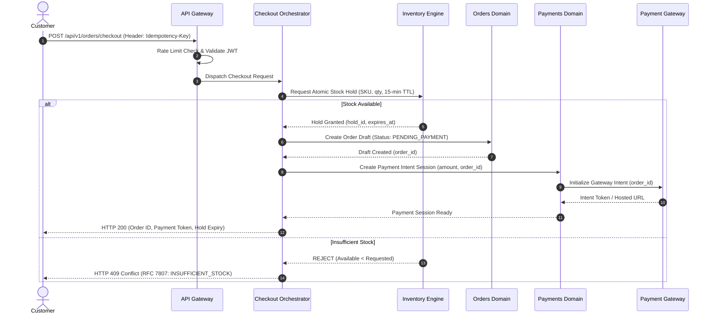
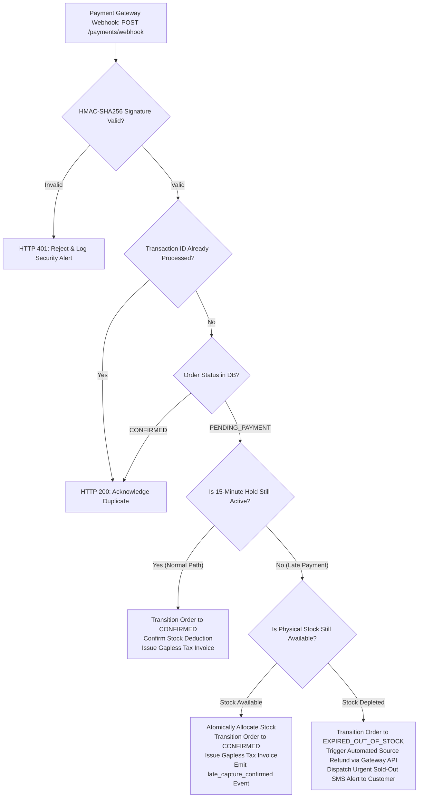

# Phase 2 — Non-Binding Architecture Blueprint

| Document Attribute                | Details                                                                                                  |
| :-------------------------------- | :------------------------------------------------------------------------------------------------------- |
| **Document ID**             | `ARCH-BLUEPRINT-01`                                                                                    |
| **Document Title**          | Step 02C: Consolidated Non-Binding Logical Architecture Blueprint                                        |
| **Project Name**            | Chellaa E-Commerce Platform                                                                              |
| **Target Repository**       | [`ezhilselvan1109/chellaa-system`](https://github.com/ezhilselvan1109/chellaa-system) (Branch: `dev`) |
| **File Location**           | `docs/00-requirements/review/non-binding-architecture-blueprint.md`                                    |
| **Creation Date**           | 2026-10-18                                                                                               |
| **Author Role**             | Principal Software Architect, Domain-Driven Design Specialist & Distributed Systems Engineer             |
| **Governance Status**       | **`NON_BINDING_BLUEPRINT`** (Consolidated Architecture Planning Artifact Only)                   |
| **Phase 1 Baseline Status** | **`PENDING_APPROVAL`** (Maintained strictly per governance constraints)                          |

---

## 1. Purpose and Governance

### 1.1 Purpose

This document provides a consolidated, non-binding **Logical Architecture Blueprint** for the Chellaa single-retailer e-commerce platform. It integrates the capability modeling from the Phase 1 Business Requirements Document (BRD) suite, the domain boundary investigations from Step 02A ([`docs/00-requirements/review/architecture-discovery-and-domain-boundaries.md`](./architecture-discovery-and-domain-boundaries.md)), and the technical trade-off evaluations from Step 02B ([`docs/00-requirements/review/architecture-decision-analysis.md`](./architecture-decision-analysis.md)).

### 1.2 Non-Binding & Exploratory Nature

* **Planning Instrument Only:** This blueprint is strictly an exploratory research and evaluation artifact. It does **not** authorize final architectural decisions, approve production technology selections, define immutable microservice boundaries, establish physical database schemas, or initiate software implementation.
* **Proposals Designated for Evaluation:** All structural patterns, data partitioning models, inter-service protocols, and toolchain comparisons contained herein are explicitly designated as **`PROPOSED for Evaluation`**.
* **Strict Phase 1 Governance Adherence:** Moving to formal architecture design under `docs/01-architecture/` remains strictly prohibited until the Enterprise Business Owner formally executes Section 7 of [`docs/00-requirements/11-review-and-approval.md`](../11-review-and-approval.md):
  ```markdown
  ### Official Governance State (Unmodified):
  * Lifecycle Status: PENDING_APPROVAL
  * Requirements Baseline: NOT_APPROVED (Subject to Human Review)
  * Architecture Design Approval: NOT_GRANTED
  * Software Implementation: NOT_STARTED
  ```

### 1.3 Scope Boundaries & Invariants

* **Strict Single-Retailer Invariant:** The architecture is strictly confined to an enterprise owning and selling its proprietary inventory directly to consumers. Zero third-party marketplace capabilities (such as external vendor onboarding, merchant administration portals, vendor commission ledgers, split payouts, multi-merchant buy-boxes, or third-party inventory feeds) are evaluated or permitted.
* **Backend-First Prioritization:** Architecture planning focuses exclusively on core backend business capabilities, transactional consistency, distributed Saga orchestration, external provider integration resilience, and statutory financial compliance. Storefront and administrative user interfaces are deferred to a subsequent frontend phase.

---

## 2. Source Documents and Traceability

This blueprint is a non-binding architecture exploration. Traceability is being reconciled against the current Phase 1 requirements branch; no 100% coverage claim is made until bidirectional semantic review is complete.

| Document Filename                                                                                              | Content & Traceability Scope                                       | Verified Requirement Identifiers                                                                                                                                                                                                                                                                                                                                                                                                |
| :------------------------------------------------------------------------------------------------------------- | :----------------------------------------------------------------- | :------------------------------------------------------------------------------------------------------------------------------------------------------------------------------------------------------------------------------------------------------------------------------------------------------------------------------------------------------------------------------------------------------------------------------ |
| [`00-business-overview.md`](../00-business-overview.md)                                                       | Business vision, objectives, and quantitative KPIs.                | [`OBJ-001`](../00-business-overview.md#obj-001)–[`010`](../00-business-overview.md#obj-010), [`KPI-001`](../00-business-overview.md#kpi-001)–[`012`](../00-business-overview.md#kpi-012)                                                                                                                                                                                                                                  |
| [`01-business-scope.md`](../01-business-scope.md)                                                             | In-scope capabilities and explicit marketplace exclusions.         | Core commercial boundaries; anti-scope rules                                                                                                                                                                                                                                                                                                                                                                                    |
| [`02-stakeholders-and-actors.md`](../02-stakeholders-and-actors.md)                                           | System personas (customers, internal staff, automated actors).     | [`ACT-001`](../02-stakeholders-and-actors.md#act-001)–[`014`](../02-stakeholders-and-actors.md#act-014)                                                                                                                                                                                                                                                                                                                      |
| [`03-business-feature-inventory.md`](../03-business-feature-inventory.md)                                     | 41 business features across 18 capability areas.                   | [`FEAT-ADM-001`](../03-business-feature-inventory.md#feat-adm-001) to [`FEAT-OPS-001`](../03-business-feature-inventory.md#feat-ops-001)                                                                                                                                                                                                                                                                                      |
| [`04-functional-requirements.md`](../04-functional-requirements.md)                                           | 56 functional requirement specifications with acceptance criteria. | [`FR-CUST-001`](../04-functional-requirements.md#fr-cust-001) to [`FR-OPS-001`](../04-functional-requirements.md#fr-ops-001)                                                                                                                                                                                                                                                                                                  |
| [`05-business-rules.md`](../05-business-rules.md)                                                             | 55 formal business rules and compliance constraints.               | [`BR-CUST-001`](../05-business-rules.md#br-cust-001) to [`BR-OPS-001`](../05-business-rules.md#br-ops-001)                                                                                                                                                                                                                                                                                                                    |
| [`06-business-workflows.md`](../06-business-workflows.md)                                                     | 16 end-to-end commerce workflows and Mermaid diagrams.             | [`WF-001`](../06-business-workflows.md#wf-001) to [`WF-016`](../06-business-workflows.md#wf-016)                                                                                                                                                                                                                                                                                                                              |
| [`07-non-functional-requirements.md`](../07-non-functional-requirements.md)                                   | 18 non-functional requirements (performance, scaling, security).   | [`NFR-PERF-001`](../07-non-functional-requirements.md#nfr-perf-001) to [`NFR-LOC-001`](../07-non-functional-requirements.md#nfr-loc-001)                                                                                                                                                                                                                                                                                      |
| [`08-assumptions-dependencies-open-questions.md`](../08-assumptions-dependencies-open-questions.md)           | Assumptions, external dependencies, and open decisions.            | [`ASM-001`](../08-assumptions-dependencies-open-questions.md#asm-001)–[`010`](../08-assumptions-dependencies-open-questions.md#asm-010), [`DEP-001`](../08-assumptions-dependencies-open-questions.md#dep-001)–[`006`](../08-assumptions-dependencies-open-questions.md#dep-006), [`OQ-001`](../08-assumptions-dependencies-open-questions.md#oq-001)–[`022`](../08-assumptions-dependencies-open-questions.md#oq-022) |
| [`09-requirements-traceability-matrix.md`](../09-requirements-traceability-matrix.md)                         | Master bidirectional traceability matrix (41 rows).                | Full requirements-to-feature mapping                                                                                                                                                                                                                                                                                                                                                                                            |
| [`10-glossary.md`](../10-glossary.md)                                                                         | Ubiquitous domain terminology dictionary.                          | Ubiquitous language definitions                                                                                                                                                                                                                                                                                                                                                                                                 |
| [`11-review-and-approval.md`](../11-review-and-approval.md)                                                   | Governance baseline and formal approval record.                    | Approval gate checklists and status definitions                                                                                                                                                                                                                                                                                                                                                                                 |
| [`review/phase-2-architecture-planning.md`](./phase-2-architecture-planning.md)                               | Phase 2 architecture roadmap, principles, and deliverables.        | `ARCH-PLAN-01` (Deliverables `ARCH-01` to `ARCH-12`)                                                                                                                                                                                                                                                                                                                                                                      |
| [`review/phase-2-architecture-draft-alignment-audit-2026-10-24.md`](./phase-2-architecture-draft-alignment-audit-2026-10-24.md)                   | Reconciliation audit for the current 41 FEAT / 56 FR / 55 BR / 17 WF / 18 NFR inventory; semantic verification pending.           | `ARCH-AUDIT-01` (Identifier proof & reference audit)                                                                                                                                                                                                                                                                                                                                                                          |
| [`review/architecture-discovery-and-domain-boundaries.md`](./architecture-discovery-and-domain-boundaries.md) | Step 02A domain discovery, boundaries, and flows.                  | `ARCH-DISC-01` (20 candidate domains analysis)                                                                                                                                                                                                                                                                                                                                                                                |
| [`review/architecture-decision-analysis.md`](./architecture-decision-analysis.md)                             | Step 02B deep technical evaluation of architectural decisions.     | `ARCH-DEC-01` (Decisions `AD-001` to `AD-012`)                                                                                                                                                                                                                                                                                                                                                                            |

---

## 3. Logical Architecture Overview

The logical architecture organizes platform business capabilities into cohesive functional layers.

> [!IMPORTANT]
> **Logical Layers are NOT Deployable Microservices.**
> These layers represent logical groupings of business capabilities. Depending on the outcome of future architectural evaluations, these capabilities may be implemented within a Modular Monolith or grouped into Coarse-Grained Service Clusters.

```mermaid
graph TD
    subgraph Layer 1: Client & External Interaction Channels
        C_Web["Retail Customer Storefront (Web / Mobile)"]
        C_Admin["Internal Staff Operations Portal"]
        C_Hooks["External Third-Party Webhook Ingress (Gateways, Couriers)"]
    end

    subgraph Layer 2: API Routing, Security Perimeter & Ingress Defense
        GW["API Gateway & Reverse Proxy"]
        GW --> WAF["WAF & Rate Limiting"]
        GW --> JWT_Val["JWT Signature Validation (JWKS)"]
        GW --> Trace_Inject["W3C TraceContext Header Injection (traceparent)"]
        GW --> Header_Sign["Sanitized Header Injection & Gateway Signing"]
    end

    C_Web & C_Admin & C_Hooks --> GW

    subgraph Layer 3: Commerce & Merchandising Capabilities
        M_Cat["Product Catalog & Variants Domain"]
        M_Ctg["Category Taxonomy & Dynamic Specs"]
        M_Brd["Brand Governance"]
        M_Prc["Pricing & Promotional Engine"]
        M_Cart["Cart & Wishlist Management"]
    end

    subgraph Layer 4: Inventory, Checkout & Order Lifecycle Capabilities
        O_Chk["Checkout Orchestrator (Saga Coordinator)"]
        O_Inv["Central Stock Ledgers & Atomic Reservation Engine"]
        O_Ord["Orders & Order Lifecycle Management"]
        O_Track["Device Serial / IMEI Tracking Ledger"]
    end

    subgraph Layer 5: Payment & Statutory Financial Capabilities
        F_Pay["Payment Gateway Adapters & Webhook Processor"]
        F_Tax["Statutory GST Calculation Engine"]
        F_Inv["Sequential Tax Invoicing & Credit Notes"]
        F_Recon["Daily Gateway Settlement Reconciliation"]
    end

    subgraph Layer 6: Fulfillment, Logistics & Post-Order Capabilities
        L_Pick["Warehouse Picking & Packing Operations"]
        L_Ship["Courier Logistics & AWB Tracking Integration"]
        L_Ret["Returns, Replacements & Diagnostic Inspection"]
        L_Sup["Customer Support Ticketing & Dispute SLAs"]
    end

    subgraph Layer 7: Analytics, Search & Read-Model Projections
        R_Search["CQRS Faceted Search Read Model"]
        R_Report["Executive Sales & Tax Reporting Datamart"]
        R_Notify["Multi-Channel Transactional Notification Relay"]
    end

    subgraph Layer 8: Shared Platform, Governance & Infrastructure Capabilities
        P_IAM["Staff IAM & Granular RBAC"]
        P_Audit["Append-Only WORM Audit Ledger (Hash Chained)"]
        P_Outbox["Transactional Outbox Relay / CDC Streamer"]
        P_Vault["Secrets Governance & Key Vault"]
        P_Obs["Prometheus Telemetry & OpenTelemetry Exporters"]
    end

    GW --> Layer 3
    GW --> Layer 4
    GW --> Layer 5
    GW --> Layer 6

    Layer 3 <==> Layer 4
    Layer 4 <==> Layer 5
    Layer 4 <==> Layer 6

    Layer 4 -.->|Domain Events via Outbox| Layer 7
    Layer 5 -.->|Domain Events via Outbox| Layer 7
    Layer 6 -.->|Domain Events via Outbox| Layer 7
    Layer 8 -.->|Cross-Cutting Governance| Layer 3 & Layer 4 & Layer 5 & Layer 6
```

### Logical Layer Descriptions:

* **Layer 1 (Client & Ingress Channels):** Supports retail customers browsing and checking out, internal staff executing warehouse or administrative tasks, and external provider webhooks delivering asynchronous callbacks.
* **Layer 2 (API Routing & Security Perimeter):** Provides perimeter defense, SSL/TLS termination, rate limiting, token validation via JWKS, request correlation tagging with W3C `traceparent`, and verified identity injection.
* **Layer 3 (Commerce & Merchandising):** Encapsulates product catalogs, electronics variant definitions (color, RAM, storage), taxonomy hierarchies, selling prices, compare-at MRP ceilings, and active customer carts.
* **Layer 4 (Inventory, Checkout & Order Lifecycle):** Manages atomic inventory reservations, coordinates multi-step checkout Sagas, enforces order status state machines, and tracks physical device serial/IMEI numbers.
* **Layer 5 (Payment & Statutory Finance):** Manages payment intent sessions, verifies cryptographic webhook signatures, calculates statutory GST (CGST/SGST/IGST), and issues gapless sequential tax invoices.
* **Layer 6 (Fulfillment, Logistics & Post-Order):** Coordinates warehouse picking/packing, books third-party courier AWBs, tracks reverse logistics pickups, executes technician diagnostic grading, and handles support tickets.
* **Layer 7 (Analytics, Search & Read-Model Projections):** Decoupled read-only projections updated asynchronously via domain events to deliver sub-200ms faceted search and analytical reports without locking operational tables.
* **Layer 8 (Shared Platform & Governance):** Provides enterprise RBAC, Write-Once Read-Many (WORM) audit logging with SHA-256 hash chaining, distributed telemetry, and secrets management.

---

## 4. Candidate Domain Boundaries & Decomposition Analysis

### 4.1 Boundary Evaluation Summary

The Chellaa platform comprises **20 candidate business domains** established during Step 02A discovery ([`architecture-discovery-and-domain-boundaries.md`](./architecture-discovery-and-domain-boundaries.md)). Step 02B confirmed that grouping these domains into **Coarse-Grained Service Clusters** or maintaining them within a **Modular Monolith** delivers superior transactional consistency and lower operational risk than fine-grained microservices for the initial launch team:

| Candidate Cluster                          | Constituent Domains                                                                                                 | Authoritative Data Owned                                                                                    | Key Consistency Needs                                                                             | Major Boundary Trade-Offs                                                                                                                                 |
| :----------------------------------------- | :------------------------------------------------------------------------------------------------------------------ | :---------------------------------------------------------------------------------------------------------- | :------------------------------------------------------------------------------------------------ | :-------------------------------------------------------------------------------------------------------------------------------------------------------- |
| **1. Merchandising Cluster**         | Product Catalog & Variants (03), Categories & Specs (03), Brands (03), Bulk Data Exchange (18)                      | `Product`, `SKU`, `Category`, `Brand`, `SpecificationSchema`                                      | Immediate ACID within catalog; Eventual consistency in Search read models.                        | High cohesion; keeping categories, brands, and SKUs co-located avoids artificial network boundaries during catalog authoring.                             |
| **2. Commerce Cluster**              | Customer Accounts (01), Cart & Wishlist (06), Pricing & Promotions (04), Checkout Orchestration (08), Orders (09)   | `CustomerProfile`, `Cart`, `PriceRecord`, `Coupon`, `Order`, `OrderLineItem`                    | Immediate ACID for coupon usage counters and order placement.                                     | Co-locating Cart, Pricing, and Checkout enables low-latency cart calculations and eliminates distributed Sagas for basic order creation.                  |
| **3. Fulfillment Cluster**           | Inventory & Warehousing (07), Shipping & Delivery (12), Returns, Replacements & Refunds (13), Customer Support (15) | `StockLedger`, `StockHold`, `Consignment`, `ReturnRequest`, `InspectionReport`, `SupportTicket` | **Strict Immediate ACID** for available stock; Eventual consistency with external couriers. | Eliminates network serialization between warehouse picking, serial scanning, and carrier AWB generation; isolates slow courier APIs via circuit breakers. |
| **4. Finance Cluster**               | Payments & Reconciliation (10), Tax & Invoicing (11)                                                                | `PaymentTransaction`, `TaxInvoice`, `CreditNote`, `GSTRateSchedule`                                 | **Strict Immutable ACID** for gapless invoice numbering; Idempotent webhook processing.     | Isolates the PCI DSS compliance perimeter; separates synchronous checkout tax calculations from asynchronous invoice PDF generation.                      |
| **5. Platform & Operations Cluster** | Staff IAM (02), Audit & Platform Operations (20), Notifications Relay (14)                                          | `StaffUser`, `Role`, `Permission`, `WORM_AuditLedger`, `NotificationLog`                          | Append-only immutability with cryptographic hash chaining; At-least-once messaging.               | Centralizes administrative access and auditing; ensures third-party messaging outages (SMS/Email) cannot crash checkout.                                  |

#### Complete 20 Candidate Domains to Cluster / Projection Mapping Matrix

|                Domain ID & Name                | Primary Architectural Allocation | Execution Mechanism                 | Authoritative Aggregates Owned                                                    |
| :--------------------------------------------: | :------------------------------- | :---------------------------------- | :-------------------------------------------------------------------------------- |
|        **01. Customer Accounts**        | Commerce Cluster                 | REST API / Relational Schema        | `CustomerProfile`, `CustomerAddress`, `CustomerPreferences`                 |
|            **02. Staff IAM**            | Platform Cluster                 | High-Security Internal Gateway      | `StaffUser`, `Role`, `Permission`, `StaffSession`, `MFACredential`      |
|    **03. Product Catalog & Variants**    | Merchandising Cluster            | REST API / Relational Schema        | `Product`, `ProductVariant`, `SKU`, `Category`, `Brand`, `SpecSchema` |
|       **04. Pricing & Promotions**       | Commerce Cluster                 | In-Memory Engine / Relational DB    | `PriceRecord`, `Coupon`, `CouponRedemptionLedger`                           |
|        **05. Search & Discovery**        | Decoupled Read-Model Projection  | Asynchronous CQRS (Event Ingestion) | Read-only search documents (Elasticsearch / OpenSearch / Postgres FTS)            |
|         **06. Cart & Wishlist**         | Commerce Cluster                 | Fast Cache / Relational DB          | `Cart`, `CartItem`, `WishlistItem`                                          |
| **07. Inventory & Warehouse Operations** | Fulfillment Cluster              | Atomic Concurrency Engine           | `StockLedger`, `StockHold`, `SerialScannedItem`, `WarehouseZone`          |
|      **08. Checkout Orchestration**      | Commerce Cluster                 | Stateless Saga Orchestrator         | `CheckoutSession`, `ReservationHoldReference`                                 |
|     **09. Orders & Order Lifecycle**     | Commerce Cluster                 | State Machine / Relational DB       | `Order`, `OrderLineItem`, `OrderStatusHistory`                              |
|    **10. Payments & Reconciliation**    | Finance Cluster                  | Secure Adapter / Webhook Ingress    | `PaymentTransaction`, `PaymentIntent`, `SettlementRecord`                   |
|         **11. Tax & Invoicing**         | Finance Cluster                  | Sequential Generation Worker        | `TaxInvoice`, `CreditNote`, `GSTRateSchedule`                               |
|       **12. Shipping & Delivery**       | Fulfillment Cluster              | External Logistics Adapter          | `Consignment`, `TrackingMilestone`, `ShippingLabel`                         |
| **13. Returns, Replacements & Refunds** | Fulfillment Cluster              | Reverse Logistics & Diagnostic Gate | `ReturnRequest`, `InspectionReport`, `ReplacementOrder`                     |
|       **14. Notifications Relay**       | Platform Cluster                 | Asynchronous Event Consumer         | `NotificationLog`, `DispatchReceipt`, `NotificationTemplate`                |
|         **15. Customer Support**         | Fulfillment Cluster              | Helpdesk REST API                   | `SupportTicket`, `CustomerInquiryMessage`, `SupportSLA`                     |
|        **16. Reviews & Ratings**        | Merchandising Read Projection    | Moderated Projection Model          | `ProductReview`, `ProductRatingSummary`                                       |
|      **17. Reporting & Analytics**      | Analytical Datamart Projection   | Read Replica / Columnar Datamart    | Aggregated Sales, GMV, AOV, Tax Ledgers, Stock Velocity                           |
|        **18. Bulk Data Exchange**        | Merchandising Cluster            | Asynchronous Batch Worker           | `BulkImportJob`, `ValidationErrorReport`                                      |
|      **19. External Integrations**      | Embedded in Relevant Clusters    | Circuit-Breaker Wrapped Adapters    | Integration Client Config, Webhook Ingress Filters                                |
|   **20. Audit & Platform Operations**   | Platform Cluster                 | WORM Ledger & Middleware            | `WORM_AuditRecord` (SHA-256 hash chained), System Metrics                       |

---

## 5. Critical Business Flows & Transaction Correctness

The following execution models define the domain collaboration, transaction boundaries, failure modes, and recovery paths for core commerce flows:

---

### 5.1 Flow 1: High-Concurrency Checkout & Atomic Inventory Reservation

* **Relevant Requirements & Rules:** [`FR-CHK-001`](../04-functional-requirements.md#fr-chk-001), [`FR-INV-001`](../04-functional-requirements.md#fr-inv-001), [`BR-INV-001`](../05-business-rules.md#br-inv-001), [`BR-INV-002`](../05-business-rules.md#br-inv-002), [`WF-006`](../06-business-workflows.md#wf-006).



* **Idempotency Guarantee:** Client `Idempotency-Key` cached in Redis for 24 hours. Duplicate submissions return HTTP 409 if in progress or the cached response if completed.
* **Concurrency Safety:** Inventory hold executed via atomic Redis Lua script or PostgreSQL `SELECT FOR UPDATE` with a 2-second timeout ceiling to prevent thread pool starvation during flash sales.
* **Failure Recovery:** If payment session initialization fails, the Checkout Orchestrator issues an immediate compensating command to release the inventory hold.

---

### 5.2 Flow 2: Payment Webhook Processing & Late Arrival Recovery

* **Relevant Requirements & Rules:** [`FR-PAY-001`](../04-functional-requirements.md#fr-pay-001) through [`FR-PAY-003`](../04-functional-requirements.md#fr-pay-003), [`BR-PAY-002`](../05-business-rules.md#br-pay-002), [`BR-PAY-003`](../05-business-rules.md#br-pay-003), [`WF-007`](../06-business-workflows.md#wf-007).



* **The Late Payment Invariant:** Under no circumstance may the system confirm an order without verified physical stock allocation. If the 15-minute hold expired and stock was re-allocated to another buyer, the system **must execute an automated source refund** via the gateway API ([`BR-PAY-003`](../05-business-rules.md#br-pay-003)).

---

### 5.3 Flow 3: Order Fulfillment, Serial Number Scanning & Dispatch

* **Relevant Requirements & Rules:** [`FR-ORD-003`](../04-functional-requirements.md#fr-ord-003), [`FR-SHP-001`](../04-functional-requirements.md#fr-shp-001), [`BR-ORD-003`](../05-business-rules.md#br-ord-003), [`BR-SHP-001`](../05-business-rules.md#br-shp-001), [`WF-008`](../06-business-workflows.md#wf-008).

1. **Warehouse Picking:** Warehouse operator picks physical electronics units from the designated bin location.
2. **Mandatory Serial/IMEI Scanning:** Operator scans physical hardware barcode. System verifies serial number format and uniqueness, permanently binding it to the specific order line item in `OrderDeviceSerialRecord`.
3. **Consignment Booking:** System calls Courier API ([`DEP-002`](../08-assumptions-dependencies-open-questions.md#dep-002)) to allocate an Air Waybill (AWB) and generate a thermal shipping label PDF.
4. **Failure & Circuit Breaking:** If the Courier API times out, a Resilience4j circuit breaker trips to `OPEN`. The order remains in `PACKED` status and is enqueued in an asynchronous retry queue, preventing warehouse terminal lockups.

---

### 5.4 Flow 4: Return Request, Warehouse Diagnostic Inspection & Refund

* **Relevant Requirements & Rules:** [`FR-RET-001`](../04-functional-requirements.md#fr-ret-001) through [`FR-RET-003`](../04-functional-requirements.md#fr-ret-003), [`BR-RET-001`](../05-business-rules.md#br-ret-001) through [`BR-RET-003`](../05-business-rules.md#br-ret-003), [`WF-010`](../06-business-workflows.md#wf-010).

1. **Eligibility Check:** Customer submits return request within 7 days of verified delivery.
2. **Reverse Pickup:** Courier collects parcel and delivers to the enterprise warehouse.
3. **Diagnostic Inspection Gate:** Warehouse technician scans the physical device serial/IMEI. System verifies match against the dispatched order record. Technician inspects hardware condition and inputs diagnostic grading.
4. **Approval & Financial Saga:**
   * Upon technician approval, System generates a sequential statutory **Credit Note** ([`BR-FIN-003`](../05-business-rules.md#br-fin-003)).
   * Payments Domain calls Gateway API to execute an automated refund to the customer's original payment source ([`FR-RET-003`](../04-functional-requirements.md#fr-ret-003)).
   * Inventory Domain restocks the SKU to Available Stock (or moves it to the Damaged/RTV ledger if grading indicates user damage).

---

## 6. Data Ownership and Consistency

### 6.1 Master Authoritative Data Ownership Matrix

Every core business entity is assigned exactly one authoritative owning domain. Direct database writes from foreign domains are strictly forbidden:

| Core Business Entity                 | Authoritative Owning Domain     | Primary Read Consumers                  | Consistency Model                                  | Emitted Domain Events                            | Cross-Domain Transaction Concerns                                                         |
| :----------------------------------- | :------------------------------ | :-------------------------------------- | :------------------------------------------------- | :----------------------------------------------- | :---------------------------------------------------------------------------------------- |
| **Product, Variant, SKU**      | Product Catalog                 | Search, Cart, Checkout, Orders          | Immediate ACID in Catalog; Eventual in Search      | `product.published`, `sku.activated`         | Direct DB joins prohibited; Search must ingest change events via Outbox.                  |
| **Stock Ledger Balance**       | Inventory & Warehouse           | Cart, Checkout, Reporting               | **Immediate ACID** (Strict Zero Overselling) | `inventory.reserved`, `inventory.depleted`   | Extreme contention during flash sales; requires atomic reservation.                       |
| **Price & Promotion Rules**    | Pricing & Promotions            | Catalog, Search, Cart, Checkout         | Immediate ACID                                     | `price.updated`, `coupon.redeemed`           | Cart must detect price revisions prior to checkout submission.                            |
| **Cart & Cart Items**          | Cart & Wishlist                 | Checkout Orchestration                  | Session Consistency                                | `cart.cleared`                                 | Large payload; high churn; ephemeral storage candidate (Redis).                           |
| **Order & Line Items**         | Orders Domain                   | Fulfillment, Payments, Finance, Support | Immediate ACID                                     | `order.placed`, `order.confirmed`            | Central anchor for fulfillment, sequential invoicing, and return lifecycles.              |
| **Payment Transaction**        | Payments & Reconciliation       | Orders, Finance, Customer               | Immediate ACID                                     | `payment.captured`, `refund.processed`       | Gateway webhooks can arrive duplicate or delayed; mandates idempotency key deduplication. |
| **Tax Invoice & Credit Note**  | Tax & Invoicing                 | Orders, Customer, Finance, Audit        | **Strict Immutable ACID** (Gapless)          | `invoice.generated`, `credit_note.generated` | Statutory audit records; cannot be deleted or re-ordered; 8-year retention.               |
| **Consignment & Tracking**     | Shipping & Delivery             | Orders, Customer, Support               | Eventual Consistency                               | `shipment.dispatched`, `shipment.delivered`  | High dependency on third-party courier webhook reliability and rate limits.               |
| **Return & Inspection Report** | Returns, Replacements & Refunds | Payments, Orders, Inventory, Tax        | Immediate ACID                                     | `return.approved`, `refund.dispatched`       | Triggers multi-step financial credit note generation, payment refund, and restocking.     |

### 6.2 Data Architecture Alternatives Analysis

| Architecture Alternative                               | Core Structural Characteristics                                                                                                                      | Key Advantages                                                                                                                                       | Trade-Offs & Operational Risks                                                                                   |    Status for Evaluation    |
| :----------------------------------------------------- | :--------------------------------------------------------------------------------------------------------------------------------------------------- | :--------------------------------------------------------------------------------------------------------------------------------------------------- | :--------------------------------------------------------------------------------------------------------------- | :-------------------------: |
| **Physical Database-Per-Service**                | Completely independent managed database instances for each service cluster.                                                                          | Maximum blast radius containment; independent scaling, tuning, and connection pools.                                                                 | High infrastructure cost; complex local developer setup; fragmented backups; requires distributed reporting ETL. | `PROPOSED for Evaluation` |
| **Logical Schema Isolation (Shared PostgreSQL)** | Single managed PostgreSQL cluster (Multi-AZ) with separate schemas (`catalog`, `orders`, `inventory`, `finance`) and distinct DB user roles. | Enforces strict logical boundaries via user permissions; zero cross-schema foreign keys; unified Point-in-Time Recovery (PITR); lowest initial cost. | Shared compute and connection pool; risk of "noisy neighbor" contention during high-load flash sales.            | `PROPOSED for Evaluation` |

---

## 7. API and Event Communication Architecture

### 7.1 Synchronous Communication Patterns

* **Client-to-Backend Protocol:** RESTful HTTP/2 APIs using JSON payloads for storefront browsing, cart management, and checkout.
* **Standardized Error Responses:** Strict adherence to **RFC 7807 (Problem Details for HTTP APIs)** across all endpoints:
  ```json
  {
    "type": "https://api.chellaa.com/errors/insufficient-stock",
    "title": "Insufficient Stock",
    "status": 409,
    "detail": "SKU-ELC-001 has only 2 units available, 5 requested.",
    "instance": "/api/v1/orders/checkout",
    "code": "INSUFFICIENT_STOCK",
    "timestamp": "2026-10-18T16:00:00Z"
  }
  ```
* **Inter-Cluster Communication:** Evaluate high-performance gRPC with Protocol Buffers for synchronous inter-cluster calls (e.g., Checkout to Inventory Hold), with REST over HTTP/2 as the fallback alternative.

### 7.2 Asynchronous Event-Driven Communication

* **CloudEvents Standard Envelope:** All asynchronous domain events published across boundaries must adhere to the **CloudEvents v1.0** specification:
  ```json
  {
    "specversion": "1.0",
    "type": "com.chellaa.commerce.order.confirmed",
    "source": "/services/order-service",
    "id": "evt-uuid-98765",
    "time": "2026-10-18T16:05:00Z",
    "datacontenttype": "application/json",
    "traceparent": "00-4bf92f3577b34da6a3ce929d0e0e4736-00f067aa0ba902b7-01",
    "data": {
      "order_id": "ORD-20261018-0001",
      "customer_id": "CUST-9876",
      "total_amount": 49999.00,
      "currency": "INR"
    }
  }
  ```
* **Delivery Semantics & Invariants:**
  * **At-Least-Once Delivery:** Consumers must be strictly idempotent to tolerate duplicate deliveries.
  * **Partitioning Keys:** Messages partitioned by Aggregate Root ID (e.g., `order_id` or `sku_id`) to guarantee strict in-order processing per business entity.
  * **Transactional Outbox Pattern:** Application writes events to an `outbox` table within the local ACID transaction; background workers (polling or Debezium CDC) publish to the broker, eliminating dual-write data loss.
* **Broker Alternatives Under Evaluation:** Apache Kafka vs RabbitMQ vs AWS SQS/SNS (All marked `PROPOSED for Evaluation`).

---

## 8. Security and Privacy Architecture

### 8.1 Customer vs Administrative Staff Identity Segregation

The platform enforces strict logical and physical separation between customer retail identities and administrative staff:

| Dimension                        | Retail Customer Identity                                                                                         | Administrative Staff IAM                                                                                                           |
| :------------------------------- | :--------------------------------------------------------------------------------------------------------------- | :--------------------------------------------------------------------------------------------------------------------------------- |
| **Primary Credential**     | Mobile phone number verified via SMS OTP ([`OQ-010`](../08-assumptions-dependencies-open-questions.md#oq-010)). | Enterprise email + strong password + mandatory MFA ([`FEAT-ADM-001`](../03-business-feature-inventory.md#feat-adm-001)).          |
| **Credential Storage**     | Phone numbers encrypted at rest; OTP hashed with 5-minute TTL.                                                   | Passwords hashed using bcrypt (factor $ge 12$) or Argon2id ([`NFR-SEC-002`](../07-non-functional-requirements.md#nfr-sec-002)). |
| **Token Claims & Expiry**  | Short-lived JWT (RS256, 15-minute expiry) + rotating refresh token.                                              | Short-lived JWT with embedded RBAC roles and permissions ([`BR-ADM-001`](../05-business-rules.md#br-adm-001)).                    |
| **Access Perimeter**       | Public API Gateway; throttled via IP and account rate limiters.                                                  | Restricted internal gateway; IP whitelisting / VPN access recommended.                                                             |
| **Blast Radius Isolation** | Customer database breach cannot compromise staff administrative accounts.                                        | Staff credential compromise cannot be used to spoof customer storefront sessions.                                                  |

### 8.2 Internal Service Security & Perimeter Defense

* **Perimeter Gateway Verification:** The API Gateway validates incoming JWT tokens against the identity provider's public JWKS keys.
* **Cryptographic Header Injection:** Gateway injects sanitized identity headers (`X-User-Id`, `X-User-Roles`, `X-Permissions`) signed with an `X-Gateway-Signature` HMAC token. Internal services verify the signature to prevent header spoofing.

### 8.3 Sensitive Data Protection & Compliance

* **Zero Cardholder Storage:** No cardholder PAN, CVV, or banking credentials stored on Chellaa servers ([`BR-SEC-001`](../05-business-rules.md#br-sec-001), [`NFR-SEC-001`](../07-non-functional-requirements.md#nfr-sec-001)). Hosted SDK fields handle payment data entry directly with the PCI DSS Level 1 certified gateway.
* **PII Encryption at Rest:** Customer names, phone numbers, and addresses encrypted using AES-256 in the database ([`NFR-SEC-003`](../07-non-functional-requirements.md#nfr-sec-003)).
* **Automated Log Scrubbing:** Interceptors in shared logging libraries use regular expressions to scrub phone numbers, emails, passwords, and tokens before logs are emitted.
* **WORM Audit Trail:** Privileged administrative mutations written to an append-only ledger with cryptographic SHA-256 hash chaining ([`FR-AUD-001`](../04-functional-requirements.md#fr-aud-001), [`FR-AUD-002`](../04-functional-requirements.md#fr-aud-002)).

---

## 9. Reliability and Performance Architecture

### 9.1 Requirements Governance & Quantitative Categorization

To maintain strict requirements integrity, every quantitative target is explicitly classified below:

| Target / Metric                         | Target Value                               | Governance Classification                        | Source Requirement IDs                                                                                                                   | Architectural Validation Plan                                              |
| :-------------------------------------- | :----------------------------------------- | :----------------------------------------------- | :--------------------------------------------------------------------------------------------------------------------------------------- | :------------------------------------------------------------------------- |
| **Cardholder Data Storage**       | Zero PAN / CVV stored                      | **Confirmed Requirement**                  | [`BR-SEC-001`](../05-business-rules.md#br-sec-001), [`NFR-SEC-001`](../07-non-functional-requirements.md#nfr-sec-001)                  | Security code audit & penetration test verifying zero PAN fields in DB.    |
| **Password Hashing**              | bcrypt ($ge 12$) / Argon2id              | **Confirmed Requirement**                  | [`FR-SEC-001`](../04-functional-requirements.md#fr-sec-001), [`NFR-SEC-002`](../07-non-functional-requirements.md#nfr-sec-002)         | Unit test validating salt generation and cryptographic iteration cost.     |
| **PII Data Protection**           | AES-256 at rest, log scrubbing             | **Confirmed Requirement**                  | [`NFR-SEC-003`](../07-non-functional-requirements.md#nfr-sec-003)                                                                       | Database column inspection & regex log scanner assertions.                 |
| **Catalog SKU Capacity**          | Up to 100,000 active SKUs                  | **Confirmed Requirement**                  | [`NFR-SCL-002`](../07-non-functional-requirements.md#nfr-scl-002)                                                                       | Seed test database with 100,000 SKUs and verify indexing memory footprint. |
| **Baseline Order Throughput**     | 100 sustained orders/minute                | **Proposed Requirement**                   | [`NFR-SCL-001`](../07-non-functional-requirements.md#nfr-scl-001)                                                                       | Synthetic load test simulating 100 OPM sustained for 1 hour.               |
| **Search Response Latency**       | $le 200\text{ms}$ ($p95$)              | **Proposed Requirement**                   | [`NFR-PERF-001`](../07-non-functional-requirements.md#nfr-perf-001)                                                                     | Benchmark search queries under 5,000 concurrent browsing sessions.         |
| **Checkout Submission Latency**   | $le 1,000\text{ms}$ ($p95$)            | **Proposed Requirement**                   | [`NFR-PERF-002`](../07-non-functional-requirements.md#nfr-perf-002)                                                                     | End-to-end checkout load testing under peak concurrent load.               |
| **Batch SKU Import**              | 5,000 SKUs in $le 15\text{ min}$         | **Proposed Requirement**                   | [`NFR-PERF-003`](../07-non-functional-requirements.md#nfr-perf-003)                                                                     | Asynchronous batch worker test measuring chunked import throughput.        |
| **Peak Surge Order Throughput**   | 1,000 peak orders/minute                   | **Owner decision recorded; verification evidence open** | [`OQ-016`](../08-assumptions-dependencies-open-questions.md#oq-016)                                                                     | Stress testing Kafka partitions, Redis holds, and DB connection pools.     |
| **Core Checkout Availability**    | 99.9% uptime                               | **Owner decision recorded; verification evidence open** | [`OQ-017`](../08-assumptions-dependencies-open-questions.md#oq-017), [`NFR-AVL-001`](../07-non-functional-requirements.md#nfr-avl-001) | Availability modeling for Single-Region Multi-AZ deployment.               |
| **Disaster Recovery (RPO / RTO)** | RPO $le 5\text{m}$, RTO $le 2\text{h}$ | **Owner decision recorded; verification evidence open** | [`OQ-017`](../08-assumptions-dependencies-open-questions.md#oq-017), [`NFR-BCM-001`](../07-non-functional-requirements.md#nfr-bcm-001) | Staging automated database failover drill measuring exact RTO/RPO.         |
| **Cash on Delivery Ceiling**      | ₹10,000 order cap                         | **Owner decision recorded; verification evidence open** | [`OQ-006`](../08-assumptions-dependencies-open-questions.md#oq-006)                                                                     | Policy configuration validation in checkout rules engine.                  |
| **Audit Ledger Retention**        | 8-financial-year statutory retention plus appropriate profile/marketing-data anonymization | **Owner decision recorded; Legal/Security details open** | [`OQ-020`](../08-assumptions-dependencies-open-questions.md#oq-020) | Archive tiering, anonymization coverage and legal/operational evidence remain subject to review. |
| **Warehouse Topology**            | Central enterprise warehouse               | **Operational Assumption**                 | [`ASM-007`](../08-assumptions-dependencies-open-questions.md#asm-007)                                                                   | Architecture baseline models a single physical inventory ledger.           |

---

## 10. Deployment and Observability Options

### 10.1 Container Deployment Topology

* **Containerization:** All deployable components packaged as minimal, non-root OCI-compliant container images (Docker with Alpine/Distroless bases).
* **Runtime Platform Alternatives Under Evaluation:**
  1. *Managed Container PaaS (AWS ECS / Google Cloud Run):* Simplest operational management, rapid setup, low overhead for small teams.
  2. *Managed Kubernetes (AWS EKS / Google GKE):* Maximum deployment flexibility and ecosystem portability, but introduces substantial management complexity.
* **Configuration Governance:** 12-Factor app methodology: configuration externalized via environment variables; secrets injected via HashiCorp Vault or AWS Secrets Manager.
* **Zero-Downtime Deployment:** Rolling deployment strategies or Blue/Green environments with automated rollback on health probe failure.

### 10.2 Distributed Observability & Telemetry

* **Distributed Tracing:** W3C TraceContext (`traceparent` header) propagated across 100% of HTTP requests and message broker envelopes ([`NFR-OBS-001`](../07-non-functional-requirements.md#nfr-obs-001), [`BR-OPS-001`](../05-business-rules.md#br-ops-001)).
* **Structured Logging:** Standard JSON format with mandatory fields: `timestamp`, `level`, `service_name`, `trace_id`, `span_id`, and `message`, with automated PII regex redaction.
* **Prometheus Metrics:** Prometheus-compatible `/metrics` scrape endpoints exporting RED metrics (Rate, Errors, Duration) and system resource utilization ([`NFR-OBS-002`](../07-non-functional-requirements.md#nfr-obs-002)).
* **Health Checking:** Distinct `/health/live` (liveness) and `/health/ready` (readiness) HTTP probes for container lifecycle management.

---

## 11. Architectural Risks and Trade-Offs

| Risk ID               | Risk Description                                 |      Severity      | Architecture Impact & Trade-Off                                                                                                  | Mitigation Strategy to Evaluate                                                                   |
| :-------------------- | :----------------------------------------------- | :----------------: | :------------------------------------------------------------------------------------------------------------------------------- | :------------------------------------------------------------------------------------------------ |
| **`RISK-01`** | **Premature Microservice Decomposition**   |   **HIGH**   | Carving into 15+ microservices creates severe operational drag, distributed transaction bugs, and network serialization latency. | Evaluate Coarse-Grained Clusters (4-6) or a Modular Monolith as the primary baseline.             |
| **`RISK-02`** | **Flash-Sale Inventory Contention**        | **CRITICAL** | 1,000 OPM contending on identical SKUs causes database lock timeouts or overselling proprietary inventory.                       | In-memory distributed holds in Redis via Lua scripts, with background PostgreSQL synchronization. |
| **`RISK-03`** | **Late Payment Webhook Ambiguity**         |   **HIGH**   | Gateways confirm payment after 15-minute hold expires; forcing orders risks overselling if stock depleted.                       | Implement dual-path recovery: re-reserve if stock exists; automated source refund if depleted.    |
| **`RISK-04`** | **Third-Party Provider Outages**           |   **HIGH**   | Payment gateway, courier, or SMS API downtime blocks checkout or fulfillment.                                                    | Circuit breakers (Resilience4j), multi-gateway automated failover, and asynchronous queues.       |
| **`RISK-05`** | **Cross-Domain Data Consistency**          |  **MEDIUM**  | Distributed writes across boundaries risk partial failures and orphaned records.                                                 | Transactional Outbox pattern with Debezium CDC and idempotent consumer design.                    |
| **`RISK-06`** | **Operational & Cloud Cost Proliferation** |  **MEDIUM**  | Over-provisioning multi-region standbys or 20+ microservice databases exceeds launch budget.                                     | Single-region Multi-AZ deployment and logical schema isolation on managed PostgreSQL.             |
| **`RISK-07`** | **Reporting OLTP Contention**              |  **MEDIUM**  | Heavy executive sales and GST aggregations lock operational database tables during checkout.                                     | Direct reporting queries exclusively to dedicated read-replicas or an analytical datamart.        |

---

## 12. Open Decisions and Approval Dependencies

The following register synthesizes all unresolved architectural and commercial decisions:

### Part A: Business-Owner Strategic Decisions

|      Decision ID      | Decision to be Made                                            |                           Related BRD IDs                           | Business & Technical Impact                                                    |      Decision Owner      |   Current Status   |
| :-------------------: | :------------------------------------------------------------- | :------------------------------------------------------------------: | :----------------------------------------------------------------------------- | :-----------------------: | :----------------: |
| **`ADQ-001`** | **Geographic Scope (Domestic vs International)**         | [`OQ-001`](../08-assumptions-dependencies-open-questions.md#oq-001) | Dictates Indian GST compliance vs multi-country tax/customs schemas.           | Enterprise Business Owner | **`OPEN`** |
| **`ADQ-002`** | **Currency Architecture (Single INR vs Multi-Currency)** | [`OQ-002`](../08-assumptions-dependencies-open-questions.md#oq-002) | Single-currency ledger vs dual-currency conversion engine.                     | Enterprise Business Owner | **`OPEN`** |
| **`ADQ-003`** | **Cash on Delivery (COD) Policy & Order Ceiling**        | [`OQ-006`](../08-assumptions-dependencies-open-questions.md#oq-006) | Sizing delivery-agent cash collection and OTP handshakes.                      | Enterprise Business Owner | **`OPEN`** |
| **`ADQ-004`** | **Return Physical Inspection Policy**                    | [`OQ-008`](../08-assumptions-dependencies-open-questions.md#oq-008) | Gating customer refund on technician diagnostic grading vs pickup scan.        | Enterprise Business Owner | **`OPEN`** |
| **`ADQ-005`** | **Tax-Inclusive MRP Calculation**                        | [`OQ-009`](../08-assumptions-dependencies-open-questions.md#oq-009) | Reverse-extraction GST formulas vs additive checkout tax calculation.          | Enterprise Business Owner | **`OPEN`** |
| **`ADQ-006`** | **Customer Identity Credential**                         | [`OQ-010`](../08-assumptions-dependencies-open-questions.md#oq-010) | Mobile phone + SMS OTP primary key vs Email + password.                        | Enterprise Business Owner | **`OPEN`** |
| **`ADQ-007`** | **Peak Throughput Baseline**                             | [`OQ-016`](../08-assumptions-dependencies-open-questions.md#oq-016) | Sizing Kafka partitions, Redis clusters, and DB connections for 1,000 OPM.     | Enterprise Business Owner | **`OPEN`** |
| **`ADQ-008`** | **High Availability & Disaster Recovery SLAs**           | [`OQ-017`](../08-assumptions-dependencies-open-questions.md#oq-017) | 99.9% uptime (Single-Region Multi-AZ) vs 99.99% (Multi-Region active-passive). | Enterprise Business Owner | **`OPEN`** |

---

### Part B: Technical Architecture Decisions

|     Decision ID     | Decision Statement                                  |                           Related BRD IDs                           | Options Considered                                                                            |        Decision Owner        |   Current Status   |
| :------------------: | :-------------------------------------------------- | :------------------------------------------------------------------: | :-------------------------------------------------------------------------------------------- | :--------------------------: | :----------------: |
| **`AD-001`** | **System Decomposition & Service Boundaries** |  [`NFR-SCL-001`](../07-non-functional-requirements.md#nfr-scl-001)  | A: Modular MonolithB: Coarse Clusters (4-6)C: Fine Microservices (15-20)                      | Principal Software Architect | **`OPEN`** |
| **`AD-002`** | **Inventory Concurrency Safety Mechanism**    |         [`BR-INV-001`](../05-business-rules.md#br-inv-001)         | A: SQL `SELECT FOR UPDATE`B: Redis Distributed Hold (Lua)C: Optimistic Locking              | Distributed Systems Engineer | **`OPEN`** |
| **`AD-003`** | **Late Payment Arrival & Depleted Inventory** |         [`BR-PAY-003`](../05-business-rules.md#br-pay-003)         | A: Reallocate if stock exists; auto-refund if depletedB: Place on backorder                   |  Enterprise Business Owner  | **`OPEN`** |
| **`AD-004`** | **Checkout Saga Orchestration Pattern**       |         [`BR-CHK-001`](../05-business-rules.md#br-chk-001)         | A: Orchestrated Saga (State Machine)B: Choreographed Saga                                     | Distributed Systems Engineer | **`OPEN`** |
| **`AD-005`** | **Database Architecture & Data Isolation**    | [`FEAT-FIN-001`](../03-business-feature-inventory.md#feat-fin-001) | A: Physical Database-per-ServiceB: Logical Schema Isolation on PostgreSQL                     |      Database Architect      | **`OPEN`** |
| **`AD-006`** | **Transactional Event Publishing Pattern**    |         [`BR-OPS-001`](../05-business-rules.md#br-ops-001)         | A: Outbox + Scheduled PollerB: Outbox + Debezium CDCC: Direct Dual-Write                      | Distributed Systems Engineer | **`OPEN`** |
| **`AD-007`** | **Asynchronous Messaging Broker**             |  [`NFR-AVL-002`](../07-non-functional-requirements.md#nfr-avl-002)  | A: Apache KafkaB: RabbitMQC: AWS SQS/SNS                                                      | Distributed Systems Engineer | **`OPEN`** |
| **`AD-008`** | **Staff vs Customer Identity Segregation**    |         [`BR-ADM-001`](../05-business-rules.md#br-adm-001)         | A: Completely separate auth services and signing keysB: Unified auth service                  |      Security Architect      | **`OPEN`** |
| **`AD-009`** | **Internal Identity Propagation & Defense**   |  [`NFR-SEC-002`](../07-non-functional-requirements.md#nfr-sec-002)  | A: Gateway signed header injection (`X-Gateway-Signature`)B: Decentralized JWT verification |      Security Architect      | **`OPEN`** |
| **`AD-010`** | **Catalog Search Read-Model Technology**      | [`NFR-PERF-001`](../07-non-functional-requirements.md#nfr-perf-001) | A: PostgreSQL Read Replica FTSB: Dedicated OpenSearch Cluster                                 | Principal Software Architect | **`OPEN`** |
| **`AD-011`** | **Executive Reporting Data Isolation**        | [`FEAT-RPT-001`](../03-business-feature-inventory.md#feat-rpt-001) | A: PostgreSQL Read ReplicaB: Columnar Datamart (ClickHouse)                                   |      Database Architect      | **`OPEN`** |
| **`AD-012`** | **High Availability & DR Cloud Topology**     | [`OQ-017`](../08-assumptions-dependencies-open-questions.md#oq-017) | A: Single-Region Multi-AZ Active-ActiveB: Multi-Region Active-Passive                         |    Cloud Architect / SRE    | **`OPEN`** |

---

## 13. Future Formal Architecture Deliverables

When the Phase 1 BRD baseline is approved, the following 12 formal architecture deliverables will be authored under `docs/01-architecture/`:

1. **`ARCH-01` — Architecture Overview & System Context:** C4 Level 1 context diagram, system boundary statement, single-retailer constraints.
2. **`ARCH-02` — Domain Decomposition & Bounded Contexts:** C4 Level 2 container diagram, Bounded Context Map, Ubiquitous Language dictionary.
3. **`ARCH-03` — Service Decomposition & Responsibility Matrix:** Service catalog, component ownership, physical service packaging rationale.
4. **`ARCH-04` — Service Interaction & Dependency Diagrams:** Sequence diagrams for all 16 business workflows (`WF-001` to `WF-016`).
5. **`ARCH-05` — Data Ownership & Distributed Consistency:** Entity-to-service mapping, Saga flowcharts, Outbox pattern specifications.
6. **`ARCH-06` — API & Event Contracts Architecture:** REST/gRPC conventions, OpenAPI 3.0 specs, CloudEvents JSON schemas.
7. **`ARCH-07` — Security & Access Architecture:** JWT claims schema, RBAC permission matrix, PII encryption rules, secret rotation policies.
8. **`ARCH-08` — Resilience & Fault Isolation Strategy:** Circuit breaker parameters, retry with jitter formulas, bulkhead isolation, DLQ runbooks.
9. **`ARCH-09` — Observability & Operational Architecture:** W3C TraceContext standards, Prometheus metric catalog, WORM audit implementation.
10. **`ARCH-10` — Deployment Topology & Infrastructure:** Cloud infrastructure topology diagram, container manifests, backup/DR runbooks.
11. **`ARCH-11` — Architecture Decision Records (ADRs):** Versioned ADR documents (`ADR-001` onwards) capturing ratified decisions.
12. **`ARCH-12` — Master Architecture Traceability Matrix:** Bidirectional mapping proving 100% coverage of all 56 FRs, 55 BRs, and 18 NFRs.

---

## 14. Architecture Review & Approval Checklist

This review checklist synthesizes the governance and evaluation requirements into four distinct review categories. All unresolved decisions remain explicitly **`OPEN`** pending stakeholder evaluation.

### Part 1: Enterprise Business Owner Decisions Checklist (Commercial Governance)

* [ ] **`ADQ-001` Geographic Scope & Jurisdiction:** Decide between Domestic India launch scope vs cross-border trade ([`OQ-001`](../08-assumptions-dependencies-open-questions.md#oq-001)). `Status: OPEN (Proposed: Domestic India)`
* [ ] **`ADQ-002` Currency Architecture:** Decide between Single INR base currency vs Multi-Currency conversion engine ([`OQ-002`](../08-assumptions-dependencies-open-questions.md#oq-002)). `Status: OPEN (Proposed: Single INR)`
* [ ] **`ADQ-003` Cash on Delivery (COD) Policy:** Decide between Restricted COD with ₹10,000 order ceiling vs 100% prepaid launch ([`OQ-006`](../08-assumptions-dependencies-open-questions.md#oq-006)). `Status: OPEN (Proposed: Restricted COD)`
* [ ] **`ADQ-004` Electronics Return Inspection Gating:** Confirm mandatory technician diagnostic grading before source refund dispatch vs immediate pickup refund ([`OQ-008`](../08-assumptions-dependencies-open-questions.md#oq-008)). `Status: OPEN (Proposed: Technician Diagnostic Gating)`
* [ ] **`ADQ-005` Tax-Inclusive MRP Display:** Confirm tax-inclusive catalog pricing vs additive checkout tax calculation ([`OQ-009`](../08-assumptions-dependencies-open-questions.md#oq-009)). `Status: OPEN (Proposed: Tax-Inclusive Display)`
* [ ] **`ADQ-006` Customer Authentication Credential:** Ratify Mobile Phone + SMS OTP primary signup vs Email + Password ([`OQ-010`](../08-assumptions-dependencies-open-questions.md#oq-010)). `Status: OPEN (Proposed: Mobile Phone + SMS OTP)`
* [ ] **`ADQ-007` Peak Festive Surge Sizing:** Ratify capacity sizing for 1,000 peak orders/minute surge ([`OQ-016`](../08-assumptions-dependencies-open-questions.md#oq-016)). `Status: OPEN (Proposed: 1,000 OPM Peak)`
* [ ] **`ADQ-008` Availability & DR Recovery SLA:** Ratify 99.9% uptime target and RPO $\le 5\text{m}$ / RTO $\le 2\text{h}$ targets ([`OQ-017`](../08-assumptions-dependencies-open-questions.md#oq-017)). `Status: OPEN (Proposed: 99.9% Uptime, Multi-AZ)`

### Part 2: Technical Architecture Review Checklist (Systemic Soundness)

* [ ] **`AD-001` Service Decomposition Granularity:** Evaluate Coarse-Grained Clusters (4–6) vs Modular Monolith vs Fine-Grained Microservices for launch team topology. `Status: OPEN (Proposed: Coarse Clusters)`
* [ ] **`AD-002` Inventory Atomic Concurrency Control:** Evaluate In-Memory Redis Lua distributed hold vs PostgreSQL `SELECT FOR UPDATE` under 1,000 OPM flash sales. `Status: OPEN (Proposed: Redis Lua + DB Sync)`
* [ ] **`AD-003` Late Payment Arrival Recovery Path:** Ratify automated source gateway refund if inventory is depleted after hold expiry vs backordering. `Status: OPEN (Proposed: Re-reserve if available; Auto-refund if depleted)`
* [ ] **`AD-004` Checkout Distributed Saga Coordination:** Evaluate Orchestrated Saga (State Machine) vs Choreographed Event Saga for order placement. `Status: OPEN (Proposed: Orchestrated Saga)`
* [ ] **`AD-005` Data Isolation Strategy:** Evaluate Logical Schema Isolation on shared PostgreSQL vs Physical Database-per-Service. `Status: OPEN (Proposed: Logical Schema Isolation)`
* [ ] **`AD-006` Transactional Event Publishing:** Evaluate Transactional Outbox + Debezium CDC vs Outbox Scheduled Poller. `Status: OPEN (Proposed: Outbox + CDC Engine)`
* [ ] **`AD-007` Message Broker Selection:** Evaluate Apache Kafka vs RabbitMQ vs AWS SQS/SNS for domain event distribution. `Status: OPEN (Proposed: Apache Kafka / Managed MSK)`
* [ ] **`AD-008` Staff vs Customer Identity Segregation:** Verify complete physical/logical isolation of internal staff IAM from customer storefront authentication. `Status: OPEN (Proposed: Fully Segregated)`
* [ ] **`AD-009` Internal Gateway Token Propagation:** Evaluate Signed Gateway Header Injection (`X-Gateway-Signature`) vs decentralized JWT signature checks. `Status: OPEN (Proposed: Signed Gateway Headers)`
* [ ] **`AD-010` Catalog Search Read-Model Engine:** Evaluate Dedicated OpenSearch/Elasticsearch Cluster vs PostgreSQL Read Replica Full-Text Search. `Status: OPEN (Proposed: OpenSearch Cluster)`
* [ ] **`AD-011` Executive Reporting Isolation:** Evaluate Dedicated Read-Replica queries vs Columnar Datamart (ClickHouse) for OLTP protection. `Status: OPEN (Proposed: PostgreSQL Read Replica)`
* [ ] **`AD-012` Cloud Infrastructure DR Topology:** Evaluate Single-Region Multi-AZ Active-Active vs Multi-Region Active-Passive deployment. `Status: OPEN (Proposed: Single-Region Multi-AZ)`

### Part 3: Additional Evidence & Performance Testing Checklist (Empirical Validation)

* [ ] **Test 1 — Flash-Sale Concurrency Benchmark:** Benchmark Redis Lua scripts vs PostgreSQL `SELECT FOR UPDATE` under synthetic 1,000 OPM surge contending on 10 SKUs to measure lock wait timeouts, connection pool exhaustion, and latency. `Status: OPEN (Pending Staging Prototype)`
* [ ] **Test 2 — Checkout Latency Load Test:** Execute k6 / Gatling load simulation of 100 OPM baseline and 1,000 OPM peak to empirically verify $p95 \le 1,000\text{ms}$ latency budget ([`NFR-PERF-002`](../07-non-functional-requirements.md#nfr-perf-002)). `Status: OPEN (Pending Staging Prototype)`
* [ ] **Test 3 — Search Indexing & Query Latency Benchmark:** Seed 100,000 SKUs with dynamic specifications and measure $p95$ query latency under 5,000 concurrent browsing sessions to verify $p95 \le 200\text{ms}$ ([`NFR-PERF-001`](../07-non-functional-requirements.md#nfr-perf-001)). `Status: OPEN (Pending Staging Prototype)`
* [ ] **Test 4 — Batch Catalog Import Throughput:** Benchmark asynchronous worker ingestion of 5,000 SKUs with JSON validation and image link checks within 15 minutes ([`NFR-PERF-003`](../07-non-functional-requirements.md#nfr-perf-003)). `Status: OPEN (Pending Staging Prototype)`
* [ ] **Test 5 — Disaster Recovery & PITR Drill:** Execute automated database failover drill measuring exact Recovery Time Objective (target $\le 2\text{ hours}$) and continuous WAL recovery Point Objective (target $\le 5\text{ minutes}$) ([`NFR-BCM-001`](../07-non-functional-requirements.md#nfr-bcm-001)). `Status: OPEN (Pending Staging Infrastructure)`
* [ ] **Test 6 — Circuit Breaker Fault Injection Drill:** Inject synthetic 500ms+ latency and 60% failure rates into third-party payment gateway and courier mocks to verify Resilience4j trips to `OPEN` and prevents worker thread exhaustion ([`NFR-AVL-002`](../07-non-functional-requirements.md#nfr-avl-002)). `Status: OPEN (Pending Staging Prototype)`

### Part 4: Formal Approval Checkpoints After Phase 1 (Governance Sign-Off Gate)

* [ ] **Checkpoint 1 — Phase 1 Requirements Baseline Sign-Off:** Executive Business Owner executes written approval in Section 7 of [`docs/00-requirements/11-review-and-approval.md`](../11-review-and-approval.md). `Status: PENDING_APPROVAL`
* [ ] **Checkpoint 2 — Baseline Lifecycle Transition:** Requirements baseline transitions from `NOT_APPROVED` to `APPROVED`. `Status: NOT_APPROVED`
* [ ] **Checkpoint 3 — Phase 2 Architecture Design Authorization:** Explicit sponsor authorization granted to establish `docs/01-architecture/` and author formal Phase 2 technical specifications (`ARCH-01` through `ARCH-12`). `Status: NOT_GRANTED`
* [ ] **Checkpoint 4 — Software Implementation Gate:** Confirmation that software coding, database migrations, and infrastructure deployments remain blocked until Phase 2 architecture design is ratified. `Status: NOT_STARTED`
