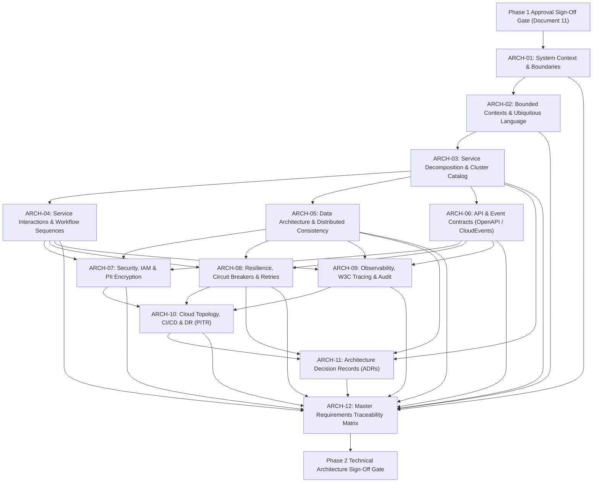

# Phase 2 — Architecture Document Plan & Implementation Roadmap

> [!WARNING]
> **NON-BINDING PLANNING ARTIFACT — NOT APPROVED FOR IMPLEMENTATION**
> This document is strictly an internal preparatory planning instrument. It does **not** authorize formal architecture design, approve binding specifications, establish `docs/01-architecture/`, or initiate software implementation. Formal promotion is strictly blocked until the Enterprise Business Owner signs [`docs/00-requirements/11-review-and-approval.md`](../11-review-and-approval.md).

| Document Attribute                   | Details                                                                                |
| :----------------------------------- | :------------------------------------------------------------------------------------- |
| **Document ID**                | `ARCH-PLAN-DOC-01`                                                                   |
| **Document Title**             | Proposed Phase 2 Architecture Document Index, Dependency Sequence & Traceability Plan  |
| **Project Name**               | Chellaa E-Commerce Platform                                                            |
| **Target Repository**          | [`ezhilselvan1109/chellaa-system`](https://github.com/ezhilselvan1109/chellaa-system) |
| **Target Branch**              | `dev`                                                                                |
| **File Location**              | `docs/00-requirements/review/phase-2-architecture-document-plan.md`                  |
| **Creation Date**              | 2026-10-23                                                                             |
| **Author Roles**               | Senior Solution Architect, Architecture Governance Lead & Repository Engineer          |
| **Governance Status**          | **`NON_BINDING_PLANNING`** (Exploratory Document Roadmap Only)                 |
| **Phase 1 Baseline Status**    | **`PENDING_APPROVAL`** (Maintained strictly per governance constraints)        |
| **Architecture Authorization** | **`NOT_GRANTED`** (Awaiting Business Owner Sign-Off in Document 11)            |
| **Software Implementation**    | **`NOT_STARTED`** (Strictly gated behind Phase 2 ratification)                 |

---

## 1. Purpose and Governance Boundaries

### 1.1 Purpose

This planning artifact establishes the target document index, architectural prerequisite dependencies, authoring sequence, bidirectional traceability methodology, and review checkpoints for **Phase 2 (Technical Architecture & Specifications)** of the Chellaa single-retailer e-commerce platform.

### 1.2 Strict Governance Constraints

* **Phase Isolation:** Authoring formal architecture documents under `docs/01-architecture/` remains **strictly prohibited** until the authorized Enterprise Business Owner ratifies the Phase 1 BRD baseline in [`docs/00-requirements/11-review-and-approval.md`](../11-review-and-approval.md) and resolves the 8 strategic decisions in [`docs/00-requirements/review/executive-decision-register.md`](./executive-decision-register.md).
* **Single-Retailer Invariant:** The architecture document suite is strictly bounded to proprietary inventory retail. Zero marketplace concepts (multi-vendor onboarding, merchant administration portals, vendor commission ledgers, split payouts, or third-party inventory feeds) are evaluated or permitted.
* **Backend-First Prioritization:** Architecture documentation focuses exclusively on backend services, domain data boundaries, transaction invariants, distributed Saga coordination, external gateway integration resilience, and statutory tax compliance. Frontend applications remain deferred to subsequent phases.

---

## 2. Proposed Phase 2 Architecture Document Index (`docs/01-architecture/`)

Upon executive authorization of Phase 1, the formal architecture package will be established under `docs/01-architecture/` containing the following 12 foundational technical specifications:

|      Document ID      | Target File Path                                              | Formal Specification Title                                       | Primary Architecture Scope & C4 Level                                                                                                             | Source BRD Cross-References                                                                                                                                                                                                                                                                                 |
| :-------------------: | :------------------------------------------------------------ | :--------------------------------------------------------------- | :------------------------------------------------------------------------------------------------------------------------------------------------ | :---------------------------------------------------------------------------------------------------------------------------------------------------------------------------------------------------------------------------------------------------------------------------------------------------------- |
| **`ARCH-01`** | `docs/01-architecture/01-system-context.md`                 | Architecture Overview, System Context & Scope Boundaries         | **C4 Level 1 (System Context):** External customer, administrative, and third-party provider boundaries. Single-retailer model constraints. | [`OBJ-001`](../00-business-overview.md#obj-001)–[`010`](../00-business-overview.md#obj-010)[`01-business-scope.md`](../01-business-scope.md)[`ACT-001`](../02-stakeholders-and-actors.md#act-001)–[`014`](../02-stakeholders-and-actors.md#act-014)                                                  |
| **`ARCH-02`** | `docs/01-architecture/02-domain-decomposition.md`           | Domain Decomposition, Bounded Contexts & Ubiquitous Language     | **C4 Level 2 (Containers):** Formal Bounded Context Map across the 20 candidate business domains; ubiquitous language glossary.             | [`03-business-feature-inventory.md`](../03-business-feature-inventory.md)[`10-glossary.md`](../10-glossary.md)[`architecture-discovery-and-domain-boundaries.md`](./architecture-discovery-and-domain-boundaries.md)                                                                                     |
| **`ARCH-03`** | `docs/01-architecture/03-service-catalog.md`                | Service Decomposition, Cluster Packaging & Responsibility Matrix | Physical deployable service boundaries: Coarse-Grained Clusters (or Modular Monolith) component allocations and responsibilities.                 | [`03-business-feature-inventory.md`](../03-business-feature-inventory.md)[`architecture-decision-analysis.md`](./architecture-decision-analysis.md) (`AD-001`)                                                                                                                                          |
| **`ARCH-04`** | `docs/01-architecture/04-service-interactions.md`           | Service Interaction Workflows & Dynamic Collaboration Diagrams   | End-to-end sequence diagrams, synchronous REST/gRPC calls, and asynchronous CloudEvents for all 16 business workflows.                            | [`WF-001`](../06-business-workflows.md#wf-001)–[`016`](../06-business-workflows.md#wf-016)[`non-binding-architecture-blueprint.md`](./non-binding-architecture-blueprint.md)                                                                                                                            |
| **`ARCH-05`** | `docs/01-architecture/05-data-architecture.md`              | Data Ownership, Storage Strategies & Distributed Consistency     | Master authoritative entity ownership, logical schema isolation, Saga compensation state machines, and Transactional Outbox.                      | [`05-business-rules.md`](../05-business-rules.md)[`architecture-decision-analysis.md`](./architecture-decision-analysis.md) (`AD-002`–`AD-006`)                                                                                                                                                      |
| **`ARCH-06`** | `docs/01-architecture/06-api-and-event-contracts.md`        | API Protocols, Event Taxonomy & Schema Governance                | REST HTTP/2 JSON conventions (RFC 7807 error details), OpenAPI 3.0 contracts, and CloudEvents v1.0 specifications.                                | [`04-functional-requirements.md`](../04-functional-requirements.md)[`phase-2-architecture-planning.md`](./phase-2-architecture-planning.md)                                                                                                                                                               |
| **`ARCH-07`** | `docs/01-architecture/07-security-and-identity.md`          | Security Architecture, Identity Segregation & RBAC Matrix        | Customer mobile OTP vs Staff IAM MFA segregation, signed gateway header injection, AES-256 PII encryption, and WORM audit ledgers.                | [`FR-SEC-001`](../04-functional-requirements.md#fr-sec-001), [`FR-SEC-002`](../04-functional-requirements.md#fr-sec-002)[`BR-SEC-001`](../05-business-rules.md#br-sec-001)[`NFR-SEC-001`](../07-non-functional-requirements.md#nfr-sec-001)–[`003`](../07-non-functional-requirements.md#nfr-sec-003) |
| **`ARCH-08`** | `docs/01-architecture/08-resilience-and-fault-tolerance.md` | Reliability, Circuit Breaking & Failure Recovery Strategy        | External provider circuit breakers (Resilience4j), late payment webhook recovery, exponential retry with jitter, and dead-letter queues.          | [`BR-INT-001`](../05-business-rules.md#br-int-001), [`BR-PAY-003`](../05-business-rules.md#br-pay-003)[`NFR-AVL-001`](../07-non-functional-requirements.md#nfr-avl-001), [`NFR-AVL-002`](../07-non-functional-requirements.md#nfr-avl-002)                                                              |
| **`ARCH-09`** | `docs/01-architecture/09-observability-and-audit.md`        | Distributed Telemetry, Logging & Compliance Audit Architecture   | W3C TraceContext propagation (`traceparent`), structured JSON logging with automated PII regex scrubbing, Prometheus RED metrics.               | [`FR-AUD-001`](../04-functional-requirements.md#fr-aud-001), [`FR-AUD-002`](../04-functional-requirements.md#fr-aud-002)[`NFR-OBS-001`](../07-non-functional-requirements.md#nfr-obs-001), [`NFR-OBS-002`](../07-non-functional-requirements.md#nfr-obs-002)                                            |
| **`ARCH-10`** | `docs/01-architecture/10-deployment-and-infrastructure.md`  | Cloud Infrastructure Topology, CI/CD & Disaster Recovery         | Single-Region Multi-AZ container topology (ECS/EKS), PostgreSQL continuous WAL archiving (PITR), secrets governance (Vault).                      | [`NFR-SCL-001`](../07-non-functional-requirements.md#nfr-scl-001), [`NFR-BCM-001`](../07-non-functional-requirements.md#nfr-bcm-001)[`OQ-016`](../08-assumptions-dependencies-open-questions.md#oq-016), [`OQ-017`](../08-assumptions-dependencies-open-questions.md#oq-017)                            |
| **`ARCH-11`** | `docs/01-architecture/11-architecture-decision-records.md`  | Formal Architecture Decision Records (ADR Catalog)               | Ratified ADRs (`ADR-001` through `ADR-012`) capturing binding technical selections, context, consequences, and compliance checks.             | [`architecture-decision-analysis.md`](./architecture-decision-analysis.md)[`phase-2-open-decisions-and-evidence.md`](./phase-2-open-decisions-and-evidence.md)                                                                                                                                            |
| **`ARCH-12`** | `docs/01-architecture/12-master-traceability-matrix.md`     | Master Architecture Requirements Traceability Matrix             | Bidirectional mapping verifying 100% architectural coverage of all 56 FRs, 55 BRs, 18 NFRs, and 16 Workflows.                                     | [`09-requirements-traceability-matrix.md`](../09-requirements-traceability-matrix.md)Full BRD Document Suite                                                                                                                                                                                               |

---

## 3. Document Dependencies and Implementation Sequence

The authoring of Phase 2 technical specifications follows a rigorous dependency chain to ensure architectural cohesion:



### Authoring Stages:

1. **Stage 1 — Perimeter & Context (Days 1–2):** `ARCH-01` (System Context) and `ARCH-02` (Domain Decomposition).
2. **Stage 2 — Services, Interactions & Data (Days 3–5):** `ARCH-03` (Service Catalog), `ARCH-04` (Interactions), `ARCH-05` (Data Architecture), and `ARCH-06` (API/Event Contracts).
3. **Stage 3 — Cross-Cutting Quality & Governance (Days 6–8):** `ARCH-07` (Security & IAM), `ARCH-08` (Resilience & Recovery), and `ARCH-09` (Observability & Audit).
4. **Stage 4 — Infrastructure, Decisions & Traceability (Days 9–10):** `ARCH-10` (Cloud Infrastructure), `ARCH-11` (ADR Ratification), and `ARCH-12` (Master Architecture RTM).

---

## 4. Requirements Traceability Methodology

To ensure zero architectural drift, every architectural component, API endpoint, database schema, and event topic must maintain bidirectional traceability back to the Phase 1 BRD baseline:

### 4.1 Traceability Schema

```text
[BRD Objective (OBJ-xxx)]
       │
       ▼
[Business Feature (FEAT-xxx)] ──► [Business Rule (BR-xxx)]
       │                                     │
       ▼                                     ▼
[Functional Requirement (FR-xxx)] ──► [Workflow (WF-xxx)]
       │                                     │
       ├──────────────────┬──────────────────┤
       ▼                  ▼                  ▼
[Bounded Context]   [Service Component]   [Data Aggregate]
(ARCH-02)           (ARCH-03)             (ARCH-05)
       │                  │                  │
       ▼                  ▼                  ▼
[API / Event Spec]  [Security Policy]     [ADR Justification]
(ARCH-06)           (ARCH-07)             (ARCH-11)
```

### 4.2 Quality Audit Thresholds:

* **Completeness:** 100% of all 56 Functional Requirements ([`FR-CUST-001`](../04-functional-requirements.md#fr-cust-001) to [`FR-OPS-001`](../04-functional-requirements.md#fr-ops-001)), 55 Business Rules ([`BR-CUST-001`](../05-business-rules.md#br-cust-001) to [`BR-OPS-001`](../05-business-rules.md#br-ops-001)), and 18 Non-Functional Requirements ([`NFR-PERF-001`](../07-non-functional-requirements.md#nfr-perf-001) to [`NFR-LOC-001`](../07-non-functional-requirements.md#nfr-loc-001)) must map directly to an owning service and data aggregate in `ARCH-12`.
* **Zero Orphaned Components:** Every microservice endpoint, database schema, and message topic must cite its originating requirement identifier.
* **Anti-Scope Verification:** Automated scans must verify that zero marketplace or third-party seller constructs exist in any architectural specification.

---

## 5. Phase 2 Review and Approval Checkpoints

Progression through Phase 2 technical architecture design will be governed by four formal review checkpoints:

* [ ] **Checkpoint A — Context & Domain Boundary Baseline:** Review of `ARCH-01` and `ARCH-02` confirming single-retailer boundary integrity, ubiquitous language consistency, and context separation.
* [ ] **Checkpoint B — Service Decomposition & Data Sovereignty:** Review of `ARCH-03`, `ARCH-04`, `ARCH-05`, and `ARCH-06` confirming single authoritative data ownership, atomic inventory reservation safety, and API/event contract standards.
* [ ] **Checkpoint C — Security, Resilience & Observability Review:** Review of `ARCH-07`, `ARCH-08`, and `ARCH-09` by Security and SRE leads confirming staff/customer identity isolation, circuit breaker isolation, and W3C distributed tracing.
* [ ] **Checkpoint D — Formal Architecture Package Ratification:** Executive sign-off on `ARCH-10`, `ARCH-11` (all 12 ADRs resolved with empirical evidence), and `ARCH-12` (100% traceability achieved), authorizing the transition to **Phase 3 (Software Implementation)**.
