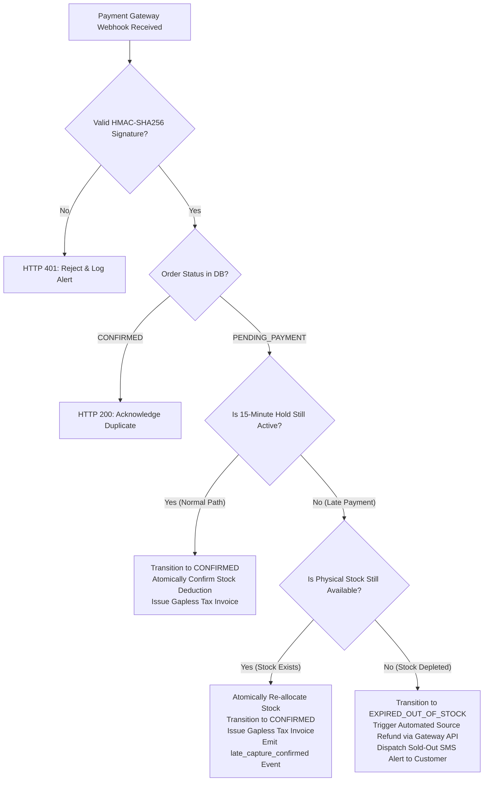

# Phase 2 — Architecture Drafts & Structural Patterns

> [!WARNING]
> **NON-BINDING DRAFTS — NOT APPROVED FOR IMPLEMENTATION**  
> This artifact compiles preparatory architectural drafts, structural options, and technical patterns. It does **not** authorize final architecture design, select immutable production frameworks, or initiate software implementation. Formal promotion is strictly blocked until the Enterprise Business Owner signs [`docs/00-requirements/11-review-and-approval.md`](../11-review-and-approval.md).

| Document Attribute | Details |
| :--- | :--- |
| **Document ID** | `ARCH-DRAFT-DOC-01` |
| **Document Title** | Consolidated Phase 2 Candidate Architecture Drafts, Trade-Offs & Invariant Flows |
| **Project Name** | Chellaa E-Commerce Platform |
| **Target Repository** | [`ezhilselvan1109/chellaa-system`](https://github.com/ezhilselvan1109/chellaa-system) |
| **Target Branch** | `dev` |
| **File Location** | `docs/00-requirements/review/phase-2-architecture-drafts.md` |
| **Creation Date** | 2026-10-23 |
| **Author Roles** | Senior Solution Architect, Distributed Systems Specialist & Security Architect |
| **Governance Status** | **`NON_BINDING_DRAFT`** (Architecture Exploration Artifact Only) |
| **Phase 1 Baseline Status** | **`PENDING_APPROVAL`** (Maintained strictly per governance constraints) |
| **Architecture Authorization** | **`NOT_GRANTED`** (Awaiting Business Owner Sign-Off in Document 11) |
| **Software Implementation** | **`NOT_STARTED`** (Strictly gated behind Phase 2 ratification) |

---

## 1. Candidate System Decomposition Models

To prevent premature microservice fragmentation for the initial engineering team while satisfying the 100 sustained / 1,000 peak orders/minute target ([`NFR-SCL-001`](../07-non-functional-requirements.md#nfr-scl-001)), three structural deployment models are comparatively analyzed:

```mermaid
graph TD
    subgraph Model 1: Modular Monolith
        MM_Deploy["Single OCI Container Image"]
        MM_Deploy --> MM_M1["Module: Merchandising"]
        MM_Deploy --> MM_M2["Module: Commerce & Orders"]
        MM_Deploy --> MM_M3["Module: Fulfillment"]
        MM_Deploy --> MM_M4["Module: Finance & Invoicing"]
        MM_Deploy --> MM_M5["Module: Platform & IAM"]
        MM_M1 & MM_M2 & MM_M3 & MM_M4 & MM_M5 -.->|In-Memory Call / In-Process Events| MM_Kernel["Core Kernel"]
    end

    subgraph Model 2: Coarse-Grained Clusters (Recommended Baseline for Evaluation)
        C1["Cluster 1: Merchandising
(Catalog, Category, Brand, Specs, Bulk)"]
        C2["Cluster 2: Commerce
(Cart, Pricing, Checkout Orchestrator, Orders)"]
        C3["Cluster 3: Fulfillment
(Inventory, Logistics, Returns, Support)"]
        C4["Cluster 4: Finance
(Payments, GST Tax, Invoicing)"]
        C5["Cluster 5: Platform
(Staff IAM, Audit, Notifications, Ops)"]
        C2 <==>|Async CloudEvents / gRPC| C3
        C2 <==>|Async CloudEvents / gRPC| C4
    end

    subgraph Model 3: Fine-Grained Microservices
        S1["IAM Service"]
        S2["Customer Service"]
        S3["Catalog Service"]
        S4["Cart Service"]
        S5["Checkout Service"]
        S6["Inventory Service"]
        S7["Order Service"]
        S8["Payment Service"]
        S9["Tax Service"]
        S10["Shipping Service"]
        S11["Returns Service"]
        S12["... (15-20 Independent Services)"]
        S5 -.->|Distributed Saga| S6
        S5 -.->|Distributed Saga| S8
    end
```

### Multidimensional Trade-Off Matrix

| Evaluation Dimension | Model 1: Modular Monolith | Model 2: Coarse-Grained Clusters (Recommended for Evaluation) | Model 3: Fine-Grained Microservices |
| :--- | :--- | :--- | :--- |
| **Transaction Boundaries** | **Highest:** Native local ACID transactions across modules. Zero distributed Sagass required. | **High:** Local ACID within clusters (e.g., Cart + Pricing + Checkout + Orders); Sagass limited to cross-cluster milestones. | **Very Low:** Every multi-step workflow requires distributed Sagass, two-phase reservation, and complex compensation. |
| **Scalability Under Surge** | Moderate: Entire application scales when checkout surges to 1,000 OPM during festive promotions. | **High:** *Commerce* and *Fulfillment* scale independently without scaling low-traffic back-office administration modules. | **Highest:** Individual endpoints scale independently; but network hop serialization degrades latency budget. |
| **Failure Isolation** | Low: Uncaught thread or memory exhaustion in PDF rendering or reporting can crash the entire application process. | **High:** A failure in Reporting, Logistics, or SMS Notifications cannot crash or slow down the core checkout funnel. | **Highest:** Maximum container isolation; but vulnerable to cascading network latency without strict circuit breakers. |
| **Operational Drag** | **Lowest:** Single CI/CD pipeline, single Docker image, single monitoring target, simple local dev environment. | **Manageable:** 4–6 CI/CD pipelines, manageable container orchestration, clear service ownership boundaries. | **Highest:** Requires 15+ pipelines, service mesh, distributed tracing, and specialized SRE/DevOps overhead. |
| **Evaluation Status** | `PROPOSED for Prototype Evaluation` | `PROPOSED as Primary Exploration Baseline` | `NOT RECOMMENDED for Initial Launch Team` |

---

## 2. Domain and Data Ownership Boundaries

### 2.1 Complete 20 Candidate Business Domains Reconciliation
The 20 candidate business domains established in Step 02A discovery ([`architecture-discovery-and-domain-boundaries.md`](./architecture-discovery-and-domain-boundaries.md)) map directly into the Coarse-Grained Clusters and Read Projections:

1. **Customer Accounts Domain (01):** Co-located within *Commerce Cluster* (`CustomerProfile`, `CustomerAddress`).
2. **Staff IAM Domain (02):** Co-located within *Platform Cluster* (`StaffUser`, `Role`, `Permission`, `MFACredential`).
3. **Product Catalog & Variants Domain (03):** Co-located within *Merchandising Cluster* (`Product`, `SKU`, `Variant`, `SpecSchema`).
4. **Pricing & Promotions Domain (04):** Co-located within *Commerce Cluster* (`PriceRecord`, `Coupon`, `CouponRedemptionLedger`).
5. **Search & Discovery Domain (05):** **Decoupled CQRS Read Model** populated asynchronously via domain change events.
6. **Cart & Wishlist Domain (06):** Co-located within *Commerce Cluster* (`Cart`, `CartItem`, `WishlistItem`).
7. **Inventory & Warehouse Operations Domain (07):** Co-located within *Fulfillment Cluster* (`StockLedger`, `StockHold`, `SerialScannedItem`).
8. **Checkout Orchestration Domain (08):** Co-located within *Commerce Cluster* (Stateless Saga Orchestrator).
9. **Orders & Order Lifecycle Domain (09):** Co-located within *Commerce Cluster* (`Order`, `OrderLineItem`, `OrderStatusHistory`).
10. **Payments & Reconciliation Domain (10):** Co-located within *Finance Cluster* (`PaymentTransaction`, `PaymentIntent`, `SettlementRecord`).
11. **Tax & Invoicing Domain (11):** Co-located within *Finance Cluster* (`TaxInvoice`, `CreditNote`, `GSTRateSchedule`).
12. **Shipping & Delivery Domain (12):** Co-located within *Fulfillment Cluster* (`Consignment`, `TrackingMilestone`, `ShippingLabel`).
13. **Returns, Replacements & Refunds Domain (13):** Co-located within *Fulfillment Cluster* (`ReturnRequest`, `InspectionReport`, `ReplacementOrder`).
14. **Notifications Relay Domain (14):** Co-located within *Platform Cluster* (Asynchronous event consumer worker).
15. **Customer Support Domain (15):** Co-located within *Fulfillment Cluster* (`SupportTicket`, `CustomerInquiryMessage`).
16. **Reviews & Ratings Domain (16):** Merchandising Read Projection (`ProductReview`, `ProductRatingSummary`).
17. **Reporting & Analytics Domain (17):** Dedicated Analytical Datamart Projection (Aggregated GMV, AOV, Sales, Tax ledgers).
18. **Bulk Data Exchange Domain (18):** Co-located within *Merchandising Cluster* (Asynchronous CSV/XLSX worker).
19. **External Integrations Domain (19):** Embedded in respective clusters with circuit breaker adapters.
20. **Audit & Platform Operations Domain (20):** Co-located within *Platform Cluster* (`WORM_AuditRecord`, System Metrics).

### 2.2 Master Authoritative Data Ownership Matrix
Every business entity is assigned exactly one authoritative owner. Cross-domain database joins and foreign key constraints across schemas are strictly prohibited:

| Core Business Aggregate | Authoritative Owning Domain | Primary Read Consumers | Consistency Model | Outbox Domain Events Emitted |
| :--- | :--- | :--- | :--- | :--- |
| **`Product`, `SKU`, `Category`** | Product Catalog Domain | Search, Cart, Checkout, Orders | Immediate ACID in Catalog; Eventual in Search | `product.published`, `sku.activated` |
| **`StockLedger`, `StockHold`** | Inventory & Warehouse Domain | Checkout, Cart, Reporting | **Immediate ACID** (Zero Overselling) | `inventory.reserved`, `inventory.depleted` |
| **`PriceRecord`, `Coupon`** | Pricing & Promotions Domain | Catalog, Cart, Checkout | Immediate ACID | `price.updated`, `coupon.redeemed` |
| **`Cart`, `CartItem`** | Cart Domain | Checkout Orchestrator | Session Consistency (Redis / DB) | `cart.cleared` |
| **`Order`, `OrderLineItem`** | Orders Domain | Fulfillment, Payments, Finance, Support | Immediate ACID | `order.placed`, `order.confirmed` |
| **`PaymentTransaction`** | Payments Domain | Orders, Finance, Customer | Immediate ACID | `payment.captured`, `refund.processed` |
| **`TaxInvoice`, `CreditNote`** | Tax & Invoicing Domain | Customer, Finance, Audit | **Strict Immutable ACID** (Gapless Sequential) | `invoice.generated`, `credit_note.generated` |
| **`Consignment`, `AWB`** | Shipping & Delivery Domain | Orders, Customer, Support | Eventual Consistency (Courier Webhooks) | `shipment.dispatched`, `shipment.delivered` |
| **`ReturnRequest`, `Diagnostic`** | Returns & Refunds Domain | Payments, Orders, Inventory, Tax | Immediate ACID | `return.approved`, `refund.dispatched` |
| **`StaffUser`, `Role`** | Staff IAM Domain | API Gateway, Audit | Immediate ACID | `staff.authenticated`, `staff.suspended` |
| **`WORM_AuditRecord`** | Audit & Platform Domain | Compliance, Executive Audit | **Strict Append-Only Immutability** (SHA-256) | `audit.security_alert.triggered` |

---

## 3. API and Event Contract Candidates

### 3.1 Synchronous Ingress & Inter-Service Communication
* **Client-to-Backend Protocol:** RESTful HTTP/2 APIs using JSON payloads.
* **Standardized Error Representation (RFC 7807):** Every client error adheres to `application/problem+json`:
  ```json
  {
    "type": "https://api.chellaa.com/errors/insufficient-stock",
    "title": "Insufficient Stock",
    "status": 409,
    "detail": "SKU-ELC-001 has only 2 units available, 5 requested.",
    "instance": "/api/v1/orders/checkout",
    "code": "INSUFFICIENT_STOCK",
    "timestamp": "2026-10-23T10:00:00Z"
  }
  ```
* **Inter-Cluster Communication:** Evaluate high-performance **gRPC with Protocol Buffers** for synchronous latency-critical calls (e.g., Checkout to Inventory reservation hold), with internal REST over HTTP/2 as fallback.

### 3.2 Asynchronous Event Contract Standards (CloudEvents v1.0)
All domain events published across service cluster boundaries strictly conform to **CloudEvents v1.0**:
```json
{
  "specversion": "1.0",
  "type": "com.chellaa.commerce.order.confirmed",
  "source": "/services/commerce-cluster",
  "id": "evt-77156ac-98765",
  "time": "2026-10-23T10:00:00Z",
  "datacontenttype": "application/json",
  "traceparent": "00-4bf92f3577b34da6a3ce929d0e0e4736-00f067aa0ba902b7-01",
  "data": {
    "order_id": "ORD-20261023-0001",
    "customer_id": "CUST-9876",
    "total_amount": 49999.00,
    "currency": "INR",
    "items": [
      { "sku_code": "SKU-SMARTPHONE-01", "quantity": 1, "unit_price": 49999.00 }
    ]
  }
}
```
* **Partitioning Keys:** Messages partitioned by Aggregate Root ID (`order_id` or `sku_code`) ensuring guaranteed in-order processing.
* **Delivery Semantics:** At-least-once delivery with strictly idempotent consumer handlers.
* **Publishing Pattern:** **Transactional Outbox Pattern** with Debezium CDC or polling streamer to eliminate dual-write partial failures.

---

## 4. Inventory Concurrency Alternatives (Flash-Sale Overselling Prevention)

To guarantee zero overselling during 1,000 orders/minute promotional surges ([`BR-INV-001`](../05-business-rules.md#br-inv-001), [`BR-INV-002`](../05-business-rules.md#br-inv-002), [`NFR-SCL-001`](../07-non-functional-requirements.md#nfr-scl-001)), three concurrency mechanisms are comparatively analyzed:

| Concurrency Alternative | Implementation Pattern | Concurrency Safety & Overselling Prevention | Scalability Under 1,000 OPM Surge | Infrastructure Overhead & Risks | Status for Evaluation |
| :--- | :--- | :--- | :--- | :--- | :---: |
| **Alternative A: PostgreSQL `SELECT FOR UPDATE`** | Pessimistic row locking on `stock_ledger` table with a strict 2-second timeout. | **100% Guaranteed:** Native database ACID row lock prevents race conditions. | Moderate: 1,000 OPM contending on identical flagship SKU causes database connection pool exhaustion and lock wait timeouts. | Zero new infrastructure; risks connection starvation during massive flash sales. | `PROPOSED for Evaluation` |
| **Alternative B: In-Memory Redis Lua Distributed Hold** | Atomic stock decrement in Redis via single-threaded Lua script with 15-minute TTL; background PostgreSQL sync. | **100% Guaranteed:** Redis single-threaded execution guarantees atomic checks without overselling; ultra-low latency ($\le 2\text{ms}$). | **Extremely High:** Capable of handling 50,000+ operations/second without relational database table locking. | Requires high-availability Redis cluster (Multi-AZ) and automated state reconciliation on cache restart. | `PROPOSED for Evaluation (Recommended)` |
| **Alternative C: Optimistic Locking with `@Version`** | Database update with version check: `UPDATE stock SET qty = qty - 1, version = version + 1 WHERE sku = ? AND version = ?`. | Guaranteed, but results in massive abort/retry rates under high concurrency. | **Very Poor:** Under 1,000 OPM contending on 10 SKUs, $> 80\%$ of transactions fail validation and require retries, causing severe retry storms. | Low infrastructure, but unviable user experience during flash sales. | `NOT RECOMMENDED` |

---

## 5. Checkout Orchestration & Failure Handling Flows

### 5.1 High-Concurrency Checkout Sequence
1. Customer submits checkout with client-supplied `Idempotency-Key` header.
2. Gateway checks Redis idempotency lock (24-hour TTL) and validates JWT token.
3. Checkout Orchestrator initiates atomic 15-minute inventory hold (`FR-INV-001`).
4. If stock available, creates Order Draft (`PENDING_PAYMENT`) and initializes Payment Intent with Gateway (`DEP-001`).
5. If stock unavailable, returns HTTP 409 Conflict (`INSUFFICIENT_STOCK`).

### 5.2 The Dual-Path Late Payment Webhook Invariant
When a Payment Gateway confirms payment after the 15-minute hold has expired (`WF-007`, `BR-PAY-003`):



> [!CRITICAL]
> **Strict Late Payment Invariant:**  
> The system **must never confirm an order without verified physical stock allocation**. If the hold expired and stock was re-allocated to another buyer, the system **must execute an automated source refund** via the gateway API ([`BR-PAY-003`](../05-business-rules.md#br-pay-003)).

### 5.3 Order Fulfillment & Barcode Scanning
1. Operator picks items from warehouse bin location.
2. Mandatory hardware barcode scanning permanently binds serial/IMEI to the order line item in `OrderDeviceSerialRecord` (`BR-ORD-003`).
3. System calls Courier API (`DEP-002`) to generate AWB and shipping label PDF.
4. If Courier API times out, Resilience4j circuit breaker trips to `OPEN`, leaving the order in `PACKED` status and enqueuing an asynchronous background retry without stalling the warehouse terminal.

### 5.4 Return Diagnostic Inspection Gate & Automated Refund
1. Customer submits return request within 7 calendar days of delivery (`FR-RET-001`, `BR-RET-001`).
2. Courier completes reverse pickup and delivers package to enterprise warehouse.
3. **Diagnostic Inspection Gate:** Warehouse technician scans device serial/IMEI. System verifies match against dispatched order records. Technician inspects physical seals, accessories, and diagnostic functionality (`BR-RET-002`).
4. Upon technician sign-off, system sequentially generates statutory **Credit Note** (`BR-FIN-003`), calls Gateway API to execute automated source refund (`FR-RET-003`), and restocks SKU to Available Stock (or moves to Damaged/RTV ledger).

---

## 6. Database and Messaging Alternatives

### 6.1 Database Architecture Alternatives
* **Alternative 1: Logical Schema Isolation on Shared PostgreSQL Cluster (Recommended for Evaluation):**
  * *Architecture:* Single managed PostgreSQL cluster (Multi-AZ) with distinct schemas (`catalog`, `commerce`, `fulfillment`, `finance`, `platform`) and isolated database user credentials. Direct cross-schema joins strictly disabled via role permissions.
  * *Advantages:* Unified Point-in-Time Recovery (PITR); lowest operational complexity for small engineering teams; lowest launch cost.
* **Alternative 2: Physical Database-Per-Service Cluster:**
  * *Architecture:* Independent managed PostgreSQL instances for each service cluster.
  * *Trade-Offs:* Maximum blast radius isolation; but doubles infrastructure costs and complicates cross-cluster analytical reporting.

### 6.2 Asynchronous Messaging Broker Alternatives
* **Alternative 1: Apache Kafka / AWS Managed MSK (Recommended for Evaluation):** High-throughput log partition model; guarantees strict per-entity in-order processing; highly resilient replayability.
* **Alternative 2: RabbitMQ:** AMQP exchange/queue routing; lightweight and simple, but lacks long-term immutable event replay buffers.
* **Alternative 3: AWS SQS/SNS:** Fully managed serverless queues; simple operations, but lacks global partition order and introduces vendor lock-in.

---

## 7. Security and Identity Boundaries

### 7.1 Customer vs Administrative Staff Identity Segregation
Strict logical and physical separation is maintained between customer storefront authentication and staff IAM:

| Dimension | Retail Customer Storefront | Administrative Staff IAM |
| :--- | :--- | :--- |
| **Authentication Credential** | Mobile phone number verified via SMS OTP ([`OQ-010`](../08-assumptions-dependencies-open-questions.md#oq-010)). | Enterprise email + password + mandatory MFA ([`FEAT-ADM-001`](../03-business-feature-inventory.md#feat-adm-001)). |
| **Password Storage** | None (passwordless OTP with 5-minute TTL). | Hashed with bcrypt (work factor $\ge 12$) or Argon2id ([`NFR-SEC-002`](../07-non-functional-requirements.md#nfr-sec-002)). |
| **Token Claims & Expiry** | Short-lived JWT (RS256, 15-min expiry) + rotating refresh token. | Short-lived JWT with embedded granular RBAC permissions ([`BR-ADM-001`](../05-business-rules.md#br-adm-001)). |
| **Network Perimeter** | Public API Gateway; throttled via IP and account rate limiters. | Restricted internal gateway; IP whitelisting / VPN access recommended. |
| **Blast Radius Containment** | Storefront database breach cannot expose administrative credentials. | Staff compromise cannot be used to spoof customer sessions. |

### 7.2 Cryptographic Header Injection & Internal Gateway Defense
* API Gateway validates incoming JWT signatures statelessly using public JWKS.
* Gateway injects sanitized headers (`X-User-Id`, `X-User-Roles`, `X-Permissions`) signed with an HMAC token (`X-Gateway-Signature`). Internal service clusters verify this signature to prevent header injection spoofing.
* **Zero Cardholder Data Storage:** Zero PAN/CVV stored on Chellaa servers ([`BR-SEC-001`](../05-business-rules.md#br-sec-001)). Hosted SDK fields handle payment data entry directly with the PCI DSS Level 1 gateway.
* **PII Protection:** AES-256 encryption at rest for customer names, phones, and addresses ([`NFR-SEC-003`](../07-non-functional-requirements.md#nfr-sec-003)). Automated regex scrubbing interceptors mask sensitive data before logs are emitted.
* **Immutable WORM Audit Trail:** Privileged administrative mutations written to an append-only ledger with cryptographic SHA-256 hash chaining ([`FR-AUD-001`](../04-functional-requirements.md#fr-aud-001), [`FR-AUD-002`](../04-functional-requirements.md#fr-aud-002)).

---

## 8. Search, Reporting, Observability & Disaster Recovery Options

### 8.1 Search Read-Model Technology
* **Alternative A: PostgreSQL Read Replica Full-Text Search (FTS):** Simple, low cost, but lacks typo-tolerance and high-concurrency faceted search filtering.
* **Alternative B: Dedicated OpenSearch / Elasticsearch Cluster (Recommended for Evaluation):** Asynchronously synced via Outbox change events; guarantees sub-200ms faceted browsing under 100,000 SKUs and 5,000 concurrent sessions ([`NFR-PERF-001`](../07-non-functional-requirements.md#nfr-perf-001)).

### 8.2 Executive Reporting Data Isolation
* Direct reporting queries exclusively to dedicated read-replicas or a columnar datamart (ClickHouse) to prevent complex executive sales and GST aggregations from locking operational OLTP tables during peak checkout.

### 8.3 Distributed Observability & Telemetry
* **Distributed Tracing:** W3C TraceContext (`traceparent` header) propagated across 100% of HTTP requests and message broker envelopes ([`NFR-OBS-001`](../07-non-functional-requirements.md#nfr-obs-001)).
* **Structured JSON Logging:** Standard JSON format with `timestamp`, `level`, `service_name`, `trace_id`, `span_id`, and automated PII scrubbing.
* **Prometheus Metrics:** Prometheus-compatible `/metrics` scrape endpoints exporting RED metrics (Rate, Errors, Duration) and resource utilization ([`NFR-OBS-002`](../07-non-functional-requirements.md#nfr-obs-002)).

### 8.4 Disaster Recovery & Business Continuity (PITR)
* Single-Region Multi-AZ cloud deployment with automated daily full snapshots and continuous Write-Ahead Log (WAL) streaming.
* Guarantees Recovery Point Objective $\le 5\text{ minutes}$ and Recovery Time Objective $\le 2\text{ hours}$ ([`OQ-017`](../08-assumptions-dependencies-open-questions.md#oq-017), [`NFR-BCM-001`](../07-non-functional-requirements.md#nfr-bcm-001)).
