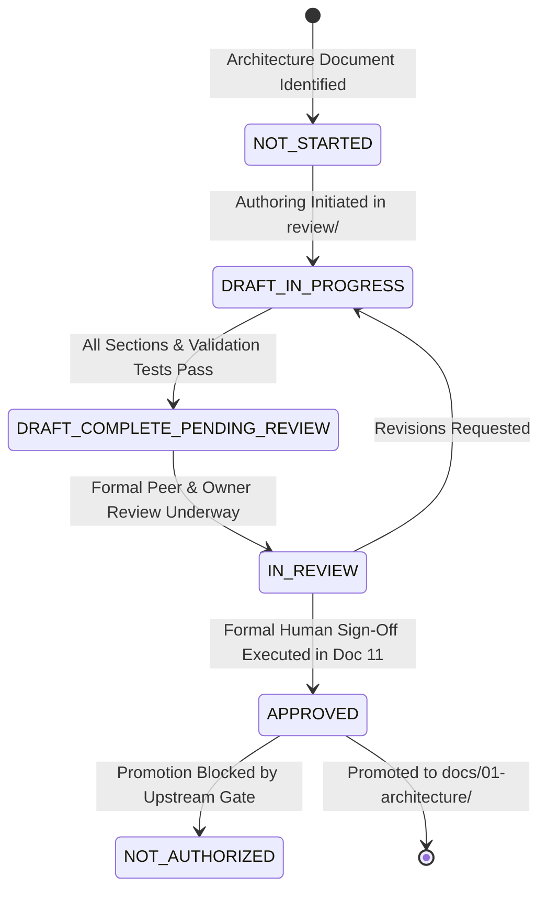
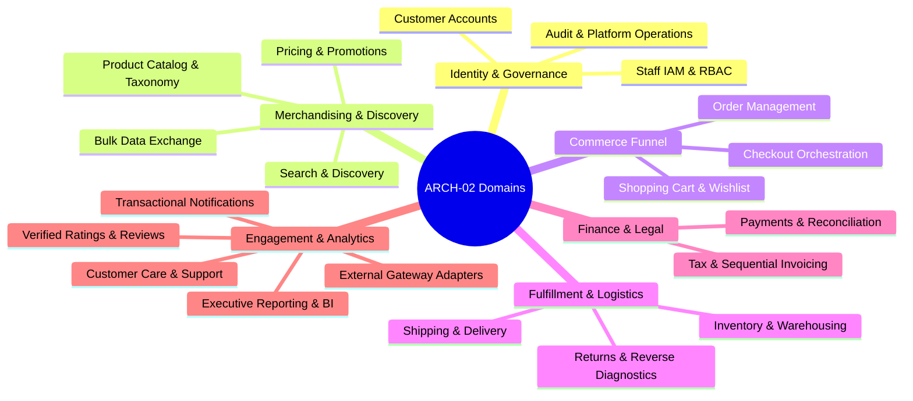

# Phase 2 — Architecture Document Status Register & Detailed Planning

> [!WARNING]
> **NON-BINDING PLANNING ARTIFACT — NOT APPROVED FOR IMPLEMENTATION**  
> This specification is an internal architectural planning and governance tracking instrument prepared under `docs/00-requirements/review/`. It does **not** authorize formal architecture design, approve binding specifications, establish `docs/01-architecture/`, or initiate software implementation.  
> Transitioning to approved architecture under `docs/01-architecture/` remains strictly blocked until the authorized Enterprise Business Owner signs off on [`docs/00-requirements/11-review-and-approval.md`](../11-review-and-approval.md) and ratifies the strategic decisions in [`docs/00-requirements/review/executive-decision-register.md`](./executive-decision-register.md).

---

## 1. Document Control

| Document Attribute | Details |
| :--- | :--- |
| **Document ID** | `ARCH-REG-01` |
| **Document Title** | Phase 2 Architecture Document Status Register, Governance Lifecycle, and ARCH-02 Detailed Plan |
| **Project Name** | Chellaa E-Commerce Platform |
| **Target Repository** | [`ezhilselvan1109/chellaa-system`](https://github.com/ezhilselvan1109/chellaa-system) &bull; Branch: `dev` |
| **File Location** | `docs/00-requirements/review/phase-2-document-status-register.md` |
| **Version** | `1.1.0-DRAFT` |
| **Lifecycle State** | **`NON_BINDING_PLANNING`** (Exploratory Document Status Register & Planning Roadmap) |
| **Author Roles** | Principal Solution Architect, Architecture Governance Lead, Requirements Traceability Auditor |
| **Target Reviewers** | Enterprise Business Owner, Chief Technology Officer, Lead Security Architect, SRE Lead |
| **Phase 1 Baseline Status** | **`PENDING_APPROVAL`** (Maintained strictly per governance constraints) |
| **Architecture Authorization** | **`NOT_GRANTED`** (Subject to human business owner signature in Document 11 Section 7) |
| **Software Implementation** | **`NOT_STARTED`** (Strictly gated behind Phase 2 ratification) |

### 1.1 Revision History
| Version | Date | Author Roles | Description of Changes & Governance Triggers |
| :---: | :---: | :--- | :--- |
| `0.1.0-PLAN` | 2026-10-23 | Senior Solution Architect | Outlined preliminary architecture document sequence in [`phase-2-architecture-document-plan.md`](./phase-2-architecture-document-plan.md). |
| `1.0.0-DRAFT` | 2026-10-24 | Principal Solution Architect | Initial formal release of Master Architecture Status Register (`ARCH-01` through `ARCH-12`) with rigorous governance lifecycle status definitions, blocking decision tracking, and detailed scope plan for `ARCH-02`. |
| `1.1.0-DRAFT` | 2026-10-24 | Principal Solution Architect | Updated all architecture specifications ARCH-01 through ARCH-12 to DRAFT_COMPLETE_PENDING_REVIEW following completion of all 12 draft documents under docs/00-requirements/review/. |

---

## 2. Governance Lifecycle Status Definitions

To eliminate ambiguity between document authoring progress and formal governance authorization, every specification in the Chellaa architecture suite is tracked using standardized lifecycle states. 

> [!IMPORTANT]
> **Completion Must Never Be Confused with Approval.**  
> An engineering draft may be 100% complete and validated against automated syntactic and traceability tests, but it remains strictly non-binding until human technical leaders and the Enterprise Business Owner execute written sign-off.

### Detailed Lifecycle State Dictionary:
1. **`NOT_STARTED`:**
   * *Definition:* The document scope, ID, and prerequisite inputs have been defined in this register, but formal authoring has not commenced.
   * *Condition to Exit:* Upstream architectural dependencies are met and the technical team begins drafting in `docs/00-requirements/review/`.
2. **`DRAFT_IN_PROGRESS`:**
   * *Definition:* Active drafting is underway under `docs/00-requirements/review/`. Some sections, diagrams, or requirement mappings remain incomplete or unverified.
   * *Condition to Exit:* All required document sections are populated, all cited IDs are verified against the BRD baseline, and automated link/syntax tests pass.
3. **`DRAFT_COMPLETE_PENDING_REVIEW`:**
   * *Definition:* The draft is structurally complete, 100% of required sections and diagrams are populated, and automated validation tests pass with zero broken links or unknown IDs. It is ready for stakeholder inspection. It does **not** constitute an approved architecture.
   * *Condition to Exit:* Technical reviewers and the Business Owner convene to perform formal peer review.
4. **`IN_REVIEW`:**
   * *Definition:* The specification is undergoing active technical architecture peer review, security review, or commercial business owner policy evaluation.
   * *Condition to Exit:* Revisions are requested (reverts to `DRAFT_IN_PROGRESS`) or all reviewers submit affirmative written evaluation.
5. **`APPROVED`:**
   * *Definition:* The document has received formal, authentic written sign-off from authorized technical leaders and the Enterprise Business Owner. All blocking open questions and commercial options are formally ratified.
   * *Condition to Exit:* Promotion to `docs/01-architecture/` upon Phase 1 baseline authorization.
6. **`NOT_AUTHORIZED`:**
   * *Definition:* A draft or design proposal has been submitted, but formal authorization to execute software implementation or promote to binding architecture is explicitly denied or withheld by governance authorities.

---

## 3. Master Phase 2 Architecture Document Status Register (`ARCH-01` through `ARCH-12`)

The following register tracks the end-to-end lifecycle, source traceability, prerequisite dependencies, approval requirements, and promotion criteria for all 12 Phase 2 technical specifications:

| Document ID & Title | Purpose & Target Content | Source Requirements | Upstream Dependencies | Author & Reviewer Roles | Draft Completion Criteria | Required Approvals | Current Status | Blocking Decisions | Validation Evidence | Promotion Criteria |
| :--- | :--- | :--- | :--- | :--- | :--- | :--- | :---: | :--- | :--- | :--- |
| **`ARCH-01`** Architecture Overview, System Context and Scope Boundaries | Overarching system context, C4 Level 1 diagram, 18 capability areas, single-retailer anti-scope, 12 runtime interaction flows, and quality attributes. | [`OBJ-001`](../00-business-overview.md#obj-001)–[`010`](../00-business-overview.md#obj-010) [`ACT-001`](../02-stakeholders-and-actors.md#act-001)–[`014`](../02-stakeholders-and-actors.md#act-014) [`FEAT-001`](../03-business-feature-inventory.md#feat-adm-001)–[`041`](../03-business-feature-inventory.md#feat-ops-001) [`FR-001`](../04-functional-requirements.md#fr-cust-001)–[`056`](../04-functional-requirements.md#fr-ops-001) [`BR-001`](../05-business-rules.md#br-cust-001)–[`055`](../05-business-rules.md#br-ops-001) [`NFR-001`](../07-non-functional-requirements.md#nfr-perf-001)–[`018`](../07-non-functional-requirements.md#nfr-loc-001) [`DEP-001`](../08-assumptions-dependencies-open-questions.md#dep-001)–[`006`](../08-assumptions-dependencies-open-questions.md#dep-006) | [`11-review-and-approval.md`](../11-review-and-approval.md) | **Author:** Principal Solution Architect **Reviewers:** CTO, Lead Security Architect, Business Owner | All 14 sections completed; C4 Level 1 Mermaid diagram valid; 100% RTM coverage; 0 broken links. | Technical Lead, Security Lead, Enterprise Business Owner | **`DRAFT_COMPLETE_PENDING_REVIEW`** | Owner-selected ADQs recorded; remaining OQs `OQ-003`, `OQ-004`, `OQ-005`, `OQ-007`, `OQ-012`, `OQ-015`, `OQ-018`, `OQ-019`; Phase 1 approval and downstream design alignment remain pending | Automated test suite passes (0 broken links, 0 unknown IDs, balanced C4 Mermaid). Draft available at `arch-01-architecture-overview-draft.md`. | Document 11 Section 7 human signature; promote draft to `docs/01-architecture/ARCH-01-architecture-overview.md`. |
| **`ARCH-02`** Domain Decomposition, Bounded Contexts & Ubiquitous Language | Detailed DDD domain modeling across 20 candidate domains, aggregate ownership, domain events, consistency boundaries, and context maps. | [`FEAT-001`](../03-business-feature-inventory.md#feat-adm-001)–[`041`](../03-business-feature-inventory.md#feat-ops-001) [`10-glossary.md`](../10-glossary.md) [`ARCH-DISC-01`](./architecture-discovery-and-domain-boundaries.md) | `ARCH-01` | **Author:** DDD Specialist / Solution Architect **Reviewers:** Principal Architect, Engineering Leads | All 20 candidate domains analyzed; aggregates & entities defined; domain events cataloged; context map valid. | Principal Solution Architect, Software Engineering Lead | **`DRAFT_COMPLETE_PENDING_REVIEW`** | `ADQ-003` (COD) `ADQ-004` (Returns) `ADQ-006` (Auth) | Bounded context map validation; aggregate consistency verification. Draft available at `arch-02-domain-decomposition-draft.md`. | Review approval; promote to `docs/01-architecture/ARCH-02-domain-decomposition.md`. |
| **`ARCH-03`** Service Decomposition, Cluster Packaging & Responsibility Matrix | Evaluates physical deployment topologies (Modular Monolith vs Coarse-Grained Clusters vs Fine Microservices), container sizing, and service responsibilities. | [`FEAT-001`](../03-business-feature-inventory.md#feat-adm-001)–[`041`](../03-business-feature-inventory.md#feat-ops-001) [`NFR-SCL-001`](../07-non-functional-requirements.md#nfr-scl-001) [`AD-001`](./architecture-decision-analysis.md) | `ARCH-02` | **Author:** Principal Distributed Systems Architect **Reviewers:** CTO, DevOps/SRE Lead | Service catalog defined; physical deployment units bounded; team ownership assigned. | CTO, Principal Solution Architect | **`DRAFT_COMPLETE_PENDING_REVIEW`** | `ADQ-007` (Surge Sizing) `AD-001` (Style ADR) | 5 Coarse-Grained Clusters defined; OpenSearch read-model bounded; sizing for 1,000 OPM surge documented. Draft at `arch-03-service-decomposition-draft.md`. | Technical sign-off; promote to `docs/01-architecture/ARCH-03-service-catalog.md`. |
| **`ARCH-04`** Service Interactions, Workflows & Collaboration Diagrams | End-to-end dynamic interaction sequence diagrams, synchronous REST/gRPC calls, and asynchronous CloudEvents for all 16 business workflows. | [`WF-001`](../06-business-workflows.md#wf-001)–[`016`](../06-business-workflows.md#wf-016) [`FR-001`](../04-functional-requirements.md#fr-cust-001)–[`056`](../04-functional-requirements.md#fr-ops-001) [`BR-001`](../05-business-rules.md#br-cust-001)–[`055`](../05-business-rules.md#br-ops-001) | `ARCH-03` | **Author:** Integration & API Architect **Reviewers:** Backend Leads, QA Lead | Sequence diagrams for all 16 business workflows; failure compensation paths mapped. | Principal Architect, Backend Engineering Lead | **`DRAFT_COMPLETE_PENDING_REVIEW`** | `AD-004` (Saga ADR) | 16 sequence diagrams completed with compensation rollbacks and CloudEvent payloads. Draft at `arch-04-service-interactions-draft.md`. | Review approval; promote to `docs/01-architecture/ARCH-04-service-interactions.md`. |
| **`ARCH-05`** Data Architecture, Master Ownership & Distributed Consistency | Database engine selection, logical schema isolation, Saga compensation state machines, Transactional Outbox CDC, and master entity ownership. | [`BR-INV-001`](../05-business-rules.md#br-inv-001)–[`004`](../05-business-rules.md#br-inv-004) [`NFR-INT-001`](../07-non-functional-requirements.md#nfr-int-001) [`AD-002`](./architecture-decision-analysis.md)–[`AD-006`](./architecture-decision-analysis.md) | `ARCH-03`, `ARCH-04` | **Author:** Principal Database Architect **Reviewers:** Data Architect, Lead SRE | Data ownership matrix complete; schema isolation contracts defined; zero shared tables. | Chief Architect, Principal Database Architect | **`DRAFT_COMPLETE_PENDING_REVIEW`** | `AD-002` (Hold ADR) `AD-005` (DB ADR) `AD-006` (Outbox ADR) | Master entity ownership matrix, 5 isolated schemas, zero shared tables rule, and atomic hold SQL documented. Draft at `arch-05-data-architecture-draft.md`. | Technical sign-off; promote to `docs/01-architecture/ARCH-05-data-architecture.md`. |
| **`ARCH-06`** API Protocols, Event Contracts & Schema Governance | REST HTTP/2 JSON conventions (RFC 7807 problem details), OpenAPI 3.0 contracts, CloudEvents v1.0 specifications, and schema evolution rules. | [`04-functional-requirements.md`](../04-functional-requirements.md) [`FEAT-INT-001`](../03-business-feature-inventory.md#feat-int-001) | `ARCH-04`, `ARCH-05` | **Author:** API Governance Lead **Reviewers:** Frontend Leads, Platform SRE | OpenAPI specifications for core endpoints; CloudEvents schemas for all domain events. | API Governance Lead, Engineering Lead | **`DRAFT_COMPLETE_PENDING_REVIEW`** | `AD-007` (Gateway ADR) `AD-009` (Protocol ADR) | Standardized RFC 7807 problem detail schema, CloudEvents v1.0 standard, topic taxonomy, and evolution rules documented. Draft at `arch-06-api-and-event-contracts-draft.md`. | Review approval; promote to `docs/01-architecture/ARCH-06-api-and-event-contracts.md`. |
| **`ARCH-07`** Security Architecture, Identity Segregation & RBAC Matrix | Customer mobile OTP vs staff IAM MFA segregation, signed gateway header injection, AES-256 PII encryption, zero PAN storage, and WORM ledgers. | [`FR-SEC-001`](../04-functional-requirements.md#fr-sec-001), [`002`](../04-functional-requirements.md#fr-sec-002) [`BR-SEC-001`](../05-business-rules.md#br-sec-001) [`NFR-SEC-001`](../07-non-functional-requirements.md#nfr-sec-001)–[`003`](../07-non-functional-requirements.md#nfr-sec-003) [`AD-008`](./architecture-decision-analysis.md) | `ARCH-03`, `ARCH-06` | **Author:** Chief Information Security Officer / Security Architect **Reviewers:** Security Architect, Compliance Officer | Threat model complete (STRIDE); RBAC permission matrix defined; PII encryption rules specified. | Chief Information Security Officer (CISO), CTO | **`DRAFT_COMPLETE_PENDING_REVIEW`** | `ADQ-006` (Auth) `AD-008` (IAM ADR) | STRIDE threat model, 8-persona RBAC matrix, X-Gateway-Signature HMAC, zero PAN, and WORM audit retention detailed. Draft at `arch-07-security-and-identity-draft.md`. | Security sign-off; promote to `docs/01-architecture/ARCH-07-security-and-identity.md`. |
| **`ARCH-08`** Resilience, Circuit Breaking & Failure Recovery Strategy | External gateway circuit breakers (Resilience4j), late payment webhook dual-path recovery, exponential retry with jitter, and dead-letter queues. | [`BR-PAY-002`](../05-business-rules.md#br-pay-002), [`003`](../05-business-rules.md#br-pay-003) [`NFR-AVL-002`](../07-non-functional-requirements.md#nfr-avl-002) [`AD-003`](./architecture-decision-analysis.md) | `ARCH-04`, `ARCH-06` | **Author:** SRE / Resilience Architect **Reviewers:** Platform SRE, Technical Lead | Circuit breaker thresholds configured; late payment automated refund state machine mapped. | SRE Lead, Principal Solution Architect | **`DRAFT_COMPLETE_PENDING_REVIEW`** | `AD-003` (Late Webhook) `OQ-004`, `OQ-005` | Resilience4j circuit breaker configs, late webhook recovery paths, DLQ routing, and comprehensive FMEA table documented. Draft at `arch-08-resilience-and-fault-tolerance-draft.md`. | Technical sign-off; promote to `docs/01-architecture/ARCH-08-resilience-and-fault-tolerance.md`. |
| **`ARCH-09`** Distributed Telemetry, Observability & Compliance Audit | W3C TraceContext propagation (`traceparent`), structured JSON logging with PII regex redaction, Prometheus RED metrics, and immutable WORM audit logs. | [`FR-AUD-001`](../04-functional-requirements.md#fr-aud-001), [`002`](../04-functional-requirements.md#fr-aud-002) [`NFR-OBS-001`](../07-non-functional-requirements.md#nfr-obs-001), [`002`](../07-non-functional-requirements.md#nfr-obs-002) [`BR-DAT-001`](../05-business-rules.md#br-dat-001) | `ARCH-03`, `ARCH-07` | **Author:** Observability Architect / SRE Lead **Reviewers:** DevOps Lead, Compliance Auditor | Structured logging schema defined; metric scrape intervals established; WORM audit chained. | SRE Lead, Enterprise Audit Lead | **`DRAFT_COMPLETE_PENDING_REVIEW`** | `OQ-020` (8-Year Audit Retention) | W3C traceparent standards, structured JSON log format with PII redaction, RED/USE metrics catalog, and chained WORM schema documented. Draft at `arch-09-observability-and-audit-draft.md`. | Review approval; promote to `docs/01-architecture/ARCH-09-observability-and-audit.md`. |
| **`ARCH-10`** Cloud Infrastructure Topology, CI/CD & Disaster Recovery | Single-Region Multi-AZ container topology, automated continuous WAL archiving (PITR), secrets governance (Vault), and zero-downtime rolling deploys. | [`NFR-SCL-001`](../07-non-functional-requirements.md#nfr-scl-001) [`NFR-BCM-001`](../07-non-functional-requirements.md#nfr-bcm-001) [`OQ-016`](../08-assumptions-dependencies-open-questions.md#oq-016), [`017`](../08-assumptions-dependencies-open-questions.md#oq-017) [`AD-011`](./architecture-decision-analysis.md), [`AD-012`](./architecture-decision-analysis.md) | `ARCH-03`, `ARCH-05`, `ARCH-08` | **Author:** Cloud Infrastructure Architect / SRE Lead **Reviewers:** CTO, Lead Cloud Architect | Infrastructure topology diagrams complete; RTO $\le 2\text{h}$ and RPO $\le 5\text{m}$ mapped to PITR. | CTO, SRE Lead | **`DRAFT_COMPLETE_PENDING_REVIEW`** | `ADQ-007` (Surge Sizing) `ADQ-008` (SLA/DR) | AWS Mumbai 3-AZ topology, 3-tier subnets, PITR RTO <= 2h / RPO <= 5m, GitOps CI/CD pipeline, and HashiCorp Vault secrets governance documented. Draft at `arch-10-deployment-and-infrastructure-draft.md`. | Technical sign-off; promote to `docs/01-architecture/ARCH-10-deployment-and-infrastructure.md`. |
| **`ARCH-11`** Formal Architecture Decision Records (ADR Catalog) | Ratified ADRs (`ADR-001` through `ADR-012`) capturing binding technical selections, context, consequences, and compliance verification checks. | [`architecture-decision-analysis.md`](./architecture-decision-analysis.md) [`phase-2-open-decisions-and-evidence.md`](./phase-2-open-decisions-and-evidence.md) | `ARCH-01`–`ARCH-10` | **Author:** Enterprise Architecture Lead **Reviewers:** Architecture Review Board (ARB) | All 12 ADRs fully articulated with alternatives, consequences, and evidence results. | Architecture Review Board, CTO | **`DRAFT_COMPLETE_PENDING_REVIEW`** | All `AD-001` through `AD-012` technical decisions | All 12 ADRs (ADR-001 through ADR-012) articulated in MADR format; proposed evaluation status documented. Draft at `arch-11-architecture-decision-records-draft.md`. | ARB sign-off; promote to `docs/01-architecture/ARCH-11-architecture-decision-records.md`. |
| **`ARCH-12`** Master Architecture Requirements Traceability Matrix | Bidirectional traceability verifying 100% architectural coverage of all 56 FRs, 55 BRs, 18 NFRs, 16 Workflows, and 41 Features across specifications. | [`09-requirements-traceability-matrix.md`](../09-requirements-traceability-matrix.md) Full BRD Suite (Docs 00–11) | `ARCH-01`–`ARCH-11` | **Author:** Requirements Traceability Lead **Reviewers:** Principal Solution Architect, Lead BA | 100% of the 260 formal baseline BRD identifiers mapped to concrete architecture documents. | Quality Lead, Principal Solution Architect | **`DRAFT_COMPLETE_PENDING_REVIEW`** | Phase 1 baseline ratification | 100% bidirectional mapping of all 260 BRD requirements across ARCH-01 to ARCH-11 documented. Draft at `arch-12-master-traceability-matrix-draft.md`. | Final governance sign-off; promote to `docs/01-architecture/ARCH-12-master-traceability-matrix.md`. |

---

## 4. Detailed Scope, Plan and Acceptance Checklist for ARCH-02

**Document ID:** `ARCH-02`  
**Specification Title:** Domain Decomposition, Bounded Contexts, and Ubiquitous Language  
**Target File Path (Pre-Approval):** `docs/00-requirements/review/arch-02-domain-decomposition-draft.md`  
**Target Promotion Path (Post-Approval):** `docs/01-architecture/ARCH-02-domain-decomposition.md`  
**Author Role:** Principal Solution Architect & Domain-Driven Design Specialist  
**Reviewer Roles:** Principal Software Architect, Domain Engineering Leads, Lead Business Analyst  

> [!IMPORTANT]
> **Core Architectural Invariant for ARCH-02:**  
> Candidate business domains represent **logical boundaries of ubiquitous language and business responsibility**, NOT mandated deployable microservices. Physical packaging into deployable units (Modular Monolith vs Coarse-Grained Clusters vs Fine Microservices) is strictly governed by `ARCH-03` and Architecture Decision `AD-001`. `ARCH-02` must strictly preserve logical domain modeling independence.

### 4.1 Scope Analysis across All 20 Candidate Business Domains

The specification must exhaustively articulate the boundaries, responsibilities, exclusions, data ownership, events, and consistency models across the 20 candidate business domains identified in [`architecture-discovery-and-domain-boundaries.md`](./architecture-discovery-and-domain-boundaries.md):

#### Detailed Domain Scope Specifications:

1. **Customer Accounts Domain (`FEAT-CUST-001`–`003`, `FR-CUST-001`–`004`, `BR-CUST-001`, `BR-CUST-002`, `WF-001`):**
   * *Responsibilities:* Customer identity registration, phone OTP authentication, multi-address management, delivery PIN code validation, self-service account deactivation.
   * *Exclusions:* Internal staff accounts (owned by Staff IAM); session carts (owned by Cart Domain).
   * *Aggregate Candidates:* `CustomerProfile` (Root), `CustomerAddress` (Entity), `CustomerPreference` (Value Object).
   * *Domain Events:* `customer.registered`, `customer.phone_verified`, `customer.address_added`, `customer.deactivated`.
   * *Consistency:* Immediate ACID consistency for profiles and addresses; eventual consistency for downstream notification dispatches.

2. **Staff Identity & Access Management (IAM) Domain (`FEAT-ADM-001`, `FR-SEC-001`, `FR-SEC-002`, `BR-ADM-001`, `BR-ADM-002`, `WF-016`):**
   * *Responsibilities:* Internal operator credentials, mandatory MFA enforcement, fine-grained Role-Based Access Control (RBAC), session timeouts (15 mins).
   * *Exclusions:* Retail customer authentication (strictly segregated per `NFR-SEC-002`).
   * *Aggregate Candidates:* `StaffUser` (Root), `Role` (Entity), `Permission` (Value Object), `MFACredential` (Entity).
   * *Domain Events:* `staff.authenticated`, `staff.mfa_enforced`, `staff.role_assigned`, `staff.revoked`.
   * *Consistency:* Immediate ACID consistency for role and permission revocations.

3. **Product Catalog, Categories, Brands & Variants Domain (`FEAT-CAT-001`, `002`, `FEAT-CTG-001`, `002`, `FEAT-BRD-001`, `FR-CAT-001`–`003`, `BR-CAT-001`–`003`, `WF-002`):**
   * *Responsibilities:* Hierarchical category taxonomies, dynamic specifications, authorized brand profiles, multi-variant modeling (RAM, storage, color), SKU lifecycles.
   * *Exclusions:* Selling prices and discounts (owned by Pricing); live available inventory balances (owned by Inventory).
   * *Aggregate Candidates:* `Product` (Root), `ProductVariant` (Entity), `SKU` (Value Object), `Category` (Root), `Brand` (Root).
   * *Domain Events:* `product.created`, `product.published`, `sku.activated`, `sku.archived`.
   * *Consistency:* Immediate ACID consistency across product variants and dynamic attributes.

4. **Pricing & Promotions Domain (`FEAT-PRC-001`, `FEAT-PRM-001`, `FR-PRC-001`, `FR-PRM-001`, `002`, `BR-PRC-001`, `002`, `BR-PRM-001`, `002`, `WF-005`, `WF-011`):**
   * *Responsibilities:* Compare-at MRP ceilings, active selling prices, minimum margin alerts, coupon codes, non-stacking rules, pro-rata line-item discount distribution.
   * *Exclusions:* Server-side checkout sum calculation (orchestrated by Checkout).
   * *Aggregate Candidates:* `PriceRecord` (Root), `Coupon` (Root), `CouponRedemptionLedger` (Entity).
   * *Domain Events:* `price.updated`, `coupon.redeemed`, `coupon.exhausted`.
   * *Consistency:* Immediate consistency for coupon redemption counters to prevent double-spending.

5. **Search & Discovery Domain (`FEAT-SRCH-001`, `FR-SRCH-001`, `002`, `BR-SRCH-001`, `002`, `WF-002`):**
   * *Responsibilities:* Full-text typo-tolerant search, faceted filtering, category navigation read-models, stockout badge ranking.
   * *Exclusions:* Authoritative catalog writes (owned by Catalog).
   * *Aggregate Candidates:* `SearchCatalogView` (Read-Model Projection).
   * *Domain Events Consumed:* `product.published`, `price.updated`, `inventory.stock_level_changed`.
   * *Consistency:* Eventual consistency ($\le 5\text{ seconds}$ propagation SLA per `NFR-INT-002`).

6. **Cart & Wishlist Domain (`FEAT-CART-001`, `FEAT-WSH-001`, `FR-CART-001`, `FR-WSH-001`, `BR-CART-001`, `002`, `WF-001`):**
   * *Responsibilities:* Persistent authenticated carts, anonymous guest cart sessions, guest-to-customer cart merging upon login, maximum purchase caps per SKU, wishlist items.
   * *Exclusions:* Inventory reservation (reserved only at checkout initiation per `BR-CART-001`).
   * *Aggregate Candidates:* `ShoppingCart` (Root), `CartItem` (Entity), `Wishlist` (Root).
   * *Domain Events:* `cart.item_added`, `cart.merged`, `cart.cleared`.
   * *Consistency:* Immediate ACID consistency per customer cart; transient in-memory session caching.

7. **Inventory & Warehouse Operations Domain (`FEAT-INV-001`–`003`, `FR-INV-001`–`004`, `BR-INV-001`–`004`, `WF-006`, `WF-008`):**
   * *Responsibilities:* Available-to-Sell (ATS) stock calculation, 15-minute atomic checkout reservation holds, quarantine put-away inspection, serial/IMEI hardware scanning.
   * *Exclusions:* Delivery routing and shipping label generation (owned by Shipping).
   * *Aggregate Candidates:* `InventoryLedger` (Root), `StockHold` (Entity), `SerialAssetRecord` (Entity).
   * *Domain Events:* `inventory.hold_created`, `inventory.hold_released`, `inventory.hold_expired`, `inventory.stock_deducted`.
   * *Consistency:* Strict immediate consistency (Zero Overselling Mandate per `NFR-INT-001`).

8. **Checkout Orchestration Domain (`FEAT-CHK-001`, `FR-CHK-001`, `002`, `BR-CHK-001`, `002`, `WF-006`):**
   * *Responsibilities:* Multi-step checkout state machine, mandatory server-side total recalculation, price drift detection, atomic hold orchestration, payment session creation.
   * *Exclusions:* Actual card/UPI processing (delegated to Payment Gateway `DEP-001`).
   * *Aggregate Candidates:* `CheckoutSession` (Root), `CheckoutSagaState` (Entity).
   * *Domain Events:* `checkout.initiated`, `checkout.payment_requested`, `checkout.completed`, `checkout.aborted`.
   * *Consistency:* Distributed Saga orchestration with compensating rollback steps.

9. **Orders Domain (`FEAT-ORD-001`, `FR-ORD-001`–`003`, `BR-ORD-001`–`004`, `WF-008`, `WF-009`):**
   * *Responsibilities:* Immutable historical order snapshots, order lifecycle state machine (`PENDING` $\rightarrow$ `CONFIRMED` $\rightarrow$ `PROCESSING` $\rightarrow$ `PACKED` $\rightarrow$ `DISPATCHED` $\rightarrow$ `DELIVERED`), cancellation window enforcement.
   * *Exclusions:* Dynamic pricing updates (historical orders are permanently frozen per `BR-ORD-001`).
   * *Aggregate Candidates:* `CustomerOrder` (Root), `OrderLineItem` (Entity), `OrderSnapshot` (Value Object).
   * *Domain Events:* `order.created`, `order.confirmed`, `order.cancelled`, `order.dispatched`.
   * *Consistency:* Immediate ACID consistency within the order aggregate.

10. **Payments & Reconciliation Domain (`FEAT-PAY-001`, `002`, `FR-PAY-001`–`003`, `BR-PAY-001`–`003`, `WF-007`, `WF-012`):**
    * *Responsibilities:* Payment intent generation, cryptographic webhook signature verification (HMAC-SHA256), late payment capture recovery, automated source refunds, daily settlement reconciliation.
    * *Exclusions:* Raw cardholder PAN/CVV storage (prohibited per `NFR-SEC-001`).
    * *Aggregate Candidates:* `PaymentTransaction` (Root), `GatewayWebhookEvent` (Entity), `SettlementBatch` (Root).
    * *Domain Events:* `payment.authorized`, `payment.captured`, `payment.failed`, `refund.initiated`.
    * *Consistency:* Strict idempotency on payment event processing (`BR-PAY-001`).

11. **Tax & Invoicing Domain (`FEAT-FIN-001`, `002`, `FR-FIN-001`–`003`, `BR-FIN-001`–`003`, `WF-007`, `WF-010`):**
    * *Responsibilities:* Indian GST calculation (CGST+SGST vs IGST), monotonic gapless sequential invoice numbering (`INV/YYYY-YY/XXXXX`), immutable invoice PDFs, credit notes (`CN/YYYY-YY/XXXXX`).
    * *Exclusions:* General corporate bookkeeping or payroll ledgers.
    * *Aggregate Candidates:* `TaxInvoice` (Root), `InvoiceLine` (Entity), `CreditNote` (Root).
    * *Domain Events:* `invoice.generated`, `credit_note.issued`.
    * *Consistency:* Strict atomic monotonicity for sequential number generation; immutable ledgering.

12. **Shipping & Delivery Domain (`FEAT-SHP-001`, `FR-SHP-001`, `002`, `BR-SHP-001`, `002`, `WF-008`, `WF-009`):**
    * *Responsibilities:* Consignment booking, carrier AWB allocation, thermal shipping label generation, tracking status webhook ingestion, delivery attempt counter, RTO management.
    * *Exclusions:* Physical parcel transit (delegated to Courier Aggregator `DEP-002`).
    * *Aggregate Candidates:* `Shipment` (Root), `ConsignmentTrackingLog` (Entity).
    * *Domain Events:* `shipment.booked`, `shipment.dispatched`, `shipment.out_for_delivery`, `shipment.delivered`, `shipment.rto_initiated`.
    * *Consistency:* Resilient outward integration protected by circuit breakers and polling fallback.

13. **Returns, Replacements & Refunds Domain (`FEAT-RET-001`, `FR-RET-001`–`003`, `BR-RET-001`–`003`, `WF-010`):**
    * *Responsibilities:* 7-day electronics return policy window enforcement, reverse logistics AWB generation, mandatory warehouse technician diagnostic condition grading gate, source-instrument refund dispatch.
    * *Exclusions:* In-store cash refunds (strictly banned per `BR-RET-003`).
    * *Aggregate Candidates:* `ReturnRequest` (Root), `DiagnosticInspectionReport` (Entity), `RefundDisbursement` (Entity).
    * *Domain Events:* `return.requested`, `return.received`, `return.graded`, `refund.approved`.
    * *Consistency:* Refund blocked until diagnostic condition certification is recorded.

14. **Notifications Domain (`FEAT-NTF-001`, `FR-NTF-001`, `BR-NTF-001`, `WF-015`):**
    * *Responsibilities:* Multi-channel message formatting (Transactional SMS, WhatsApp, Email), DLT template registration, customer alert dispatch, marketing opt-out bypass for transactional alerts.
    * *Exclusions:* Core checkout blocking (must run strictly asynchronously).
    * *Aggregate Candidates:* `NotificationMessage` (Root), `NotificationTemplate` (Entity).
    * *Domain Events Consumed:* `customer.registered`, `order.confirmed`, `order.dispatched`, `refund.initiated`.
    * *Consistency:* Asynchronous queue processing; isolated from commerce failure blast radius.

15. **Customer Support Domain (`FEAT-SUP-001`, `FR-SUP-001`, `BR-SUP-001`, `WF-014`):**
    * *Responsibilities:* Support ticket lifecycle, transit damage dispute handling, customer inquiry audit history, 2-hour SLA timer for critical complaints.
    * *Exclusions:* Direct refund authorization without diagnostic gating.
    * *Aggregate Candidates:* `SupportTicket` (Root), `TicketMessage` (Entity), `SLATimer` (Value Object).
    * *Domain Events:* `ticket.opened`, `ticket.assigned`, `ticket.escalated`, `ticket.resolved`.
    * *Consistency:* Masked customer PII presentation in support dashboard.

16. **Reviews & Ratings Domain (`FEAT-REV-001`, `FR-REV-001`, `BR-REV-001`, `WF-013`):**
    * *Responsibilities:* Verified-buyer rating (1-5 stars) and review submission, profanity and abuse moderation queue, product average rating calculation.
    * *Exclusions:* Anonymous unverified product reviews.
    * *Aggregate Candidates:* `ProductReview` (Root), `ReviewRatingAggregate` (Read-Model).
    * *Domain Events:* `review.submitted`, `review.approved`, `review.rejected`.
    * *Consistency:* Eventual consistency for aggregated star ratings.

17. **Reporting & Analytics Domain (`FEAT-RPT-001`, `FR-RPT-001`, `BR-RPT-001`, `WF-012`):**
    * *Responsibilities:* Commercial KPI calculation (GMV, net sales, refund take-rates), sales reconciliation with invoiced ledgers, historical trend aggregation.
    * *Exclusions:* Real-time transactional operational writes.
    * *Aggregate Candidates:* `DailySalesReport` (Read Projection), `ReconciliationSummary` (Projection).
    * *Domain Events Consumed:* `order.confirmed`, `invoice.generated`, `credit_note.issued`.
    * *Consistency:* Eventual consistency generated via change data capture streams.

18. **Bulk Data Exchange Domain (`FEAT-DAT-001`, `FR-CAT-001`, `FR-INV-001`, `NFR-PERF-003`):**
    * *Responsibilities:* Asynchronous bulk ingestion of supplier product spreadsheets (5,000 SKUs in $\le 15\text{ mins}$), batch inventory adjustments, administrative CSV data exports.
    * *Exclusions:* Direct synchronous table locking during large file uploads.
    * *Aggregate Candidates:* `BulkJobBatch` (Root), `BulkRowErrorRecord` (Entity).
    * *Domain Events:* `bulk_job.started`, `bulk_job.completed`, `bulk_job.failed`.
    * *Consistency:* Chunked batch validation in staging tables before publishing.

19. **External Integrations Domain (`FEAT-INT-001`, `FR-INT-001`, `BR-INT-001`):**
    * *Responsibilities:* Outbound API proxying, protocol translation, API key secret injection, Resilience4j circuit breaking, rate limiting, and webhook HMAC signature parsing.
    * *Exclusions:* Core business domain rule evaluation.
    * *Aggregate Candidates:* `IntegrationPartnerConfig` (Root), `OutboundCallAudit` (Entity).
    * *Domain Events:* `circuit_breaker.opened`, `circuit_breaker.closed`.
    * *Consistency:* Stateless fault-tolerant gateway adaptation.

20. **Audit & Platform Operations Domain (`FEAT-AUD-001`, `FEAT-OPS-001`, `FR-AUD-001`, `002`, `BR-AUD-001`, `BR-DAT-001`, `WF-016`):**
    * *Responsibilities:* Append-only WORM audit ledgers with SHA-256 cryptographic hash chaining, 8 Financial Years statutory retention, health check metrics, distributed trace context propagation (`traceparent`).
    * *Exclusions:* Application business workflow orchestration.
    * *Aggregate Candidates:* `AuditEventBlock` (Root), `AuditChainAnchor` (Value Object).
    * *Domain Events Consumed:* 100% of state-mutating administrative and financial events.
    * *Consistency:* Immutable write-once persistence; non-blocking asynchronous event capture.

---

### 4.2 Candidate Bounded Context Groupings & Packaging Trade-Offs

`ARCH-02` will evaluate candidate bounded context groupings to inform physical service packaging in `ARCH-03`:

| Candidate Bounded Context Cluster | Enclosed Logical Domains | High-Cohesion Domain Invariants | Interservice Communication Profile | Consistency Model |
| :--- | :--- | :--- | :--- | :---: |
| **Cluster 1: Identity & Governance** | 01. Customer Accounts 02. Staff IAM & RBAC | Strict credential separation; customer JWT vs staff MFA; DPDPA PII encryption. | Synchronous authentication at API Gateway; asynchronous audit logging. | ACID within profile; eventual for analytics. |
| **Cluster 2: Catalog & Discovery** | 03. Product Catalog & Taxonomy 04. Pricing & Promotions 05. Search & Discovery 18. Bulk Data Exchange | High cohesion between categories, specs, variants, and pricing; read-heavy query scale. | Asynchronous CDC sync from Catalog to Search read-models; batch chunking for bulk imports. | ACID on catalog authoring; eventual consistency on search index ($\le 5\text{s}$). |
| **Cluster 3: Core Commerce & Orders** | 06. Cart & Wishlist 08. Checkout Orchestration 09. Orders Lifecycle | High-velocity state machines; server-side price recalculation; 15-min stock hold integration. | In-memory atomic hold coordination; distributed Saga orchestration with Payment. | ACID within Order; distributed Saga orchestration. |
| **Cluster 4: Inventory & Fulfillment** | 07. Inventory & Warehousing 12. Shipping & Delivery 13. Returns & Diagnostics | Physical asset control; Available-to-Sell ledgers; serial/IMEI scanning; diagnostic grading gate. | Synchronous stock reservation calls; asynchronous courier AWB and tracking webhooks. | **Strict ACID** on ATS inventory (0 overselling); eventual tracking updates. |
| **Cluster 5: Finance & Invoicing** | 10. Payments & Reconciliation 11. Tax & Sequential Invoicing | Monetary precision; statutory Indian GST; monotonic gapless invoice numbering; credit notes. | Inbound cryptographic webhooks; outbound gateway capture/refund calls. | **Strict ACID** on sequential invoices; idempotent payment ledger. |
| **Cluster 6: Platform & Operations** | 14. Notifications 15. Customer Support 16. Ratings & Reviews 17. Reporting & Analytics 19. External Integrations 20. Audit & Operations | Peripheral operational capabilities; bulkheads shielding the core commerce funnel. | Asynchronous event listeners; W3C trace propagation; immutable WORM logging. | Eventual consistency; zero impact on checkout availability. |

---

### 4.3 ARCH-02 Acceptance & Verification Checklist

To achieve `DRAFT_COMPLETE` status, the upcoming `ARCH-02` draft must satisfy the following verifiable criteria:

- [x] 1. **Complete 20-Domain Coverage:** Every one of the 20 candidate domains is analyzed with explicit responsibilities, exclusions, and business rules.
- [x] 2. **Aggregate & Entity Modeling:** Concrete aggregate roots, entities, and value objects identified for each domain.
- [x] 3. **Domain Event Catalog:** Complete taxonomy of domain events (with past-tense naming syntax, e.g., `order.confirmed`, `inventory.hold_created`).
- [x] 4. **Decoupled Deployment Invariant:** Explicit documentation that domains are logical bounded contexts, not mandated 1-to-1 microservices.
- [x] 5. **Cross-Domain Consistency Contracts:** Formal specification of immediate ACID vs eventual consistency requirements for all inter-domain interactions.
- [x] 6. **Ubiquitous Language Glossary:** Standardized domain terminology dictionary aligned with [`10-glossary.md`](../10-glossary.md).
- [x] 7. **Anti-Scope Verification:** Zero third-party marketplace, vendor commission, or split payout concepts introduced in any domain.
- [x] 8. **Requirements Traceability:** 100% of the 41 Features and 56 Functional Requirements mapped across the 20 domains.
- [x] 9. **Validation Test Cleanliness:** Zero broken relative markdown links, valid Mermaid bounded context diagrams, and explicit non-binding labeling.
